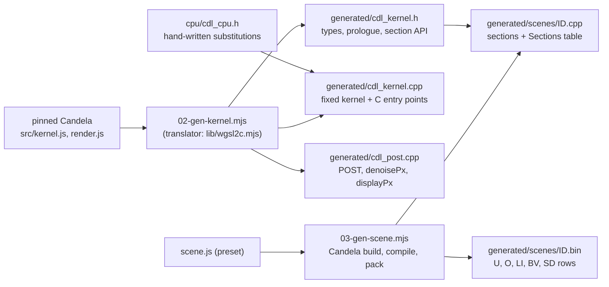

# Translate Candela's fixed kernel to firmware C and measure it on the P4

## 1. Goal and acceptance

Candela's fixed path-tracing kernel runs as C++ inside PicoCalc firmware. The C++ is generated from Candela's own `src/kernel.js` when the firmware is built, and the cost of a camera sample is measured on the ESP32-P4 instead of estimated.

The acceptance measurement, unchanged from the stub:

- B-01 at 160 x 160, 1 spp: cycles per sample measured with `rdcycle` on the P4, with and without each CPU substitution.
- RV32 frames of B-01, R-01, L-03 and G-01 at 64 spp within 1% mean luminance of the host build of the same C++. E-02, which is deterministic, within 1% on at least 99% of pixels.
- `.text` size of the kernel and its share of the firmware image.
- `fdiv.s` and `fsqrt.s` latency from a microbenchmark, and the instruction-cache behaviour of the kernel.

Out of scope: the QuickJS world (PICOCALC-CANDELA-WORLD), the bytecode interpreter for generated sections (PICOCALC-CANDELA-SECTIONS), and display integration (PICOCALC-CANDELA-FIRST-LIGHT).

## 2. What the parent ticket established

PICOCALC-CANDELA-P4 translated whole generated programs (`compiled.shared`) to C++ with `scripts/04-wgsl2cpp.mjs`. It ran them in a counting RV32IMFC interpreter: 6,100-11,300 instructions per sample for ordinary presets, 8,160 for B-01 at -O2. Re-run here with the toolchain that ESP-IDF 5.4.2 selects (esp-14.2.0_20241119), the prototype gives 8,158.9 for B-01, so the starting point reproduces. The parent's cycle model (`scripts/14-cycle-model.py`) assumed 1.13 cycles per integer instruction, 10-30 cycles per `fdiv.s`/`fsqrt.s` and 1-2 cycles per other FP instruction. That gave 8,800-12,600 cycles per sample for B-01. No part of that model has been measured on this code.

The prototype translated one program per scene, so the fixed kernel and the scene's materials were inlined into one translation unit. The firmware cannot do that. Its kernel is compiled once, and the per-scene code arrives at run time: as bytecode from PICOCALC-CANDELA-SECTIONS, and here, as a stand-in, as separately compiled C++.

## 3. Where the fixed kernel ends

`src/compile.js` assembles every program as

```text
head + PRELUDE + SPECTRAL + ggxTableWGSL() + sdfCode + hfCode + densCode + CORE + metalAt + matCode + PATH
```

`scripts/lib/candela.mjs` `splitProgram()` checks each boundary of that string: `head` is exactly `const SPECTRAL_ON: bool = true|false;`, SPECTRAL and the GGX table follow PRELUDE byte for byte, `metalAt` follows CORE, the program ends with PATH, and `hitAlbedo` and `hitEmission` appear once each with their constant text. Any other layout throws. All 105 presets of the pinned version pass (`scripts/01-section-api.mjs`, `scripts/various/01-section-api.json`).

The fixed kernel is therefore PRELUDE, SPECTRAL, the GGX table, CORE, `metalAt`, `hitAlbedo`, `hitEmission` and PATH. The per-scene part is `sdfCode + hfCode + densCode` (the field section) and `matCode` without `hitAlbedo` and `hitEmission` (the material section, which ends with `customKernel`). POST is fixed too. It is translated with the display functions `denoisePx` and `displayPx`, which `src/render.js` `displaySource()` appends to it.

### The seam in both directions

The fixed kernel calls five generated functions: `evalMaterial`, `sdUser`, `heightAt`, `densityOf` and `customKernel`. These become a table of function pointers, `struct Sections`, that a scene binds:

```cpp
struct Sections {
  Lobe  (*evalMaterial)(const Hit& h, vec3f wo, f32 u);
  f32   (*sdUser)(i32 k, vec3f p);
  f32   (*heightAt)(i32 k, vec2f xz);
  f32   (*densityOf)(i32 m, vec3f P);
  vec3f (*customKernel)(vec3f ro, vec3f rd);
};
```

`hitAlbedo` and `hitEmission` stay in the kernel because their text is the same for every scene. They call `evalMaterial` through the table.

Generated code calls back into the kernel. The census over all 105 presets finds that it uses only 15 of the 107 fixed functions. Ordered by the number of presets that use each one: `lobeNone` 105, `fresnelDielectric` 104, `metalAt` 24, `fbm3` 18, `tangentWorld` 9, `safeNorm` 7, `lum` 6, `fmodp` 4, `sellmeier` 3, `voronoi3` 3, `noise3` 2, `fmodp3` 1, `hitAlbedo` 1, `occluded` 1, `traceScene` 1. It also uses the globals `gTime` and `gLam`, the structs `Hit` and `Lobe`, and the uniform accessor `U`. That list is the section API. The kernel exports these 15 functions with external linkage; every other kernel function stays `static`, so GCC keeps inlining inside the kernel exactly as in the prototype. A scene whose sections call a kernel function outside the API fails to compile, which is the intended loud failure. PICOCALC-CANDELA-SECTIONS uses the same list as the set of `CALL` targets of its bytecode.

`SPECTRAL_ON` becomes a compile-time constant of the kernel build (`CDL_SPECTRAL`, default 0). All 28 T0 presets are RGB. The four spectral presets (T1) need a second kernel instance, and the scene binder refuses a scene whose `spectral` flag differs from the kernel's.

## 4. The generator



`02-gen-kernel.mjs` checks the SHA-256 of `kernel.js`, `compile.js` and `render.js` against the pin in `lib/candela.mjs` and refuses an unpinned copy unless `--allow-unpinned` is given. It imports `kernel.js` in Node (the file has no imports), calls `ggxTableWGSL()` once, and translates the fixed parts. The generated files are committed under `scripts/generated/`, with the pin recorded in their headers, so the board build needs neither Node nor the Candela archive. Running the generator again must reproduce them byte for byte; `04-build.sh check` does that.

The pinned version is `candela-workspace(1).zip`, SHA-256 `873b2dd4...df5d`: `src/kernel.js` `253d242d...`, `src/compile.js` `6f5926cc...`, `src/render.js` `a71df1b9...`.

### Translation rules

The translator keeps the prototype's rules. These are the rules of `src/wgsl2glsl.js` plus the DGX Spark report's WGSL-to-CUDA table: typed declarations, `fn` headers become prototypes, struct parameters become `const&`, vectors and built-ins come from a generated prologue, float literals get `f`, and multi-component swizzles become methods. It changes five things. The fifth was added after the image run (diary Step 5).

1. **It is strict.** Each WGSL line is tokenized. A keyword outside the subset Candela uses (`switch`, `while`, `ptr`, `bitcast`, attributes, `override`, `alias`, `discard`, texture calls), a call to an unknown function, an assignment to a swizzle, or `%` with a float operand stops the build with the line number. The C++ compiler catches some of these; the remaining ones would compile and mean something different.
2. **Selects and zero-initialisation are macros.** `select(f, t, c)` becomes `CDL_SEL(f, t, c)` unless an argument draws a random number, in which case it stays an eager `select(...)` so the random stream does not change. `var x: S;` for a struct or array becomes `S x; CDL_ZINIT(x);`. Both macros are defined by the substitution switches (Section 5).
3. **Override points.** For the functions that a substitution replaces (`hash3`, `hash13`, `voronoi3`, `skyL`, `atrousW`), the translator emits the original under the name `<fn>_wgsl` and a forwarding definition. `cdl_cpu.h` replaces the forwarding definition when the switch is on. A textual rewrite such as `voronoi3`'s inline sine hash is applied only if its pattern occurs exactly once; otherwise the generator fails.
4. **Linkage and data.** Private globals (`rngS`, `gTime`, `gLam`, `gTau`, `gTri`, `gBary`) get external linkage in the kernel's namespace, because sections read `gTime` and `gLam`. The GGX table becomes `static const f32 ETAB[256]` in `.rodata`.
5. **Evaluation order.** WGSL evaluates operands and function arguments left to right. C++ leaves the order of function arguments unspecified, and GCC at -O2 evaluates them in different orders on x86-64 and on RV32. The translator computes the functions with side effects on module state: those that assign a `var<private>` global, plus their callers, transitively. These are 13 functions, including `rnd`, `rnd2`, `tracePath`, and `hitMesh` with its callers, which write `gTri` and `gBary`; `manifest.json` lists them under `sideEffects`. In a declaration whose initialiser calls two of them, the calls are hoisted into temporaries in WGSL's order. Any other statement with two such calls, a nested pair, or two on a one-line function header fails the build. The fixed kernel has one such statement, `sampleLobe(L, woL, rnd2(), rnd())` in `tracePath`. Before this rule existed, the host build drew those random numbers in a different order from the RV32 build, so host and device rendered different samples with the same distribution. The eager-`select` rule (2.) uses the same set of functions.

Everything is wrapped in `namespace CDL_NS`. A firmware image can hold several kernel instances: the benchmark links one per measurement arm, and a later firmware may hold an RGB instance and a spectral one. The C entry points are named `<ns>_bind`, `<ns>_render_pixel` and so on.

### The C interface

```c
typedef struct { const float *U, *O, *LI, *BV, *SD; uint32_t nU, nO, nLI, nBV, nSD; } cdl_buffers;  /* vec4 rows */
typedef struct { float c[4], alb[4], nrm[4]; } cdl_pixout;
int        NS_bind(const cdl_buffers *b, const void *sections);   /* 0 if the scene does not fit this kernel */
cdl_pixout NS_render_pixel(int x, int y, unsigned frame);         /* one camera sample: renderPixel() */
```

`NS_bind` stores the buffer pointers and the section table. When the sky table is on, it rebuilds the table whenever uniform rows 6 and 11-16 (sun direction and Preetham coefficients) differ from the last build. The world calls `pack` again whenever the sun moves, so this is the "rebuilt when the sun moves" rule.

The kernel's private state (`rngS` and the other globals) is per core. The first firmware renders on one core. A dual-core renderer needs that state moved into a per-core context, which FIRST-LIGHT has to do before it uses the second core.

## 5. CPU substitutions

Each substitution is a preprocessor switch. Each one is measured on the device, both as a step of a cumulative ladder and by removing it from the configuration that ships.

| Switch | What changes | Expected effect on the image | How it is verified |
|---|---|---|---|
| `CDL_LAZY_SELECT` | `select` evaluates only the chosen argument | none (only `rnd()` has side effects, and those selects stay eager) | RV32 frame digests equal to the eager build |
| `CDL_NO_ZERO_INIT` | structs and arrays declared without a value are not zeroed (`memset` was 3.5% of B-01) | none if no field is read before it is written | host frames with 0xA5 poison instead of zero must be bit-identical to the zeroed build |
| `CDL_FAST_FLOOR` | `floor` and `fract` through `fcvt.w.s` (RV32F has no rounding-to-integer instruction; newlib's `floorf` is a 25-instruction call) | none, except `floor(-0.0)` returns `+0.0` | digest comparison |
| `CDL_FAST_TRIG` | one-step range reduction and a degree-9 polynomial for `sin`/`cos` (error about 4e-6 on [-pi, pi]) | rounding-level radiance changes; different values from sine hashes | 64 spp luminance against the exact build |
| `CDL_FAST_EXP` | `exp` through `exp2` with a degree-6 polynomial (2e-7 relative) | rounding-level changes | as above |
| `CDL_INT_HASH` | `hash3`, `hash13` and `voronoi3`'s cell hash become an integer hash (pcg3d of the float bit patterns, Jarzynski and Olano 2020) instead of `fract(sin(x) * 43758.5453)` | different but still uniform noise values; no change for scenes without noise | W-02 cost; image statistics |
| `CDL_SKY_TABLE` | `skyL` becomes a bilinear lookup in an N x N RGB table over the upper hemisphere in hemi-octahedral coordinates (no trigonometry in the lookup). Below the horizon the table's horizon value is multiplied by Candela's ground factor. The table is built with the exact `skyL` | bilinear interpolation error; N is chosen on the host so that the 64 spp mean luminance changes by less than 0.5% | host error sweep over N; 64 spp luminance |
| `CDL_POW32` | in `atrousW`, `pow(dn, 32)` becomes five squarings when the exponent is exactly 32, which is what `denoisePx` passes | rounding-level | post-pass comparison |

Not substituted, and recorded as such: `acos` and `atan2` outside the sky (HDRI lookups, which T0 does not use), `pow` outside the denoiser, and the 40-entry traversal stack, which is already uninitialised under `CDL_NO_ZERO_INIT`.

## 6. Measurement arms

An arm is one build of the kernel, the post pass and the six test scenes' sections with one set of switches. All arms use `-O2`, the optimisation level of the playable firmware (`CONFIG_COMPILER_OPTIMIZATION_PERF`), together with `-fno-math-errno -fwrapv -fno-exceptions -fno-rtti -msmall-data-limit=0 -mno-relax`. `-fwrapv` gives WGSL's wrapping `i32` arithmetic; `-mno-relax` makes the device's linker leave the code the interpreter counted unchanged.

| Arm | Switches | Purpose |
|---|---|---|
| `wgsl` | none | Candela's semantics as written for a GPU |
| `lazy`, `noinit`, `floor`, `trig`, `exp`, `hash` | the ladder, each adding one switch to the previous arm | marginal effect of each switch |
| `cpu` | all of them, including `CDL_SKY_TABLE` and `CDL_POW32` | the configuration that ships |
| `cpu-X` for each switch X | `cpu` without X | the cost of leaving out one switch |
| `cpu-O3` | `cpu` at -O3 | code size against speed |
| `cpu-iram` | `cpu` with the kernel's `.text` in internal RAM | the instruction-cache question |
| `mono` | `cpu`, but kernel and sections in one translation unit per scene, as in the prototype | the cost of the dispatch seam |
| `proto` | the prototype's configuration (lazy select only), one translation unit per scene | connects to the parent's counts and cycle model |

The test scenes are B-01, R-01, L-03 and G-01 (acceptance), E-02 (the custom toon integrator: deterministic, and the only preset that calls back into `traceScene`, `occluded` and `hitAlbedo` from a section) and W-02 (fbm wood, where the integer hash matters).

## 7. Tests on the host and in the interpreter

- **Generator checks.** The generated files must reproduce; every preset must split; each test scene's sections must compile against the kernel header.
- **Native host build** of every arm except the eager-select ones. x86 traps on the integer division by zero that eager `select` performs in `hdriTexel` when there is no HDRI; RISC-V defines it. The host build renders reference frames at any number of samples per pixel.
- **Poison test.** `CDL_POISON_INIT` fills every skipped initialisation with 0xA5 bytes. Host frames must be bit-identical to the zeroed build.
- **Counting interpreter.** `scripts/05-rv32imfc-count.c` is the parent's interpreter plus one system call (a7 = 500) that prints the instruction counters, so a frame is counted between two marks instead of by subtracting a baseline build. The interpreter runs a bare-metal driver linked with the same per-arm static libraries as the device image. That gives exact instructions per sample by class, and frame digests that the device has to reproduce. The device resolves `memset` and `memcpy` to ROM, so instruction counts can differ in those two functions; results cannot.
- **Sky table accuracy.** The relative error of the table against `skyL_wgsl` over random directions, swept over N, plus the 64 spp luminance change.

## 8. The device benchmark

A standalone ESP-IDF factory app (`scripts/board/`) in the style of PICOCALC-SHADOW-CODEGEN's and PICOCALC-SIMD-LAB's harnesses. `scripts/09-run-board.py` derives from SIMD-LAB's `02-run-board.py`. It verifies the playable image on flash, writes and verifies the diagnostic app at 0x10000 only, collects UART output between `CANDELA BEGIN` and `CANDELA END`, then restores and verifies the playable app and checks the board's health. The restore target is the current playable firmware. That target changes as other sessions install new playable builds, so the runner reads `/tmp/picocalc-current-playable.txt` (`<build dir> <app sha256>`) immediately before each run, instead of taking a hard-coded digest. At the start of this ticket it named `/tmp/picocalc-playable-smooth-chess-3e738a4/build` (`7b1181b4...013b`). It was then changed to `/tmp/picocalc-playable-smooth-chess-676ae95/build` (`b22a807d...f62c`). Every flash or serial operation holds the shared board lock (`board_common.acquire()`).

The app runs on core 0 with the task watchdog disabled. It holds the kernel libraries of all arms, the scene blobs, and these stages:

1. **Microbenchmarks.** Dependent chains of 256 `fdiv.s`, `fsqrt.s`, `fmadd.s`, `fmul.s`, `fadd.s`, `fcvt.w.s`, `flw`, `mul` and `div`, in inline assembly. Latency is cycles per operation; independent chains give throughput. The divide and square root are tried with several operand classes, in case the unit's latency depends on the data.
2. **Timing frames.** For three blocks, each scene, and each arm (in an order rotated per block): bind, then render a 160 x 160 frame at 1 spp with frame index 0. W-02 is exported at 80 x 80 so that its slowest arms finish in seconds. `rdcycle` is read around each row's render loop, so the digest and output work stay outside the timed region. The first frame of each arm and scene is reported separately as the cold frame. The L1 instruction-cache and data-cache access and miss counters (`CACHE_L1_IBUS0/DBUS0_ACS_*`), and the L2 counters, are read around each frame.
3. **Post-pass timing.** Display (AgX and sRGB) and one à-trous iteration per pixel, for the arms that differ in `CDL_FAST_EXP` and `CDL_POW32`.
4. **Placement.** The `cpu` arm with the scene buffers in PSRAM instead of internal RAM (B-01 and R-01).
5. **Image frames** (a second run, to keep each lock hold to one run): the `cpu` arm renders B-01, R-01, L-03, G-01 and E-02 at 160 x 160 and 64 spp, accumulated as the progressive renderer will (frame index 0-63). For each pixel the app sends f32 luminance (`0.2126 R + 0.7152 G + 0.0722 B`, computed in f32 on the device) and an RGBE preview, as base64 at 115,200 baud: about 24 s per frame.
6. **minstret probe**, last, so a trap loses nothing: whether the core implements the retired-instruction counter.

Each 1 spp frame's digest is the FNV-1a hash of the 12 floats per pixel. It must equal the interpreter's digest for the same arm and scene, which shows that the device executed the code that was counted. Cycles per sample divided by the interpreter's instructions per sample is the measured CPI of that arm.

`.text` is read from the per-arm libraries (`size`), from the app's map file, and against the playable firmware's 4,625,504-byte image.

## 9. What changes outside this ticket

Nothing. The generator, the generated kernel, the harnesses and the board app live in this ticket's `scripts/`. The board app copies `partitions.csv` and `p4_compat.h` from `picocalc-os/port/esp32p4` the same way the earlier harnesses do. Integration into the firmware is FIRST-LIGHT's job. It needs a CMake custom command that runs `02-gen-kernel.mjs` on the pinned Candela copy, or uses the committed generated files; a render service that calls `NS_bind` and `NS_render_pixel` over a worker task's rows; and the per-core state of Section 4 before it uses two cores.

## 10. Risks

- **CPI far from 1.13.** That is the question being measured. The interpreter's exact counts and the device's cycles together give the CPI per arm and scene, and the microbenchmarks give the latencies to model it.
- **I-cache.** The kernel's `.text` is 42-55 KB and the P4's L1 instruction cache is smaller than that. The cache counters and the `cpu-iram` arm separate fetch cost from execution cost.
- **Fast math changes noise.** Image comparisons use statistics (mean luminance), except for E-02, which is deterministic and is compared per pixel.
- **Translator drift.** The pin check, the strict tokenizer and the exact-layout split make a new Candela version fail at build time, not at render time.
- **The seam costs inlining.** Calls through the table cannot be inlined, and `Lobe` (88 bytes) is returned through memory. The `mono` arm measures the difference.

## 11. Results

The full account is `analysis/01-what-candela-s-fixed-kernel-costs-on-the-esp32-p4-measured.md`. In short:

- **Cycles per sample** (B-01, 160 x 160, 1 spp, one core): 14,976 with WGSL semantics and 6,832 with every substitution (52,700 samples per second). Other scenes with every substitution: R-01 12,867, L-03 5,358, G-01 11,960, E-02 4,918, W-02 19,413. Every device frame digest equals the interpreter's.
- **Latencies:** `fdiv.s` and `fsqrt.s` take 19 cycles on one unit that is not pipelined. `fadd.s` and `fmul.s` take 4 and `fmadd.s` 5. CPI is 1.28-1.72.
- **Instruction cache:** 0.6-16% of fetches miss L1 and L2 serves them. A kernel in internal RAM (`cpu-iram`) is 0.5-1.5% slower. Identical machine code at different addresses varies by up to 2.3% between images, which sets the resolution of arm-to-arm comparisons.
- **Luminance agreement** at 64 spp, device against the host build of the same C++: mean ratios within 0.005% for B-01, R-01, L-03 and G-01. Per pixel within 1%: 99.996%, 99.996%, 100%, 99.1%, and E-02 99.996%. A host build with FMA contraction reproduces the device frames to f32 rounding (1.8e-6) except in G-01.
- **Size:** the `cpu` kernel is 50,522 B of `.text`, the post pass 5,658 B, and the libm functions they use 8,308 B. Together that is 1.45% of the playable image.
- **Deviations from this design:** the kernel is C++, not C (the C interface is `extern "C"`). `NS_render_span` was added, because a per-pixel call kept `renderPixel` from inlining. W-02 runs at 80 x 80. The eager arms are measured on RV32 only. Rule 5 was added after the image run.
