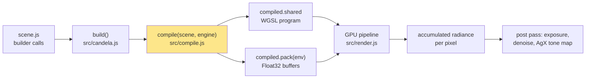
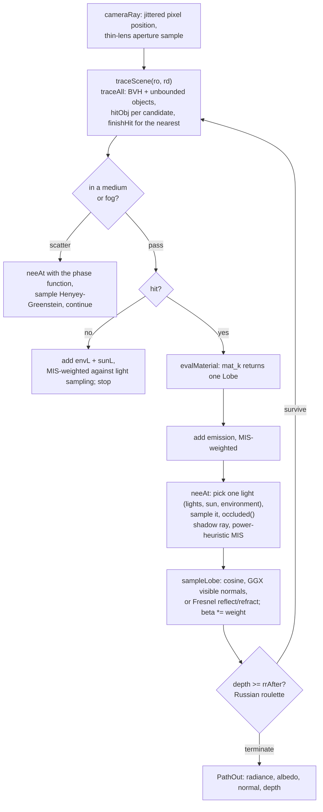
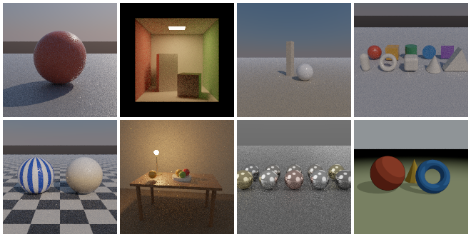

# How Candela turns a scene program into pixels

Candela is a physically based path tracer whose scenes are JavaScript programs. A scene file calls a fluent builder API; a compiler written in JavaScript lowers the resulting description to a GPU program and a handful of flat data buffers; a progressive path tracer, written once in a strict subset of WGSL, runs on WebGPU or, after a line-by-line translation, on WebGL2. This document explains that pipeline from the first builder call to the radiance a pixel accumulates, with file and function references into the archive studied here, and then measures what one camera sample costs when Candela's own generated program is compiled for the ESP32-P4.

The archive is `~/Downloads/candela-workspace(1).zip`, SHA-256 `873b2dd4bb9c32cac08751baf9fa6960ee4377306a04b2e118a8969dd940df5d`. Paths such as `src/compile.js` are relative to its `candela/` directory. The measurements are reproducible with the scripts in this ticket's `scripts/` directory; the investigation diary (`reference/01-investigation-diary.md`) records how each number was obtained.

## 1. One scene, end to end

The smallest preset, `content/presets/B-01-hello-sphere.js`, is a complete program:

```js
import { scene, shape, material, light, camera, units as u } from 'candela';

export default scene()
  .add(shape.sphere(1).at(0, 1, 0)
    .material(material.pbr().baseColor('#c8553d').roughness(0.4)))
  .add(shape.plane(30)
    .material(material.pbr().baseColor(0.18)))            // an 18 % grey card
  .light(light.daylight({ elevation: u.deg(40), turbidity: 3 }))
  .camera(camera.thinLens().at(0, 1.6, 6).lookAt(0, 0.9, 0));
```

Running it produces no image. It produces a value: an immutable tree of component records that describes a sphere, a plane, a sun with a physical sky and a thin-lens camera. Four functions then turn that value into pixels.



`build(files)` runs the scene file as a module with the API in scope and collects diagnostics. `compile` lowers the components to objects, lights and materials, generates WGSL for everything that is code (materials, signed-distance functions, density fields, custom integrators) and splices it into the fixed kernel. `pack` evaluates every value that may move (transforms, dynamic parameters, time) and writes the buffers the kernel reads. The GPU runs one invocation per pixel; each adds one or more camera samples to an accumulation buffer, and a post pass turns scene-referred radiance into a displayable picture.

The rest of this document follows that sequence. The point to retain from this overview is that Candela is already structured like a compiler with a front end and a target. Everything up to `compile` and `pack` is ordinary JavaScript that knows nothing about GPUs; only the code generator's output language and the dispatch in `src/render.js` are GPU-specific. The two earlier Candela ports, to OptiX on the DGX Spark and into embedded V8, both kept that front end unchanged and replaced only the target ([[PROJECT REPORT - Candela on the DGX Spark - From a JavaScript Scene API to OptiX Ray Tracing - A Technical Deep Dive]], [[PROJECT REPORT - Candela Render Runtime - Running Candela Scenes in Embedded V8 - A Technical Deep Dive]]).

## 2. The nouns of the API

The spec (`spec/candela-pbr-api.md`, Part I) derives the API from the measurement and rendering equations: each term becomes one noun. The table maps the nouns to their implementation.

| Noun | What it answers | Built by | Lowered by |
|---|---|---|---|
| Shape | Where is matter? | `src/scene.js` `shape.*` (sphere, plane, rect, disk, box, cylinder, capsule, torus, roundedBox, cone, prism, sdf, heightfield, mesh) | `compile.js` `addShape`: a type number 0-13, four shape parameters, a transform recipe |
| Surface (BSDF) | How does a boundary redirect light? | `scene.js` `bsdf.*`: leaves `lambert`, `conductor`, `dielectric`, `sheen`, `thinDielectric`; combinators `mix`, `add`, `layer`, `scale` | `compile.js` `genSurface`: WGSL that selects one lobe per shading point |
| Material | A surface plus emission, normal and interior medium | `material(bsdf)`, `material.define`, the standard library in `src/stdlib.js` (`material.pbr`, `glass`, `metal`, ...) | `compile.js` `lowerMaterial`: one `mat_k` function per distinct body |
| Light | Where does energy enter? | `light.point`, `spot`, `area` (via `shape.emit`), `sun`, `sky.physical`, `env.*` | records in the `LI` buffer; sun, sky and environment as uniforms |
| Camera | How is radiance turned into pixel values? | `camera.thinLens`, `pinhole` | `compile.js` `cameraUniforms`: uniform rows 1-4 |
| Medium | How does light travel through matter? | `medium.homogeneous`, `absorbing`, `heterogeneous`, `fog` | records in the scene data; density fields become WGSL |
| Field | How does a quantity vary over space, time, wavelength? | `src/fx.js`: `fx.pattern`, `fx.noise.*`, methods on symbolic values | `fx.js` `Gen`: one WGSL `let` per DAG node |
| Param | A named knob (slider) | `src/params.js` `param.float`, `color`, `angle`, ... | a uniform slot (dynamic) or a constant (static) |
| Engine | Integrator plus passes plus backend | `scene.js` `engine.realtime`, `offline`, `preview`; `integrator.path`, `define` | uniform row 5 and the generated `customKernel` |
| Fragment | A reusable extension of any of the above | `scene.js` `fragment(...)` | merged into builders and lowerings |

Units are part of the types (`src/units.js`): a light's power is a luminous flux in lumens, a sun is specified by illuminance in lux, and the builders convert to SI and photometric quantities before anything is lowered. The consequence for a port is that packed values span many orders of magnitude; Section 8 measures how many.

## 3. Three stages, and why the distinction matters

Every function a scene passes to Candela runs in exactly one of three stages, and the component receiving it decides which (`content/docs/10-architecture.md`).

| Stage | When | What the function receives | What it produces |
|---|---|---|---|
| build | once, while the scene file runs | plain JavaScript values and a seeded `rng` | structure: `scene.group(fn)`, `scene.scatter({ place })` |
| trace | once per compile, symbolically | proxies for shading inputs (`p.P`, `p.uv`, `p.N`) | a typed expression DAG, compiled into the kernel |
| run | on the host, per frame or event | live values | updates: `animation(t)`, `.behavior(...)`, `param.map(fn)` |

The trace stage is the one a port must understand. Consider the striped material of `F-01-patterns.js`:

```js
material.pbr().baseColor(p => fx.mix(fx.color('#1e4bb3'), fx.color('#f0ebe0'), fx.stripes(p.uv.x, 12)))
```

The arrow function is called once, at build time, with a proxy `p` (`fx.js` `surfaceContext`). Reading `p.uv` returns a node `ctx(uv)`; `.x` returns a swizzle node; `fx.stripes` builds `step(0.5, fract(x * 12))`; `fx.mix` builds a `mix` node. Each call goes through `fx.js` `node(op, type, args, x)`, which hash-conses: an identical operation on identical arguments returns the existing node, so the DAG shares common subexpressions automatically. The result is not a number but a typed graph whose leaves are shading-context fields, constants and parameter slots.

JavaScript is the macro language of this graph. A `for` loop over a JavaScript number unrolls into nodes, an `if` on a JavaScript boolean chooses which nodes exist, and only `fx.select`, `fx.mix` and friends branch when the shader runs. A proxy used as a number throws diagnostic E201, and a proxy used in `if` or `?:` throws E202 (`fx.js` `stageError`), because those operations would silently happen at the wrong time.

The run stage is why the front end cannot be compiled away. Five presets export `animation(t)`, one uses a behavior, and 41 declare dynamic parameters. Each of those re-runs JavaScript after the build and changes the packed data, so whatever renders the scene must keep a JavaScript engine next to the kernel. The embedded-V8 report reached the same conclusion and measured that re-packing is cheap: 0.155 ms per frame for the animated sewing machine K-09 in V8.

## 4. From builders to an IR

A builder is a `Proxy` around a frozen `Comp` record (`scene.js` `class Comp`, `wrap`). Calling a method returns a new `Comp` with one property changed; the proxy checks argument types, units and ranges and turns misuse into coded diagnostics with did-you-mean suggestions. A scene is therefore a tree of `Comp` records whose leaves include fx nodes.

Materials show why "IR" here means two layers. `material.pbr()` is not a primitive: `src/stdlib.js` defines it in the grammar itself.

```js
const dielectricBase = bsdf.layer(bsdf.dielectric({ f0: m.specular.mul(0.08), roughness: r }), bsdf.lambert(m.baseColor));
let metal = bsdf.conductor.schlick({ f0: m.baseColor, roughness: r });
let base = bsdf.mix(dielectricBase, metal, m.metallic);
...                                           // optional transmission, sheen
const coated = bsdf.layer(bsdf.dielectric({ ior: 1.5, roughness: m.coatRoughness }), base, { tint: m.coatColor });
return bsdf.mix(base, coated, m.coat);
```

The outer layer is the BSDF algebra, a tree of combinators over physical leaves. The inner layer is the fx DAG that supplies every leaf parameter: constants, parameter slots, or traced fields. `src/ir.js` prints both (`irText` shows each material "lowered" to its BSDF tree; `irGraph` draws shared nodes once).

## 5. compile: code where structure lives, data where values live

`compile(sceneB, engineB)` (`src/compile.js`, lines 165-553) walks the component tree once and fills a state object `S` with objects, lights, materials, media, SDFs, heightfields and density fields.

**Shapes** become object records (`addShape`): a type number (sphere 0, plane 1, rect 2, disk 3, box 4, cylinder 5, capsule 6, torus 7, rounded box 8, cone 9, prism 10, SDF 11, heightfield 12, mesh 13), four shape parameters, a material index, and a recipe that evaluates the object's transform later.

**Materials** become WGSL functions (`lowerMaterial`). The key function is `genSurface`, which lowers the BSDF algebra to *stochastic selection*: a material returns exactly one lobe per shading point. `mix(a, b, t)` becomes `if (u < t) { b } else { a }` with `u` rescaled into the chosen branch; `add(a, b)` picks either with probability 1/2 and doubles the weight; `layer(coat, base)` picks the coat with the Fresnel probability at that point. The expected value of the random choice equals the combination, so the estimator stays unbiased while the kernel only ever evaluates one simple lobe. Constant mix weights of 0 or 1 fold away at compile time. This is B-01's sphere material as generated:

```wgsl
fn mat_0(h: Hit, wo: vec3f, uIn: f32) -> Lobe {
  var u: f32 = uIn;
  var L: Lobe = lobeNone();
  var wgt: vec3f = vec3f(1.0, 1.0, 1.0);
  let m1: f32 = (0.5 * 0.08);
  let f0_1: f32 = fresnelDielectric(clamp(dot(wo, h.N), 0.0, 1.0), ((1.0 + sqrt(clamp(m1, 0.0, 0.99))) / (1.0 - sqrt(clamp(m1, 0.0, 0.99)))));
  if (u < f0_1) {
    u = u / max(f0_1, 1e-6);
    L.kind = 3; L.ior = ...; L.c0 = vec3f(1.0, 1.0, 1.0); L.ax = max(0.4 * 0.4, 0.0005); L.ay = L.ax; L.N = h.N; L.flags = 2;
  } else {
    u = (u - f0_1) / max(1.0 - f0_1, 1e-6);
    L.kind = 1; L.c0 = vec3f(0.57758044, 0.0908417112, 0.0466650863); L.N = h.N;
  }
  L.w = L.w * wgt;
  L.med = -1;
  return L;
}
```

`metallic` and `coat` were the constant 0, so the conductor and the clear coat vanished; what remains is a Fresnel-weighted choice between a reflect-only GGX coat (`kind 3`, `flags 2`) and a Lambert lobe (`kind 1`). Material bodies are deduplicated by their text, so 401 instanced spheres with two materials compile to two functions (I205).

**Fields** inside a material are generated by `fx.js` `Gen`: it walks the DAG in dependency order and emits one `let` per node, naming each node once, so shared subexpressions are computed once. A `param` node becomes a read of a uniform slot (`U(32).x` and upward) when the parameter is dynamic, and a constant when it is static. Moving a dynamic slider therefore costs a buffer write; changing a static one re-runs `build` and `compile` and produces different WGSL.

**The program** is assembled as `head + PRELUDE + SPECTRAL + ggxTableWGSL() + sdfCode + hfCode + densCode + CORE + metalAt + matCode + PATH` (`compile.js` line 539). The fixed parts come from `src/kernel.js` (1,513 lines of JavaScript holding the WGSL source). Over the 105 presets the assembled program has 1,461 to 2,107 lines, median 1,506; the generated material section is small (43 lines for B-01, 86 for F-01, 70 for the Cornell box R-01). `ggxTableWGSL` recomputes a constant 16 x 16 table of GGX directional albedos by 2.1 million Monte Carlo iterations on every compile; on a fast host this is invisible, on a slow interpreter it is not.

## 6. pack: the buffers the kernel reads

`compiled.pack(env)` (`compile.js` `pack`, lines 629-790) evaluates every transform recipe at the given time and poses, rebuilds the top-level BVH (median split, leaves of at most three objects), and writes `Float32Array`s of `vec4` rows:

| Buffer | Contents | B-01 size |
|---|---|---|
| `U` uniforms | row 0 width, height, frame index, samples per dispatch; rows 1-4 camera; 5 integrator settings; 6-7 sun direction and radiance; 8-16 environment and Preetham sky coefficients; 17-18 fog; 19 counts; 20-24 miscellaneous; 32+ parameters | 41 rows |
| `O` objects | 6 rows each: type, material, light, flags; world-to-object 3x4 matrix; shape parameters; random id, original index, motion block, bound | 2 objects |
| `LI` lights | 6 rows each: type, object, position, radiance, area or cone frame, colour temperature | 0 (sun and sky are uniforms) |
| `BV` BVH | 2 rows per node: min corner and first index or child, max corner and count | 1 node |
| `SD` scene data | static head: mesh BVHs and triangles, face tables, HDRI sampling tables; dynamic tail: media, motion poses | empty |

Everything B-01 needs fits in 1,016 bytes. For every preset outside the mechanical group (K-*), the scene data's static head is empty; the K presets carry 16.9-19.9 MB, mostly HDRI importance-sampling tables and triangle meshes. `pack` runs again whenever the clock ticks or a dynamic parameter moves; `compile` runs again only when structure changes.

## 7. What the kernel computes for one sample

The WebGPU backend dispatches one invocation per pixel, which calls `renderPixel(px, frameIx)` (`kernel.js` lines 1365-1404). For each of the dispatch's samples it seeds the random generator (`pcgH`, a PCG hash), picks a wavelength if the engine is spectral, generates a camera ray and calls `tracePath`. The path loop (`tracePath`, lines 1142-1312) is the heart of the renderer:



Three details govern the cost of that loop on any processor.

- **Every geometric query goes through `traceAll`.** It tests unbounded objects (infinite planes) one by one, then walks the BVH with a 40-entry stack. `hitObj` transforms the ray into the object's frame (`xfP`, `xfD`, with motion-blur poses when present) and solves the shape analytically for types 0-5, sphere-traces types 6-12 inside a bounding sphere (up to 220 steps of `sdLocal`), and walks a per-mesh BVH for meshes. A sample of depth `d` with next-event estimation performs up to `d` closest-hit queries and `d` shadow queries.
- **Light sampling picks one emitter uniformly** among the scene's lights, the sun and the environment (`neeAt`, `nLightChoices`), samples a direction, evaluates the lobe there (`evalLobe`, `pdfLobe`), traces a shadow ray (`occluded`) and weights the result against BSDF sampling with the power heuristic (`misW`). When a BSDF-sampled ray later reaches the same emitter, the complementary weight is applied.
- **The sky is evaluated, not looked up.** `skyL` evaluates the Preetham model's Perez function (`perez`, two exponentials and a cosine) per direction; `sunL` tests the solar disc. Every escaped path and every environment light sample pays that evaluation.

The real-time engine (97 of 105 presets) runs a maximum depth of 5 with Russian roulette from depth 2, one sample per pixel per frame, then the à-trous denoiser and AgX tone mapping (`kernel.js` `POST`). Per sample the kernel keeps a few words of private state (`rngS`, `gTime`, `gLam`, `gTau`, `gTri`, `gBary`) and a 40-entry traversal stack; everything else is read from the packed buffers. All arithmetic is single-precision float.

## 8. What the 105 presets ask for

I built every preset with Candela's own front end in Node (`scripts/01-census.mjs`; all 105 build, 9.3 s in total, median 70 ms per preset) and recorded the shapes, lobes, lights, environments, media and generated fields each one uses (`various/01-census.json`). Then I sorted them by the smallest kernel that renders them without changing their meaning (`scripts/02-tiers.mjs`, `various/02-tiers.json`).

| Tier | Kernel needed | Presets | Cumulative |
|---|---|---:|---:|
| T0 | fixed kernel and material **data**: analytic quadrics (sphere, plane, rect, disk, box, cylinder); Lambert, GGX conductor and reflect-only dielectric coats; point, spot, area and sun lights; uniform, gradient, studio, night environments and the Preetham sky; RGB; path integrator; every material value constant or a uniform | 28 | 28 |
| T1 | T0 plus more fixed kernel code: sphere-traced primitives, refraction, thin sheets, sheen, thin films, anisotropy, absorbing interiors, scattering media and fog, spectral sampling, motion blur | 29 | 57 |
| T2 | T1 plus per-scene generated code: surface-varying material fields (patterns, noise, bump), user SDFs, heightfields, density fields, custom integrators and passes | 38 | 95 |
| T3 | T2 plus large data: triangle meshes, HDRI environments, more than 1,000 objects | 10 | 105 |

The single largest reason to need generated code is a surface-varying material field (39 presets). Features by number of presets that need them: refraction 18, torus 16, rounded box 16, media 13, anisotropic finishes 9, meshes 9, HDRIs 9, capsules 7, SDFs 6, sheen 6, cones 5, spectral rendering 4, motion blur 4, density fields 4, heightfields 3. The median preset has 6 objects and 4 material kernels.

The magnitudes in the packed buffers matter for any numeric format. The largest uniform is the sun's radiance, 1.83e9 (photometric units); the largest value in any light record is 7.4e4. Reflectances near 0.03 multiplied by 1/pi coexist with them in the same expressions.

## 9. A cost model: Candela's own kernel on the ESP32-P4's instruction set

### How the numbers were obtained

Estimating operations per sample by hand would measure my reading of the kernel. Instead I ran Candela's generated program. `scripts/04-wgsl2cpp.mjs` translates `compiled.shared` to C++: the rules are those `src/wgsl2glsl.js` relies on and those of the DGX Spark report's WGSL-to-CUDA table (typed declarations become C++ declarations, `fn` headers become prototypes, struct parameters become `const` references, vector types and WGSL built-ins come from a generated prologue, float literals get an `f` suffix so nothing is computed in double precision, and `select` becomes a conditional except where an argument draws a random number). `scripts/05-harness.cpp` binds the packed buffers to the accessors `U`, `objF`, `litF`, `bvhF` and `sdF` exactly as `src/render.js` binds them to the GPU, and calls `renderPixel` for every pixel.

The same source compiles natively (a reference frame) and with the ESP32-P4's GCC (`riscv32-esp-elf-g++` 14.2, `-march=rv32imafc -mabi=ilp32f`, newlib's single-precision libm). The repository's `rv32emu` executes only RV32IM, so `scripts/06-rv32imfc-count.c` executes RV32I, M, F and C, counts retired instructions by class and attributes them to functions. Counts are instructions, not cycles. The RV32 and host frames agree in mean luminance within 0.7% for every preset measured (pixel-by-pixel agreement is not expected at one sample per pixel, because single-precision libm results differ and steer random decisions differently); the deterministic toon preset E-02 agrees within 1% on every pixel.

The translated kernel renders the presets recognisably; these are host renders of the same C++ at 64 samples per pixel, 160 x 160, with a simple exposure and tone curve instead of Candela's post pass.



*Top: B-01 hello sphere, R-01 Cornell box, L-03 sun and sky, G-01 primitives. Bottom: F-01 patterns, W-02 a lamp-lit table with fbm wood, M-02 measured metals, E-02 the custom toon integrator.*

### Instructions per camera sample

At 160 x 160 and one sample per pixel (a complete frame each), with the presets' own engines (depth 5, Russian roulette from depth 2, next-event estimation and MIS on):

| Preset | What it exercises | -O2 | -O3 |
|---|---|---:|---:|
| B-01 hello sphere | sphere, plane, pbr coat over Lambert, sun + Preetham sky | 8,160 | 7,100 |
| L-03 sun and sky | box, sphere, plane, dynamic sun angles | 7,250 | 6,136 |
| R-01 Cornell box | seven rects and boxes, one area light | 9,525 | 9,354 |
| M-02 metals | eleven spheres, measured conductors, studio environment | 8,472 | 8,378 |
| G-01 primitives | quadrics and five sphere-traced primitives | 11,287 | 10,289 |
| A-01 mix | BSDF `mix` with a uniform and with a stripe field | 6,267 | 6,173 |
| F-01 patterns | checker, stripes and ramp fields | 8,924 | 7,892 |
| M-04 glass | refracting dielectrics | 7,465 | 7,374 |
| E-02 toon | custom integrator, one bounce | 3,608 | 3,503 |
| W-02 table | fbm wood, a point light, fifteen objects | 78,776 | 78,624 |

For the path-traced presets other than W-02 the range is 6,100-11,300 instructions per sample. About 46% of the instructions are floating-point (loads and stores included); there are 70-110 `fdiv.s` and 15-28 `fsqrt.s` per sample. The compiled kernel with libm occupies 42-47 KB of `.text`.

### Where a sample's instructions go

`scripts/12-profile-groups.py` groups the per-function profile. GCC inlines freely, so "path loop" holds the inlined `renderPixel`, `cameraRay` and much of `tracePath`; the libm groups are exact because newlib is not inlined.

| Part of the kernel | B-01 | R-01 | G-01 | W-02 |
|---|---:|---:|---:|---:|
| libm sin/cos/tan | 2,192 (27%) | 527 | 2,027 | 5,177 |
| traversal and intersection | 1,906 (23%) | 6,423 (67%) | 5,241 (46%) | 8,560 |
| libm exp/log/pow | 1,283 (16%) | — | 1,128 | — |
| path loop, camera, RNG | 931 (11%) | 1,079 | 982 | 1,245 |
| environment and sun | 767 (9%) | 58 | 678 | 70 |
| materials and lobes | 366 | 512 | 418 | 2,208 |
| light sampling and MIS | 339 | 580 | 413 | 822 |
| large-argument sine reduction | — | — | — | 58,001 (74%) |

Two observations follow, and both are about the CPU rather than about rendering.

First, transcendental functions dominate outdoor scenes. Cosine-weighted hemisphere sampling and sun-cone sampling call `cosf` and `sinf` of angles up to 2 pi, which newlib reduces through `__ieee754_rem_pio2f` (about 111 instructions per call); the Preetham sky's Perez function calls `expf` (about 101). Together they are 43% of B-01.

Second, W-02's cost is an artifact of a GPU idiom. Candela's noise hashes positions with `fract(sin(dot(p, k)) * 43758.5453)` (`kernel.js` `hash3`, `hash13`). A GPU evaluates `sin` of a large argument in a few cycles with whatever accuracy its hardware gives; newlib computes it exactly with Payne-Hanek reduction, 1,961 instructions per call. Five octaves of `fbm3` call it 120 times per evaluation.

### CPU-specific math

To see how much of this is inherent, the translator's prologue has an experimental `CDL_FAST_MATH` mode: one-step range reduction with a degree-9 polynomial for `sin`/`cos` (error about 4e-6 on [-pi, pi]), a degree-6 `exp2`-based `exp` (2e-7 relative), and a conversion-based `floor` (RV32F has no floor instruction; newlib's `floorf` is a 25-instruction call). It changes results at the level of single-precision rounding, and it changes the hash's pseudo-random values (WGSL leaves `sin`'s accuracy for large arguments unspecified, so the GPU's values are not portable either). Measured at -O2 (`various/07-kernel-counts-fastmath.jsonl`):

| Preset | libm -O2 | fast math -O2 | Change |
|---|---:|---:|---:|
| B-01 | 8,160 | 6,173 | −24% |
| F-01 | 8,924 | 6,926 | −22% |
| G-01 | 11,287 | 9,478 | −16% |
| R-01 | 9,525 | 9,205 | −3% |
| W-02 | 78,776 | 14,967 | −81% |

In fast-math B-01 the Perez function is now the largest single function (1,180 instructions per sample) and the environment-and-sun group is 1,656 per sample. A sky radiance table indexed by direction, rebuilt when the sun moves, would replace most of that with a bilinear lookup of a few dozen instructions; I estimate B-01 near 4,700 instructions per sample with it, but did not measure it.

### From instructions to time

The ESP32-P4's cycle cost per instruction for this code has not been measured, so the conversion is a range with explicit assumptions.

- Integer, load, store and branch instructions: 1.13 cycles per instruction, the value measured for GCC -O3's integer ray tracer frame on this board (2,450,039 instructions in 7.72 ms at 360 MHz; RAY-PARITY diary, Step 13).
- `fdiv.s` and `fsqrt.s`: 10 to 30 cycles each (iterative units are typical; no P4 measurement exists).
- Other floating-point arithmetic: pipelined, with 0 to 1 cycle of extra stall per instruction for dependent chains.

For B-01 at -O3 (7,100 instructions, of which 110 are divisions and square roots and 1,612 other floating-point arithmetic) this gives 8,800 to 12,600 cycles per sample: **28,500 to 41,000 samples per second on one 360 MHz core**. A 160 x 160 frame at one sample per pixel then takes 0.63-0.90 s, and an 80 x 80 frame 0.16-0.22 s. `scripts/14-cycle-model.py` applies the same model to every measured run (`various/11-cycle-model.txt`): the ordinary presets fall between 20,000 and 47,000 samples per second, the toon preset E-02 reaches 59,000-83,000, and W-02 manages 3,500-4,100 with newlib and 15,000-21,000 with the fast-math prologue. The fast-math and sky-table changes above would shorten this by roughly a quarter to a third for outdoor scenes. For comparison, the Typed integer ray tracer renders its 160 x 160 frame (primary rays and hard shadows) in 16.26 ms; a physically based path-traced sample costs about 50 times more per pixel than that frame does.

## 10. Key points

- Candela is a front end (builders, fx tracing, `compile`, `pack`) that emits a WGSL program and flat buffers, plus a fixed path-tracing kernel. Ports so far kept the front end and replaced the target.
- The front end must stay alive at run time: animations, behaviors and parameter maps re-run JavaScript and re-pack the buffers.
- Materials are generated code on the GPU, but for 57 of the 105 presets every material value is a constant or a uniform, so a CPU kernel could take them as data.
- Candela's own kernel, compiled for RV32IMAFC, costs 6,100-11,300 instructions per camera sample on ordinary presets; the outdoor presets spend 40% of that in libm, and sine-based hashes cost up to ten times more than everything else.
- The packed values span 1e-2 to 1.8e9, which a single fixed-point format cannot hold.
- On one 360 MHz core the estimated budget is 20,000-47,000 samples per second for ordinary presets: several updates per second at 80 x 80, about one pass per second at 160 x 160, about a minute for 16 passes at 320 x 320.

The design document (`design-doc/01-a-candela-subset-for-the-esp32-p4.md`) turns these facts into a subset, a numeric model and a staged implementation.
