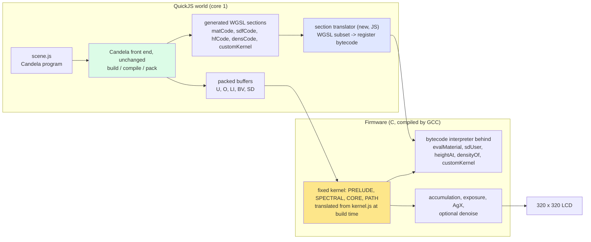
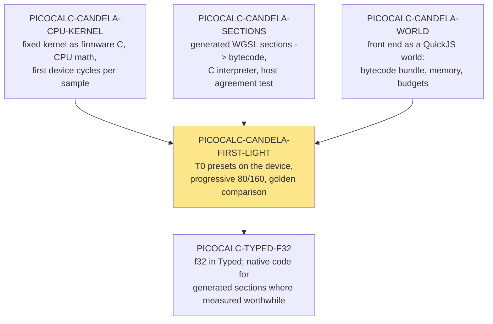

# A Candela subset for the ESP32-P4

## Executive summary

The goal is that a Candela scene file, written against Candela's own JavaScript API, runs on the PicoCalc and produces a physically based image on its screen. This document decides how, using the measurements in the companion analysis (`analysis/01-how-candela-turns-a-scene-program-into-pixels.md`) and three host experiments made for this purpose.

The decisions, in one table:

| Question | Decision | Deciding evidence |
|---|---|---|
| Where does the scene program run? | In a QuickJS world on the device, with Candela's front end (`build`, `compile`, `pack`) unchanged | All 105 presets build in the firmware's QuickJS with identical WGSL and diagnostics; B-01's build is an estimated 70-120 ms on the device once a constant table is memoised; animations and parameters need JavaScript at run time anyway |
| What runs the path tracer? | Candela's fixed WGSL kernel, translated to C at firmware build time and compiled by GCC into the firmware | Ten presets render correctly through a prototype translator; 6,100-11,300 RV32 instructions per sample |
| Numeric model | IEEE single precision on the RV32F unit; no fixed point, no soft float | f32 is 9-50x cheaper than 64-bit fixed point and 90-130x cheaper than soft float on kernel fragments; 32-bit fixed point gives wrong answers; packed values span 1e-2 to 1.8e9 |
| What runs per-scene generated code (materials, SDFs, fields)? | First a register-bytecode interpreter in the C kernel, fed by an on-device translator of the generated WGSL sections; native code generation later, only if measured overhead warrants it | 0.8-1.7 material evaluations per sample; the interpreter costs about 20 instructions per node, so a material adds roughly 3-10% to a sample |
| Role of Typed | None in the first path. A Typed f32 type is a separate, later project that can compile generated sections to native code | Typed has only i32 and bool; GCC -O3 is 2.11x faster than Typed on integer ray tracing, and the fixed kernel gains nothing from being compiled on the device |
| First subset | Tier T0: 28 presets (analytic shapes, Lambert/GGX/coat lobes, point, spot, area, sun and sky lights, simple environments) | `various/02-tiers.json` |
| Resolution and rate | 160 x 160 progressive, one sample per pixel per pass, 80 x 80 while the camera or a slider moves | Estimated 28,500-41,000 samples per second per 360 MHz core for B-01 (0.63-0.90 s per 160 x 160 pass); 20,000-47,000 for the ordinary presets measured |

The rest of the document explains each decision, what it reuses and what it rewrites, and the order of work. Section 10 lists the follow-up tickets.

## 1. What "running a Candela program" means here

A Candela program is a JavaScript module that default-exports a scene built with `scene()`, `shape.*`, `material.*`, `light.*`, `camera.*` and friends, optionally with an `engine`, parameters, an `animation(t)` function and behaviors. Running it means three things, and the design keeps all three on the device:

1. The module's code runs, including its build-stage loops and its trace-stage lambdas, and produces the same component tree it produces in a browser.
2. Candela's compiler turns that tree into the same program and the same packed buffers it produces in a browser.
3. A path tracer consumes the program and buffers and produces radiance whose expected value is the same as on the GPU.

"The same" is testable. Steps 1 and 2 produce a WGSL string and `Float32Array`s that can be hashed and compared with Node's output for the same scene; step 3 produces an image whose mean luminance, at enough samples, must match a host rendering of the same kernel. The QuickJS study (`reference/02-quickjs-front-end-diary.md`) already shows steps 1 and 2 agree byte for byte with Node for all 105 presets, after adding one missing global (`atob`).

What the design gives up is equally specific: WebGPU and WebGL2 dispatch (`src/render.js`), the browser viewport and its UI, GPU timing, and for now the presets whose data does not fit or whose kernel features are not yet translated (Section 7).

## 2. The machine and the runtime it offers

The ESP32-P4 has two 360 MHz RV32IMAFC cores with a single-precision FPU (no double-precision unit, so every JavaScript `Number` operation in QuickJS is soft-float), 32 MB of PSRAM and a few hundred KB of internal RAM. The PicoCalc firmware runs JavaScript programs as worlds, each in its own QuickJS 2026-06-04 runtime:

| World resource | Default | Where set | What Candela needs |
|---|---|---|---|
| Heap | 1 MB | `nucleus/kernel.c` `add_world` (`mem_kb` in the manifest) | 1.37 MB after loading the modules (32-bit); B-01's build peaks at 1.65 MB, W-02's at 1.75 MB |
| C stack for QuickJS | 56 KB | `port/esp32p4/main/port_p4.c` `port_js_stack` | B-01's build reaches 20 KB (32-bit host); the deepest preset (S-04) 69 KB |
| Turn budget | 50 ms (600 ms while booting) | `kernel.c`, `vm.c` `vm_begin_segment` | builds of roughly 70-120 ms for simple scenes (Section 5) |
| Bytecode cache | used for the prelude | `vm.c` `build_prelude_cache`, `JS_ReadObject` | avoids recompiling 329 KB of Candela source on each start |

Native code reaches worlds through firmware services: the painter service (`port/esp32p4/main/painter_service.c`) compiles and draws for a world on a worker task, and the earlier PicoCalc Candela renderer (`port/esp32p4/main/candela_p4.c`) draws a frame through a native slot. The kernel task that runs worlds is pinned to core 1; the painter runs its compile worker at low priority on the same core because, in its own comment, "competing from the other core can push a cold launcher draw past its deadline under PSRAM and instruction-cache load".

The Typed compiler (`picocalc-os/compiler/typed-rv32.js`) compiles a JavaScript subset with `i32` and `bool` scalars, records and buffers to RV32 machine code on the device. After RAY-PARITY Step 13 (versioned loops, split locals, pointer homes) its integer ray tracer draws a 160 x 160 frame in 16.26 ms against 7.72 ms for GCC -O3 C.

## 3. Architecture

The design keeps Candela's own split between a front end and a target, as both earlier ports did: the DGX Spark port kept the JavaScript front end and translated the WGSL program to CUDA, replacing only the scene traversal with OptiX ([[PROJECT REPORT - Candela on the DGX Spark - From a JavaScript Scene API to OptiX Ray Tracing - A Technical Deep Dive]]); the embedded-V8 runtime hosted the whole front end so animations, behaviors and parameter maps keep running, and gated changes on a golden digest of the packed data ([[PROJECT REPORT - Candela Render Runtime - Running Candela Scenes in Embedded V8 - A Technical Deep Dive]]). On the PicoCalc the WGSL program is again the contract between the two halves, but it is split along a line that `compile.js` already draws.

`compile.js` assembles the program as

```js
const shared = head + PRELUDE + SPECTRAL + ggxTableWGSL() + sdfCode + hfCode + densCode + CORE + metalAt + matCode + PATH;
```

`PRELUDE`, `SPECTRAL`, `CORE`, `PATH` and the GGX table are the same for every scene (`head` only sets `SPECTRAL_ON`). `sdfCode`, `hfCode`, `densCode` and `matCode` are generated per scene, and the fixed code reaches them through exactly five dispatch functions: `sdUser(k, p)`, `heightAt(k, xz)`, `densityOf(m, P)`, `evalMaterial(h, wo, u)` (with `hitAlbedo` and `hitEmission` built on it) and `customKernel(ro, rd)`. That is the seam.



At run time the world calls a host function such as `candela.start(program, buffers, options)` once per compile and `candela.update(buffers)` whenever `pack` runs again; the firmware renders progressively on a worker task and posts frames to the display. The world never touches pixels, and the kernel never runs JavaScript.

## 4. Decision: f32 on the FPU, in C, for the fixed kernel

### The options

The brief named three candidates for the arithmetic of the kernel: a new f32 type in Typed generating RV32F code, Typed's existing i32 used as fixed point, and an interpreter for Candela's IR written in C. To compare them on equal terms, `scripts/09-numeric-bench.c` implements three fragments of Candela's kernel five ways each: the object-space sphere test from `hitObj`, the GGX microfacet term from `evalLobe`, and `safeNorm`. The arms are f32 on the FPU (what Typed f32 or C would produce), the same source as soft-float, Q16.16 with 64-bit intermediates, Q16.16 restricted to 32-bit operations (what Typed i32 can express), and a C interpreter of a register bytecode with one instruction per expression node. RV32 instruction counts come from the counting interpreter; accuracy from host builds against double precision; 2,000 inputs per fragment (`various/05-numeric-bench.jsonl`).

| Fragment | f32 (FPU) | soft float | Q16.16, 64-bit | Q16.16, 32-bit only | bytecode VM |
|---|---:|---:|---:|---:|---:|
| sphere test | 23 | 2,121 | 215 (2 of 482 hit/miss wrong) | 95 (153 of 481 hit/miss wrong; median error 94%) | 338 |
| GGX term | 49 | 6,277 | 2,439 (99th-percentile error 16x the value) | 848 (median error 77%) | 958 |
| `safeNorm` | 14 | 1,793 | 799 | 427 (median error 38%) | 99 |

*RV32 instructions per call, -O2, ESP GCC 14.2. f32, soft float and the VM agree with double precision to about 1e-7 relative.*

### Why fixed point fails

The 32-bit-only fixed point that Typed can express today is cheap and wrong. A dot product of two Q16.16 vectors must either shift operands before multiplying (losing the low bits that decide whether a grazing ray hits a sphere) or overflow; a quotient must be pre-shifted the same way. The 64-bit variant computes the sphere test acceptably but needs 64-bit multiplies and divides that Typed does not have, costs 9-50x the f32 code, and still fails on GGX: the distribution term peaks at 1/(pi alpha^2), 1.3e6 at Candela's minimum roughness, beyond Q16.16's range of 32,767. The scenes themselves rule out any single fixed-point format: the census found the sun's radiance at 1.83e9 in the same buffers as reflectances near 0.03, and radiance is accumulated over thousands of samples. The earlier PicoCalc Candela work reached the same conclusion from the other side: its Q8 scalars changed the result of fractional-coordinate predicates at about a third of sampled locations.

### Why C and not Typed f32 for the fixed kernel

Typed f32 would generate the same kind of code as the f32 column, so the question is not arithmetic but compilers. Three facts decide it.

- The fixed kernel is the same for every scene. Compiling it on the device buys nothing; compiling it once with GCC when the firmware is built is free at run time.
- GCC is the better code generator today: on the same integer ray tracer, GCC -O3 takes 7.72 ms per frame and Typed 16.26 ms (2.11x). A Typed f32 back end would start further behind on floating-point code (FP register allocation, FMA formation, libm-quality transcendental routines).
- The kernel is 1,500 lines of WGSL with structs, `inout`-free value semantics and 116 functions. Typed does not have f32, vectors or structs passed by value; rewriting the kernel in Typed is a port, while translating it to C is mechanical and already works (`scripts/04-wgsl2cpp.mjs` renders ten presets).

### Why not interpret the kernel

The bytecode VM is 7-20x slower than compiled f32 per fragment. Over a whole sample that would turn 7,000 instructions into 50,000-140,000, so a 160 x 160 pass would take roughly 5-13 s instead of under one second. (The GGX program has 44 bytecode instructions and costs 958 RV32 instructions, about 22 per bytecode instruction including the arithmetic itself.) An interpreter is only acceptable for a small part of each sample's work, which is where Decision 6 uses one.

## 5. Decision: Candela's front end runs unchanged in a QuickJS world

The alternative is to build scenes on a host and ship packed buffers. It would work for static scenes and would avoid all JavaScript cost on the device, but it would not run Candela programs on the device: animations (5 presets), behaviors (1) and parameter maps re-run JavaScript after the build, dynamic parameters (41 presets) change uniforms whenever a slider moves, and a user editing a scene on the PicoCalc needs `build` and `compile` to run there. The V8 runtime report made the same choice for the same reasons.

The QuickJS study (`reference/02-quickjs-front-end-diary.md`, `various/03-quickjs-front-end.json`) ran Candela's unmodified sources in the firmware's QuickJS build on a host, in 64-bit and in 32-bit. Its findings set the world's parameters:

- **Compatibility.** All 105 presets build; the generated WGSL is byte-identical to Node's for all of them, and the 28 diagnostics are identical in code and location. The only shim is `atob` (K-09 decodes base64 mesh data). QuickJS ignores `//# sourceURL=`, so in a bundled build Candela's `callSite()` would lose user line numbers; the host should compile scene files with a file name.
Two scale factors turn host times into device estimates, and they agree. The nucleus calibrates QuickJS on the ESP32-P4 at 133 ms for a 100,000-iteration loop and 31 ms for `fib(20)` (`nucleus/vm.c`); the same programs take 3.04 and 0.93 ms in the 32-bit host build, ratios of 44 and 33. Against the 64-bit host build, the PSIX-STAGING System world gave a ratio of about 61 (4.70 ms on the host, 287.9 ms on the P4), which matches the 64-bit calibration loop (2.08 ms, ratio 64). Both are integer-heavy programs; Candela's front end computes in doubles, which the P4 does in software, so the estimates below are lower bounds.

- **The GGX table must not be computed on the device.** `ggxTableWGSL()` recomputes a constant 256-entry table by Monte Carlo on every compile: 26.7 million QuickJS steps, 3,680 ms of CPU in the 32-bit host build (1,476 ms in 64-bit), more than 99% of B-01's build. On the device that is at least 123-161 s. The table is constant, so the firmware kernel embeds it as data and the world supplies a memoised `ggxTableWGSL` (the study's `--memo-ggx` loader patch shows the WGSL is unchanged by it).
- **Build cost.** With the table memoised, B-01's build takes 2.0 ms in the 32-bit host build, so about 67-88 ms on the device (117-123 ms from the 64-bit build and the factor of 61); R-01 takes 3.2 ms, W-02 6.5-6.8 ms, G-01 6.4 ms. That is longer than a 50 ms turn: the Candela world needs a raised `budget_ms` for build turns (a few hundred milliseconds covers T0 and T2 scenes with margin), or the build must run as its own segment the way boot does. Over all 105 presets the 32-bit median is 4.2 ms per build.
- **Load cost.** Loading Candela's 15 modules (329 KB of source) takes 16 ms in host QuickJS, almost all of it compiling source: about 0.5-1.0 s on the device. Shipping the modules as QuickJS bytecode, as `vm.c` already does for the prelude, removes the compile.
- **Pack cost.** B-01's first `pack` takes 0.34 ms and later ones 0.11 ms in 32-bit (R-01: 1.1 and 0.8 ms), so roughly 4-15 ms per animation frame on the device for B-01 and 30-50 ms for R-01: affordable per frame for small scenes.
- **Memory.** 1.37 MB of heap after loading (32-bit), against a default world limit of 1 MB: loading fails at 1 MB and succeeds at 2 MB. B-01's build peaks at 1.65 MB and keeps 154 KB alive in its result; W-02 peaks at 1.75 MB. A 4 MB world covers T0 to T2. Scenes that carry large data (the K presets with meshes and HDRIs) need 24-47 MB more during the build and are out of scope.
- **Stack.** In 32-bit QuickJS every preset but one fits a 56 KB C stack; S-04 needs 69 KB and E-02 52 KB, because `fx.js` `Gen` recurses once per level of an expression graph.
- **Scene code can be expensive in itself.** M-12 runs a Monte Carlo furnace test in its scene file (14.7 s in 32-bit host QuickJS), and X-02 rebuilds a 10,001-object BVH in every `pack` (2.4-2.9 s on the host). Neither belongs in a device subset regardless of kernel features.

## 6. Decision: generated sections become bytecode on the device

### What has to run

Every scene has generated code, even the simplest: B-01's two materials are two WGSL functions (`analysis/01`, Section 5). The generated sections are small (43 lines for B-01, 86 for F-01, 70 for R-01), are produced by two regular generators (`genSurface` for the BSDF selection and `fx.js` `Gen` for fields, which emits one `let` per DAG node), and are entered through five dispatch functions. Instrumenting the translated kernel shows how often one camera sample enters them (`scripts/13-count-entry-calls.sh`, `various/10-entry-calls.txt`):

| Preset | `evalMaterial` per sample | `traceAll` per sample | `occluded` per sample |
|---|---:|---:|---:|
| B-01 | 0.81 | 2.47 | 0.71 |
| R-01 | 1.31 | 2.91 | 0.92 |
| F-01 | 0.90 | 2.70 | 0.87 |
| G-01 | 0.94 | 2.80 | 0.92 |
| W-02 | 1.71 | 4.09 | 1.62 |

A material is evaluated about once per sample. That changes the economics: an interpreter that is 7-20x slower than compiled code is affordable for work done once per sample, as long as the heavy operations inside it (noise, Fresnel, `fbm3`) are calls into compiled kernel functions rather than interpreted node by node.

### The translator and the bytecode

The world translates the generated sections from WGSL text into a register bytecode, after `compile` and before the first frame. Translating the text rather than adding a second back end to `compile.js` keeps Candela's sources unchanged, which is what kept both earlier ports in step with Candela; the cost is a parser for the subset the generators emit (function headers, `var`/`let`, assignments to `Lobe` fields, `if`/`else` on the selection variable `u`, calls, vector constructors, swizzles, arithmetic). A host test translates every preset's sections and checks them against the C++ translation of the same WGSL, so a generator change in a new Candela version shows up as a failing preset, not a wrong image.

B-01's sphere material, after constant folding in the translator, needs one call and a handful of instructions:

```text
mat_0:                                     ; h.N in v0, wo in v1, u in f0
  DOT      f1, v1, v0
  CLAMP01  f1, f1
  CALL     f2, fresnelDielectric(f1, K[0]=1.5000)   ; layer probability, f0 = 0.04
  CHOOSE   f0, f2, else=L1                 ; u < p: rescale u into [0,1), fall through
  LOBE     kind=3 flags=2 ior=K[0] c0=(1,1,1) ax=ay=0.16 N=v0
  RET
L1:
  LOBE     kind=1 c0=(0.5776,0.0908,0.0467) N=v0
  RET
```

`CHOOSE` is the stochastic selection that `genSurface` uses for `mix`, `add` and `layer`; `LOBE` writes a whole `Lobe` from constants, uniform slots or registers. With the VM's measured cost of about 20 RV32 instructions per interpreted instruction, this material costs on the order of 150-250 instructions per evaluation, 2-4% of B-01's sample; a field-driven material of 30-60 nodes costs 600-1,200, or about 10% of a sample at one evaluation per sample. SDFs are different: sphere tracing calls `sdUser` up to 220 times per ray, so interpreted user SDFs (6 presets) would cost several times the sample; they are the first candidate for native code.

### Native code later

If the measured interpreter overhead matters for a class of scenes (user SDFs certainly, heavy fields possibly), the same bytecode can be compiled to RV32F machine code on the device and linked into a native slot as the Typed tool chain already does for integer code (`compiler/candela.js` links Typed programs into the earlier Candela renderer's slot). Whether that compiler is Typed with an f32 type or a direct emitter from the bytecode is the subject of a separate ticket; it does not block anything in the first subset.

## 7. Decision: the subset

### First subset: tier T0

The census sorted the 105 presets by the smallest kernel that renders them (`analysis/01`, Section 8). Tier T0 needs the fixed kernel plus material data and nothing else, and has 28 presets:

`A-03 B-01 B-03 B-04 B-05 C-02 C-03 C-04 D-01 D-02 E-03 E-04 G-06 L-01 L-02 L-03 L-04 L-05 L-06 L-07 L-08 M-01 M-02 M-03 M-09 M-12 R-01 R-07`

The API subset this implies:

| Supported in the first subset | Not yet |
|---|---|
| `shape.sphere`, `plane`, `rect`, `disk`, `box`, `cylinder`, transforms, groups, scatter | `roundedBox`, `capsule`, `torus`, `cone`, `prism` (sphere-traced), `sdf`, `heightfield`, `mesh` |
| `material.pbr` and the stdlib materials built from `lambert`, `conductor` (including measured metals), reflect-only `dielectric` coats; `mix`, `add`, `layer`, `scale` with constant or parameter weights | refraction, `thinDielectric`, `sheen`, thin films, anisotropy, absorbing interiors, surface-varying fields |
| `light.point`, `spot`, area lights from emissive shapes, `light.daylight` / `sun` with `sky.physical` | HDRI environments |
| `env.uniform`, `gradient`, `studio`, `night` | media, fog, spectral engines, motion blur |
| `camera.thinLens`, `pinhole`; `param.*` (dynamic and static); `animation(t)`, behaviors | custom integrators and passes |

The firmware kernel contains all of the fixed WGSL anyway, so "not yet" mostly means "not yet verified". The world checks a compiled scene against the subset before starting the kernel and reports an unsupported feature as a diagnostic in Candela's own format (code, message, location), not as a wrong image. M-12 stays out of the device demo list because of its scene-side Monte Carlo test (Section 5).

### Growth path

T1 (29 more presets, 57 in total) adds features that are fixed kernel code: sphere-traced primitives, refraction, thin sheets, sheen, films, anisotropy, interiors, media and fog, spectral sampling, motion blur. Each is a verification task against the host translation, plus per-feature cost measurements; spectral rendering also needs the CIE tables that `SPECTRAL` carries. T2 (38 more, 95 in total) needs the bytecode path for fields, SDFs, heightfields, density fields and the custom integrator; the toon preset E-02 is the cheapest of them (3,600 instructions per sample) and a good first T2 target. T3 (meshes, HDRIs, the 10,001-sphere scene) needs megabytes of scene data and a front end that does not rebuild BVHs every `pack`; it is out of scope.

## 8. Decision: resolution and samples per second

### The estimate

The analysis converts measured instruction counts to time with stated assumptions (1.13 cycles per instruction for integer work, as measured for the GCC ray tracer on this board; 10-30 cycles per `fdiv.s`/`fsqrt.s`; 0-1 stall cycle per other FP instruction). For B-01 at -O3 the result is 8,800-12,600 cycles per sample, **28,500-41,000 samples per second on one core** (`scripts/14-cycle-model.py`, `various/11-cycle-model.txt`; 20,000-47,000 over the ordinary presets measured). The CPU-specific math measured in `various/07-kernel-counts-fastmath.jsonl` (polynomial `sin`/`cos`/`exp`, conversion-based `floor`) removes 16-24% of the instructions on outdoor presets and 81% on W-02; a sky radiance table would remove most of the remaining Perez cost (estimated, not measured).

| Rendered size | Samples per pass | One pass (B-01, estimate) | 16 passes |
|---|---:|---:|---:|
| 80 x 80 | 6,400 | 0.16-0.22 s | 2.5-3.6 s |
| 160 x 160 | 25,600 | 0.63-0.90 s | 10-14 s |
| 320 x 320 | 102,400 | 2.5-3.6 s | 40-57 s |

### The policy

The display is 320 x 320. The design renders at 160 x 160 and scales by two, the size at which the PicoCalc's earlier ray tracers and their published measurements work, so results stay comparable. Rendering is progressive: one sample per pixel per pass, accumulated in a float buffer in PSRAM (160 x 160 x 16 bytes, 400 KB for radiance, plus the albedo and normal buffers the denoiser reads), and displayed after every pass with Candela's exposure and AgX curve. While the camera or a dynamic parameter is changing, the renderer drops to 80 x 80 and resets accumulation on every change, which gives four to six updates per second; Candela's own `engine.preview` (depth 3, half scale) has the same intent.

The à-trous denoiser is expensive on this CPU as written: 4 iterations of 25 taps, each tap calling `exp` three times and `pow` once, is on the order of 70,000 instructions per pixel, about ten samples' worth. It runs once when accumulation pauses, with a CPU form of the edge weights (`pow(x, 32)` as five squarings, polynomial `exp`), and never per pass.

The second HP core could double throughput, but the painter service's experience is a warning: rendering from core 0 may disturb the kernel task's deadlines through PSRAM and instruction-cache contention. The first implementation renders on core 1 at low priority, as the painter does, and the dual-core variant is a measured experiment.

## 9. What is reused and what is rewritten

| Part | Fate | Notes |
|---|---|---|
| Candela front end: `candela.js`, `scene.js`, `fx.js`, `params.js`, `units.js`, `stdlib.js`, `compile.js`, `diag.js` | reused unchanged, as QuickJS bytecode | memoised `ggxTableWGSL`; an `atob` global; scene files compiled with a file name for diagnostics |
| Fixed kernel: `kernel.js` `PRELUDE`, `SPECTRAL`, `CORE`, `PATH` | reused as source, translated to C at firmware build time | `scripts/04-wgsl2cpp.mjs` grown into a build step; CPU substitutions: lazy `select`, no zero-initialisation of large structs, polynomial transcendental functions, an integer hash in place of `fract(sin(...))`, a sky table |
| GGX albedo table | reused as data | computed once on the host, embedded in the firmware |
| Generated sections (`matCode`, `sdfCode`, `hfCode`, `densCode`, `customKernel`) | translated on the device | new JS translator to bytecode; new C interpreter behind the five dispatch functions |
| `render.js` (WebGPU/WebGL2), `viewport.js`, `wgsl2glsl.js` | replaced | by a firmware render service: dispatch over pixels, accumulation, post |
| `POST` (exposure, AgX, false colour, à-trous) | reused as source, translated like the kernel | denoise only on demand |
| Earlier PicoCalc Candela (`nucleus/candela_scene.c`, `worlds/candela/*.typed`, Q8 graphs) | not reused for this path | its fixtures and measurements remain the baseline for Typed-compiled shading |

## 10. Order of work and follow-up tickets



| Ticket | Goal | Acceptance measurement |
|---|---|---|
| PICOCALC-CANDELA-CPU-KERNEL | Candela's fixed kernel as C in the firmware, generated from `kernel.js` at build time | B-01 at 160 x 160, 1 spp: measured cycles per sample on the P4 (the first device number for this code, including `fdiv`/`fsqrt` latency); RV32 frame within 1% mean luminance of the host translation at 64 spp |
| PICOCALC-CANDELA-SECTIONS | Generated sections translated to bytecode on the device and interpreted by the kernel | all T0 and T2 material sections of the 105 presets translate; interpreted and compiled sections agree per evaluation on recorded hits; measured interpreter instructions per sample |
| PICOCALC-CANDELA-WORLD | Candela's front end as a QuickJS world | B-01 load, build and pack times and peak heap measured on the device; all T0 presets build within the world's limits; WGSL and packed-data digests equal Node's |
| PICOCALC-CANDELA-FIRST-LIGHT | T0 Candela scenes rendered on the PicoCalc | B-01 and R-01 on screen; samples per second measured; a 64-pass image matches the host golden within the tolerance above; slider and animation updates under one second at 80 x 80 |
| PICOCALC-TYPED-F32 | An f32 type in Typed and RV32F code generation | the three numeric-bench fragments written in Typed within 1.5x of GCC -O2's instruction counts, results equal to C's f32 results |

The first four can proceed in parallel up to the integration in FIRST-LIGHT. The Typed ticket is independent and must coordinate with whoever is changing `picocalc-os/compiler/` at the time.

## 11. Risks and open questions

- **Cycle cost is not measured.** Every time figure in this document is an instruction count times an assumed CPI. The divider and square-root latencies, FP stalls and PSRAM behaviour of this kernel are unknown until CPU-KERNEL measures them on the device.
- **libm quality vs speed.** The fast-math experiment changes results at single-precision rounding level and changes the values of `sin`-based hashes. WGSL leaves those values unspecified too, so a GPU and the PicoCalc never agreed bit for bit, but a golden test must compare statistics, not pixels.
- **Translator drift.** Both translators depend on the WGSL Candela generates. The mitigation is a host test over all presets for every Candela version adopted.
- **Front-end cost on soft-float.** The host-to-device factors (33-44 against 32-bit, about 61 against 64-bit) come from integer-heavy programs. Candela's builds compute in doubles, which the P4 emulates in software; the device may be slower than estimated. WORLD measures it.
- **Stack depth.** `fx.js` `Gen` recurses once per level of an expression graph; in 32-bit host QuickJS S-04 needs 69 KB and E-02 52 KB against a 56 KB limit. RV32 frames may differ; field-heavy T2 scenes may need a larger world stack.
- **Dual-core rendering** may conflict with UI deadlines (Section 8).
- **Diagnostics locations** need the host to name compiled scene files (Section 5).
