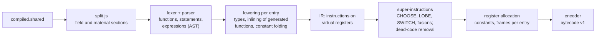

# Translate Candela's generated WGSL sections to bytecode and interpret them in the P4 kernel

## 1. Goal and acceptance

Every Candela scene carries generated code: its materials (`matCode`), user signed-distance functions (`sdfCode`), heightfields (`hfCode`), density fields (`densCode`) and, for a custom integrator, `customKernel`. On a GPU this code is spliced into the WGSL program. On the PicoCalc the fixed kernel is C++ compiled into the firmware (PICOCALC-CANDELA-CPU-KERNEL), and the scene's code arrives at run time. This ticket makes that code run:

1. A **translator**, written in JavaScript that runs in the PicoCalc's QuickJS world, reads the WGSL text that Candela's unchanged compiler emits and produces a **register bytecode**.
2. A **C verifier** rejects malformed bytecode before anything runs.
3. A **C interpreter** runs the bytecode behind the kernel's five dispatch functions; the heavy operations inside it are calls into compiled C.
4. A **host agreement test** shows that the interpreted sections compute what the compiled translation of the same WGSL computes.

Acceptance, from the brief:

- Every generated section of the 105 presets translates; failures are listed by construct.
- Interpreted and compiled sections agree per evaluation, on the hit records a render produces, to 1e-5 relative.
- Whole-frame mean luminance within 1% at 64 samples per pixel for B-01, R-01, F-01 and W-02.
- RV32 instructions per sample, interpreted against compiled, for B-01, F-01, W-02 and one SDF preset; SDF presets reported separately.

Out of scope: the fixed kernel (CPU-KERNEL), the QuickJS world (WORLD), display and integration (FIRST-LIGHT), native code generation for sections (TYPED-F32 or a direct emitter). Device timing is optional here.

## 2. The seam

`compile.js` assembles every program as

```text
head + PRELUDE + SPECTRAL + ggxTableWGSL() + sdfCode + hfCode + densCode + CORE + metalAt + matCode + PATH
```

The fixed kernel reaches the generated code through five functions:

| Dispatch function | Generated from | Called by the fixed kernel | Per camera sample |
|---|---|---|---|
| `evalMaterial(h: Hit, wo: vec3f, u: f32) -> Lobe` | `lowerMaterial`/`genSurface` (one `mat_k` per distinct material) | `tracePath`, `hitAlbedo`, `hitEmission` | 0.81 (B-01) to 1.71 (W-02) |
| `sdUser(k: i32, p: vec3f) -> f32` | `genFunction('sdf_k')` per `shape.sdf` | `sdLocal` during sphere tracing (up to 220 steps) and normals | up to several hundred |
| `heightAt(k: i32, xz: vec2f) -> f32` | `genFunction('hf_k')` per heightfield | heightfield tracing | many per ray |
| `densityOf(m: i32, P: vec3f) -> f32` | `genFunction('dens_k')` per heterogeneous medium | delta tracking in media | several per ray in a medium |
| `customKernel(ro: vec3f, rd: vec3f) -> vec3f` | `genCustomKernel` | `renderPixel` when the integrator is `custom` | 1 |

(Per-sample counts from PICOCALC-CANDELA-P4 `various/10-entry-calls.txt`.)

CPU-KERNEL turns these five into a table of function pointers, `struct Sections`, that a scene binds (its `generated/cdl_kernel.h`). This ticket fills that table with five small adapters that call the interpreter. The generated code calls back into the kernel: CPU-KERNEL's census over all 105 presets (`scripts/various/01-section-api.json` on its branch) finds 15 of the 107 fixed functions: `lobeNone` 105 presets, `fresnelDielectric` 104, `metalAt` 24, `fbm3` 18, `tangentWorld` 9, `safeNorm` 7, `lum` 6, `fmodp` 4, `sellmeier` 3, `voronoi3` 3, `noise3` 2, `fmodp3` 1, `hitAlbedo` 1, `occluded` 1, `traceScene` 1; plus the globals `gTime` and `gLam`, the structs `Hit` and `Lobe`, and the uniform accessor `U`. That list is the interpreter's call interface (Section 7).

## 3. The WGSL that has to be translated

`scripts/01-export-sections.mjs` builds all 105 presets with Candela's own front end in Node and splits each program at the boundaries above (`scripts/translator/split.js`, which follows CPU-KERNEL's `splitProgram` and checks every boundary). All 105 build and split. Over the 210 section texts:

- **Statements**: `let x: T = e;` (2,536), `var x: T = e;` (1,785, nearly all `u`, `L` and `wgt`), assignments to variables and to `Lobe` fields (`L.kind`, `L.c0`, ... 11 fields), `if (c) { ... } else { ... }` (1,003 `if`, 390 `else`), `return e;`. No loops, no `switch`, no pointers.
- **Types**: `f32` 2,109 lets, `vec3f` 393, `vec2f` 22, `vec4f` 5, `bool` 6, `Hit` 1; `i32` only in literals assigned to `Lobe` fields and in dispatch comparisons.
- **Calls**: WGSL built-ins (`max`, `clamp`, `sqrt`, `dot`, `pow`, `mix`, `abs`, `smoothstep`, `cross`, `sin`, `fract`, `length`, `step`, `floor`, `min`, `select`, `cos`), constructors (`vec3f`, `vec2f`), the 15 kernel functions, `U(row)`, and calls to other generated functions (`mat_k`, `sdf_k`, `hf_k`, `dens_k`, `bumpH_k`, `bumpN_k`).
- **Field and swizzle reads**: `h.N`, `h.P`, `h.lp`, `h.uv`, `h.irand`, `h.mat`; `.x`, `.y`, `.z`, `.xyz`, `.xz`.
- **Operators**: `+ - * /`, comparisons, `|` (on `L.flags`), `!`, `&&`.

Two generators produce all of it:

- `genSurface` lowers the BSDF algebra to *stochastic selection*. `mix(a, b, t)`, `add(a, b)` and `layer(top, bottom)` all become

  ```wgsl
  let x0_1: f32 = clamp(T, 0.0, 1.0);          // or a Fresnel pick, or 0.5 for add
  if (u < x0_1) {
    u = u / max(x0_1, 1e-6);
    ... one branch's lobe ...
  } else {
    u = (u - x0_1) / max(1.0 - x0_1, 1e-6);
    ... the other branch's lobe ...
  }
  ```

  and every leaf is a run of `L.field = expr;` assignments.
- `fx.js` `Gen` walks the field DAG and emits one `let` per node, so a field is a straight-line sequence of single-operation lets whose operands are earlier lets, context fields (`h.P`, `h.uv`, ...), constants or parameter slots (`U(32).x`).

The translator therefore needs a parser for this subset, not for WGSL. Anything outside it gets a diagnostic naming the construct (Section 4.6), and the host test over all presets is the guard against a new Candela version emitting something new.

## 4. The translator

### 4.1 Where it runs and what it is given

The translator runs in the Candela world, after `compile` and before the first frame, in QuickJS. It is pure JavaScript: no Node module, no `Buffer`, no file access; its output is a `Uint8Array`. Its entry point takes `compiled.shared` and Candela's kernel module (for the fixed `PRELUDE`, `SPECTRAL`, `CORE` and `PATH` strings that `split.js` uses to find the sections), or the two section texts directly:

```js
import { translateProgram, translateSections } from './translator/index.js';
const r = translateProgram(compiled.shared, kernelModule);   // or translateSections(fieldCode, matCode, { spectral })
// r.ok, r.bytes (Uint8Array), r.diagnostics [{ code, construct, message, line, col, text }], r.stats, r.listing()
```

The host test runs the same module in Node and in the firmware's QuickJS build and requires byte-identical output.

### 4.2 Pipeline



1. **Parse** each section into functions. The parser accepts exactly the statements and expressions of Section 3; WGSL attributes, loops, `switch`, pointers, arrays and unknown keywords are diagnostics.
2. **Lower** each of the five dispatch functions separately. Calls to generated functions (`mat_k`, `bumpN_k`, `bumpH_k`, `sdf_k`, `hf_k`, `dens_k`) are **inlined**: WGSL forbids recursion, the call graph is a small tree, and inlining removes every bytecode-level call and return. A `bumpH_k` called six times by its `bumpN_k` is inlined six times with different arguments. Lowering keeps a value environment: a name is bound to a constant, a virtual register (with a width of 1-4 words, or 23 for a `Hit` and 26 for a `Lobe`), or the entry's input `Hit` pointer.
3. **Type** every expression (`f32`, `i32`, `bool`, `vec2f`-`vec4f`, `Hit`, `Lobe`), resolving WGSL's abstract integer literals by context. Types choose the instruction (scalar, `vec3`, mixed vector-scalar) and catch misuse.
4. **Fold constants.** An operation whose operands are all constants is computed at translation time in single precision (each result rounded with `Math.fround`, so `(1.0 + sqrt(0.04)) / (1.0 - sqrt(0.04))` becomes the same f32 the compiled kernel computes). `SPECTRAL_ON` is a constant of the program, so `select(n_d, sellmeier(...), SPECTRAL_ON)` folds. A `var` that is never assigned after its initialiser is treated as a `let`; with exact identities (`x * 1`, `x / 1`, `pow(1, y) = 1`) this removes `L.w = L.w * wgt` and the constant coat tint `pow(max(vec3f(1.0), ...), ...)` that `genSurface` emits for an untinted layer.
5. **Super-instructions** (Section 5.5): the stochastic selection becomes one `CHOOSE`, a run of `Lobe` field assignments becomes one `LOBE`, the `if (h.mat == k) { return mat_k(...); }` chain becomes one `SWITCH`, and a few frequent patterns are fused.
6. **Remove dead code**: pure instructions whose results are never read.
7. **Allocate registers** (Section 4.4) and **encode** (Section 5).

### 4.3 Swizzles and fields are addresses, not instructions

A register operand is a word index, and a vector occupies consecutive words. A single-component swizzle (`m4.x`), a contiguous multi-component swizzle (`U(32).xyz`, `v.yz`) and a field of a register-held struct (`k1.P` of a `Hit` returned by `traceScene`) are therefore operand offsets and cost nothing. Only non-contiguous swizzles (`h.P.xz`) need a gather instruction. Reads of the input `Hit` (`h.N`, `h.P`, ...) are loads from the kernel's `Hit` record, emitted once per field at the top of the material body that uses them.

### 4.4 Registers, constants and frames

The interpreter has one register file of 32-bit words per core (a union of `float` and `int32_t`; booleans are 0 or 1). It is divided once, by the translator:

```text
[0, nconst)                 constants and uniform imports (read-only for the bytecode)
[frame_k.lo, frame_k.hi)    one frame per dispatch function, disjoint
```

- **Constants** are deduplicated by bit pattern; a vector constant is a run of consecutive words. They are written once when the program is bound, so the bytecode never decodes an immediate float.
- **Uniform imports**: `U(row)` in a section reads a parameter slot (rows 32 and up) or, in a custom integrator, the sun direction (row 6). Each distinct row becomes a 4-word block in the constant region, copied from the uniform buffer when the program is bound and again whenever the renderer rebinds the buffers (every `pack`). Uniform rows do not change during a frame.
- **Frames**: each dispatch function gets its own frame. Within a frame, registers are allocated by linear scan over the linearised code: a value's interval runs from its definition to its last use in linear order. Because the code is structured (`if`/`else` only) and every jump goes forward, an interval in linear order covers every path between definition and use, so this is correct without a data-flow analysis; a register freed at the end of a `then` branch is reused in the `else` branch, which is exclusive with it. Variables (`u`, `wgt`, `L`) live from their first to their last occurrence.

Disjoint frames are what make re-entrancy safe: `customKernel` calls `hitAlbedo`, which calls `evalMaterial`, and `traceScene` calls `sdUser` through sphere tracing, while the caller's frame is live. No frame can be re-entered while it is active, because the verifier only allows the ray-tracing and material-calling kernel functions in the `customKernel` frame (Section 6).

### 4.5 Program limits

Register operands are 16-bit word indices and code offsets are 16-bit halfword indices. The verifier's limits (version 1): at most 4,096 registers (16 KB) and 65,535 code halfwords. The translator reports a program that exceeds either, or a single function that needs more than 1,024 live words, as a diagnostic (`E-SECT-LIMIT`) with the function named, instead of emitting something the verifier would reject.

### 4.6 Diagnostics

Every failure names the construct, the section and the position:

```text
E-SECT-UNSUPPORTED  statement 'for' is not in the section subset  (mat.wgsl:41:3: for (var k: i32 = 0; ...)
E-SECT-CALL         call to 'textureSampleLevel' is not a kernel function or WGSL built-in the interpreter has
E-SECT-TYPE         operator '*' on vec3f and vec2f
E-SECT-LIMIT        mat_3 needs 1,310 live words (limit 1,024)
```

The construct string (`statement:for`, `call:textureSampleLevel`, `type:mat3x3f`, `operator:%`, `assign:swizzle`, ...) is the key the coverage report groups by.

## 5. Bytecode version 1

### 5.1 Layout

All fields are little-endian.

| Offset | Size | Field |
|---|---|---|
| 0 | 4 | magic `CDVM` |
| 4 | 2 | version (1) |
| 6 | 2 | flags (bit 0: spectral) |
| 8 | 2 | `nregs`: register file size in words |
| 10 | 2 | `nconst`: words in the constant region |
| 12 | 2 | `nimport`: uniform imports |
| 14 | 2 | `ncode`: code size in halfwords |
| 16 | 4 | kernel functions the program calls (bit mask, Section 7) |
| 20 | 5 x 12 | entry descriptors, in the order material, sdUser, heightAt, densityOf, customKernel: `pc`, `end`, `frame_lo`, `frame_hi`, `arg`, `ret` (u16 each) |
| 80 | 4 x `nconst` | constant words (import slots zero) |
| ... | 4 x `nimport` | imports: `reg` (u16), `row` (u16); copies `U(row)` into `reg .. reg+3` |
| ... | 2 x `ncode` | code |

An entry's code is the halfword range `[pc, end)`; the five ranges are disjoint. Arguments are written by the C entry point into consecutive words starting at `arg` (material: `wo` then `u`; `sdUser`: `k` then `p`; `heightAt`: `k`, `xz`; `densityOf`: `m`, `P`; `customKernel`: `ro`, `rd`), and the result is read at `ret` (26 words for the `Lobe`, 1 for a distance, height or density, 3 for a colour).

### 5.2 Instructions

An instruction is one opcode halfword followed by a fixed number of operand halfwords that depends only on the opcode, except for three variable-length instructions whose first operand gives the length (`LOBE`, `SWITCH`, `CALL`). The opcode halfword's low byte is the opcode; its high byte carries a small immediate (a width for the generic vector instructions, a kernel function number for `CALL`). The operand kinds are:

| Kind | Meaning | Verified |
|---|---|---|
| `d` | destination register, width given by the opcode | inside the entry's frame |
| `s` | source register | inside the constant region or the entry's frame |
| `t` | jump target, a halfword offset | forward, inside the entry's range, on an instruction boundary |
| `i` | small immediate (a hit field offset, a gather pattern, an octave count) | range per opcode |

One table (`scripts/translator/isa.js`) defines every opcode's name, number, operand kinds and widths; `scripts/vm/gen-isa.mjs` generates `cdl_vm_isa.h` from it, so the translator, the verifier and the interpreter cannot disagree.

### 5.3 Instruction families

- **Control**: `RET`, `JMP t`, `BRZ s t` (jump if the word is zero), `BRNZ s t`, `IFLT a b t` (jump unless `a < b`), `SWITCH s n t0 ... tn-1 tdefault`, `CHOOSE u v t`, `CHOOSE0 u v t`.
- **Moves and inputs**: `MOV1`-`MOV4`, `MOVN` (a `Hit` or `Lobe`), `SPLAT3`, `GATHER` (non-contiguous swizzles), `HLD d off n` (load `n` words of the input `Hit` at word offset `off`), `HBOOL d s off` (a `bool` field of a register-held `Hit`), `GLD d which` (`gTime`, `gLam`), `LNONE d` (the `lobeNone()` template), `LOBE`.
- **Scalar float**: binary `ADD SUB MUL DIV MIN MAX POW ATAN2 STEP FMODP`, unary `NEG ABS FLOOR CEIL FRACT SQRT SIN COS TAN ASIN ACOS ATAN EXP EXP2 LOG LOG2 SIGN`, ternary `CLAMP MIX SMOOTHSTEP`, comparisons `FLT FLE FGT FGE FEQ FNE` producing booleans, `SEL`.
- **vec3** (the common vector width): `ADD3 SUB3 MUL3 DIV3 MIN3 MAX3 NEG3 ABS3 FLOOR3 FRACT3`, vector-scalar `ADD3S SUB3S MUL3S DIV3S`, scalar-vector `SSUB3 SDIV3`, `MIX3` (vector or scalar weight), `CLAMP3`, `DOT3 CROSS LEN3 NORM3` (WGSL `normalize`) `SAFENORM3` (kernel `safeNorm`), `SEL3`.
- **Generic vector** (widths 2-4, and the rarer vec3 functions): one opcode per operation with the width in the high byte and per-operand broadcast flags, executed by a loop.
- **Integer and boolean**: `IOR IAND IEQ INE ILT`, `NOT AND OR`, conversions `ITOF FTOI`.
- **Kernel calls**: `CALL fn d args...`, the argument list fixed by the function's signature (Section 7).

### 5.4 Semantics follow the compiled kernel

Every instruction computes exactly what the C++ translation of the same WGSL computes, in single precision, with the same library functions: `min`/`max` are `fminf`/`fmaxf`; `clamp(x, lo, hi)` is `min(max(x, lo), hi)`; `mix(a, b, t)` is `a + (b - a) * t`; `smoothstep`, `step`, `sign`, `fract(x) = x - floor(x)`, `fmodp(a, b) = a - b * floor(a / b)` and `safeNorm` are written as in `kernel.js`. Transcendental functions go through macros (`CDL_VM_SINF` and so on) that default to newlib's single-precision functions and that the firmware build points at whatever the kernel uses (CPU-KERNEL's `CDL_FAST_TRIG` and `CDL_FAST_EXP` substitute polynomials), so interpreted and compiled sections use the same approximations.

### 5.5 Super-instructions

**`CHOOSE u v t`** is `genSurface`'s stochastic selection:

```c
if (R[u] < R[v]) { R[u] = R[u] / fmaxf(R[v], 1e-6f); pc += size; }                 /* fall into the then branch */
else             { R[u] = (R[u] - R[v]) / fmaxf(1.0f - R[v], 1e-6f); pc = t; }     /* the else branch */
```

The translator recognises the pattern (`if (u < x)` whose branches begin with the two rescalings of `u`); `add`'s `u = u * 2.0` and `u = (u - 0.5) * 2.0` are the same operation with `x = 0.5`, because dividing by 0.5 and multiplying by 2 are both exact. `CHOOSE0` skips the rescaling when neither branch reads `u` again (a leaf).

**`LOBE base mask s...`** writes a run of `Lobe` fields: bit `i` of the 16-bit `mask` selects field `i` (`kind c0 c1 ax ay ior flags N w Le film med T`), and one source register follows for each set bit. Within a run the translator resolves reads of fields written earlier in the run (`L.ay = L.ax`, `L.flags = L.flags | 8`) to their sources, so the moves have no order dependence and `L.flags = 1; ...; L.flags = L.flags | 8` becomes the constant 9. A computed field value is computed straight into the field's register instead of moved.

**`SWITCH s n ...`** replaces the `if (h.mat == k) { return mat_k(h, wo, u); }` chain of `evalMaterial` (and of `sdUser`, `heightAt`, `densityOf`) with one table jump.

**Fusions** found by measuring (Section 9): `fresnelDielectric(clamp(dot(a, b), 0.0, 1.0), eta)`, which every `layer` emits, is one `CALL` with a dot-product form; `step(d, fract(x * n))` (fx `stripes`) and `fmodp(floor(p * n).x + floor(p * n).y, 2.0)` (fx `checker`) are single instructions when their intermediate values have no other use. In this Candela version `checker` and `stripes` are fx macros, not kernel functions, so they arrive as three to five lets; fusing them turns them into the built-ins the brief asks for without changing their arithmetic.

## 6. The verifier

`cdl_vm_load()` checks a blob completely before any of it runs, and returns an error string naming the first violation:

1. **Header**: magic, version, sizes consistent with the blob length; `nconst <= nregs <= 4096`; the entry ranges disjoint, inside the code, and each frame inside `[nconst, nregs)` and disjoint from the others; `arg` and `ret` blocks inside their entry's frame.
2. **Imports**: each block inside the constant region; the row is checked against the uniform buffer's size when the program is bound.
3. **Instructions**, decoded linearly through each entry's range: a known opcode; operands inside the range; every destination inside the entry's frame; every source inside the constant region or the entry's frame; every jump target forward, inside the range and on an instruction boundary (a bitmap of boundaries is built during the walk and checked after it); immediates in range (a `Hit` field offset and width inside the 23-word record, an `fbm3` octave count of at most 16 and a mode of 0-2).
4. **Termination**: the last instruction of each range is `RET` or `JMP`, so execution cannot fall out of the range.
5. **Kernel calls**: the function number is known; the kernel table supplied at load time has the function (a program that needs `traceScene` is refused by a kernel that does not export it); the ray-tracing and material-calling functions (`traceScene`, `occluded`, `hitAlbedo`, `hitEmission`, and the random-number functions) are allowed only in the `customKernel` range, and the input-`Hit` operand only in the material range.

What a verified program guarantees: every register and code access is in bounds; every evaluation terminates after at most `end - pc` instructions plus bounded kernel calls; a nested evaluation (custom integrator calling a material, a ray calling a user SDF) never writes the caller's frame. It does not guarantee that the program computes Candela's material: that is what the agreement test checks.

## 7. The interpreter and its C interface

### 7.1 Execution

An entry point writes its arguments into its frame, sets `pc` to the entry's start and runs a loop that dispatches on the opcode until `RET`. The first implementation is a `switch` over a dense opcode set; the bytecode is read in place. If the measurements show dispatch to be a large part of the cost, the prepared form is the next step: after verification, the halfword code is rewritten once into a direct-threaded array of handler addresses and pre-scaled operand offsets, which removes the opcode decode and the index scaling from every instruction. The verified format does not change.

### 7.2 Kernel functions

Light functions are instructions, written exactly as in `kernel.js`: `lobeNone` (`LNONE`), `safeNorm`, `lum`, `fmodp`/`fmodp3`, `sq`, and `metalAt` (identity in RGB; the spectral form uses `gLam`). Heavy functions and functions that need kernel state are calls through a table of C function pointers the kernel supplies:

| # | Function | C signature in the table |
|---|---|---|
| 0 | `fresnelDielectric` | `float (float cosIn, float eta)` |
| 1 | `noise3` | `float (const float p[3])` |
| 2 | `fbm3` | `float (const float p[3], int oct, float lac, float gain, int mode)` |
| 3 | `voronoi3` | `void (const float p[3], float out[4])` |
| 4 | `tangentWorld` | `void (const cdl_hit *h, const float tl[3], float rot, const float N[3], float out[3])` |
| 5 | `sellmeier` | `float (float lam, const float B[3], const float C[3])` |
| 6 | `traceScene` | `void (const float ro[3], const float rd[3], float tmax, cdl_hit *out)` |
| 7 | `occluded` | `int (const float ro[3], const float rd[3], float tmax)` |
| 8 | `hitAlbedo` | `void (const cdl_hit *h, const float wo[3], float out[3])` |
| 9 | `hitEmission` | `void (const cdl_hit *h, const float wo[3], float out[3])` |
| 10 | `hash13` | `float (const float p[3])` |
| 11 | `voronoiVec3` | `void (const float p[3], float out[3])` |
| 12 | `envSun` | `void (const float d[3], float out[3])` (`envL(d) + sunL(d)`) |
| 13 | `rnd` | `float (void)` |
| 14 | `rnd2` | `void (float out[2])` |
| 15 | `cosHemiN` | `void (const float N[3], float out[3])` (`toWorld(frameOf(N), cosHemi(rnd2()))`) |

Functions 0-8 are the ones the 105 presets use, all within CPU-KERNEL's section API. Functions 9-15 are what `fx.js` `Gen` and `genCustomKernel` can emit but no preset does; the kernel may leave them `NULL`, and the verifier then refuses a program that needs them, with the function named.

`cdl_hit` and `cdl_lobe` are C structs with the same layout as the kernel's C++ `Hit` (23 words; `ok` and `front` are one-byte `bool`s padded to a word) and `Lobe` (26 words). The adapter that connects the interpreter to a kernel checks the layout with `static_assert` on `sizeof` and `offsetof`, so the interpreter reads the kernel's records in place without copying.

### 7.3 The header

The interface is `scripts/vm/cdl_vm.h`. In outline:

```c
typedef struct cdl_vm_kernel {                 /* supplied by the kernel; NULL entries are not exported */
  float (*fresnelDielectric)(float cosIn, float eta);
  ...                                          /* the 16 functions of Section 7.2 */
  const float *time, *lambda;                  /* the kernel's gTime and gLam */
} cdl_vm_kernel;

typedef struct cdl_vm_program cdl_vm_program;  /* a verified blob (points into it; the blob must outlive it) */
typedef struct cdl_vm_ctx cdl_vm_ctx;          /* one per core: program, kernel table, register file */

int    cdl_vm_load(cdl_vm_program *p, const void *blob, size_t len, const cdl_vm_kernel *k, char *err, size_t errlen);
size_t cdl_vm_regs_bytes(const cdl_vm_program *p);
int    cdl_vm_bind(cdl_vm_ctx *c, const cdl_vm_program *p, const cdl_vm_kernel *k, void *regs,
                   const float *U, unsigned nU_rows, char *err, size_t errlen);       /* constants + uniforms */
void   cdl_vm_rebind_uniforms(cdl_vm_ctx *c, const float *U);                    /* after every pack */

void   cdl_vm_eval_material(cdl_vm_ctx *c, const cdl_hit *h, const float wo[3], float u, cdl_lobe *out);
float  cdl_vm_sd_user(cdl_vm_ctx *c, int k, const float p[3]);
float  cdl_vm_height_at(cdl_vm_ctx *c, int k, const float xz[2]);
float  cdl_vm_density_of(cdl_vm_ctx *c, int m, const float P[3]);
void   cdl_vm_custom_kernel(cdl_vm_ctx *c, const float ro[3], const float rd[3], float out[3]);
```

The five entry points have the dispatch functions' signatures, so the `Sections` adapters are one line each. A context is per core, like the kernel's own `rngS`: a dual-core renderer gives each core its own context and register file.

## 8. The host agreement test

Until CPU-KERNEL's firmware kernel lands, the reference is PICOCALC-CANDELA-P4's prototype translation (`04-wgsl2cpp.mjs`), which compiles a preset's whole program, including its sections, to C++. The test rewrites that C++ so that each dispatch function `F` becomes `F_compiled` plus a wrapper `F`, and builds the same harness (`05-harness.cpp`, renamed and extended here) in three modes:

| Mode | The wrapper returns | Used for |
|---|---|---|
| `compiled` | `F_compiled(...)` | reference frames and instruction counts |
| `compare` | `F_compiled(...)`, after also calling the interpreter on the same arguments and comparing | per-evaluation agreement on the render's own hit records |
| `vm` | the interpreter's result | interpreted frames and instruction counts |

In `compare` mode every evaluation of every dispatch function during the frame is compared; the kernel's random state (`rngS`) is saved before the compiled call and restored around the interpreted one, so a section that draws random numbers sees the same stream twice and the frame continues on the compiled path. The comparison metric is per field: integer fields (`kind`, `flags`, `med`) must be equal; a float vector field is compared with `max_i |a_i - b_i| <= 1e-5 * max(max_i |a_i|, max_i |b_i|)` plus an absolute floor of 1e-30 for exact zeros, so a near-zero component of a unit normal is judged against the normal's length rather than against itself. The harness also writes the first evaluations of each dispatch function (inputs and compiled outputs) to a record file, which the RV32 cost runs replay.

The luminance check renders B-01, R-01, F-01 and W-02 at 64 spp in `compiled` and `vm` modes on the host and compares the frames' mean luminance (`0.2126 R + 0.7152 G + 0.0722 B`).

## 9. Cost measurement

The same harness builds for `rv32imafc`/`ilp32f` with the ESP-IDF GCC 14.2 at -O2 (the firmware's level), and the counting interpreter (`scripts/harness/rv32imfc-count.c`, CPU-KERNEL's region-counting copy of P4's interpreter) counts a frame in `compiled` and `vm` modes. Instructions per sample are the frame's instructions divided by its samples; the profile attributes them to the interpreter and to kernel calls. A replay build runs the recorded evaluations through the compiled function and through the interpreter between region marks, which gives instructions per evaluation with no influence of path divergence. Presets: B-01, F-01, W-02 and R-01 as path-traced presets, and the user-SDF presets separately, because sphere tracing evaluates `sdUser` up to 220 times per ray.

## 10. Where the code lives

Everything is in this ticket's `scripts/`:

| Path | What |
|---|---|
| `translator/split.js`, `translator/*.js` | the translator (QuickJS-compatible ES modules); `isa.js` is the single opcode table |
| `vm/cdl_vm.h`, `vm/cdl_vm.c`, `vm/cdl_vm_isa.h` (generated) | interface, verifier and interpreter, plain C99 |
| `vm/cdl_vm_cpu_kernel.inc` | the adapter that fills CPU-KERNEL's `Sections` table (C++) |
| `harness/` | the prototype rewrite, the three-mode harness, the counting interpreter |
| `0N-*.mjs`, `0N-*.py`, `0N-*.sh` | numbered drivers for each test and measurement |

Nothing outside the ticket changes. The firmware gets the interpreter when FIRST-LIGHT adds `vm/` to the build next to CPU-KERNEL's generated kernel; until then, the ticket directory is the only home that does not collide with the kernel ticket's files.

## 11. Risks

- **User SDFs.** At up to 220 evaluations per ray, an interpreted SDF of 30-70 instructions may cost more than the rest of the sample. The measurement decides whether SDF presets need native code (TYPED-F32 or a direct RV32 emitter from this bytecode).
- **Floating-point contraction.** GCC contracts `a * b + c` into `fmadd.s` on RV32; the interpreter performs the multiply and the add separately unless an instruction fuses them. Results differ at the last bit, and a comparison of `u` with a selection probability can go the other way when the two are within that bit. The agreement test runs on the host, where neither build contracts; the RV32 runs compare frames by mean luminance.
- **Generator drift.** A new Candela version can emit a construct outside the subset. The diagnostic names it, and the all-presets test is the gate for adopting a version.
- **Register pressure and program size** for field-heavy scenes: limits and diagnostics in Section 4.5.

## 12. What FIRST-LIGHT needs from this ticket

- `vm/cdl_vm.h`, `vm/cdl_vm.c` and the generated `vm/cdl_vm_isa.h` in the firmware build, compiled with the kernel's math switches mapped onto the `CDL_VM_*` math macros.
- `vm/cdl_vm_cpu_kernel.inc` included in the kernel's translation unit (or one beside it) to export the kernel table and the `Sections` adapters.
- The translator modules in the Candela world's bundle, run after `compile`; the bytes passed to the render service with the packed buffers.
- A call to `cdl_vm_rebind_uniforms` wherever the render service rebinds the buffers.
