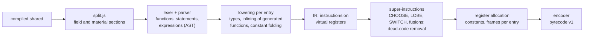

# Translate Candela's generated WGSL sections to bytecode and interpret them in the P4 kernel

## 1. Goal and acceptance

Every Candela scene carries generated code: its materials (`matCode`), user signed-distance functions (`sdfCode`), heightfields (`hfCode`), density fields (`densCode`) and, for a custom integrator, `customKernel`. On a GPU this code is spliced into the WGSL program. On the PicoCalc the fixed kernel is C++ compiled into the firmware (PICOCALC-CANDELA-CPU-KERNEL), and the scene's code arrives at run time. This ticket makes that code run:

1. A **translator**, written in JavaScript that runs in the PicoCalc's QuickJS world, reads the WGSL text that Candela's unchanged compiler emits and produces a **register bytecode**.
2. A **C verifier** rejects malformed bytecode before anything runs.
3. A **C interpreter** runs the bytecode behind the kernel's five dispatch functions; the heavy operations inside it are calls into compiled C.
4. A **host agreement test** shows that the interpreted sections compute what the compiled translation of the same WGSL computes.

Acceptance, from the brief:

- Every generated section of the 105 presets translates; failures are listed by construct.
- Interpreted and compiled sections agree per evaluation, on the hit records a render produces, to 1e-5 relative.
- Whole-frame mean luminance within 1% at 64 samples per pixel for B-01, R-01, F-01 and W-02.
- RV32 instructions per sample, interpreted against compiled, for B-01, F-01, W-02 and one SDF preset; SDF presets reported separately.

Out of scope: the fixed kernel (CPU-KERNEL), the QuickJS world (WORLD), display and integration (FIRST-LIGHT), native code generation for sections (TYPED-F32 or a direct emitter). Device timing is optional here.

## 2. The seam

`compile.js` assembles every program as

```text
head + PRELUDE + SPECTRAL + ggxTableWGSL() + sdfCode + hfCode + densCode + CORE + metalAt + matCode + PATH
```

The fixed kernel reaches the generated code through five functions:

| Dispatch function | Generated from | Called by the fixed kernel | Per camera sample |
|---|---|---|---|
| `evalMaterial(h: Hit, wo: vec3f, u: f32) -> Lobe` | `lowerMaterial`/`genSurface` (one `mat_k` per distinct material) | `tracePath`, `hitAlbedo`, `hitEmission` | 0.81 (B-01) to 1.71 (W-02) |
| `sdUser(k: i32, p: vec3f) -> f32` | `genFunction('sdf_k')` per `shape.sdf` | `sdLocal` during sphere tracing (up to 220 steps) and normals | up to several hundred |
| `heightAt(k: i32, xz: vec2f) -> f32` | `genFunction('hf_k')` per heightfield | heightfield tracing | many per ray |
| `densityOf(m: i32, P: vec3f) -> f32` | `genFunction('dens_k')` per heterogeneous medium | delta tracking in media | several per ray in a medium |
| `customKernel(ro: vec3f, rd: vec3f) -> vec3f` | `genCustomKernel` | `renderPixel` when the integrator is `custom` | 1 |

(Per-sample counts from PICOCALC-CANDELA-P4 `various/10-entry-calls.txt`.)

CPU-KERNEL turns these five into a table of function pointers, `struct Sections`, that a scene binds (its `generated/cdl_kernel.h`). This ticket fills that table with five small adapters that call the interpreter. The generated code calls back into the kernel: CPU-KERNEL's census over all 105 presets (`scripts/various/01-section-api.json` on its branch) finds 15 of the 107 fixed functions: `lobeNone` 105 presets, `fresnelDielectric` 104, `metalAt` 24, `fbm3` 18, `tangentWorld` 9, `safeNorm` 7, `lum` 6, `fmodp` 4, `sellmeier` 3, `voronoi3` 3, `noise3` 2, `fmodp3` 1, `hitAlbedo` 1, `occluded` 1, `traceScene` 1; plus the globals `gTime` and `gLam`, the structs `Hit` and `Lobe`, and the uniform accessor `U`. That list is the interpreter's call interface (Section 7).

## 3. The WGSL that has to be translated

`scripts/01-export-sections.mjs` builds all 105 presets with Candela's own front end in Node and splits each program at the boundaries above (`scripts/translator/split.js`, which follows CPU-KERNEL's `splitProgram` and checks every boundary). All 105 build and split. Over the 210 section texts:

- **Statements**: `let x: T = e;` (2,536), `var x: T = e;` (1,785, nearly all `u`, `L` and `wgt`), assignments to variables and to `Lobe` fields (`L.kind`, `L.c0`, ... 11 fields), `if (c) { ... } else { ... }` (1,003 `if`, 390 `else`), `return e;`. No loops, no `switch`, no pointers.
- **Types**: `f32` 2,109 lets, `vec3f` 393, `vec2f` 22, `vec4f` 5, `bool` 6, `Hit` 1; `i32` only in literals assigned to `Lobe` fields and in dispatch comparisons.
- **Calls**: WGSL built-ins (`max`, `clamp`, `sqrt`, `dot`, `pow`, `mix`, `abs`, `smoothstep`, `cross`, `sin`, `fract`, `length`, `step`, `floor`, `min`, `select`, `cos`), constructors (`vec3f`, `vec2f`), the 15 kernel functions, `U(row)`, and calls to other generated functions (`mat_k`, `sdf_k`, `hf_k`, `dens_k`, `bumpH_k`, `bumpN_k`).
- **Field and swizzle reads**: `h.N`, `h.P`, `h.lp`, `h.uv`, `h.irand`, `h.mat`; `.x`, `.y`, `.z`, `.xyz`, `.xz`.
- **Operators**: `+ - * /`, comparisons, `|` (on `L.flags`), `!`, `&&`.

Two generators produce all of it:

- `genSurface` lowers the BSDF algebra to *stochastic selection*. `mix(a, b, t)`, `add(a, b)` and `layer(top, bottom)` all become

  ```wgsl
  let x0_1: f32 = clamp(T, 0.0, 1.0);          // or a Fresnel pick, or 0.5 for add
  if (u < x0_1) {
    u = u / max(x0_1, 1e-6);
    ... one branch's lobe ...
  } else {
    u = (u - x0_1) / max(1.0 - x0_1, 1e-6);
    ... the other branch's lobe ...
  }
  ```

  and every leaf is a run of `L.field = expr;` assignments.
- `fx.js` `Gen` walks the field DAG and emits one `let` per node, so a field is a straight-line sequence of single-operation lets whose operands are earlier lets, context fields (`h.P`, `h.uv`, ...), constants or parameter slots (`U(32).x`).

The translator therefore needs a parser for this subset, not for WGSL. Anything outside it gets a diagnostic naming the construct (Section 4.7), and the host test over all presets is the guard against a new Candela version emitting something new.

## 4. The translator

### 4.1 Where it runs and what it is given

The translator runs in the Candela world, after `compile` and before the first frame, in QuickJS. It is pure JavaScript: no Node module, no `Buffer`, no file access; its output is a `Uint8Array`. Its entry point takes `compiled.shared` and Candela's kernel module (for the fixed `PRELUDE`, `SPECTRAL`, `CORE` and `PATH` strings that `split.js` uses to find the sections), or the two section texts directly:

```js
import { translateProgram, translateSections } from './translator/index.js';
const r = translateProgram(compiled.shared, kernelModule);   // or translateSections(fieldCode, matCode, { spectral })
// r.ok, r.bytes (Uint8Array), r.diagnostics [{ code, construct, message, line, col, text }], r.stats, r.listing()
```

The host test runs the same module in Node and in the firmware's QuickJS build and requires byte-identical output.

### 4.2 Pipeline



1. **Parse** each section into functions. The parser accepts exactly the statements and expressions of Section 3; WGSL attributes, loops, `switch`, pointers, arrays and unknown keywords are diagnostics.
2. **Lower** each of the five dispatch functions separately. Calls to generated functions (`mat_k`, `bumpN_k`, `bumpH_k`, `sdf_k`, `hf_k`, `dens_k`) are **inlined**: WGSL forbids recursion, the call graph is a small tree, and inlining removes every bytecode-level call and return. A `bumpH_k` called six times by its `bumpN_k` is inlined six times with different arguments. Lowering keeps a value environment: a name is bound to a constant, a virtual register (with a width of 1-4 words, or 23 for a `Hit` and 26 for a `Lobe`), or the entry's input `Hit` pointer.
3. **Type** every expression (`f32`, `i32`, `bool`, `vec2f`-`vec4f`, `Hit`, `Lobe`), resolving WGSL's abstract integer literals by context. Types choose the instruction (scalar, `vec3`, mixed vector-scalar) and catch misuse.
4. **Fold constants.** An operation whose operands are all constants is computed at translation time in single precision (each result rounded with `Math.fround`, so `(1.0 + sqrt(0.04)) / (1.0 - sqrt(0.04))` becomes the same f32 the compiled kernel computes). `SPECTRAL_ON` is a constant of the program, so `select(n_d, sellmeier(...), SPECTRAL_ON)` folds. A `var` that is never assigned after its initialiser is treated as a `let`; with exact identities (`x * 1`, `x / 1`, `pow(1, y) = 1`, `x - (+0)`) this removes `L.w = L.w * wgt`, the constant coat tint `pow(max(vec3f(1.0), ...), ...)` that `genSurface` emits for an untinted layer, and the `P - vec3f(0.0, 0.0, 0.0)` of an SDF primitive at the origin. `x + 0` is not an identity (`-0 + 0 = +0`) and stays.
   Lowering also removes repeated work: an expression already computed in an enclosing scope is reused (common-subexpression elimination over pure instructions), a constructor whose arguments are consecutive words aliases them instead of copying, and a value is computed directly into the register it is finally assigned to (retargeting). Retargeting is refused for a value that is bound to a name or held in the hit-field load cache, because later reads under the old name would find an unwritten register (Step 6 of the diary records the bug that rule fixed).
5. **Super-instructions** (Section 5.5): the stochastic selection becomes one `CHOOSE`, a run of `Lobe` field assignments becomes one `LOBE`, the `if (h.mat == k) { return mat_k(...); }` chain becomes one `SWITCH`, and a few frequent patterns are fused.
6. **Remove dead code**: pure instructions whose results are never read.
7. **Allocate registers** (Section 4.4) and **encode** (Section 5).

### 4.3 Swizzles and fields are addresses, not instructions

A register operand is a word index, and a vector occupies consecutive words. A single-component swizzle (`m4.x`), a contiguous multi-component swizzle (`U(32).xyz`, `v.yz`) and a field of a register-held struct (`k1.P` of a `Hit` returned by `traceScene`) are therefore operand offsets and cost nothing. Only non-contiguous swizzles (`h.P.xz`) need a gather instruction. Reads of the input `Hit` (`h.N`, `h.P`, ...) are loads from the kernel's `Hit` record, emitted once per field at the top of the material body that uses them.

### 4.4 Registers, constants and frames

The interpreter has one register file of 32-bit words per core (a union of `float` and `int32_t`; booleans are 0 or 1). It is divided once, by the translator:

```text
[0, nconst)                 constants and uniform imports (read-only for the bytecode)
[frame_k.lo, frame_k.hi)    one frame per dispatch function, disjoint
```

- **Constants** are deduplicated by bit pattern; a vector constant is a run of consecutive words. They are written once when the program is bound, so the bytecode never decodes an immediate float.
- **Uniform imports**: `U(row)` in a section reads a parameter slot (rows 32 and up) or, in a custom integrator, the sun direction (row 6). Each distinct row becomes a 4-word block in the constant region, copied from the uniform buffer when the program is bound and again whenever the renderer rebinds the buffers (every `pack`). Uniform rows do not change during a frame.
- **Frames**: each dispatch function gets its own frame. Within a frame, registers are allocated by linear scan over the linearised code: a value's interval runs from its definition to its last use in linear order. Because the code is structured (`if`/`else` only) and every jump goes forward, an interval in linear order covers every path between definition and use, so this is correct without a data-flow analysis; a register freed at the end of a `then` branch is reused in the `else` branch, which is exclusive with it. Variables (`u`, `wgt`, `L`) live from their first to their last occurrence.

Disjoint frames are what make re-entrancy safe: `customKernel` calls `hitAlbedo`, which calls `evalMaterial`, and `traceScene` calls `sdUser` through sphere tracing, while the caller's frame is live. No frame can be re-entered while it is active, because the verifier only allows the ray-tracing and material-calling kernel functions in the `customKernel` frame (Section 6).

### 4.5 Program limits

Register operands are 16-bit word indices and code offsets are 16-bit halfword indices. The verifier's limits (version 1): at most 4,096 registers (16 KB) and 65,535 code halfwords. The translator reports a program that exceeds either, or a single function that needs more than 1,024 live words, as a diagnostic (`E-SECT-LIMIT`) with the function named, instead of emitting something the verifier would reject.

### 4.6 Calls with side effects and evaluation order

Thirteen kernel functions change the kernel's module state: the random generator, the trace state and the sample's globals (CPU-KERNEL `scripts/generated/manifest.json`, `kernel.sideEffects`). Four of them can be reached from sections: `traceScene` and `occluded`, which are in the section API, and `rnd` and `rnd2`, which are not. `cosHemiN` draws `rnd2` and counts as a fifth. WGSL evaluates operands and call arguments left to right; C++ leaves the order unspecified. CPU-KERNEL measured the consequence in its own kernel: `sampleLobe(L, woL, rnd2(), rnd())` gave different images on x86-64 and RV32. The translator's rules (`isa.js` flags each kernel function `effects` and `api` from the manifest's lists):

1. **Order.** Lowering emits one instruction per call, in source order: operands left to right, arguments left to right, an inlined generated function at its call site. The bytecode therefore performs side effects in WGSL's order by construction. No later pass moves an instruction with effects. The fusions move only pure producers to their single consumer.
2. **Never removed.** Dead-code removal keeps a call with effects whose result is unused (`let o = occluded(...)` still draws through the trace state).
3. **Never merged.** Common-subexpression elimination merges only pure kernel calls (`fresnelDielectric`, `noise3`, `fbm3`, `voronoi3`, `tangentWorld`, `sellmeier`). Two equal `traceScene` calls stay two calls.
4. **Short-circuit operators.** `a && b` and `a || b` evaluate `b` only when needed in WGSL, while the bytecode evaluates both operands. A right operand with a side effect, directly or through a generated function, is refused (`E-SECT-UNSUPPORTED short-circuit:side-effect`) rather than translated wrongly.
5. **The kernel's API.** By default the translator accepts kernel calls only to the manifest's `sectionAPI` (`opts.kernelApi` overrides it). The seven custom-integrator helpers beyond it (`hitEmission`, `hash13`, `voronoiVec3`, `envSun`, `rnd`, `rnd2`, `cosHemiN`) keep their opcode numbers for a kernel that exports them.

`scripts/09-order-test.mjs` checks rules 1-4 with a stub kernel whose side effects all change one counter (Section 13). A census of the 105 presets (`scripts/10-effects-census.mjs`) finds 2 of 13,205 section statements with any call with effects (E-02's custom integrator calls `traceScene` and `occluded`), none with two, and no `&&`/`||` with one on the right. For today's presets the rules change no image; they protect the next generator version.

### 4.7 Diagnostics

Every failure names the construct, the section and the position:

```text
E-SECT-UNSUPPORTED  statement 'for' is not in the section subset  (mat.wgsl:41:3: for (var k: i32 = 0; ...)
E-SECT-CALL         call to 'textureSampleLevel' is not a kernel function or WGSL built-in the interpreter has
E-SECT-TYPE         operator '*' on vec3f and vec2f
E-SECT-LIMIT        mat_3 needs 1,310 live words (limit 1,024)
```

The construct string (`statement:for`, `call:textureSampleLevel`, `type:mat3x3f`, `operator:%`, `assign:swizzle`, ...) is the key the coverage report groups by.

## 5. Bytecode version 1

### 5.1 Layout

All fields are little-endian.

| Offset | Size | Field |
|---|---|---|
| 0 | 4 | magic `CDVM` |
| 4 | 2 | version (1) |
| 6 | 2 | flags (bit 0: spectral) |
| 8 | 2 | `nregs`: register file size in words |
| 10 | 2 | `nconst`: words in the constant region |
| 12 | 2 | `nimport`: uniform imports |
| 14 | 2 | `ncode`: code size in halfwords |
| 16 | 4 | kernel functions the program calls (bit mask, Section 7) |
| 20 | 5 x 12 | entry descriptors, in the order material, sdUser, heightAt, densityOf, customKernel: `pc`, `end`, `frame_lo`, `frame_hi`, `arg`, `ret` (u16 each) |
| 80 | 4 x `nconst` | constant words (import slots zero) |
| ... | 4 x `nimport` | imports: `reg` (u16), `row` (u16); copies `U(row)` into `reg .. reg+3` |
| ... | 2 x `ncode` | code |

An entry's code is the halfword range `[pc, end)`; the five ranges are disjoint. Arguments are written by the C entry point into consecutive words starting at `arg` (material: `wo` then `u`; `sdUser`: `k` then `p`; `heightAt`: `k`, `xz`; `densityOf`: `m`, `P`; `customKernel`: `ro`, `rd`), and the result is read at `ret` (26 words for the `Lobe`, 1 for a distance, height or density, 3 for a colour).

### 5.2 Instructions

An instruction is one opcode halfword followed by a fixed number of operand halfwords that depends only on the opcode, except for three variable-length instructions whose first operand gives the length (`LOBE`, `SWITCH`, `CALL`). The opcode halfword's low byte is the opcode; its high byte carries a small immediate (a width for the generic vector instructions, a kernel function number for `CALL`). The operand kinds are:

| Kind | Meaning | Verified |
|---|---|---|
| `d` | destination register, width given by the opcode | inside the entry's frame |
| `s` | source register | inside the constant region or the entry's frame |
| `t` | jump target, a halfword offset | forward, inside the entry's range, on an instruction boundary |
| `i` | small immediate (a hit field offset, a gather pattern, an octave count) | range per opcode |

One table (`scripts/translator/isa.js`) defines every opcode's name, number, operand kinds and widths; `scripts/vm/gen-isa.mjs` generates `cdl_vm_isa.h` from it, so the translator, the verifier and the interpreter cannot disagree.

### 5.3 Instruction families

- **Control**: `RET`, `JMP t`, `BRZ s t` (jump if the word is zero), `BRNZ s t`, `IFLT a b t` (jump unless `a < b`), `SWITCH s n t0 ... tn-1 tdefault`, `CHOOSE u v t`, `CHOOSE0 u v t`.
- **Moves and inputs**: `MOV1`-`MOV4`, `MOVN` (a `Hit` or `Lobe`), `SPLAT3`, `GATHER` (non-contiguous swizzles), `HLD d off n` (load `n` words of the input `Hit` at word offset `off`), `HBOOL d s off` (a `bool` field of a register-held `Hit`), `GLD d which` (`gTime`, `gLam`), `LNONE d` (the `lobeNone()` template), `LOBE`.
- **Scalar float**: binary `ADD SUB MUL DIV MIN MAX POW ATAN2 STEP FMODP`, unary `NEG ABS FLOOR CEIL FRACT SQRT SIN COS TAN ASIN ACOS ATAN EXP EXP2 LOG LOG2 SIGN`, ternary `CLAMP MIX SMOOTHSTEP`, comparisons `FLT FLE FGT FGE FEQ FNE` producing booleans, `SEL`.
- **vec3** (the common vector width): `ADD3 SUB3 MUL3 DIV3 MIN3 MAX3 NEG3 ABS3 FLOOR3 FRACT3`, vector-scalar `ADD3S SUB3S MUL3S DIV3S`, scalar-vector `SSUB3 SDIV3`, `MIX3` (vector or scalar weight), `CLAMP3`, `DOT3 CROSS LEN3 NORM3` (WGSL `normalize`) `SAFENORM3` (kernel `safeNorm`), `SEL3`.
- **Generic vector** (widths 2-4, and the rarer vec3 functions): one opcode per operation with the width in the high byte and per-operand broadcast flags, executed by a loop.
- **Integer and boolean**: `IOR IAND IEQ INE ILT`, `NOT AND OR`, conversions `ITOF FTOI`.
- **Kernel calls**: `CALL fn d args...`, the argument list fixed by the function's signature (Section 7).

### 5.4 Semantics follow the compiled kernel

Every instruction computes exactly what the C++ translation of the same WGSL computes, in single precision, with the same library functions: `min`/`max` are `fminf`/`fmaxf`; `clamp(x, lo, hi)` is `min(max(x, lo), hi)`; `mix(a, b, t)` is `a + (b - a) * t`; `smoothstep`, `step`, `sign`, `fract(x) = x - floor(x)`, `fmodp(a, b) = a - b * floor(a / b)` and `safeNorm` are written as in `kernel.js`. Transcendental functions go through macros (`CDL_VM_SINF` and so on) that default to newlib's single-precision functions and that the firmware build points at whatever the kernel uses (CPU-KERNEL's `CDL_FAST_TRIG` and `CDL_FAST_EXP` substitute polynomials), so interpreted and compiled sections use the same approximations.

### 5.5 Super-instructions

**`CHOOSE u v t`** is `genSurface`'s stochastic selection:

```c
if (R[u] < R[v]) { R[u] = R[u] / fmaxf(R[v], 1e-6f); pc += size; }                 /* fall into the then branch */
else             { R[u] = (R[u] - R[v]) / fmaxf(1.0f - R[v], 1e-6f); pc = t; }     /* the else branch */
```

The translator recognises the pattern (`if (u < x)` whose branches begin with the two rescalings of `u`); `add`'s `u = u * 2.0` and `u = (u - 0.5) * 2.0` are the same operation with `x = 0.5`, because dividing by 0.5 and multiplying by 2 are both exact. `CHOOSE0` skips the rescaling when neither branch reads `u` again (a leaf).

**`LOBE base mask s...`** writes a run of `Lobe` fields: bit `i` of the 16-bit `mask` selects field `i` (`kind c0 c1 ax ay ior flags N w Le film med T`), and one source register follows for each set bit. Within a run the translator resolves reads of fields written earlier in the run (`L.ay = L.ax`, `L.flags = L.flags | 8`) to their sources, so the moves have no order dependence and `L.flags = 1; ...; L.flags = L.flags | 8` becomes the constant 9. A computed field value is computed straight into the field's register instead of moved.

**`SWITCH s n ...`** replaces the `if (h.mat == k) { return mat_k(h, wo, u); }` chain of `evalMaterial` (and of `sdUser`, `heightAt`, `densityOf`) with one table jump.

**Fusions** found by measuring (Section 9): `fresnelDielectric(clamp(dot(a, b), 0.0, 1.0), eta)`, which every `layer` emits, is one `CALL` with a dot-product form; `step(d, fract(x * n))` (fx `stripes`) and `fmodp(floor(p * n).x + floor(p * n).y, 2.0)` (fx `checker`) are single instructions when their intermediate values have no other use. In this Candela version `checker` and `stripes` are fx macros, not kernel functions, so they arrive as three to five lets; fusing them turns them into the built-ins the brief asks for without changing their arithmetic. `a * b + c` (`MAD`) and `v * s + c` (`MAD3S`) are fused when the product has no other use; both still round twice, as the compiled host code does, so the fusion saves a dispatch without changing a result.

## 6. The verifier

`cdl_vm_load()` checks a blob completely before any of it runs, and returns an error string naming the first violation:

1. **Header**: magic, version, sizes consistent with the blob length; `nconst <= nregs <= 4096`; the entry ranges disjoint, inside the code, and each frame inside `[nconst, nregs)` and disjoint from the others; `arg` and `ret` blocks inside their entry's frame.
2. **Imports**: each block inside the constant region; the row is checked against the uniform buffer's size when the program is bound.
3. **Instructions**, decoded linearly through each entry's range: a known opcode; operands inside the range; every destination inside the entry's frame; every source inside the constant region or the entry's frame; every jump target forward, inside the range and on an instruction boundary (a bitmap of boundaries is built during the walk and checked after it); immediates in range (a `Hit` field offset and width inside the 23-word record, an `fbm3` octave count of at most 16 and a mode of 0-2).
4. **Termination**: the last instruction of each range is `RET` or `JMP`, so execution cannot fall out of the range.
5. **Kernel calls**: the function number is known; the kernel table supplied at load time has the function (a program that needs `traceScene` is refused by a kernel that does not export it); the ray-tracing and material-calling functions (`traceScene`, `occluded`, `hitAlbedo`, `hitEmission`, and the random-number functions) are allowed only in the `customKernel` range, and the input-`Hit` operand only in the material range.

What a verified program guarantees: every register and code access is in bounds; every evaluation terminates after at most `end - pc` instructions plus bounded kernel calls; a nested evaluation (custom integrator calling a material, a ray calling a user SDF) never writes the caller's frame. It does not guarantee that the program computes Candela's material: that is what the agreement test checks.

## 7. The interpreter and its C interface

### 7.1 Execution

An entry point writes its arguments into its frame, sets `pc` to the entry's start and runs the code in place until `RET`. Under GCC and Clang, dispatch goes through a table of label addresses. Every handler ends in its own copy of the dispatch, and the table has no bounds check, because a verified program holds only defined opcodes. Elsewhere, or with `-DCDL_VM_SWITCH`, the loop uses a `switch`. Three changes came from the RV32 profile of the first version (Section 13.5):

- The instruction's high byte is decoded only by the handlers that use it.
- `lobeNone()`, the result copy and the vector result stores are written out word by word. GCC had turned them into calls to newlib's `memcpy` (256 instructions per sample in B-01).
- `LOBE` walks its mask with a shift loop. RV32IMAFC has no count-trailing-zeros instruction, so `__builtin_ctz` was a call to `__ctzsi2`.

The vec3 handlers read all three source words before writing the first destination word, since a destination may overlap a source. On RV32 a scalar `SUB` is now 19 instructions: three operand loads, three index scalings and three address additions, two float loads, the subtraction, a store, and six instructions of dispatch.

The next step, if the cost matters, is the prepared form. After verification, the halfword code would be rewritten once into a direct-threaded array of handler addresses and pre-scaled byte offsets. That removes the index scaling (three of the 19 instructions of a scalar operation) and the opcode decode. The verified format does not change.

### 7.2 Kernel functions

Light functions are instructions, written exactly as in `kernel.js`: `lobeNone` (`LNONE`), `safeNorm`, `lum`, `fmodp`/`fmodp3`, `sq`, and `metalAt` (identity in RGB; the spectral form uses `gLam`). Heavy functions and functions that need kernel state are calls through a table of C function pointers the kernel supplies:

| # | Function | C signature in the table |
|---|---|---|
| 0 | `fresnelDielectric` | `float (float cosIn, float eta)` |
| 1 | `noise3` | `float (const float p[3])` |
| 2 | `fbm3` | `float (const float p[3], int oct, float lac, float gain, int mode)` |
| 3 | `voronoi3` | `void (const float p[3], float out[4])` |
| 4 | `tangentWorld` | `void (const cdl_hit *h, const float tl[3], float rot, const float N[3], float out[3])` |
| 5 | `sellmeier` | `float (float lam, const float B[3], const float C[3])` |
| 6 | `traceScene` | `void (const float ro[3], const float rd[3], float tmax, cdl_hit *out)` |
| 7 | `occluded` | `int (const float ro[3], const float rd[3], float tmax)` |
| 8 | `hitAlbedo` | `void (const cdl_hit *h, const float wo[3], float out[3])` |
| 9 | `hitEmission` | `void (const cdl_hit *h, const float wo[3], float out[3])` |
| 10 | `hash13` | `float (const float p[3])` |
| 11 | `voronoiVec3` | `void (const float p[3], float out[3])` |
| 12 | `envSun` | `void (const float d[3], float out[3])` (`envL(d) + sunL(d)`) |
| 13 | `rnd` | `float (void)` |
| 14 | `rnd2` | `void (float out[2])` |
| 15 | `cosHemiN` | `void (const float N[3], float out[3])` (`toWorld(frameOf(N), cosHemi(rnd2()))`) |

Functions 0-8 are the ones the 105 presets use, all within CPU-KERNEL's section API; the other six API functions (`lobeNone`, `lum`, `metalAt`, `safeNorm`, `fmodp`, `fmodp3`) are translated into bytecode. Functions 9-15 are what `fx.js` `Gen` and `genCustomKernel` can emit but no preset does. They are outside the section API, so the translator refuses them by default (Section 4.6), and a kernel may leave them `NULL`; the verifier then refuses a program that needs them, with the function named. `traceScene`, `occluded`, `rnd`, `rnd2` and `cosHemiN` have side effects (Section 4.6).

`cdl_hit` and `cdl_lobe` are C structs with the same layout as the kernel's C++ `Hit` (23 words; `ok` and `front` are one-byte `bool`s padded to a word) and `Lobe` (26 words). The adapter that connects the interpreter to a kernel checks the layout with `static_assert` on `sizeof` and `offsetof`, so the interpreter reads the kernel's records in place without copying.

### 7.3 The header

The interface is `scripts/vm/cdl_vm.h`. In outline:

```c
typedef struct cdl_vm_kernel {                 /* supplied by the kernel; NULL entries are not exported */
  float (*fresnelDielectric)(float cosIn, float eta);
  ...                                          /* the 16 functions of Section 7.2 */
  const float *time, *lambda;                  /* the kernel's gTime and gLam */
} cdl_vm_kernel;

typedef struct cdl_vm_program cdl_vm_program;  /* a verified blob (points into it; the blob must outlive it) */
typedef struct cdl_vm_ctx cdl_vm_ctx;          /* one per core: program, kernel table, register file */

int    cdl_vm_load(cdl_vm_program *p, const void *blob, size_t len, const cdl_vm_kernel *k, char *err, size_t errlen);
size_t cdl_vm_regs_bytes(const cdl_vm_program *p);
int    cdl_vm_bind(cdl_vm_ctx *c, const cdl_vm_program *p, const cdl_vm_kernel *k, void *regs,
                   const float *U, unsigned nU_rows, char *err, size_t errlen);       /* constants + uniforms */
void   cdl_vm_rebind_uniforms(cdl_vm_ctx *c, const float *U);                    /* after every pack */

void   cdl_vm_eval_material(cdl_vm_ctx *c, const cdl_hit *h, const float wo[3], float u, cdl_lobe *out);
float  cdl_vm_sd_user(cdl_vm_ctx *c, int k, const float p[3]);
float  cdl_vm_height_at(cdl_vm_ctx *c, int k, const float xz[2]);
float  cdl_vm_density_of(cdl_vm_ctx *c, int m, const float P[3]);
void   cdl_vm_custom_kernel(cdl_vm_ctx *c, const float ro[3], const float rd[3], float out[3]);
```

The five entry points have the dispatch functions' signatures, so the `Sections` adapters are one line each. A context is per core, like the kernel's own `rngS`: a dual-core renderer gives each core its own context and register file.

### 7.4 The adapter for CPU-KERNEL's kernel

`scripts/ck/cdl_vm_sections.cpp` makes the bytecode a `Sections` table of a CPU-KERNEL kernel instance. It is compiled once per instance, with the instance's defines (`-DCDL_NS=<ns>`, its `CDL_*` switches) and include paths, and exports with C linkage:

```c
extern const Sections <ns>_sections_vm;          /* pass to <ns>_bind instead of <ns>_sections_<ID> */
int  <ns>_vm_load(const void *blob, size_t len, const float *U, unsigned nU, char *err, size_t errlen);
void <ns>_vm_rebind_uniforms(const float *U);   /* when only uniform rows change */
float cdl_vm_k_floorf(float), cdl_vm_k_sinf(float), cdl_vm_k_cosf(float), cdl_vm_k_expf(float);
```

`<ns>_vm_load` verifies the blob against the instance's kernel table. It refuses a spectral program for an RGB instance and the reverse, and binds the constants and uniform imports to the rows `<ns>_bind` received. The kernel table holds the nine `api::` functions plus `gTime` and `gLam`; the seven helpers outside the API are `NULL`. `static_assert`s check that `Hit` and `cdl_hit`, and `Lobe` and `cdl_lobe`, agree in size and in every field's offset. The interpreter therefore reads the kernel's hit record and writes the kernel's `Lobe` in place.

The four math functions are the instance's own `floor`, `sin`, `cos` and `exp` (`cpu/cdl_math.h`), which `CDL_FAST_FLOOR`, `CDL_FAST_TRIG` and `CDL_FAST_EXP` replace by approximations. Compiling `vm/cdl_vm.c` with `-include ck/cdl_vm_ck_math.h` points the interpreter's `CDL_VM_FLOORF`, `CDL_VM_SINF`, `CDL_VM_COSF` and `CDL_VM_EXPF` at them, so interpreted sections round exactly as the instance's compiled sections do. Every other built-in is a libm function or an instruction in both. A binary with two instances under the same switches (RGB and spectral) defines the four functions in one of them and compiles the other with `CDL_VM_NO_MATH_EXPORTS`.

## 8. The host agreement test

Until CPU-KERNEL's firmware kernel lands, the reference is PICOCALC-CANDELA-P4's prototype translation (`04-wgsl2cpp.mjs`), which compiles a preset's whole program, including its sections, to C++. The test rewrites that C++ so that each dispatch function `F` becomes `F_compiled` plus a wrapper `F`, and builds the same harness (`05-harness.cpp`, renamed and extended here) in three modes:

| Mode | The wrapper returns | Used for |
|---|---|---|
| `compiled` | `F_compiled(...)` | reference frames and instruction counts |
| `compare` | `F_compiled(...)`, after also calling the interpreter on the same arguments and comparing | per-evaluation agreement on the render's own hit records |
| `vm` | the interpreter's result | interpreted frames and instruction counts |

In `compare` mode every evaluation of every dispatch function during the frame is compared; the kernel's random state (`rngS`) is saved before the compiled call and restored around the interpreted one, so a section that draws random numbers sees the same stream twice and the frame continues on the compiled path. The comparison metric is per field: integer fields (`kind`, `flags`, `med`) must be equal; a float vector field is compared with `max_i |a_i - b_i| <= 1e-5 * max(max_i |a_i|, max_i |b_i|)` plus an absolute floor of 1e-30 for exact zeros, so a near-zero component of a unit normal is judged against the normal's length rather than against itself. The harness also writes the first evaluations of each dispatch function (inputs and compiled outputs) to a record file, which the RV32 cost runs replay.

The luminance check renders B-01, R-01, F-01 and W-02 at 64 spp in `compiled` and `vm` modes on the host and compares the frames' mean luminance (`0.2126 R + 0.7152 G + 0.0722 B`), and also counts the pixels that are equal bit for bit.

**Inside CPU-KERNEL's kernel.** Once CPU-KERNEL's firmware kernel existed, the reference became that kernel's own compiled sections, as its `lib/wgsl2c.mjs` (with rule 5) translates them. `scripts/08-kernel-digest.py` builds one host executable per kernel instance and preset (`ck/driver.c`) with both tables. A preset the kernel ticket did not generate goes through that ticket's own `03-gen-scene.mjs` first. The executable renders frames 0..N-1 with the compiled table and again with `<ns>_sections_vm`. Each pixel's digest is FNV-1a over its 48-byte `cdl_pixout` (colour, albedo and normal) in every frame, and frame 0's digest over all pixels is the frame digest that CPU-KERNEL's driver and board app print. The test passes when every pixel digest is equal. Two arms are compared: `lazy` (Candela's arithmetic; select evaluates only the chosen value) and `cpu` (every CPU substitution). The eager `wgsl` arm cannot run on x86-64: in a scene without an HDRI it evaluates `hdriTexel`'s `x0 % W` with `W = 0`, which traps there.

## 9. Cost measurement

The same harness builds for `rv32imafc`/`ilp32f` with the ESP-IDF GCC 14.2 at -O2 (the firmware's level), and the counting interpreter (`scripts/harness/rv32imfc-count.c`, CPU-KERNEL's region-counting copy of P4's interpreter) counts a frame in `compiled` and `vm` modes. Instructions per sample are the frame's instructions divided by its samples; the profile attributes them to the interpreter and to kernel calls. A replay build runs the recorded evaluations through the compiled function and through the interpreter between region marks, which gives instructions per evaluation with no influence of path divergence. Presets: B-01, F-01, W-02 and R-01 as path-traced presets, and the user-SDF presets separately, because sphere tracing evaluates `sdUser` up to 220 times per ray. The replay build was not needed: the per-function profile separates the interpreter from the kernel well enough, and the compiled sections' own cost is the profile entry of the compiled dispatch functions.

`08-kernel-digest.py --rv32` repeats the comparison in CPU-KERNEL's kernel with that ticket's RV32 flags (`-O2 -fno-math-errno -fwrapv -msmall-data-limit=0 -mno-relax -std=gnu++17`, sections and functions in their own sections, `--gc-sections`). It counts frame 0 in the same per-row regions as the kernel ticket's driver. `--rv32-nofma` adds `-ffp-contract=off` to every file. GCC contracts `a * b + c` into one `fmadd.s` in GNU C++ mode, and the interpreter's C99 build does not, so only the second build can produce equal digests on RV32.

## 10. Where the code lives

Everything is in this ticket's `scripts/`:

| Path | What |
|---|---|
| `translator/split.js`, `translator/*.js` | the translator (QuickJS-compatible ES modules); `isa.js` is the single opcode table |
| `vm/cdl_vm.h`, `vm/cdl_vm.c`, `vm/cdl_vm_isa.h` (generated) | interface, verifier and interpreter, plain C99 |
| `vm/test-verify.c`, `vm/test-order.c` | the verifier's rejection and mutation test; the evaluation-order stub kernel |
| `ck/cdl_vm_sections.cpp`, `ck/cdl_vm_ck_math.h`, `ck/driver.c` | the adapter that makes the bytecode a CPU-KERNEL `Sections` table (C++), the math hook, a driver with per-pixel digests |
| `harness/` | the prototype rewrite, the three-mode harness, the counting interpreter |
| `lib/candela-host.mjs` | Node-only: Candela pin check, loading, scene export |
| `01-*` to `10-*` | numbered drivers: export, translate all, agreement, QuickJS, engine summary, luminance, RV32 counts, kernel digests, order test, effects census |

Nothing outside the ticket changes; CPU-KERNEL's files are read from its ticket directory (`08-kernel-digest.py --ck`), never copied or written. The firmware gets the interpreter when FIRST-LIGHT adds `vm/` and `ck/cdl_vm_sections.cpp` to the build next to CPU-KERNEL's generated kernel; until then, the ticket directory is the only home that does not collide with the kernel ticket's files.

## 11. Risks

- **User SDFs.** At up to 220 evaluations per ray, an interpreted SDF of 30-70 instructions may cost more than the rest of the sample. Measured (Section 13.5): 1.55-2.81 times the compiled instructions per sample in CPU-KERNEL's kernel (1.52-2.69 without contraction). Whether SDF presets need native code (TYPED-F32 or a direct RV32 emitter from this bytecode) is FIRST-LIGHT's decision.
- **Floating-point contraction.** GCC contracts `a * b + c` into `fmadd.s` on RV32 in GNU C++ mode, and the interpreter (C99, which does not contract) performs the multiply and the add separately. Measured (Section 13.6): with the kernel ticket's flags, 8 of 13 presets give different RV32 frame digests for compiled and interpreted sections. With `-ffp-contract=off` on every file, all 13 RV32 digests are equal. The differences are roundings of the compiled sections, not interpreter errors. A device check of the interpreter must compare against a build without contraction.
- **Generator drift.** A new Candela version can emit a construct outside the subset. The diagnostic names it, and the all-presets test is the gate for adopting a version.
- **Register pressure and program size** for field-heavy scenes: limits and diagnostics in Section 4.5.

## 12. What FIRST-LIGHT needs from this ticket

- `vm/cdl_vm.h`, `vm/cdl_vm.c` and the generated `vm/cdl_vm_isa.h` in the firmware build. Compile `cdl_vm.c` with `-include ck/cdl_vm_ck_math.h`, so that the kernel instance's `floor`, `sin`, `cos` and `exp` are the interpreter's.
- `ck/cdl_vm_sections.cpp` compiled once per kernel instance, with the instance's defines and include paths (Section 7.4). For a binary with an RGB and a spectral instance, add `CDL_VM_NO_MATH_EXPORTS` to the second.
- At scene load: `<ns>_bind(&buffers, <ns>_sections_vm, sky)`, then `<ns>_vm_load(blob, len, buffers.U, buffers.nU, err, sizeof err)`. Report `err` to the user if it fails, since the verifier names the violation. Call `<ns>_vm_rebind_uniforms(U)` wherever the render service rebinds the uniform rows (time, camera).
- The translator modules (`translator/*.js`, with `split.js`) in the Candela world's bundle, run after `compile` with the default `kernelApi`. Pass the bytes to the render service with the packed buffers. Expect about 0.2-3.4 s of translation on the P4 per scene change (Section 13.4). Caching blobs by a hash of the section text avoids repeating it.
- One register file per rendering core (`CDL_VM_REG_LIMIT` words, 16 KB, or `cdl_vm_regs_bytes()` of the program), and one context per core. The adapter keeps one static context, which serves the one core the kernel renders with today.
- A board check of the interpreter compares frame digests against a kernel build with `-ffp-contract=off` (Section 13.6), or mean luminance against the normal build.

## 13. Results

All measurements were made on the host; evidence files are in `various/`, and the diary (Steps 6-10) has the commands.

### 13.1 Translation coverage

All 105 presets translate; failures by construct: none (`various/02-translation.json`). The median program is 572 bytes with 90 register words and 171 code halfwords; the largest, K-03, has 2,888 bytes and 175 register words. Over all presets there are 6,922 instructions: `RET` 1,516, `LOBE` 1,089, `HLD` 978, `LNONE` 699, `CHOOSE0` 317, `FRESDOT` 305, `CALL` 182, `SWITCH` 118, `CHOOSE` 73, `MAD` 65. Kernel calls go to nine functions only, all in the section API.

### 13.2 Agreement with the prototype translation

At 4 spp and 64 x 64, every evaluation of every dispatch function during the render (`various/03-agreement-s4.jsonl`):

| Entry | Presets | Evaluations | Bit-identical | Over 1e-5 |
|---|---:|---:|---:|---:|
| `evalMaterial` | 105 | 2,016,847 | 2,016,845 | 0 (largest relative 2.49e-7) |
| `sdUser` | 6 | 1,541,521 | 1,541,521 | 0 |
| `heightAt` | 3 | 6,851,269 | 6,851,269 | 0 |
| `densityOf` | 4 | 6,547,730 | 6,547,730 | 0 |
| `customKernel` | 1 | 16,384 | 16,384 | 0 |

No integer field and no random draw differs. At 64 spp and 160 x 160, B-01, R-01, F-01 and W-02 are identical in all 25,600 pixels: mean-luminance ratio 1 exactly (B-01 8461.34, R-01 62.1498, F-01 8176.34, W-02 15.3828).

### 13.3 Inside CPU-KERNEL's kernel, per pixel

`08-kernel-digest.py`, 4 frames per preset (`various/08-kernel-digests-host.jsonl`, rerun with the final translator and interpreter): 40 of 40 renderings pixel-identical, arms `lazy` and `cpu`, presets B-01, R-01, L-03, G-01, E-02 (160 x 160) and W-02, F-01, K-04, K-08, G-02, X-04, S-02, X-03, R-04, R-05, R-08, G-03, V-02, V-03, V-04 (80 x 80). The `cpu` arm's frame digests with the bytecode, B-01 `df6d3f85`, R-01 `e8421c97`, L-03 `585a3f2f`, G-01 `211878db`, E-02 `de9e22b5`, W-02 `794c1a46`, are those in CPU-KERNEL's `various/05-host-frames-64spp.jsonl`.

### 13.4 The verifier, the order rules and QuickJS

- Verifier (`various/05-verifier-test.txt`): 17 of 17 targeted malformations rejected; 184,933 of 210,000 random mutants rejected; the 25,067 accepted ran 755,160 evaluations under ASan/UBSan, each within its step bound.
- Evaluation order (`various/09-order-test.txt`): 15 of 15 cases. Census (`various/10-effects-census.json`): 2 of 13,205 statements contain a call with side effects, none two.
- QuickJS (`various/04-engines.json`): identical bytes in Node, 64-bit and 32-bit QuickJS for all 105 presets. QuickJS steps per translation: median 161,149, largest 1,330,011 (K-03). CPU time in the 32-bit host build, on a shared machine: B-01 6.3 ms, K-03 77 ms. P4's QuickJS runs 33-44 times slower than that build (PICOCALC-CANDELA-P4 analysis), so about 0.2-0.3 s for B-01 and 2.5-3.4 s for K-03 on the device.

### 13.5 Cost in RV32 instructions

In CPU-KERNEL's kernel, `cpu` arm with its RV32 flags, frame 0 (`various/11-cost-kernel.json`, `.txt`; figure `various/12-kernel-cost.png`). Instructions per camera sample. "Sections" are the compiled section functions, or the interpreter plus the adapter:

| Preset | Compiled | Interpreted | Ratio | Sections compiled | Sections interpreted | Slowdown on sections | Section share |
|---|---:|---:|---:|---:|---:|---:|---:|
| B-01 | 4,419.5 | 4,696.8 | 1.063 | 54.9 | 359.7 | 6.6 | 1.24% |
| R-01 | 9,533.8 | 9,978.6 | 1.047 | 95.5 | 585.3 | 6.1 | 1.00% |
| L-03 | 3,408.8 | 3,604.3 | 1.057 | 41.5 | 256.7 | 6.2 | 1.22% |
| G-01 | 8,240.0 | 8,555.1 | 1.038 | 69.6 | 417.0 | 6.0 | 0.84% |
| F-01 | 5,252.5 | 5,663.1 | 1.078 | 103.7 | 556.3 | 5.4 | 1.97% |
| W-02 | 13,890.3 | 14,486.7 | 1.043 | 142.3 | 806.7 | 5.7 | 1.02% |
| K-04 | 16,675.4 | 17,159.3 | 1.029 | 95.0 | 625.3 | 6.6 | 0.57% |
| E-02 (custom integrator) | 3,535.4 | 4,583.6 | 1.296 | 271.4 | 1,250.9 | 4.6 | 7.68% |
| S-02 (spectral, SDF) | 14,878.9 | 23,117.4 | 1.554 | 849.9 | 9,170.3 | 10.8 | 5.71% |
| G-02 (SDF) | 9,569.6 | 17,296.0 | 1.807 | 2,349.3 | 10,108.9 | 4.3 | 24.55% |
| X-04 (SDF, Menger sponge) | 13,687.3 | 38,450.7 | 2.809 | 3,938.3 | 32,042.3 | 8.1 | 28.77% |
| R-04 (heightfield) | 559,279.0 | 622,748.4 | 1.113 | 17,354.0 | 81,399.8 | 4.7 | 3.10% |
| V-04 (volume) | 83,169.6 | 94,254.3 | 1.133 | 2,069.7 | 13,190.4 | 6.4 | 2.49% |

In the prototype harness (`various/11-cost-harness.json`, `.txt`; figure `various/12-interpreter-versions.png`), the first and the final interpreter. The final one has label-table dispatch, no library copies, and per-component vec3 handlers:

| Preset | Frame | Compiled | First interpreter | Final interpreter | Interpreter per evaluation (final) |
|---|---|---:|---:|---:|---:|
| B-01 | 160 x 160 | 8,164.3 | 1.071 | 1.043 | 431 |
| R-01 | 160 x 160 | 9,531.5 | 1.095 | 1.057 | 435 |
| F-01 | 160 x 160 | 8,928.6 | 1.091 | 1.053 | 575 |
| W-02 | 160 x 160 | 78,549.6 | 1.016 | 1.009 | 488 |
| E-02 | 64 x 64 | 3,634.2 | 1.454 | 1.297 | 416 |
| R-05 (SDF) | 64 x 64 | 13,560.5 | 1.230 | 1.170 | 277 |
| R-08 (SDF, heightfield) | 64 x 64 | 617,388.4 | 1.156 | 1.114 | 716 |
| S-02 (SDF) | 64 x 64 | 15,279.5 | 1.750 | 1.586 | 269 |
| G-02 (SDF) | 64 x 64 | 13,156.8 | 1.773 | 1.569 | 528 |
| X-04 (SDF) | 64 x 64 | 17,334.5 | 3.188 | 2.302 | 1,374 |
| V-02 (volume) | 24 x 24 | 12,026.3 | | 1.075 | |
| V-03 (volume) | 24 x 24 | 1,820,976.7 | | 1.003 | |
| V-04 (volume) | 24 x 24 | 4,689,590.3 | | 1.003 | |
| X-03 (volume, SDF) | 24 x 24 | 4,778,347.1 | | 1.022 | |

The prototype kernel is not the firmware kernel: its volume presets cost far more per sample (V-04 4.7 million instructions against 83,170 in CPU-KERNEL's kernel), so their ratios there understate the interpreter's share. The firmware kernel's numbers are the ones to plan with.

### 13.6 Contraction on RV32

With the kernel ticket's flags, GCC contracts `a * b + c` into `fmadd.s` in the compiled sections, and the interpreter rounds twice. The RV32 frame digests of compiled and interpreted sections are equal for B-01, R-01, L-03, G-01 and K-04, and differ for E-02, W-02, F-01, G-02, X-04, S-02, R-04 and V-04. With `-ffp-contract=off` on every file, they are equal for all 13 presets (B-01, R-01, L-03, G-01, E-02, W-02, F-01, K-04, G-02, X-04, S-02, R-04, V-04), so the interpreter is bit-exact on RV32 as on x86-64. Turning contraction off costs the kernel itself 5-8% more instructions (B-01 4,419.5 to 4,678.1). The interpreted-to-compiled ratios change by 0.001-0.12 (largest for X-04, 2.809 to 2.688) (`various/08-kernel-digests-rv32.jsonl`).
