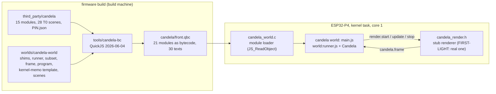

# Run Candela's unchanged JavaScript front end as a QuickJS world on the PicoCalc

## 1. Goal and result

A Candela scene program is a JavaScript module written against Candela's own API. Running it means three steps: execute the module and its build-stage code, compile the resulting component tree into a WGSL program, and pack the scene into five float buffers. This ticket puts all three on the PicoCalc's ESP32-P4, in a QuickJS world, with Candela's sources unchanged, and hands the result to the firmware renderer through host functions. Animation time and parameters keep running in the world after the build.

The acceptance measurements are on the device (Section 9): module load time from bytecode, B-01's build, compile and pack times, peak heap and C stack, every T0 preset built within the world's limits with WGSL and packed-data digests equal to Node's, and a dynamic parameter change re-packed within one 50 ms turn.

## 2. What the world is made of



| Part | File | Role |
|---|---|---|
| Vendored front end | `picocalc-os/third_party/candela/src/*.js`, `PIN.json` | `src/candela.js` and its 14 imports, byte for byte from `candela-workspace(1).zip` (SHA-256 `873b2dd4...df5d`); `kernel.js` and `compile.js` equal CPU-KERNEL's pin |
| Vendored scenes | `third_party/candela/presets/*.js` | the 28 T0 preset scene files |
| Bundle list | `worlds/candela-world/bundle.list` | what goes into the bundle, under which module names |
| Bytecode compiler | `tools/candela-bc.c` | runs on the build machine; writes `front.qbc` |
| Host side | `nucleus/candela_world.c`, `.h` | the loader and the `__candela` host object |
| Renderer seam | `nucleus/candela_render.h`, `candela_render_stub.c` | the interface FIRST-LIGHT implements; a stub today |
| World script | `worlds/candela-world/main.js` | the app, its messages and screen |
| World modules | `shims.js`, `runner.js`, `subset.js`, `frame.js`, `program.js`, `kernel-memo.js` | Section 4 |
| Manifest entry | `worlds/candela-world/manifest.json` | Section 6 |

## 3. The bundle: bytecode compiled when the firmware is built

### Why bytecode

Compiling Candela's 329 KB of source takes 15 ms in host QuickJS, about 0.5-1 s on the device by the study's ratios. QuickJS's `JS_WriteObject` serialises a compiled module; `JS_ReadObject` restores it in another runtime without parsing. The prelude cache in `nucleus/vm.c` already does this for one script, but it compiles on the device at boot. Candela's modules are compiled once on the build machine instead.

QuickJS bytecode depends on the QuickJS version and the byte order. It does not depend on the word size: atoms are written as strings, constants as 64-bit doubles, and the reader converts the atom indices. `tools/candela-bc` links the same `third_party/quickjs` as the firmware (version 2026-06-04 and its three patches) and runs on the x86-64 build machine; both machines are little-endian. The bundle starts with the QuickJS version string, which `candela_world.c` checks, and `JS_ReadObject` checks QuickJS's own `BC_VERSION`.

### How it is built

`candela-bc OUT --list worlds/candela-world/bundle.list picocalc-os/` reads the list and:

1. evaluates `third_party/candela/src/kernel.js` (it imports nothing) and calls `ggxAlbedoTable()` and `ggxTableWGSL()` once (2.5 s on the build machine);
2. queues every module source, and the memo template with the two results substituted for its tokens;
3. compiles each queued module with `JS_Eval(..., JS_EVAL_TYPE_MODULE | JS_EVAL_FLAG_COMPILE_ONLY)` through a module loader with the device's names. QuickJS resolves a module's imports while it compiles it (`js_resolve_module` in `__JS_EvalInternal`), so compiling `candela:candela.js` compiles its imports, each once;
4. writes each module with `JS_WriteObject(..., JS_WRITE_OBJ_BYTECODE)`, function source text stripped (`JS_SetStripInfo(rt, JS_STRIP_SOURCE)`), line tables kept;
5. adds the texts: `pin` (PIN.json), `preset:<file>` (the T0 scenes), `scene:<file>` (the world's scenes).

The output format "CQB1" is a magic, the 16-byte version string, an entry count, and per entry a kind (1 module, 2 text), a name and the bytes. 21 modules and 30 texts, 500,684 bytes of data, 470,244 of them bytecode.

### Module names, and why they contain no slash

Candela's modules are named `candela:<file>` and the world's `world:<file>`. A relative import (`./diag.js`) resolves within its importer's namespace. Candela's diagnostics find the user's line with `diag.js`'s FRAME regex, which strips a frame's directory and compares the base name with the user's files. With a name such as `candela/src/scene.js`, Candela's own `scene.js` frame would match the user's `scene.js` first, which is what happens in Node (Section 5). A name with a colon and no slash does not match the regex at all, so Candela's frames are skipped.

## 4. The world's modules

### Shims (`world:shims.js`, evaluated first)

`world:runner.js` imports `world:shims.js` before any Candela module, and ES module evaluation is post-order in import order, so the shims are installed before `candela.js` runs its boot-time probe of `new Function`.

| Shim | Why |
|---|---|
| `atob` | K-09 decodes base64 mesh data; WHATWG forgiving-base64, decoding to a binary string in 8,192-byte chunks |
| `performance.now()` | `build()` times itself; the host's real clock in milliseconds |
| `console` | `params.js` reports listener errors with `console.error`; mapped to the world's `log` |
| `Function` | Section 5 |
| `__candela` | taken off the global object and exported as `host`, so scene code cannot reach the renderer |

### The memoised GGX table (`world:kernel-memo.js`)

`ggxTableWGSL()` recomputes a constant 256-entry table by Monte Carlo on every compile: 26.7 million QuickJS steps, minutes on the device. The memo module is

```js
export * from 'candela:kernel.js';
import { ggxAlbedoTable as computeAlbedoTable } from 'candela:kernel.js';
const TABLE = /* 256 numbers, written by candela-bc */;
const WGSL = /* the WGSL text, written by candela-bc */;
export function ggxAlbedoTable(N = 16, S = 512) { return N === 16 && S === 512 ? TABLE.slice() : computeAlbedoTable(N, S); }
export function ggxTableWGSL() { return WGSL; }
```

A local export takes precedence over `export *`, so these two names replace kernel.js's and every other name passes through. The module loader resolves every import of `candela:kernel.js`, except the memo module's own, to `world:kernel-memo.js`. No Candela file is changed. The WGSL digests of Section 9 show the memoised program equals Node's, where Candela computes the table itself.

### The scene runner (`world:runner.js`)

`buildScene(id, files, o)` is the world's version of Candela's workbench `Host.build()` plus `Viewport.load()`:

1. `host.longSegment()` (Section 6), `paramStore.reset()` unless a static parameter is being rebuilt;
2. Candela's `build(files)`: runs the scene files and compiles the scene;
3. the subset check; a scene above T0 is refused with E790 diagnostics;
4. the first `pack({ time: 0 })`, then digests of the WGSL and the six arrays, computed in C;
5. with `measure`: three `pack({ time: 2.5 })` (median) and one separate `compile()` of the built scene;
6. the frame uniforms at 160 x 160 (`world:frame.js`) and the split of the program (`world:program.js`);
7. `host.render.start(program, buffers, options)`.

`setParam(id, value)` moves a slider as Candela's `Host.onParam` does: a dynamic parameter re-packs (`repack(time)`: `pack`, frame uniforms, `render.update`), a static one rebuilds with the slider values kept. `repack(time)` also serves animation time (`compiled.animation(t)` poses). No T0 preset has an animation or behaviours; the path is the same as for a parameter.

### Frame uniforms (`world:frame.js`)

`pack()` leaves U's rows 0-5, 20, 21 and words 80-87 and 96 to Candela's viewport, which fills them before each dispatch: the frame size and sample counter, the camera (`compile.js` `cameraUniforms`), the integrator's depth and Russian-roulette settings, the spectral white balance and the seed. `frameUniforms()` writes them exactly as `Viewport.frame()` does for a fixed size, with the pass counter at 0. In Node, its U equals the U that Candela's own `Viewport.frame()` hands a recording backend for 94 of 94 presets checked (`scripts/02-node-reference.mjs --archive`). `postOptions()` collects what the display pass needs (tone map, denoise, exposure mode and EV).

### The program split (`world:program.js`)

CPU-KERNEL's `splitProgram()` at the same pin: it checks every boundary of `head + PRELUDE + SPECTRAL + ggxTableWGSL() + sdfCode + hfCode + densCode + CORE + metalAt + matCode + PATH` and returns the field section (`sdfCode + hfCode + densCode`) and the material section (`matCode` without `hitAlbedo` and `hitEmission`). `fixedText()` is the fixed WGSL in program order; its SHA-256 (`8925739795c7...`, 62,419 bytes) identifies the kernel a program was compiled against.

## 5. File-named scene compilation

Candela runs every scene file through `new Function('__req', ..., '"use strict";\nreturn (async () => {\n' + body + '\n})();\n//# sourceURL=' + path)`. QuickJS ignores `//# sourceURL=` and names the function `<input>`, so `callSite()` could never find a user frame. The world's `Function` (in `world:shims.js`) passes ordinary calls to QuickJS's constructor; for a body that ends in `//# sourceURL=NAME`, it builds the same source QuickJS's constructor would and compiles it with `__candela.evalScript(source, NAME)` (`JS_Eval` with that file name). Its `prototype` is the original `Function.prototype`, so `instanceof Function` still holds.

The layout fixes a second problem, one Candela has in V8 too. `candela.js` measures the lines `new Function` puts before a body with a probe (2 in V8 and QuickJS), but `runFiles` adds two more lines (`"use strict";`, `return (async () => {`) that the measurement does not cover. In Node a throw on line 4 of `scene.js` is reported at line 6. The world's `Function` lays out ordinary bodies with the two standard header lines, so the probe still measures 2, and joins `runFiles`' two prefix lines onto the header's second line, so line L of a scene file is source line L + 2 and Candela reports line L.

| Probe (`scripts/06-diag-probes.json`) | World | Node, unbundled |
|---|---|---|
| `throw` on line 4 | E000 at scene.js:4 | E000 at scene.js:6 |
| misspelt method on line 4 | E104 at scene.js:4 | E104 at scene.js:56 (Candela's own scene.js) |
| a torus on line 5 | E790 at scene.js:5 | E790 at scene.js:114 (same subset.js; the shape's location is Candela's frame) |
| a surface field on line 5 | E790 at scene.js:5 | E790 at scene.js:114 |
| a syntax error on line 2 | E001 at scene.js:1 | E001 at scene.js:1 |

Syntax errors stay at line 1 in both engines: `syntaxLoc()` locates them by trial parsing and matches V8's error wording.

## 6. Turns, the long segment, memory and stack

A world's turn has a budget (`budget_ms`, 50 ms by default); a world that runs past it is torn down. The boot segment has 600 ms. A Candela build cannot be split across turns: `build()` is `async`, but it only awaits promises that are already settled, so the whole build runs in the job queue of one segment. Estimates for T0 builds on the device run to about 0.8 s, more with the measurement extras.

Two patterns were considered.

- **A worker.** Run long builds on another FreeRTOS task, so the lane stays free. A QuickJS runtime can move between threads (`JS_UpdateStackTop`), but the world's runtime would then run JavaScript that makes host calls into the kernel (`K`) from a task that does not own it, and the kernel would have to keep the world's messages, settles, timers and teardown away from it meanwhile. That is a kernel change of its own.
- **A long segment.** The boot pattern, on request: a world whose manifest declares `long_ms` may ask that the segment it is running in be bounded by `long_ms` instead of `budget_ms`, counted from the segment's start. Ordinary turns keep the 50 ms budget, so a parameter re-pack that took longer would still be stopped. While a long segment runs it holds the lane, as a boot segment or a Typed boot compile does.

The world uses the long segment (`vm_long_segment()` in `vm.c`, `__candela.longSegment()`), for module loading and for builds. An overrun is reported as "ran past its long segment budget of 4000 ms". The worker is the follow-up for builds longer than a fraction of a second, which T0 does not have except M-12 (Section 9).

### The manifest entry

```json
{ "name": "candela", "file": "candela/world.js", "claims": ["candela", "fs:/candela"],
  "budget_ms": 50, "long_ms": 4000, "mem_kb": 4096, "stack_kb": 56 }
```

| Field | Value | Why |
|---|---|---|
| `claims` | `candela`, `fs:/candela` | `candela` installs the loader and host object (`vm_create`); `fs:/candela` lets the world build scene files from storage |
| `budget_ms` | 50 | ordinary turns: parameters, time, status, frame events |
| `long_ms` | 4000 | the longest build segment; T0 builds take up to about 1 s on the device (Section 9) |
| `mem_kb` | 4096 | Candela loaded is about 1.35 MB (64-bit host) and builds peak 0.3 MB above that; the study found 1 MB too small and 2 MB enough |
| `stack_kb` | 56 | the QuickJS C stack limit; at most the port's `port_js_stack()`, which is 56 KB of the kernel task's 80 KB on the P4 |

`long_ms` and `stack_kb` are new manifest fields (`manifest_world_t`, `world_t`, `vm_read_manifest`, `add_world`). `stack_kb` can only lower a world's limit below the port's; raising it would need a larger kernel task stack, which T0 does not need (Section 9).

## 7. The host object

`__candela`, installed by `candela_world_install()` after the prelude in `vm_create` for a world with the `candela` claim:

| Function | Returns / does |
|---|---|
| `now()` | the real clock, ms (`port_clock()`) |
| `segmentMs()` | time since the current segment started, ms (virtual on the host) |
| `steps()` | QuickJS interrupt-counter steps since the runtime was made |
| `mem()`, `resetPeak()` | `{ used, peak, limit }` as the world is charged (`world_t.mem_used`, the new `mem_peak`) |
| `gc()` | `JS_RunGC` |
| `longSegment()` | Section 6 |
| `loaderStats()` | modules read, bytecode bytes, time in `JS_ReadObject` |
| `stackPaint()`, `stackUsed()` | C stack high-water mark: paint the free stack below the call with 0xA5, later the lowest changed byte, as bytes below the runtime's stack top |
| `sha256(stringOrTypedArray)` | hex digest (UTF-8 for strings), in C |
| `utf8Length(s)` | UTF-8 bytes of a string |
| `text(name)`, `list(prefix)` | the bundle's texts |
| `evalScript(source, file)` | `JS_Eval` with that file name (Section 5) |
| `report(value)` | prints `CW <json>` on the console when the segment ends (a deferred effect) |
| `render.start(program, buffers, options)` | Section 8 |
| `render.update(buffers, options)` | Section 8 |
| `render.stop()`, `render.status()` | Section 8 |

## 8. The renderer seam (`nucleus/candela_render.h`)

The world calls three functions; the renderer calls one back.

```js
host.render.start(program, buffers, options) -> { gen, bytes }
  program = { sceneId, fixedKernel /* SHA-256 of fixedText() */, spectral, integrator,
              fieldCode, matCode /* the generated WGSL sections */, sections /* SECTIONS bytecode or null */, wgsl }
  buffers = { U, O, LI, BV, SDs, SDd /* Float32Array, whole vec4 rows; U has the frame uniforms */, dynBase }
  options = { width, height, post: { tonemap, denoise, exposure, ev, physicalEV, ... } }
host.render.update(buffers, { reset: true }) -> { gen, bytes }   // after every pack: parameters, time
host.render.stop()
// the renderer, after each pass:   message "candela.frame" { gen, pass, spp, us } to the world
```

In C the world's side copies the arrays into one block (`cr_scene_t`: generation, frame size, `dyn_base`, rows and offsets of the six arrays, the floats) and the program into another (`cr_program_t`: scene id, fixed-kernel digest, spectral flag, integrator, post settings, the two section texts, the SECTIONS bytecode). Both are handed over as deferred effects when the segment ends, so a segment that crashes starts nothing. The port implements

```c
int  port_candela_start(int world, cr_program_t *program, cr_scene_t *scene, char *why, size_t n);
int  port_candela_update(int world, cr_scene_t *scene, char *why, size_t n);
void port_candela_stop(int world);
char *port_candela_status_json(void);
void candela_world_frame(int world, uint32_t gen, uint32_t pass, uint32_t spp, vtime_t pass_us);  // nucleus, for the renderer
```

The stub (`candela_render_stub.c`) checks the scene (magic, uniforms and objects present, U[0..1] equal the frame size), refuses a spectral program, a non-path integrator or a missing fixed-kernel digest, keeps one program and one scene, and reports four passes 500 ms apart per generation without drawing. An update restarts the count, as a reset of accumulation would. `render.status()` returns its counters.

### What PICOCALC-CANDELA-FIRST-LIGHT must wire up

1. Replace `candela_render_stub.c` with a renderer behind the same five functions; keep them on the kernel task and run passes on a worker task (core 1, low priority, as the painter service does), posting `candela_world_frame` through `p4_kq` back to the kernel task.
2. Bind: `SD` = `SDs` at row 0 and `SDd` at row `dyn_base` (as `render.js` `uploadSD` does), then CPU-KERNEL's `cdl_buffers { U, O, LI, BV, SD }` and `NS_bind(&b, sections, sky)`.
3. Refuse a program whose `fixed_kernel_sha256` differs from the kernel the firmware was generated from: CPU-KERNEL's generator should emit the SHA-256 of the same `fixedText()` (`program.js`), `8925739795c775a2910c0096eb59dac235bd35719b5255539019b41cde12942d` at the pin.
4. Own U[2] (the pass counter: 0 for the first sample of an accumulation, then spp + 1, as `Viewport.frame()` writes it) and the per-frame seed; everything else in U arrives filled.
5. Sections: until SECTIONS' translator runs in the world, `program.sections` is null and the field and material sections arrive as WGSL text (`field_wgsl`, `mat_wgsl`). When the translator lands, the world fills `program.sections` with its bytecode (the C side already copies a typed array there) and the kernel's dispatch table is bound to the interpreter.
6. Exposure metering for `post.exposure == "auto"` (Candela's viewport meters by reading back pixels), tone mapping and the display at 160 x 160 upscaled to 320 x 320.
7. A screen: today the world's screen is a status panel; FIRST-LIGHT decides how the image reaches the compositor (a native slot or a framebuffer handle).

## 9. Device measurements

See Section 10 of the diary and `various/` for the raw records. [Filled in after the device run.]

## 10. Firmware changes and how to build the measurement image

| Change | File | Default firmware affected? |
|---|---|---|
| `long_ms`, `stack_kb` manifest fields; `world_t.long_budget_us`, `js_stack`, `mem_peak`, `seg_long` | `nucleus/nucleus.h`, `kernel.c`, `vm.c` | no behaviour change: absent fields keep today's limits; `mem_peak` is one comparison per allocation |
| `vm_long_segment()` | `nucleus/vm.c` | unused unless a world has `long_ms` |
| the overrun message names a long segment | `nucleus/kernel.c` | only for long segments |
| Candela loader and host object hooks in `vm_create`/`vm_dispose` | `nucleus/vm.c` | compiled only with `PICOCALC_CANDELA_WORLD` |
| `candela_world.c`, `candela_render.h`, `candela_render_stub.c` | `nucleus/` | compiled only with the flag |
| `PICOCALC_CANDELA_WORLD` option, bundle and manifest entry | `port/esp32p4/CMakeLists.txt`, `main/CMakeLists.txt` | OFF by default |
| `send WORLD TYPE [JSON]` console command | `port/esp32p4/main/main_p4.c` | only with the flag |
| `build-smooth-chess.sh BUILD [-D ...]` | `port/esp32p4/build-smooth-chess.sh` | without extra arguments it builds the same image |
| `make CANDELA=1 candela` host build | `picocalc-os/Makefile`, `tools/candela-stage.py` | separate build directory |

Measurement image:

```bash
source ~/esp/esp-idf-5.4.2/export.sh
picocalc-os/port/esp32p4/build-smooth-chess.sh BUILD -D PICOCALC_CANDELA_WORLD=ON
```

Host simulator:

```bash
cd picocalc-os && make CANDELA=1 candela
./build-candela/picocalc-host -j build-candela/candela-js SCRIPT    # scripts/03-host-smoke.txt, 05-host-suite.txt
```

## 11. Risks and open questions

- Builds hold the lane for up to `long_ms`. A worker that runs a world's JavaScript off the kernel task would free it; it needs kernel support (Section 6).
- D-02 calls `Math.random()` while building; the prelude seeds `Math.random` per world, so D-02's packed objects and BVH differ from Node's (WGSL equal). Candela warns about it (W501).
- M-12 runs a Monte Carlo furnace test in its scene file (100 million steps); it cannot finish in a long segment of 4 s and is not a device scene.
- The C stack figure includes up to one interrupt context frame below the deepest JavaScript frame (the RISC-V port saves context on the task stack).
