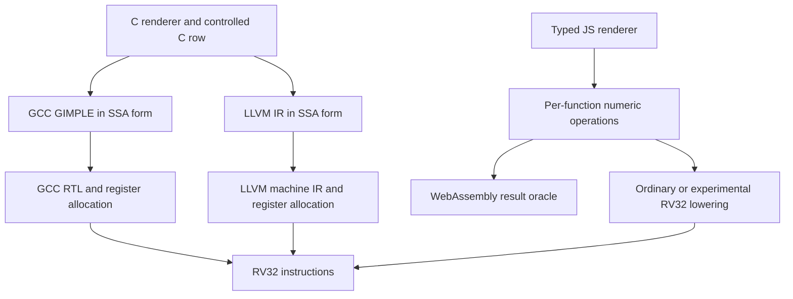
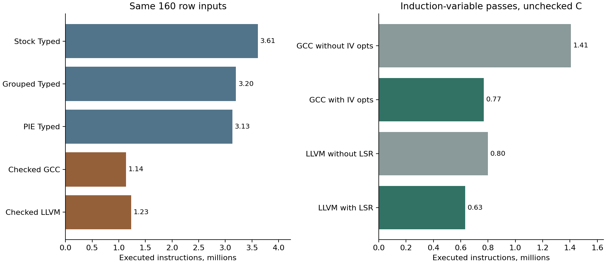
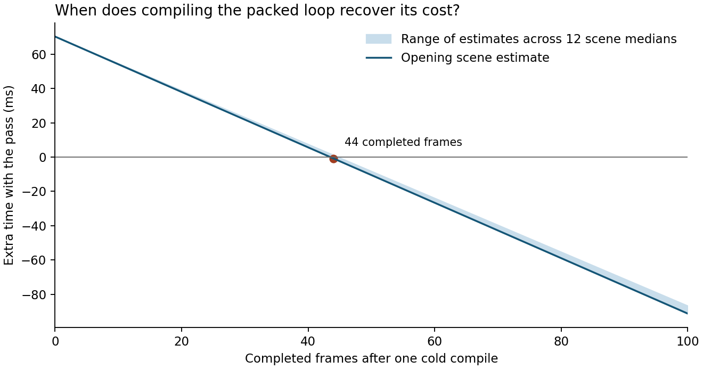

# How a compiler makes a ray-tracing loop fast

A 160 × 160 picture contains only 25,600 pixels. On the PicoCalc, a ray tracer written in Typed JS took about 58 milliseconds to compute that picture. A C renderer on the same processor produced the same pixels in about 9.5 milliseconds. Both programs ran as native machine code. To understand the difference we will follow one pixel through the renderer, one loop through two production compilers, and several versions of that same calculation through the PicoCalc compiler.

Three results set the scope. First, the Typed backend already has a specialized row implementation that reduced primary intersection time from 17.811 to 6.690 milliseconds. Second, a newer, more general compiler pass discovers an eight-lane subtraction in the ordinary source but reaches only 16.185 milliseconds for primary intersections. Third, a scalar C translation of the *checked Typed loop* executes roughly a third of stock Typed's instructions. The central question is how to obtain a good scalar loop from an ordinary program, with enough information left to select packed instructions where they pay.

## One pixel, one row, one frame

The camera looks straight along the depth axis. Each pixel has fixed horizontal and vertical coordinates, `x` and `y`. The ray through that pixel visits increasing depths. A sphere has center `(cx, cy, cz)` and radius `r`. On the sphere's surface, the squared distances along the three axes add to the squared radius. Rearranging that equation gives the calculation used by this program.

```text
row = r² - (y - cy)²
d   = row - (x - cx)²
if d >= 0:
    depth = cz - floor(sqrt(d))
```

For example, take `r = 5`, `y = cy` and `cz = 56`. The row term is 25. At horizontal distances 3, 5 and 6, the three discriminants are 16, 0 and −11. The first pixel hits at depth 52. The second just touches the sphere at depth 56. The third misses. Other spheres may project onto the same pixel. The renderer retains the nearest hit, and its strict depth comparison gives the earlier sphere precedence on a tie.

This visibility calculation is called the **primary pass**. The **shade pass** chooses a color. A sphere hit requires lighting; a floor pixel can require a shadow test. The final pixel is an RGB565 word, with five bits of red, six of green and five of blue. A **clean frame** computes all the colors in memory. The audit entry additionally writes depths and object identities for verification. A separate benchmark can request just the primary or shade work. Those calls prepare their own inputs. Their measured times cannot be added to recover the clean-frame time. None of these clocks includes sending pixels to the physical display.

## The languages and the processor

Typed JS is a restricted JavaScript-like language implemented in this project. An integer local can have the concrete type `i32`. A `buffer` carries its capacity followed by 16-bit elements. A read must check the index and then zero-extend the selected element to an integer. An invalid access traps. Earlier writes are observable. This is enough to write the complete ray tracer, including shadow tests, lighting and pixel packing.

The compiler runs on the ESP32-P4 itself. Its frontend checks declarations and emits operations for each function. One target encodes WebAssembly, which supplies an independent host execution of the Typed program. The native target translates a numeric operation sequence to 32-bit RISC-V instructions. In the ordinary backend, a local with a permanent home in the function's stack frame may be loaded again on each loop iteration. A native instruction that loads a local from the stack still consumes an instruction and performs a memory access.

GCC and LLVM compile the C experiments to RISC-V as well. Their intermediate representations, or **IRs**, are programs in formats intended for analysis and rewriting. A compiler **pass** performs one such analysis or transformation. Eventually an instruction selector chooses target instructions and a register allocator assigns values to a finite set of hardware registers. The P4 also supports Espressif's PIE extension. Its 128-bit registers can hold eight 16-bit values. A single packed subtract can operate on all eight lanes. Whether a program can use that instruction depends on arithmetic semantics, memory layout, alignment and what the rest of the computation needs.



## What the C programmer decided

Before assigning a speedup to a compiler, inspect its input. The firmware C program prepares one horizontal squared-distance table for each sphere. It also prepares an integer square-root table up to the maximum squared radius. These choices move repeated multiplications and square roots out of pixel processing. The Typed implementation likewise builds tables. Their cost profiles diverge in how the tables are laid out and traversed.

C's `trace` structure gives each field a fixed representation. Horizontal distances and discriminants are signed halfwords. The square-root table and object IDs use single bytes. Depths are halfwords. The C function first clears the depth row; zero depth marks an unoccupied pixel. It then executes two loops per sphere. The first fills 160 discriminants. The second rejects negative ones, looks up roots and updates the closest depths and IDs. Its mode switch can replace the first loop with a call to hand-written PIE assembly. That call is visible in the relocations of the real firmware object.

The ordinary Typed function clears **both** output rows in its shared buffer. It then computes one discriminant and immediately consumes it. Its tables are regions at element offsets, including 520 for square roots, 1545 for depths and 1705 for IDs. This fused traversal avoids a separate discriminant array, while each element operation carries the language's bounds contract. C can use a byte load for the root because the source declares a byte array. The Typed source asks for a checked 16-bit element. Compiling these two source files and comparing them indiscriminately would assign differences in storage width, initialization and loop structure to the compiler.

C makes independent decisions after visibility. It prepares the light direction and per-sphere bounds used to reject impossible shadow intersections. Only candidates reaching the exact test compute the projection and squared distance. It shades surfaces and floor pixels on separate paths. It writes directly to a row selected using the supplied stride. Optional counters and pixel hashes are conditional on a statistics object. GCC's loop-invariant-motion dump actually shows the `x * 32` and `y * 32` calculations moving out of the sphere loop in the shadow test. This is a compiler transformation of that algorithm. The decision to use geometric rejection was already in the source.

## Two kinds of evidence

For the firmware control I recovered the ESP-IDF compile command. It used Espressif GCC 14.2.0 at `-O2`, the `ilp32f` calling convention and an ISA string that included the vendor PIE extension. The machine-code section for the recompiled `trace_row` had the same SHA-256 digest as the original SDK object. For the LLVM comparison I passed the same preprocessed C translation unit to Clang/LLVM 18.1.3, retained the 32-bit calling convention and used the common RV32IMAFC target. The external call to the vendor routine remained visible. This gives us the LLVM scalar lowering; it does not establish LLVM performance on a flashed P4.

For the controlled experiment I wrote a second C function mirroring the Typed row. It uses the same header, element width, table offsets, traversal order, signed subtraction and conditional writes. A checked build traps when an index exceeds the capacity. A second build assumes every access is valid. Both toolchains used signed wraparound and disabled strict-aliasing optimizations for these controls. The unchecked result is a measurement of a different contract. It cannot be substituted into a checked application without establishing its preconditions.

I used the real Wasm program to prepare the opening scene and compute every expected row. Ten C configurations and three Typed configurations each received the same 160 row inputs. All **2,080** calls agreed on the return value and every byte of the 4,100-byte test buffer. The C objects ran under QEMU with one instruction per translation block. The PC counter included only the linked row function. The Typed images ran in the project's RV32 interpreter with PIE support. Both totals count guest instructions. Neither converts host elapsed time to P4 cycles. The fixtures establish a matched comparison for valid opening-scene inputs; they do not establish identical behavior of arbitrary malformed C objects.

## Pass 1. Give each value a name

Consider `x = x + 1`. The source uses the name `x` for the value before and after the assignment. A compiler analyzing definitions benefits from distinct names. In **static single assignment** (SSA) form each computed value has one definition. At a point reached by multiple paths, a **phi** selects a value according to the incoming control-flow edge. For the pixel loop the structure is:

```text
loop:
    x = phi(0 from entry, next_x from previous iteration)
    ... use x ...
    next_x = x + 1
    if next_x < 160: go to loop
```

LLVM's early snapshot of the checked row contains 16 `alloca` instructions in the row and no phis. An `alloca` reserves addressable storage for a source local at this stage of compilation. After the first scalar replacement pass, SROA, there are zero such allocations and three phis in the function. LLVM can now reason about those locals as values connected by definitions and uses. This count says nothing yet about the number of registers the finished program will need. In the *firmware* row one allocation survives the same pass: the row term has its address passed to the external PIE function. The two source programs expose a concrete reason that one local still needs an address.

GCC shows the same fundamental representation in GIMPLE. Its loop phis carry an incoming initial value and the value computed on the preceding iteration. Optimized output shows phis for address and index sequences as well as source variables. The spelling `ivtmp` in the dump denotes a temporary chosen for loop induction. SSA made the relationships explicit. The subsequent induction pass chose the recurrences. [GCC's guide to tree SSA passes](https://gcc.gnu.org/onlinedocs/gccint/Tree-SSA-passes.html) · [LLVM pass reference](https://llvm.org/docs/Passes.html)

## Pass 2. Expose the checks and find reusable values

The checked C control uses a small inline helper. It first loads the capacity, compares it to the requested unsigned index, traps on failure and returns the element address on success. Before LLVM's general inliner, the row contains eleven static calls to this helper. Immediately after inlining there are zero helper calls and eleven trap call sites. The compiler has exposed eleven pieces of control flow. It has not thereby removed eleven bounds checks.

The next early common-subexpression elimination pass reduces the number of direct header-load sites in the row from eleven to six. A prior capacity value can be used again where no intervening operation invalidates it. The optimized checked hot loop still contains a header load and unsigned branches. The compile cannot simply move every check to function entry: a later failed access must allow earlier writes to happen, and unchecked assumptions about intervening memory effects can change the answer. These counts describe instructions *present in the IR*, not their execution frequency.

In the actual checked LLVM assembly a candidate input loads the length, checks its input index, reads a halfword and branches on a negative difference. A successful hit then checks the root and depth indexes. Some of these branches reuse the same length register. This is already materially cheaper than reloading every named local from its stack slot for every operation, even though checked accesses still exist.

## Pass 3. Choose what changes on each iteration

A halfword occupies two bytes. Once the address of the first horizontal sample is known, the address of the next is just two bytes higher. A naïve backend can recompute `base + 2*(horizontal + x)` every time it sees the expression. An optimizing backend can initialize a pointer before the loop and increment it by two after each iteration. This transformation is **strength reduction**. The pointer and pixel index are both **induction variables**: each advances by a fixed amount.

GCC's IV optimization dump records candidate recurrences, their costs and its selection. For the firmware's discriminant producer it chooses one step-two induction variable beginning at the current sphere's horizontal table. In the checked fused kernel its inner loop selects two: a step-two address and a step-one index, initially 1705, from which it can express index comparisons. Maintaining both has a cost. One is convenient for addresses; the other is convenient for bounds checks and loop termination.

The real firmware's ordinary producer has this six-instruction loop. The register names and instructions come from the recompiled section verified against the firmware. The label has been shortened for readability.

```asm
loop:
    lhu     a5,0(a0)       # load this horizontal sample
    add     a4,a0,s8       # derive the destination address
    c.addi  a0,2           # advance the input pointer
    sub     a5,a3,a5       # subtract from the row term
    sh      a5,960(a4)     # save the low halfword
    bne     a0,s7,loop     # continue until the end address
```

Here `c.addi` is a compressed encoding of a scalar add-immediate. The six instructions fill one discriminant. A separate loop still performs the hit test and nearest-depth update. The low-halfword store also explains why a zero-extended load suffices for this subtraction: the stored low sixteen bits agree under either sign extension for a 16-bit input. The controlled Typed-shaped kernel requires an exact signed discriminant until the branch, so this reasoning does not transfer wholesale.

LLVM's machine-side loop strength reduction likewise creates pointer recurrences. Its machine IR after instruction selection shows three phis at the checked inner-loop header. Their updates add one, two and two. In the final assembler these become increments in scalar registers. To measure the pass itself I disabled GCC's IV optimization and LLVM's loop strength reduction separately, holding each compiler's other flags and each input fixed.

| Controlled C row | Pass disabled | Pass enabled | Fewer instructions with pass |
|---|---:|---:|---:|
| Checked, GCC IV optimization | 1,308,071 | 1,136,142 | 13.14% |
| Checked, LLVM loop strength reduction | 1,275,560 | 1,233,611 | 3.29% |
| Unchecked, GCC IV optimization | 1,407,598 | 768,238 | 45.42% |
| Unchecked, LLVM loop strength reduction | 798,350 | 632,124 | 20.82% |

These are totals for all 160 calls. The LLVM pairs both start from the same optimized module and use `llc` with or without its LSR pass. The GCC pairs use `-fno-ivopts` for the disabled arm. Disabling a pass also changes later register pressure and instruction selection. The difference measures its contribution within this compilation pipeline. It does not isolate a universal price for an addition or a multiplication. In particular, removing a bounds contract changes which recurrences are useful.

## Pass 4. Keep hot values in registers

At instruction selection, LLVM's machine IR names virtual registers. The backend then assigns physical registers, inserts saves for values that must survive across calls, and spills to memory if necessary. A store to the stack can be an ABI-mandated register save at function entry, a spilled temporary, a local with a permanent memory home, or explicit scratch storage. One can distinguish these by looking at the PC and its position in the loop. GCC's RTL allocator dump records pseudo-register assignments. The final disassembly shows which assignments actually became stack operations.

| Same 160 row inputs | Guest instructions | Direct stack loads | Direct stack stores |
|---|---:|---:|---:|
| Ordinary Typed | 3,608,697 | 936,328 | 353,778 |
| Typed, grouped scalar producer | 3,199,910 | 729,553 | 309,611 |
| Typed, inferred PIE producer | 3,131,435 | 729,553 | 309,776 |
| Checked C row, GCC | 1,136,142 | 1,120 | 1,120 |
| Checked C row, LLVM | 1,233,611 | 320 | 320 |
| Unchecked C row, GCC | 768,238 | 160 | 160 |
| Unchecked C row, LLVM | 632,124 | 640 | 640 |

A direct stack operation here is a scalar load or store whose base register is the stack pointer. The counter excludes array accesses through other pointers, including accesses through a pointer derived from the stack. GCC's checked row saves and restores seven registers per call. LLVM's saves and restores two. Their ordinary hot paths carry induction values, addresses and working operands in registers. The stock Typed row executes more than 1.29 million direct stack accesses; the inferred PIE row still executes over a million. In the matched scalar and PIE versions, the substantial scalar hit continuation is still emitted by the ordinary backend.



The near absence of direct stack traffic in **checked** C is the most consequential comparison. It shows how much a scalar backend can do while keeping bounds checks. It also cautions against using the smallest stack count as a performance score: LLVM checked uses fewer stack saves than GCC checked but executes more instructions overall. As a separate device control, the earlier Typed factor experiment kept the iteration domain fixed. Moving selected loop locals to registers saved a paired 3.121 ms in primary time with the checks retained. Hoisting checks while keeping stack locals saved 1.311 ms. Applying both saved 3.766 ms. The effects overlap in elapsed time.

## Pass 5. Decide where packed instructions help

GCC's firmware vectorizer reports three distinct obstacles. The outer sphere loop contains consecutive inner loops. The nearest-depth consumer has unsupported control flow. For the simple producer GCC considered a vector mode and rejected it on cost; the dump identifies mode SI and records zero vectorized loops for the function. That decision is specific to this compiler, target model and flags. The production PIE path calls a separate assembly routine. LLVM's ordinary RV32 target also produced scalar code and preserved the external call. Its silent remarks file did not establish a particular profitability decision. [LLVM's vectorizer documentation](https://llvm.org/docs/Vectorizers.html)

The newer Typed pass addresses a small part of the fused loop. It identifies an invariant row value, a contiguous unsigned halfword load, a subtraction, and a branch that uses the difference only on a hit. It proves the output writes safe to reorder with respect to the prefetched input, or emits entry tests for the actual intervals. The packed arm loads sixteen bytes, subtracts eight signed lanes and writes the results to scratch. Scalar code then visits the lanes in order. Alignment, tails and unsafe inputs retain scalar execution.

There is a semantic difficulty that ordinary instruction matching would miss. Typed reads an **unsigned** halfword and computes a 32-bit difference. The packed instruction uses **signed saturating** halfwords. For an admitted row between 0 and 32,766, the compiler reads back a lane as unsigned and accepts it only if it is at most the row term. Every real hit produces its exact nonnegative difference. A negative mathematical result either becomes a large unsigned lane or, for a sample whose high bit is set, produces a signed positive result greater than the row term. Positive saturation to 32,767 is still greater than the admitted row. At row 32,767 this argument would fail. The fallback covers that case. Executing the original hit continuation preserves the variable square-root lookup, comparison and conditional stores.

This design found and executed 3,135 packets in the 160 isolated opening-scene row calls. It still saves little time compared with a scalar schedule that does the same grouping. On the P4, primary time fell from 17.791 ms stock to 16.429 ms grouped scalar and 16.185 ms grouped PIE. The paired full-frame change attributable to switching the grouped producer to PIE was 0.242 ms. The isolated primary measurement and the complete-frame measurement answer different questions. A data-dependent scalar consumer can dominate even when every packed instruction is genuine.

## Which Typed result answers which question?

All figures in this table are opening-scene measurements on the P4. Earlier and later rows came from separate paired trials, each with its own stock control. Small differences between controls are ordinary measurement variation. Reductions across independent experiments should not be multiplied together.

| Treatment | What changed | Primary pass | Complete frame |
|---|---|---:|---:|
| Ordinary Typed, original physical study | Scalar source and normal backend | 17.811 ms | 57.674 ms |
| Positive literal divisor proof | Compiler can omit divide-by-zero and signed-overflow guards for a known positive divisor | 17.791 ms | 54.948 ms |
| Exact primary spans | Typed source uses sphere geometry to narrow the pixel interval | 10.510 ms | 50.410 ms |
| Specialized scalar row | Backend emits a hand-designed schedule for the recognized row | 7.037 ms | 46.918 ms |
| Earlier explicit / inferred packed row | Two ways to select the specialized eight-lane template | 6.661 / 6.690 ms | 46.535 / 46.560 ms |
| Exact spans and row-oriented shadows | Typed source changes primary and shadow traversal | 10.508 ms | 33.268 ms |
| Same traversal changes plus divisor proof | Source improvements and the compiler arithmetic proof together | 10.517 ms | **29.975 ms** |
| New inferred subregion | Ordinary fused source, compiler-generated packed producer with scalar continuation | 16.185 ms | 56.069 ms |
| Scalar C / C with hand-coded PIE | Firmware source and GCC; contemporaneous controls in the subregion trial | 4.595 / 3.467 ms | **9.535 / 8.363 ms** |

The 6.690 ms and 16.185 ms entries answer different compiler-construction questions. The former demonstrates feasibility when a backend recognizes the whole row and supplies its schedule. The latter determines what a small proof can infer from local operations even when the surrounding function or consumer changes. The earlier study also generated the same measured image through explicit and inferred template selection. That success established a useful performance target. It did not give the normal backend a general register allocator for loops.

The 29.975 ms entry shows the value of eliminating work at the source. In the opening frame, exact sphere spans reduce 76,800 sphere/pixel candidates to 6,983. The row-oriented shadow implementation reorganizes a different substantial part of the frame. Positive divisor information eliminates unnecessary trap checks but leaves the divide instruction. GCC can go further for constant division: in an isolated RGB565 comparison its `/255` sequences used high-half multiplication, shifts and signed correction. The actual firmware render object also contains high-half multiplies and a real divide. A denominator computed from runtime light and geometry needs a different justification from a compile-time 255. Individual substitutions must preserve truncation toward zero.

A scalar profile of the opening frame counted approximately 5.53 million of 15.53 million instructions in the floor-shadow function and 1.74 million in RGB565 packing. Thus even a perfect primary loop would leave considerable useful work for the compiler. Equally, we have no measurement that combines every treatment in the table. The 29.975 ms result remains the fastest complete Typed frame in these experiments.

## The decision for an on-device compiler

A desktop compiler can afford to construct many intermediate forms for one function. The handheld runs its compiler on the same processor that renders the result. In the subregion trial, full per-function decoding raised cold compile time to 657.835 ms. A cheap filter rejected functions that lacked a necessary opcode sequence before constructing their full loop records. The final PIE compiler took 523.692 ms against 454.095 ms stock. Both PIE compiler revisions emitted byte-identical programs. The matched cold experiment measured 70.324 ms of additional cost for filtered PIE, and the opening scene recovered 1.616 ms per clean frame. Dividing the former by the latter gives approximately 44 frames to recover the extra compile cost.



The curve subtracts measured per-frame savings from the measured one-time excess compile cost. The shaded range uses the twelve scene medians; the estimated crossings are 44–45 frames. This is a model for repeat rendering after one compile, not a recorded 100-frame animation. It excludes display time and assumes a stable workload.

I would make the next compiler milestone a generally recognized **checked scalar loop**. Collect def/use and liveness information for one innermost loop. Count reloads of each candidate at hot PCs. Give a small set of registers to frequently used scalar values such as the index, invariant row term and bases. Detect affine addresses of the form `base + stride*x`; evaluate whether a running pointer is cheaper than reconstructing the address. Preserve the checked access on the paths that still need it. At a branch join, establish an agreed location for every value that survives. At a call, respect the calling convention or conservatively end the optimized region. Keep the existing emitter as the baseline and fallback.

The acceptance test should distinguish three achievements. **Correctness** requires the same rows, memory, exceptions and writes before a trap. **Generated work** requires fewer executed frame loads and stores at fixed traversal, and evidence showing where each decision changed instructions. **Device benefit** requires paired primary and complete-frame timing, plus cold compile time and peak compiler memory. The previously measured 7.037 ms scalar row is an ambitious comparison point, with different specialization and iteration decisions documented separately. The checked GCC and LLVM controls give additional fixed-domain instruction targets. After scalar lowering performs well, the packed producer can be reintroduced and its incremental contribution measured again.

## How to reproduce or extend the study

The project checkout is `/home/manuel/code/wesen/2026-10-20--ds-js-os`. The new ticket is `ttmp/2026/11/21/PICOCALC-ROW-IR--trace-the-ray-row-through-gcc-and-llvm-optimization-passes`. Its scripts build from the firmware compile database, generate the fixtures, execute RV32 code, capture pass output and regenerate the figure. The analysis directory contains the commands and local evidence links.

For a first reading, open `picocalc-os/worlds/raytrace/raytrace.typed` at `typedRayComputeRow`, then open `picocalc-os/nucleus/raytrace_demo.c` at `trace_row`. Read `scripts/01-row.c` in the new ticket to see the checked control. In `various/passes/`, follow `checked-gcc-ssa.txt` to `checked-gcc-ivs.txt`, then to `checked-gcc.asm`. On the LLVM side, follow `checked-llvm-optimized.ll` through `checked-llvm-strength-reduction.txt`, `checked-finalize-isel.txt` and `checked-virtregrewriter-final.txt`. The matching JSON files distinguish static IR counts from measured dynamic instructions. The earlier tickets PICOCALC-TYPED-RAY, PICOCALC-SCALAR-BREAKDOWN and PICOCALC-PIE-LOOPS contain the physical timings and source variants.

### Laboratory commands and source artifacts

Run these commands in Bash from the checkout. Set `db` to the existing physical SDK build's compilation database. The GCC binary it references and the corresponding firmware object must be present. The scripts also require Clang, opt and llc version 18, Node, Python, QEMU RV32 user emulation and Matplotlib. The extracted module and function snapshots are for reading. The complete replayable LLVM modules are retained in the temporary work directory.

```bash
t=(ttmp/2026/11/21/PICOCALC-ROW-IR--*)
work=/tmp/p4-row-ir-replay
db=/tmp/picocalc-typed-ray-warm/build/compile_commands.json
python3 "$t/scripts/02-passes.py" "$work" "$db"
python3 "$t/scripts/05-execute.py" "$work"
prefix=$(python3 -c 'import json,sys; print(next(k[:-4] for k in json.load(open(sys.argv[1]))["versions"] if k.endswith("-gcc")))' "$work/manifest.json")
node "$t/scripts/07-typed-counts.mjs" "$work" "$prefix"
python3 "$t/scripts/06-evidence.py" "$work" "$work/evidence" "$db"
cp "$work/typed-counts.json" "$work/evidence/"
python3 "$t/scripts/08-figure.py" "$work/evidence" "$work/counts.png"
```

[Pass and toolchain metrics](../various/passes/pass-metrics.json) · [C execution counts and ablations](../various/passes/execution.json) · [Typed execution counts](../various/passes/typed-counts.json) · [Production GCC disassembly](../various/passes/firmware-gcc.asm) · [Checked LLVM optimized IR](../various/passes/checked-llvm-optimized.ll) · [LLVM after register assignment](../various/passes/checked-virtregrewriter-final.txt)

The RISC-V pipeline runs register rewriting twice. The first occurrence still has virtual GPRs. Use the second snapshot (`virtregrewriter,1`) to see the final physical assignments. The source companion traces this and the preceding optimizations through LLVM 18.1.3. [LLVM source and pass reader](02-reading-llvm-18-source-alongside-the-ray-row-pass-dumps.md)
