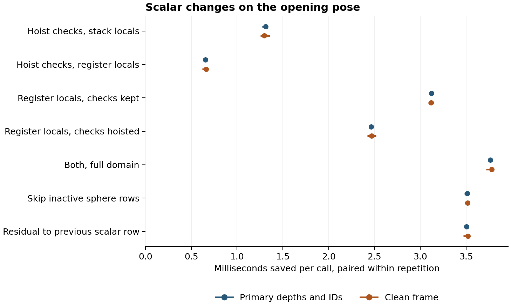

# Separating the costs of a scalar ray on the ESP32-P4

On the default ray-tracing scene, the ESP32-P4 took 57.691 ms to render an ordinary Typed frame. Moving selected locals into registers and checking buffer bounds at entry reduced the time to 53.942 ms. Skipping sphere rows with no possible intersections reduced it to 50.436 ms. The distinction between these two changes matters to a compiler author. The first makes the same iterations cheaper. The second proves that entire iterations have no effect on the image. This study uses a separate control to measure each effect and a different function to test a prediction from the instruction profile.

## What a row computes

The frame consists of 160 rows of 160 pixels. Each sphere has a center, a radius and a material. The primary ray computation identifies the object visible at a pixel and the depth of its first intersection. Later stages use those results to evaluate light and shadow and write a packed RGB565 color. Producing the right color on one scene is a weak test of primary geometry. Two different winning depths or even different objects can produce the same color. Our tests compare pixel, depth and identity planes with a C reference over twelve poses, including padded output strides. Each fast path has a checked fallback, and separate tests exercise partially written buffers on a failure.

The ordinary compiler keeps several local variables in the current function's stack frame. Reading one can emit a load even inside a loop. A Typed buffer access also checks the requested index against the buffer's capacity. The common experiment starts from the same function with an entry guard and a fast and fallback copy. In the default scene the guard admits the fast copy for all 160 row calls. Across the four central comparisons, three spheres and 160 horizontal positions yield 76,800 sphere/pixel tests. Keeping this count fixed makes a comparison of code generation possible. [Compiler experiment](02-what-a-bounds-check-costs-in-a-ray-tracing-loop.md)

## Read the device and instruction experiments together

| Default scene | Primary instructions | P4 primary, ms | P4 clean frame, ms |
|---|---:|---:|---:|
| Ordinary Typed | 3,608,697 | 17.807 | 57.691 |
| Common guard, repeated checks, stack locals | 3,615,257 | 17.818 | 57.722 |
| Hoisted checks, stack locals | 3,303,633 | 16.511 | 56.424 |
| Repeated checks, register locals | 2,953,176 | 14.699 | 54.610 |
| Hoisted checks, register locals | 2,641,552 | 14.052 | 53.942 |
| Both changes plus empty-row skip | 1,532,782 | 10.542 | 50.436 |
| Earlier hand-scheduled scalar row | 540,274 | 7.035 | 46.915 |

The host interpreter counts instruction fetches at individual RV32 addresses. The clocks are medians on the ESP32-P4. Each physical block runs the Typed version alongside scalar C and C with a PIE primary kernel. In the ordinary default-pose control the latter two clean-frame medians were 9.516 and 8.350 ms. The timed clean entry includes the work to make the frame ready in memory. Display delivery and benchmark administration occur outside that interval. Primary and shade-only measurements are separate calls with their own setup; adding them does not reconstruct a full frame. [Physical protocol and timing boundaries](../design-doc/03-protocol-for-the-paired-physical-scalar-trial.md)

The ordinary and common-guard controls quantify the overhead of introducing the experiment. At fixed local placement, hoisting saved 311,624 retired instructions by removing two executed instructions from each of 155,812 successful checks. At fixed check policy, register placement saved 662,081 instructions. The joint reduction was their sum, or 973,705. Source-mapped disassembly identifies why. The row moves from 1,290,106 executed stack accesses to 370,265 with register homes, and hoisting changes the checks around buffer payload accesses. Some of the removed memory operations are replaced by register moves. Raw changes in memory-instruction count can exceed changes in total instructions.

Now compare these differences using the physical times in the same pose and repetition. Hoisting saved 1.311 ms with stack locals and 0.654 ms with register locals. Register placement saved 3.121 ms with repeated checks and 2.463 ms with hoisted checks. Together the factors saved 3.766 ms in the primary entry. The paired interaction was −0.657 ms. The per-pose median interaction was negative across all twelve poses. The experiment establishes that the time savings overlap. It does not identify a particular pipeline hazard or cache effect responsible for that overlap. Those explanations would require additional instrumentation. [Paired timing records](../various/device/summary.json)

## Remove work from the algorithm

The next treatment starts from the compiler with both changes. A sphere contributes no intersections if its vertical distance from a scanline already exceeds its radius. Testing that condition before the horizontal loop reduces the default count to 26,400 sphere/pixel tests. This saves a further 1,108,770 instructions and 3.513 ms of paired primary time. The resulting whole frame is 12.6% shorter than ordinary Typed, and its primary entry is 40.8% shorter. The older scheduled scalar row is still faster by a further paired 3.505 ms of primary time. Its addressing and scheduling changes remain bundled. These results establish that there is still work worth investigating beyond bounds elimination.

Specialization has a compile-time and code-size cost. The physical median for compiling the stock source was 430.016 ms. The combined guard/register arm took 465.825 ms, an 8.3% increase in this experimental build, and its compiler peak rose from 645,724 to 676,232 bytes. The guard and fallback take space in the native image even when the default scene visits only the fast path. These figures characterize the ticket's generated experimental backends. A general compiler pass with different analysis and code sharing needs its own cold-compile measurement. [Load receipts](../various/device/loads.json)

## Test a prediction in the shadow function

A lighting computation asks whether another sphere lies between the winning surface and the light. The same descriptor buffer can be visited many times in this function, but its admission proof differs from the primary row proof. One can derive the highest descriptor index given the count. If capacity and count pass their entry tests, the callee can omit repeated per-access checks and retain the original fallback for other inputs.

The host counted 264,928 successful checks and 19,477 calls in this second function. Removing two executed instructions per check and adding six per admitted call predicts 412,994 fewer instructions. The lab committed that number before implementing the candidate. The measured shadow count fell from 5,528,397 to 5,115,403, exactly as predicted. Whole-frame guest instructions fell 2.66%. The native image grew from 9,564 to 10,512 bytes. This is a transfer result between two kernels of one renderer. The candidate still admits a pinned source, so a future compiler must infer the safe region and assess the cost of cloning it on additional programs. [Preregistered forecast](../various/compiler/shadow-forecast.json)
