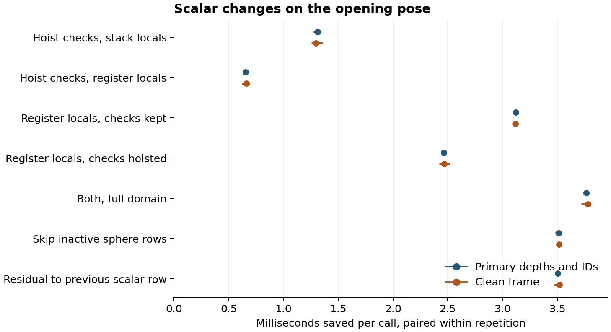

# Which scalar costs show up in a physical frame?

The ray tracer has 160 scanlines and 160 pixels per scanline. A point on one scanline can hit each of three spheres. The straightforward implementation visits 76,800 sphere/pixel pairs per frame to discover which sphere, if any, is nearest. The previous study replaced the primary row with specially scheduled scalar code and obtained a large saving on the real P4. That comparison changed buffer checks, local storage, pointer arithmetic and the number of candidate pairs. This study asks which savings still appear when the compiler changes only one property at a time.

## Name the work before counting it

A Typed buffer starts with a 32-bit length. Its elements occupy two bytes each. To load the horizontal square for one candidate, generated code can load the length, compare the requested position with it, branch over a fault instruction when the position is valid, compute the address and load the uint16 value. Bounds checks implement real language semantics. Removing the check requires a proof that the access is within the allocation for every possible iteration in the accepted row. A preflight guard restricts the optimized branch to a sufficient workspace, valid row number, permitted object count and bounded object fields. Failed admission enters the original implementation with its usual individual checks.

Counting guarded sites is insufficient to predict elapsed time. The same check might occur once at setup, once per active sphere, or inside a 160-iteration loop. The horizontal coordinate itself may be kept in a stack slot. Repeated loads and stores of that local can consume time even after the separate buffer-length check disappears. The experiment changes those local homes independently of the buffer-access checks. Four treatments share exactly the same admitted row domain and the same source. Each treatment uses per-access checks or hoisted checks, crossed with stack or register homes for selected locals. A fifth treatment retains both improvements and skips a sphere's horizontal loop when the row is outside its vertical radius. The original stock compiler and the previous hand-scheduled scalar row serve as the two external references.

The checked/stack cell includes the same 25-word admission sequence as the other four new programs. It also retains its original slow path. At the default pose the compiler team's independent machine interpreter recorded 3,615,257 instructions across the 160 primary-row calls in that cell. Hoisting with stack locals lowered the count to 3,303,633; retaining locals in registers with checks enabled lowered it to 2,953,176. Both changes together produced 2,641,552. These counts are exactly additive on this input: hoisting moved 311,624 instructions and changing local homes moved 662,081. Division by the P4 clock frequency would assume one retired instruction per cycle for every memory and control-flow operation. That assumption needs a physical test. [Compiler study artifacts](../scripts/compiler/qualify-rows.mjs)

## Keep each physical comparison paired

The firmware's ordinary Ray Tracer still selects the original scalar Typed program on its fourth mode. The console can load any of the seven test programs. Each load recompiles the same 10,438 source bytes in a fresh QuickJS runtime, binds the same four entry signatures and returns the checksum of the linked ELF before relocation. A host process independently compiled each image and recorded the full native text and linked ELF digest. The target uses the ELF checksum to verify that a measured program is the intended treatment even when two implementations produce the same color at every pixel. [Linked images](../various/device/images.json)

A single block at one pose runs scalar C, C with PIE primary geometry and the active Typed program. They share the same output addresses. Each arm executes a clean RGB565 frame, a frame that also writes nearest depth and sphere ID, a primary-only call, and a shade-from-planes call. The latter two are independent entry points and perform their own setup. Their times need not sum to the clean frame. Sensor input, LCD transfer, serial communication and host checks happen outside the frame clock. The test records both elapsed microseconds and the P4 cycle counter.

For each new output the checker initializes the C and test buffers with different patterns, compares all 25,600 visible words in each relevant plane and checks sentinel padding as well as the final guard. The board's three reference checksums must also match a separate frozen native C corpus on the host. The twelve poses include a lamp-only change, moving one sphere behind another, coordinates at both declared bounds, and strides of 160, 165 and 320 words. Seven program rotations give each arm each position in the sequence once. Thus a time difference can be calculated within a matched pose and repetition before computing its median. [Physical protocol](../design-doc/03-protocol-for-the-paired-physical-scalar-trial.md)

## How to read the interaction

Write the primary time with checks and stack homes as T00; use T10 for hoisted/stack, T01 for checked/register and T11 for hoisted/register. Hoisting saves T00−T10 with stack homes and T01−T11 with register homes. The extra joint saving beyond the sum of the two individual savings is T10+T01−T00−T11. A negative value means the two individual savings partly overlap in elapsed time. Compute these quantities from paired observations before taking medians. A table of separately rounded medians is adequate for explaining the arithmetic but can differ slightly from the actual paired estimate.

Here the stock-to-checked/stack comparison estimates the overhead of introducing a cloned fast body, its validation prologue, and its change in generated-code layout. The other three fixed-domain comparisons use the same prologue. The skip comparison uses the same local homes and check policy on both sides. Only after that comparison is it reasonable to ask how much faster the older scalar assembly body still runs: its cursor arithmetic, unrolled handling and other scheduling choices remain bundled. Their residual cost can be measured together, but this experiment cannot assign it to one instruction or one source statement.

## Physical results at the default pose

Each entry below is the median of seven observations on one 360 MHz ESP32-P4, in milliseconds except for the native text size. The tested ELF runs from external PSRAM. The allocator reserved 66,092 bytes for every installed segment. A change in instruction bytes can therefore coexist with the same loader reservation. [All 588 blocks](../various/device/rows.json) · [49 cold installations](../various/device/loads.json)

| Row treatment | Clean RGB | RGB + depth + ID | Primary | Shade | Cold compiler | Native bytes |
|---|---:|---:|---:|---:|---:|---:|
| Stock | 57.691 | 62.870 | 17.807 | 48.533 | 430.016 | 9,564 |
| Checked, stack | 57.722 | 62.856 | 17.818 | 48.583 | 465.218 | 10,608 |
| Hoisted, stack | 56.424 | 61.568 | 16.511 | 48.502 | 464.674 | 10,476 |
| Checked, registers | 54.610 | 59.747 | 14.699 | 48.534 | 465.769 | 10,516 |
| Hoisted, registers | 53.942 | 59.079 | 14.052 | 48.535 | 465.825 | 10,384 |
| Hoisted, registers, empty-row skip | 50.436 | 55.577 | 10.542 | 48.533 | 467.591 | 10,404 |
| Earlier hand-scheduled scalar row | 46.915 | 52.066 | 7.035 | 48.584 | 445.480 | 10,072 |

Hoisting saved a paired median of 1.311 ms with stack locals and 0.654 ms with register locals in the primary call. Changing local homes saved 3.121 ms with checks and 2.463 ms after hoisting. The joint saving was 3.766 ms. The measured interaction was −0.657 ms, with seven individual values between −0.667 and −0.624 ms. Across the twelve poses, the median interaction at each pose ranged from −0.670 to −0.631 ms. This experiment measures the overlap in time and cannot distinguish a cache effect from an instruction dependency or pipeline scheduling effect. The additive dynamic counts alone would miss it. [Paired effects](../various/device/summary.json)

The empty-row test saved another 3.513 ms of primary time, cutting horizontal tests from 76,800 to 26,400 in the default scene. The difference between this arm and the earlier scalar implementation was another 3.505 ms. The full-frame estimates were 3.518 ms and 3.521 ms respectively. The shade-only call barely moved under these primary-row changes. On the same stock blocks the C scalar and C+PIE clean medians were 9.516 and 8.350 ms. Independent scalar costs remain substantial elsewhere in the frame. A subsequent measurement can test those costs without revising the primary results.

The stock compiler's measured peak was 645,724 bytes. The five experimental compilers had medians between 676,232 and 676,680 bytes because the comparison embeds distinct standalone emitter treatments. These are tracked QuickJS compilation peaks. They exclude port allocations, framebuffer storage and the resident native segment.

## A second gate for the visible application

The first experimental firmware returned correct color, depth and ID for every timing block and for all nine older selectors. Its ordinary display then showed the default image correctly and faulted when a Right key moved the sphere. The compositor reported `ran past its turn budget of 80 ms`. The automatic recovery restored the previous application and verified it and the partition by flash readback. Investigating two previous release logs uncovered the same fault at first focus, immediately after on-device stock compilation took about 435 ms. A correct captured framebuffer can outlive the turn that produced it. Only a post-interaction health check establishes whether the compositor survived. [Original fault screen](../various/device/rejected-right.png) · [Recorded diagnostics](../various/device/display-failures.json) · [Rollback health](../various/device/rollback.json)

The correction is confined to the fourth Typed Ray mode. The ordinary compositor requests a pose and can display the previous plane while the kernel poll computes the new one. On first use, this poll lazily compiles the unchanged stock source. Once the plane is ready, the service issues a redraw to the compositor that requested it. Requests for an old compositor epoch are discarded. Each timed benchmark still directly calls its existing native entry. The change moves a synchronous cost outside the display world's 80 ms turn. The kernel thread still spends that time computing the image, so the first user-visible image can take substantially longer than one 80 ms display turn. [Fourth-mode service](../../../../../../picocalc-os/port/esp32p4/main/typed_ray_p4.c)
