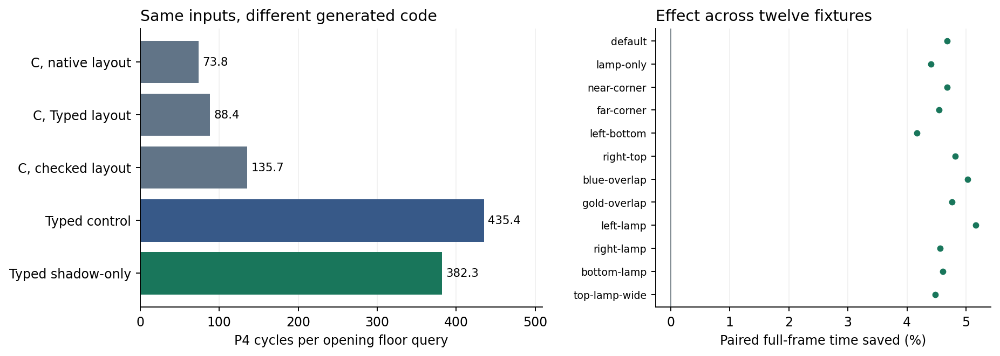

# From a floor-shadow ray to an ESP32-P4 instruction budget

A floor pixel in our ray tracer has two possible lighting states. To decide which state to draw, the program asks whether a ray from the pixel towards the lamp crosses any sphere. The ESP32-P4 can run two implementations of that calculation. A C implementation is built on the developer’s computer with GCC. A second implementation is written in the project’s Typed JavaScript language. The handheld can compile it into native 32-bit RISC-V instructions. Both renderers can draw the same 160 by 160 image. Their execution times differ considerably. This study asks how much of the difference a single compiler change can remove with the Typed application source held fixed.

## Begin with the scene, the input and the observable answer

The scene contains three spheres above a checkerboard floor. Rays determining the nearest visible surface come first. For a ray that hits a sphere, the program shades that sphere. For a ray that reaches the floor, the program evaluates a second predicate to test whether the lamp is visible. In the opening image, 19,477 of the 25,600 pixels reach the floor. Only those pixels contribute to the opening shadow workload. Moving a sphere changes the set of floor pixels. Moving the lamp can change the cost of the predicate even if every pixel still sees the same primary surface.

For each sphere, the shadow predicate first compares the floor pixel with the sphere’s projected bounding rectangle. Rejecting on the horizontal axis skips the vertical comparison. Rejecting on either axis skips the exact sphere intersection. When the pixel passes both comparisons, a dot product tells us whether the sphere lies ahead along the ray. Comparing two squared quantities determines whether the ray passes within the radius, avoiding a square root. A hit returns true immediately. Testing the remaining spheres without finding a hit returns false. Traversal order and short-circuit behavior are part of the workload. [Typed implementation](../../../../../../picocalc-os/worlds/raytrace/raytrace.typed) · [Production C implementation](../../../../../../picocalc-os/nucleus/raytrace_demo.c)

| Route through one sphere | Work paid before advancing or returning |
|---|---|
| X rejection | First magnitude and one comparison |
| Y rejection | Both magnitudes and both comparisons |
| Exact miss | Both bounds pass, then the exact test rejects the sphere |
| Hit | Bounds and exact test pass, and the predicate returns |

The host records a word for each call. For example, XMH means the first sphere was outside the horizontal interval, the second reached the exact test and missed, and the third blocked the light. The opening scene contains 7,811 XXX calls. They constitute 40.1% of its shadow pixels. Counting words also lets us independently predict how many times the source calls the magnitude helper. Each visited sphere requires one call for X; each sphere surviving X requires a second for Y. This prediction can be checked against an instruction trace of the actual machine image. [Frozen path counts for the twelve scenes](../various/board/paths.json)

## Why the comparison needs four controls

C and Typed use different representations for the same geometry. Production C accesses per-sphere native fields and per-axis projection arrays. Typed keeps the geometry in a length-prefixed buffer of unsigned 16-bit cells. Some values carry a bias so negative mathematical coordinates can be represented. Reading an element through charCodeAt checks that its index is inside the buffer. A valid frame pays the execution cost of these checks, even though none fail.

The isolated experiment therefore times the production C predicate, GCC compiling the Typed data layout without explicit checks, GCC compiling that same layout with explicit checks, and the baseline Typed compiler. The two layout arms share the same arithmetic source. GCC can optimize the checks it can prove redundant. The unchecked arm is defined for valid inputs. The actual Typed implementation must also preserve the first failing operation and prior observable writes. All isolated implementations read PSRAM and use the same indirect-call batch over the same coordinates. Each returned boolean is verified before timing. The timed loop accumulates booleans and checks its total afterwards. [Two GCC layout controls](../scripts/board/layout.inc) · [Hardware harness](../scripts/board/bench.c)

The full-frame trial restores each language’s ordinary renderer organization, scratch placement and calling convention. It verifies the entire padded RGB surface against scalar C. The separate primary trial checks both depth and sphere-ID digests with sentinels. The shade-only trial starts from C-generated depth and IDs and verifies every output byte against C. It has an extra validation loop embodied in the independent shading entry. Adding primary-only and shade-only times would misrepresent the integrated frame.

## From source expression to helper call

The frontend translates a function into typed operations, including local reads, integer arithmetic, conditional branches and calls. The RV32 backend consumes one function at a time. A call normally transfers the argument to the calling convention’s argument registers, transfers control to the helper and receives its result. The compiler must preserve the other operands in a partially evaluated caller expression. The exact cost depends on the register contents at the call site and the helper’s own machine instructions.

A source-level absolute value is small. In Typed it is an ordinary function with a single argument, an integer comparison, a conditional return and a final return of the argument. In GCC’s optimized intermediate representation, both absolute values in the predicate are explicit magnitude operations. In the archived object, GCC lowers each one to arithmetic shift, exclusive-or and subtraction. The shift produces a sign mask of zero or all ones. For a nonnegative value the last two operations leave it unchanged. For a negative value the exclusive-or complements the bits and subtracting minus one adds one. GCC emits zero function calls inside this predicate. [Optimized GCC intermediate representation](../various/compile/gcc-in-shadow.gimple) · [RISC-V disassembly](../various/compile/gcc-in-shadow.asm)

Our baseline has an equally visible cost. The whole opening image retires 14,879,359 modeled native instructions on the host. The shadow function body accounts for 5,528,397, excluding its callees. It executes 264,928 bounds tests and makes 74,226 calls into the magnitude helper. The helper itself retires 691,244 instructions across the frame. The body also executes 1,288,258 direct stack loads and 647,710 direct stack stores. Those categories overlap conceptually with call preparation; adding them to the body's total would count the same work twice. Nor is a modeled instruction a physical cycle. Instruction fetch, branches, dependencies and memory placement can change the elapsed time for the same instruction count. [Opening runtime census](../various/compile/baseline.json)

## A deliberately small implementation

The new compiler option is inlineGuardedReturns. The backend examines the verified operation sequence of an already encountered one-argument integer helper. It accepts a conditional signed comparison with a literal, a taken arm returning a literal or the negation of the argument, and a final return of the argument. It records only a compact description of the relation, operands and return action. An eligible caller can lower that operation directly into its expression registers. The following describes the mechanism.

~~~text
when finishing a function definition:
    recognize the exact supported argument, result and operation sequence
    if it matches, associate the conditional action with its function index

when lowering a call in an enabled caller:
    evaluate the argument exactly once in the original source order
    if the target has no recognized description, emit the ordinary call
    otherwise branch over the action when the source guard is false
    emit the literal or integer negation for the taken arm
    leave the result in the caller's expression state
~~~

The generated code uses a branch and the guarded action. This differs from the branchless GCC sequence. Both approaches remove a call. Which instruction sequence is fastest for each sign distribution would require a separate comparison. The implementation recognizes operation structure, so it can cover independently named functions in another app. Forward calls for which the compiler has not yet seen a body continue to use the existing call mechanism. This preserves the streaming compiler’s one-function working set. [RV32 lowering](../../../../../../picocalc-os/compiler/typed-rv32.js)

The experiment compiles three images of the same ray source. The control retains the previously qualified pie-empty setting for the primary row. The second enables guarded-return lowering only inside typedRayInShadow. The third enables it across eligible callers. The middle treatment answers a causal question about the shadow function. The general treatment answers a separate deployment question about applying the same rule wherever it matches. A call to Math.abs inserted by editing the renderer would answer neither question. [Host and target image contracts](../various/board/candidate-images.json)

| Host opening experiment | Control | Shadow caller only | All eligible callers |
|---|---:|---:|---:|
| Complete native image, bytes | 10,332 | 10,324 | 10,268 |
| Modeled instructions per full frame | 14,879,359 | 14,088,411 | 14,088,309 |
| Dynamic helper calls from shadow | 74,226 | 0 | 0 |
| Executed shadow bounds tests | 264,928 | 264,928 | 264,928 |

The shadow-only image removes 790,948 dynamic instructions, or 5.32% of the opening frame. The reduction breaks into 99,764 fewer instructions inside the caller and 691,184 fewer inside the helper. The helper still exists for other callers, so image size falls by only eight bytes. The general treatment saves a further 102 executed instructions on the opening frame. The three images produced the same observed memory digest. This is an example of why a static byte reduction and a dynamic instruction reduction need independent reporting. [Shadow-only trace](../various/compile/shadow.json) · [General trace](../various/compile/general.json)

## Correctness before speed

Compilers optimize all programs that match a rule. Testing the one renderer that suggested the rule would leave several opportunities for a wrong answer. Consider the most negative signed 32-bit value. Its mathematical magnitude is 2,147,483,648, one greater than the largest positive signed 32-bit value. The compiled operation must wrap exactly as the source integer subtraction wraps. Consider also an argument that increments a counter before returning its value. Duplicating that argument to obtain a comparison operand and a return operand would increment the counter twice. Finally, a helper on the right side of a false logical AND must never evaluate its argument. An out-of-bounds read in that argument would turn a valid program into a trapping program.

The test suite compares 744 cases on the RV32 execution model and a separate WebAssembly runtime. They exercise signed/equality relations, deep expressions that spill other operands, wraparound, prior writes, trap order, short-circuiting, imports, forward references and near matches. I reran the suite and reproduced the complete count. The device checks address the cases modeled less faithfully on the host, particularly the actual firmware calling convention and memory layout. Host tests and physical input sweeps establish different properties. [Runnable differential suite](../scripts/compile/04-correctness.mjs) · [Case counts](../various/compile/correctness.json)

## How to reproduce the experiment

All scripts run from the project repository root unless noted. The fixture builder extracts a frozen version of six unchanged Chess functions using git, compiles the ray and Chess images, runs the Wasm oracle, and writes complete entry offsets, sizes and hashes. The board harness embeds those exact byte arrays in the diagnostic firmware. The cold-compile trial instead executes the Typed compiler inside a new on-device QuickJS runtime in every block. It checks the digest of the compiled bytes against the correct host treatment.

~~~bash
T=$(find ttmp/2026/11/21 -maxdepth 1 -name 'PICOCALC-SHADOW-CODEGEN--*')
node "$T/scripts/compile/04-correctness.mjs"
node "$T/scripts/board/01-images.mjs" /tmp/shadow-images --candidate
python3 "$T/scripts/reports/05-open-repl.py"
~~~

The last command opens a new persistent session in the running trace service, loads raw rows, and prints its session ID. Each query pairs observations by block. A positive percentage means time or cycles saved relative to the first named arm. Medians of paired percentages can differ from percentages computed retrospectively from two independently rounded medians.

~~~javascript
// How many of the opening queries reached each part of the predicate?
lab.mix("default")

// What does the same-layout, explicitly checked GCC binary cost per query?
lab.pred("default", "natural", "checked-c", "typed")

// Does the improvement reach the complete frame? What about the unaffected primary path?
lab.frame("default", "full", "typed", "shadow-only")
lab.frame("default", "primary", "typed", "shadow-only")

// Does it transfer to advanced evaluation of a played Chess position?
lab.chess(1, 1)

// What does general selection cost in a fresh compiler invocation on the P4?
lab.cold(0, "compileUs")

// Report what the host observed separately from those physical measurements.
[opening.baseline, opening.shadow, opening.general].map(r => ({
    mode:r.mode, calls:r.shadow.absCalls, instructions:r.fullFrameSteps, bytes:r.imageBytes
}))
~~~

The standalone workbook published with the two articles embeds the same data for offline use. Running it with Node prints the summary; loading it from a Node REPL with .load makes the queries above available interactively. The ticket holds compact device records, image identities, host captures and rebuild instructions. The trial measures time until the image is ready in memory. The display driver and compositor are outside the timer. The selected scenes span positions, lamp geometry and output strides; they represent a fixed, reproducible corpus. [REPL analysis functions](../scripts/reports/shadow.js) · [REPL loader](../scripts/reports/05-open-repl.py) · [Frozen Chess transfer protocol](../design-doc/04-validation-and-blind-chess-transfer.md)

## Checking the path attribution independently

The classifier used to generate batches and the independent classifier differ in their arithmetic implementation. The independent one uses arbitrary-precision integers for the exact products. Across the twelve fixtures it agreed on 235,782 floor returns, 666,952 individual sphere decisions and their complete sequence. Across an additional full grid containing one sphere it verified 25,600 isolated route assignments. For just the opening frame, the independently counted source-level magnitudes total 74,226. The RV32 instruction trace observed precisely 74,226 calls from the shadow function. This agreement links geometry, branch behavior and actual executed machine code without attributing cycles based on static instruction counts. [Independent classifier replay](../scripts/validation/02-strata.mjs) · [Classification receipt](../various/validation/strata.json)

## What changed on the silicon

The P4 ran at its recorded 360 MHz clock. Six blocks rotated treatments within the same diagnostic firmware. The opening natural workload is the original sequence of all floor pixels. For each single-sphere row we instead selected all coordinates following exactly one path. The results below are medians in P4 cycles per predicate call, including the common caller loop and its coordinate loads. Percentages are medians of within-block changes from baseline Typed to shadow-only.

| Opening path | Production C | Same-layout C | Checked same-layout C | Typed control | Typed shadow-only | Cycles saved, % |
|---|---:|---:|---:|---:|---:|---:|
| Natural, three spheres | 73.76 | 88.40 | 135.74 | 435.38 | 382.28 | 12.21% |
| X rejection, one sphere | 36.01 | 43.88 | 78.01 | 183.06 | 174.02 | 4.86% |
| Y rejection, one sphere | 46.01 | 55.02 | 86.02 | 235.72 | 207.16 | 11.90% |
| Exact miss, one sphere | 68.03 | 84.04 | 119.04 | 376.45 | 349.76 | 7.09% |
| Hit, one sphere | 73.03 | 84.84 | 131.03 | 362.92 | 330.51 | 8.93% |

The fastest source path, X rejection, calls the helper only once. On Y rejection the program calls it twice, and the time reduction is larger. The effect on a natural three-sphere query depends on the complete sequence of visits. Averaging the four single-sphere percentages would discard the cost of the outer call, geometrical correlations and early returns. In particular, the absolute times of the independent control visit differ slightly from those of the main visit. All percentages above compare treatments within the main visit. [All main-trial physical observations](../various/board/final/rows.jsonl)

| Opening application entry | Scalar C | Typed control | Typed shadow-only | Typed general | General saving vs. Typed |
|---|---:|---:|---:|---:|---:|
| Integrated frame to memory | 7.7235 ms | 55.6635 ms | 53.0360 ms | 53.0440 ms | 4.73% |
| Primary intersections and depth | 4.7235 ms | 15.7715 ms | 15.7575 ms | 15.7585 ms | 0.05% |
| Shading supplied depth and IDs | 4.7445 ms | 48.4790 ms | 45.8245 ms | 45.7980 ms | 5.53% |

A simple check connects isolated and integrated timing. Saving about 53 cycles on each of 19,477 queries at 360 MHz predicts about 2.87 ms per frame. The actual difference of the two shadow-only frame medians is 2.63 ms. This approximate agreement across two distinct call contexts strengthens the attribution. The integrated primary entry never calls the shadow predicate; its shadow-only change was 0.09%. Across all twelve fixtures the general rule reduced full-frame time by 4.20–5.19%. All 72 paired full-frame measurements favored it. A 53.044 ms frame is still 6.87 times the measured scalar C time. The optimizer addressed one recurring source of overhead while leaving several large costs directly visible.

## Does it transfer, and what does the compiler pay?

The held-out program is the Chess evaluator, frozen before choosing the optimization. It assigns each position a numerical score. Advanced mode includes positional terms that call another small signed-magnitude function. Basic mode uses material counts and provides a comparison on the same boards. Neither benchmark runs search, rendering or the Chess user interface.

| Position | Basic evaluation saved | Advanced control, cycles | Advanced general, cycles | Advanced evaluation saved |
|---|---:|---:|---:|---:|
| Opening | 0.05% | 11,016.06 | 9,887.72 | 10.22% |
| After five half-moves | 0.01% | 11,106.25 | 9,975.62 | 10.18% |
| Five-piece endgame | approximately 0% | 4,803.28 | 4,571.25 | 4.85% |

Each physical sample included sixteen evaluations and verified the total against the independent score. The board buffer also had to remain byte-identical. Advanced mode improved in all six blocks on all three positions. The primary ray control and basic Chess controls help distinguish a specialized change from a generic difference in link layout. Three positions characterize this particular evaluator; they cannot establish the effect on the engine’s search speed.

Cold compilation brings a different tradeoff. General selection took 286.1130 ms for the ray source, versus 283.4775 ms for control, a paired 0.93% increase. Chess took 65.209 versus 64.478 ms, a 1.14% increase. The peak QuickJS allocator reading was 826,356 bytes for both families and all treatments. The meter includes loading the common compiler bundle. An identical maximum does not resolve smaller changes below that earlier high-water mark. Across the 36 cold compiles the on-device image digests and lengths agreed with their respective host images. The ray image shrank from 10,332 to 10,268 bytes and Chess from 1,948 to 1,924. In the opening scene about one frame’s execution savings offsets the extra compilation time. That estimate compares the measured medians; it excludes display and loading.

## Decision and the next falsifiable question

Keep the guarded-return transformation available as an opt-in native compiler policy. These results support enabling it for workloads that repeatedly evaluate these helpers. Promoting it to the general firmware default deserves a separate catalog replay, because this particular matching rule is deliberately small and the present trials cover two source families. The measured gain came from the scalar shadow path with the primary PIE setting fixed.

The strongest remaining clue is visible in the controlled comparison. After inlining, the natural Typed predicate still costs about 382 cycles against 136 for the same-layout, explicitly checked GCC build. The remaining ratio is about 2.8. The host trace still counts 1.94 million direct stack accesses inside the shadow body and 264,928 executed bounds checks. I would trace the common three-X rejection path next, assign stack accesses to individual local values, and predict how many memory operations a bounded register policy would remove after accounting for register preservation at calls. Then compile one variant and repeat the same six-block trial. A count of stack references motivates that experiment. Only the resulting emitted code, observable behavior and physical time can establish its value. [Researcher’s implementation guide](../design-doc/03-recognizing-pure-guarded-numeric-returns-in-a-streaming-compiler.md)
