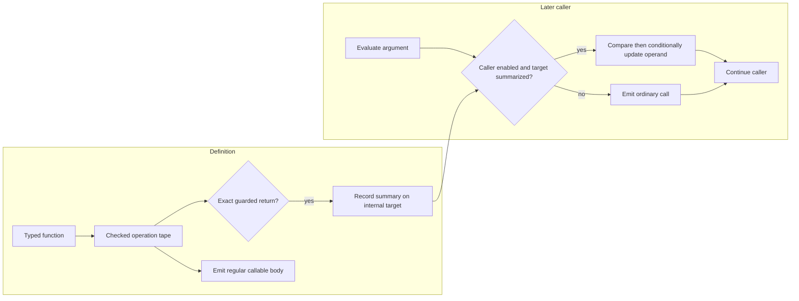

# Recognizing pure guarded numeric returns in a streaming RV32 compiler

A ray tracer determines which object a ray reaches. For a visible floor pixel, this renderer also asks whether a sphere blocks its light. The Typed program first rejects spheres whose projected extent cannot cover the pixel. It evaluates an exact intersection predicate only for candidates that pass. An early rejection computes a signed coordinate difference, takes its absolute value, and compares it to the projected radius. The order of the two coordinate tests matters: the second buffer access occurs only if the first comparison succeeds. An index failure must trap at the original position in that order.

Our objective is to make unchanged Typed source generate cheaper native code. This guide develops a local compiler transformation from the actual executed instructions. The unchanged opening frame reduces guest work by 790,948 instructions when we enable the transformation only in the shadow caller, or 5.32% of all instructions in the complete frame. The P4 trial separately determines wall-clock time.

## What the compiler knows

`picocalc-os/worlds/raytrace/raytrace.typed` defines `typedRayFrame`, `typedRayInShadow` and `typedRayAbs`. A Typed function declares an integer, boolean or buffer signature. Integer expressions obey i32 arithmetic. Negating the value −2,147,483,648 produces −2,147,483,648 because negation wraps modulo 2³². The generated helper returns an ordinary integer.

`typedWasm.compileFunctions` in `picocalc-os/compiler/typed-wasm.js` discovers function signatures, type-checks bodies and emits a sequence of numeric operations per function. In `typedRv32.compile`, these operations are already decoded into numeric tape cells. A cell may be an operation or an operand, so searching for a handful of matching opcode numbers within a longer sequence would be ambiguous. The frontend passes a complete tape to the backend, and the streaming backend releases that tape after lowering its body.

RV32 provides integer registers and integer arithmetic, conditional branches, loads and stores. A call changes the processor's instruction address and must preserve live values according to the calling convention. The callee usually receives its first argument in register a0 and returns its result in the same register. The native emitter holds five temporary operands in t0–t4 and spills deeper operands into the current function's stack frame. The existing compiler gives the signed magnitude helper a frameless implementation. Even then, the call keeps argument and result moves, target transfer, body evaluation and return.



## Following the measurements

The primary-intersection compiler is fixed to `pieLoops: "pie-empty"` in all three arms. Its code runs earlier in the same frame. The independent host RV32 interpreter counts every fetched instruction and verifies the preserved registers at each call return. In `scripts/compile/02-profile.mjs`, a counter indexed by instruction address counts the direct targets of the two calls in the shadow function. The workload is one complete opening frame, including all other setup, pixel work and cleanup.

| Opening frame | Control | Shadow callers enabled only | All callers enabled |
|---|---:|---:|---:|
| Full-frame retired instructions | 14,879,359 | 14,088,411 | 14,088,309 |
| Instructions inside shadow body | 5,528,397 | 5,428,633 | 5,428,633 |
| Instructions inside magnitude helper, all callers | 691,244 | 60 | 0 |
| Calls from shadow into magnitude helper | 74,226 | 0 | 0 |
| Unsigned buffer bounds tests inside shadow | 264,928 | 264,928 | 264,928 |
| Direct shadow stack loads / stores | 1,288,258 / 647,710 | 1,288,258 / 647,710 | 1,288,258 / 647,710 |
| Actual native image size, bytes | 10,332 | 10,324 | 10,268 |

Attribution requires ranges that do not overlap. In the shadow-only arm, 99,764 fewer steps in the caller plus 691,184 fewer in the helper sum to the 790,948 fewer in the frame. The remaining 60 steps in that helper arise from scene preparation outside the treatment. General mode also changes call sites beyond the shadow test. Its 102 additional saved instructions across the opening frame indicate how little those remaining calls cost under this particular input.

The GCC control uses the production C ray tracer and the build flags stored in the earlier ROW-IR ticket. GCC optimized GIMPLE, its high-level intermediate language, contains two `ABS_EXPR` operations in `in_shadow`. The final RV32 instructions for one use are `srai mask,x,31; xor value,mask,x; sub value,value,mask`. When x is negative, the mask has all 32 bits set. XOR complements x and subtracting −1 completes the two's-complement negation. The actual C object contains zero helper-call relocations in this function. GCC uses direct struct fields where Typed uses checked buffer access. This cross-language observation motivates a compiler mechanism; exact dynamic attribution comes from the unchanged Typed source.

## Exact grammar for the summary

The pass recognizes a single signed integer parameter, an i32 result and zero declared locals. It admits this normalized body:

```text
if (argument relation integer_literal) return action;
return argument;

relation ::= == | != | signed < | signed <= | signed > | signed >=
action   ::= integer_literal | 0 - argument
```

The exact integer literal accepted by the matcher is the literal in the numeric tape. A source frontend can lower an expression such as a written negative constant to subtraction; that different tape takes the ordinary path. A spelling of unary minus and an explicit subtraction from zero produce identical tapes here. A function can have any name. Requiring the complete sequence establishes that it has no effects, no memory reads, no calls, and no division or other trapping arithmetic. Nothing about a function's name or import signature establishes those facts.

For a magnitude helper the numeric tape is `[32,0,65,0,72,4,64,65,0,32,0,107,15,11,32,0,11]`. Decode it as local get 0, constant 0, signed less-than, void if, constant 0, local get 0, subtraction, return, end if, local get 0, end function. A constant action has fourteen tape cells; a negation has seventeen. These two lengths are checked before looking at the relevant opcodes and operands. The complete body remains callable by other functions and by external entry points.

```text
for each function in source emission order:
    if the option is enabled:
        summary = match_complete_body(signature, numeric_tape)
        if a summary exists: attach summary to internal function target
    lower the current function normally
    for each call in an enabled caller:
        if the target carries no proved summary: emit ordinary ABI call
        otherwise:
            take the already evaluated integer operand
            compare it with the signed/equality threshold
            on a false comparison skip the update
            on a true comparison negate it or load a literal
            put the result back into the caller operand slot
    release current function's tape
```

`GuardedReturnCode.call` uses the x0 register when the threshold is zero. A nonzero threshold is materialized in t6. Consider a source guard `x > K`. The compiler emits a skip on `K >= x`. For `x <= K`, the false condition is `K < x`. Signed comparisons require the correct branch opcode and operand order. Emitting the action first and patching the short branch displacement includes a possible two-instruction literal load. Both jump destinations remain inside the caller. Expressions above the register-stack capacity use the preexisting `pop` and `push` spill rules.

For the common magnitude case with x already in t0, the replacement is two static words:

```asm
bge t0, zero, after
sub t0, zero, t0
after:
```

For the first shadow call, the baseline image at byte 5140 executes `addi x10,x5,0`, `jal x1,0x1bc`, then `addi x5,x10,0`. The candidate at the same byte offset emits `bge x5,x0,0x141c` followed by `sub x5,x0,x5`. Both ranges map to frontend tape offset 113. The checked-in `various/compile/call-sites.json` binds both listings to their full image hashes. Either one or two instructions execute. The relative cost of this conditional sequence against GCC's three straight-line instructions also depends on the P4's branch behavior and input signs. This design does not establish that a conditional implementation is always the fastest.

## Compiler API and fallback

```js
// In a realm with typed-wasm.js, typed-rv32.js and typed-pie-loops.js loaded.
const decisions = [];
const opts = {
  pieLoops: 'pie-empty',
  inlineGuardedReturns: name => name === 'typedRayInShadow',
  inspect: {function:'typedRayInShadow', emit:e => decisions.push(e)}
};
const module = typedRv32.compile(source, [], undefined, opts);
const native = decisions.find(e => e.kind === 'emission' && e.target === 'rv32');
const sites = native.ranges.filter(r =>
  r.decisions?.some(d => d.includes('guarded return')));
```

- Set `inlineGuardedReturns: true` to enable all eligible callers. Omit the option or set it to false for the production control. Passing a predicate permits function-specific treatment. Each matched instruction range is in byte offsets of that exact emitted image.
- The matcher records a summary on the compiler's internal target descriptor. The caller cannot inject a summary through fields on a native import descriptor.
- A call to a definition that appears later takes the ordinary path. Buffered compilation also considers function bodies in the same order, giving the same machine image as streaming. Supporting forward-call specialization would require deferring lowering or retaining additional frontend information.
- Unknown body shape, non-i32 types, locals, different fallthrough values, trapping arithmetic and effects decline safely. Each rejection still uses the verified frontend and the ordinary lowering path.

## Validation and limitations

`scripts/compile/04-correctness.mjs` compares emitted images using an independent RV32 interpreter and WebAssembly execution. The 36 combinations of predicate, threshold and action are each tested at ten distinct inputs twice, once with the argument in a register and once with several surrounding live operands. The suite also exercises short-circuiting on both `&&` and `||`, calls whose arguments write prior to a trap, foreign imports, ordinary forward calls and two close malformed shapes. The script tests negative and maximal i32 values, including the special minimum value. Both streaming and buffered compilation succeed with identical bytes on admitted cases.

`scripts/compile/05-host-cost.mjs` compiles the original program in fresh Node VM contexts in 30 rotated three-arm trials. The measured median paired delta for general mode is −0.032 ms, with the general arm faster in 16/30 pairs. Absolute medians are 6.194 ms for control and 6.361 ms for general. These V8 runs support a rough host cost check. Only a P4 QuickJS cold compile can answer what enabling the pass costs on the handheld. Computing this summary uses a fixed amount of work per considered function and five stored scalar fields per admitted function. The implementation does not construct a graph of the program.

Register placement remains interesting. The Opus High researcher supplied and ran a prototype scorer over local accesses and loop depth. Keeping a local in a register can remove stack traffic, but replacing a load with an explicit register move still emits one instruction. Saving a preserved register on entry and restoring it on every return creates additional work in a function invoked 19,477 times per opening frame. Testing source-specific register use and register forwarding separately, with run-time counters for both, would let us determine whether this larger implementation pays.

## Reproduce the evidence

From the repository root, with the ticket location in `T` and `PREFIX` set to the vendor binary prefix ending in `riscv32-esp-elf` (no trailing hyphen):

```sh
node picocalc-os/tests/typed-rv32.test.mjs
node "$T/scripts/compile/04-correctness.mjs" /tmp/shadow-correctness.json
node "$T/scripts/compile/02-profile.mjs" baseline /tmp/shadow-control.json "$PREFIX"
node "$T/scripts/compile/02-profile.mjs" shadow /tmp/shadow-isolated.json "$PREFIX"
node "$T/scripts/compile/02-profile.mjs" general /tmp/shadow-general.json "$PREFIX"
node "$T/scripts/compile/05-host-cost.mjs" /tmp/shadow-build-cost.json
```

The canonical per-arm hashes, permission-independent run outputs and GCC excerpts are in `various/compile`. The researcher's separate JS session cells and their executed outputs are in `opus-design-repl.jsonl`; the promotion scorer is `opus-design-code.txt`. Hardware methods, controller source and run manifests are recorded in the parent experimental protocol and physical measurement documents.
