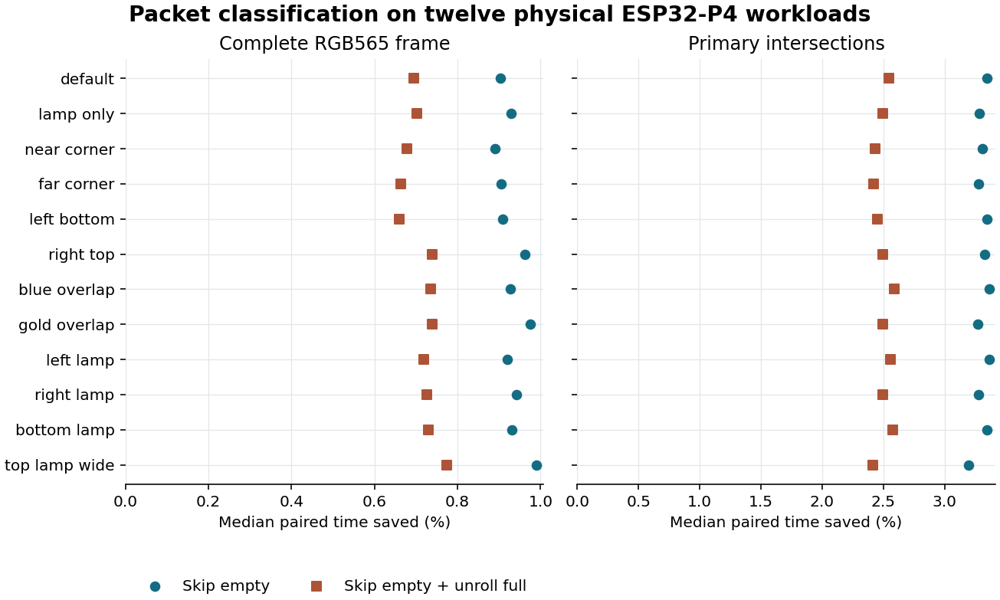

# Where an eight-lane compiler should return to scalar code

On the ESP32-P4, a compiler can read eight horizontal distances with one instruction and reject all eight rays with one comparison. Adding that decision to our Typed compiler saved about half a millisecond from a 56-millisecond ray-traced frame. We also taught an experimental compiler how to recognize a checked update to eight particle positions. When the positions and velocities occupied contiguous arrays, the measured update used 89.3% fewer cycles than its matched scalar control. Both results come from the same physical processor. The difference in their size is a consequence of the work that can stay in vector registers, the work that must return to scalar code, and how much of the application the loop occupies.

This study asks three questions a compiler must answer separately. What result does the source program promise? Which machine instructions preserve that result, including observable effects when an access fails? Among the correct implementations, which one uses less time on the target? We could answer the first two for the loops we studied. A blind test on a new collision function exposed a specific weakness in our answer to the third.

## From a Typed expression to a physical pixel

Typed is the project's JavaScript-like language. An integer local holds a 32-bit value. A `buffer` contains a length and a sequence of unsigned 16-bit elements. Reading an element checks the index. Writing one can change what the next iteration sees. The application is written in Typed. The compiler can emit WebAssembly or native RISC-V instructions, abbreviated RV32. We use WebAssembly as an independent execution of the same source and RV32 to run the finished code directly on the handheld. Both share the Typed frontend. A separate arithmetic oracle provides an independent check where the workload permits one.

For a sphere of radius `r` whose center is `dy` away from the current screen row, define `R = r*r - dy*dy`. The renderer has already stored the horizontal squared distances in a buffer. For pixel `i`, it computes `d = R - squares[i]`. A negative difference means the ray misses the sphere. On a hit, the renderer reads a square-root table, compares the candidate depth to the nearest depth so far, and conditionally writes a depth and material ID. Shadows, material shading and RGB565 pixel packing also contribute to the complete frame. RGB565 stores red, green and blue in 5, 6 and 5 bits respectively. Our complete-frame timer stops when the pixels are ready in memory. The physical LCD transfer is a separate operation. [Typed renderer](../../../../../../picocalc-os/worlds/raytrace/raytrace.typed)

The P4's processor instruction extensions, called PIE, provide 128-bit registers. One register can hold eight 16-bit values. A **lane** is one of those positions. A **packet** in this experiment is a group of eight consecutive input elements processed together. A scalar register holds one ordinary integer or address. Eight nearby input values can use a single aligned load. Eight different square-root lookup addresses still require individual accesses in our generated program. This is where a plausible vector implementation acquires costs that are invisible in the Typed addition and subtraction expressions. [Espressif’s introduction to PIE](https://developer.espressif.com/blog/2024/12/pie-introduction/)

## Plan the boundary while the compiler knows what the loop does

The Typed frontend produces operations for a function. The optional native pass recognizes a counted loop, a contiguous unsigned input, a subtraction from a loop-invariant value, a nonnegative test and a guarded continuation. The continuation is the source code executed after that test succeeds. The pass identifies the induction variable, the access base, the potentially written streams and the operations belonging to that continuation. An unsupported store address declines the transformation. The original compiler remains available inside an accepted function for inputs that fail runtime checks.

~~~text
Typed source
    ↓ per-function operations and structured branches
Recognize the producer, condition, continuation and memory effects
    ├─ proof fails → original scalar lowering
    └─ proof succeeds → choose a plan
        ├─ scalar groups or eight-wide producer
        └─ eight-wide producer with empty-packet exit
                ↓
        RV32 bytes + decision + image-relative address ranges
                ├─ host interpreter → executed counts by address
                └─ ESP32-P4 → paired time, verified output
~~~

For the integrated plan the new rule is `min_unsigned(squares[i..i+8]) > R`. When true, every lane misses. The program can advance the index by eight without writing packet scratch or touching the square-root table. When false, it performs the previously qualified subtraction, saves its results, and processes each lane in order. The first and last few pixels can still go through scalar code for alignment or a short tail. The input span must be inside the checked buffer and safe from stores that could modify unread input or its length header. LLVM's VPlan describes a related design principle. The operations whose cost is estimated should be the operations the vectorizer emits, including guards and movement between scalar and vector registers. Our smaller representation covers just this family of loops. [Optional Typed pass](../../../../../../picocalc-os/compiler/typed-pie-loops.js) · [LLVM VPlan](https://llvm.org/docs/VectorizationPlan.html)

~~~js
// The standard streaming compile entry point accepts this explicit option.
const image = typedRv32.compile(source, [], undefined, {pieLoops: "pie-empty"});

// A policy may also choose per admitted loop. This example illustrates the API.
const trial = typedRv32.compile(source, [], undefined, {
  pieLoops: facts => ({
    plan: facts.constantTrips === 8 ? "stock" : "pie-empty"
  })
});
~~~

The callback sees compile-time facts. A variable trip count appears as `null`. The callback cannot establish legality. A rejected loop never reaches it. The accepted modes include ordinary scalar (as a `stock` policy choice), scalar grouped execution, the prior PIE producer, and the new `pie-empty`. An omitted option gives the original compiler behavior. The regression test compiles the unchanged raytracer in streaming and buffered modes and checks the entire native image by SHA-256 against the device experiment. [Native interface](../../../../../../picocalc-os/compiler/typed-rv32.js) · [Regression test](../../../../../../picocalc-os/tests/typed-pie-loops.test.mjs)

## Reconcile the predicted operations with the ones that executed

Take eight squared distances `[25,36,49,64,81,100,121,144]`. If `R=16`, their minimum is 25. The new exit saves one packet store and eight scalar lane reads. If `R=60`, three rays hit. The continuation visits them in order, and observes differences 35, 24 and 11. If `R=150`, all eight hit. For that case we built a third candidate. It computes a maximum, extracts eight known-hit results directly from a vector register and emits eight copies of the continuation. Each lane index is an immediate encoded in the extraction instruction.

The opening capture had 3,135 complete packets, comprising 2,111 empty, 282 mixed and 742 full. These give exact predictions for the traffic eliminated. Run the same 160 row calls, identify the actual compiled bytes by SHA-256, trace each instruction address, then count executions in the corresponding load, store and extraction ranges. The host produced the following counts. [Captured ranges and counts](../various/evidence/candidate-workbook.json)

| Opening 160-row workload | Prior producer | Skip empty | Skip empty and unroll full |
|---|---:|---:|---:|
| Scalar scratch loads | 26,070 | 9,182 | 3,246 |
| Full-packet scratch stores | 3,135 | 1,024 | 282 |
| Vector-to-scalar lane extracts | 0 | 0 | 5,936 |
| Executed guest instructions | 3,131,435 | 2,983,602 | 2,954,486 |
| Bytes in the row function | 1,688 | 1,712 | 4,064 |

Skipping empty packets eliminated exactly `2,111 × 8 = 16,888` scalar scratch loads. Full-packet extraction eliminated exactly `742 × 8 = 5,936` more, while executing 5,936 explicit extract instructions. A smaller dynamic instruction count can coexist with a much larger static function. The CPU has to fetch and execute the actual instructions in the rest of the application as well.

## Set the extent of each timing claim

In the row harness, one observation includes 160 calls to a row function. Nine paired blocks measured each of nine implementations in each of three tested scenes. Opening medians were 4,501,684 cycles for stock Typed, 4,004,385 for grouped scalar, 3,916,869 for the prior PIE producer, 3,731,049 for skip-empty, and 3,725,090 for skip-empty plus unroll-full. Relative to the prior producer, the last two saved 4.74% and 4.90% in median paired row cycles. In the sparse scene the savings were only 1.85% and 1.83%. These inputs exercise different combinations of row admission, packets and scalar work. [Row treatments and controls](../various/ray/ceiling-summary.json)

A separate board image called the complete compiler-emitted `typedRayFrame` and the primary-pass `typedRayTrace`. The harness restored the input state before each call, varied arm order over six permutations, and timed only the compiled entry. Each return value, plane-end sentinel and applicable output-plane hash was checked afterward against the WebAssembly fixture. Twelve distinct complete-frame inputs included output strides of 160, 165 and 320 halfwords. The primary-only entry does not receive the lighting coordinates, so the same twelve fixture names represent ten distinct primary inputs. Hashes cover row padding. This experiment used flash-resident code and external PSRAM for scene buffers. These are timings for that configuration. A plane hash provides a compact check on the device. Host differential tests also compared memory byte by byte. [Frame harness](../scripts/director/frame.c) · [Frame witnesses](../various/director/frame-fixtures.json)

| Default scene | Prior producer (median) | Skip empty (median) | Paired saving | Skip empty and unroll full (median) |
|---|---:|---:|---:|---:|
| Primary intersections | 16.338 ms | 15.791 ms | 0.547 ms / 3.35% | 15.931 ms |
| Complete RGB565 frame | 56.244 ms | 55.738 ms | 0.509 ms / 0.90% | 55.861 ms |

For each block we subtract times and divide by its own baseline. The reported paired median can therefore differ from subtracting the two marginal medians. The skip-empty plan saved 0.89–0.99% of complete-frame time and 3.19–3.37% of primary time across the twelve poses. The full-hit candidate produced correct pixels, executed fewer guest instructions, and lost to skip-empty for the complete frame at every pose. On the opening frame it cost another 0.126 ms. Code size, instruction fetch, alignment and memory latency are plausible mechanisms. This trial measured their combined effect. [Paired frame results](../various/director/frame-result.json)

The hand-scheduled comparison gives the compiler team a larger target. On opening, an expert scalar row retaining hot state in registers used 313,477 cycles. The hand row with a minimum reduction used 273,307, a 12.81% paired saving over that scalar control. The generated skip-empty row still took 3,731,049 cycles. These hand functions preserve effects with whole-row admission and a checked fallback. They change several code-generation decisions at once. The large remaining gap establishes an engineering opportunity. Attributing it specifically to registers, coarser guards or skipping whole rows requires controlled implementations of those changes one at a time. [Hand controls](../scripts/ray/board/main/ceiling.c)

How expensive is one classification of each kind? A third board image replayed the captured eight-lane groups with an independently checked hand packet routine, using the same initial depth and ID values in each arm. Each of nine blocks timed many packets of one class, including the invocation and its bookkeeping. These medians of block means are P4 cycles per eight-lane packet. The compiler-generated full-frame results above have a different denominator. [Physical packet-class study](../various/ray/packet-classes-summary.json)

| Opening class | Packets in each block | Strong scalar | Unsigned minimum | Minimum plus maximum |
|---|---:|---:|---:|---:|
| Empty | 2,111 | 55.21 | 40.24 | 41.23 |
| Mixed | 282 | 95.11 | 128.26 | 126.97 |
| Full | 742 | 132.75 | 164.98 | 151.00 |

The minimum saved 27.21% against hand scalar on an empty packet. When a packet was mixed or full, the same schedule cost 34.37% or 23.36% more than scalar. The high empty fraction makes a whole-row improvement possible; a transfer to a denser workload needs a new observation of the class distribution. The conditional timings supply a mechanism to test. Applying them as universal costs for the compiled machine image would mix two implementations.

## Prove the narrower arithmetic at its exact boundary

Typed computes `d = R - s` in 32 bits, with `s` an unsigned 16-bit input. The available packed subtract interprets its inputs as signed 16-bit values and saturates its result. The original producer reinterprets that result as unsigned `u` and accepts it only when `u <= R`. For `0 ≤ R ≤ 32766` a real hit produces an exact result between zero and `R`. A miss with a high-bit input may saturate to 32767. That value still exceeds `R` and is rejected. At `R = 32767, s = 65535` the original difference is negative, while the saturated result 32767 would pass the test. One unit changes the validity of this machine sequence.

We compared an ordinary scalar function, a runtime guard preserving the scalar fallback, and a literal specialization. A constant of 32766 allows omission of the range test. A constant of 32767 selects the scalar body. Unknown inputs retain the guard. For each of the three implementations, 2,520 host cases covered tails, signed boundaries, overlaps and bad capacities. There were 723 traps, including 618 after observable writes. The oracle checked the first failing operation and write history as well as final state. The physical check covered 216 timing observations. For an allowed literal and length eight, the specialized body saved 4.63% over the runtime-guard version. At length 127 it saved 0.43%. Even identical dynamic bodies placed at different addresses gave slightly different physical measurements. This limits interpretations of very small effects. [Range proof and fixtures](../various/ray/static-proof.json) · [Physical comparisons](../various/ray/proof-summary.json)

## Use physics to separate layout, legality and profitability

Let `x` and `v` be signed 16-bit position and velocity values. One tick computes `x' = clamp(x+v, -32768, 32767)`. Eight consecutive positions and eight consecutive velocities let the processor perform aligned loads and a saturated vector add. Interleaved records give the same mathematical answer but require more work to obtain the two vectors and preserve the unchanged velocities.

The physics team compared record and planar layouts under both scalar and packed implementations. At 128 particles, the checked planar scalar and PIE plans used about 1,673 and 179 cycles per update. The 89.30% paired saving held in all 12 blocks. For checked interleaved records the saving was 33.83%. Converting records to planes, performing one packed update and converting back took **47.18% more** cycles than updating the original record layout directly with the unguarded scalar control. A system already storing planar data can realize the first comparison. A one-shot caller paying both conversions faces the second. [Physics measurements](../various/physics/workbook.json)

The second physics program updated contacts between bodies. Contacts touching a common body can depend on each other's writes. The researchers assigned contacts to groups so that no two in a group touched the same dynamic body. They compared scalar and packed execution with **the identical group order**, and compared grouped scalar with the original solver order separately. The latter can legitimately yield a different simulation state. In the 128-contact workload the groups contained 57, 41 and 30 contacts. Packed processing over that same order took 43.89% more cycles than grouped scalar, losing all 14 blocks. The gather and scatter of body velocities introduce substantial work. Establishing independence permits the transformation but leaves its profitability open. [Matched contact results](../various/physics/board-results.json) · [Box2D’s contact-SIMD study](https://box2d.org/posts/2024/08/simd-matters/)

The physics prototype also associates those hand-written instructions with ordinary Typed operations. Its recognizer proves two affine address families, explicit signed extension, a widened addition and saturation to a signed halfword. Six equivalent source functions and 11 near misses exercised its decisions. It compared 2,280 outcomes including memory and failure behavior. The original recognized 3,400-byte linked image was identical to the image containing the previously measured guarded kernels. An additional firmware scan matched all 1,652 bytes of native kernels, all 1,476 bytes of stock Typed code, and the targets of the eight relocated wrapper transfers. That ties the measured guarded entries to the recognizer’s choices. The recognition pass is a host research entry point. Its integration into the on-device streaming compiler and the cold cost of recognizing particles remain open. [Structural recognition results](../various/physics/recognition.json)

## Give the selector a workload it has never timed

Before collecting new measurements we froze a cost function in Git. Its three choices were stock scalar, grouped scalar, and the prior packed producer. Its inputs included known trip count or a prior of 32 for an unknown count, number of streams that might be written, packet width, guard overhead and scalar tail work. We used a new collision kernel that accumulates `max(0, reach - distance[i])²`. Its arithmetic and observable result differ from the ray row. The compiler saw either a constant bound of eight or 96, or a parameter whose runtime length was 3, 17 or 96. Three hit densities gave 15 input conditions. Each forced plan actually ran on the P4. [Frozen policy](../scripts/director/selector.js) · [Held-out source](../scripts/director/collision.typed)

**Regret** is the relative excess time of the selected legal implementation over the fastest measured candidate on that input. The rule picked the fastest plan in 12 of 15 cells, with zero median regret and 24.08% worst regret. It picked PIE for every cell. A policy consisting entirely of “choose PIE” achieved exactly the same score. The three failures all arose at a dynamic length of three, where the eight-lane body could never run but its setup could still execute. The holdout supplies a falsifiable diagnosis of an input the compiler was missing. It provides no evidence that the current weights generalize beyond that simpler policy. [Complete selector outcomes](../various/director/selector-result.json)

A second, explicitly post-hoc experiment put one branch at entry: if the runtime length is less than eight, use stock scalar, otherwise use the prior PIE routine. We compared a single callable dispatch with both fixed routines at 13 lengths. At length three the gate cost 160.20 cycles per call compared with 157.18 for fixed scalar and 193.38 for fixed PIE. On this fresh run the excess over the best fixed routine fell from 23.03% to 1.92%. At length zero the dispatch still cost 8.45% over that very short scalar call. Both bodies occupy code space, and the threshold has now been chosen using these results. A further unseen workload is required to validate a general selection policy. [Physical length sweep](../various/director/gate-result.json)

Forty-eight complete on-device compilations measured the additional compile work. Each observation used a fresh QuickJS runtime, loaded the compiler, generated the image and verified its size and fingerprint. The median compiler phase cost about 14.9 ms for stock and 23.3 ms for forced PIE on these small collision functions. Adding the callback to forced PIE cost another 75–143 microseconds in paired medians, depending on the source. The observed peak was 814,020 bytes for all treatments in this harness, which loaded the same compiler bundle for every arm. The selector's own peak storage below that shared maximum was unresolved. The larger time cost came from constructing and emitting grouped code. [Cold rows](../various/director/selector-cold-rows.json)

## Reproduce the reasoning in a private REPL

The trace service verifies each image against its recorded bytes, and joins an instruction address to counts only when the image identities match. A source line or function name by itself is insufficient. Two builds can assign the same numeric address to different operations. The director workbook loads the uninstrumented device records into the same session as the host traces. Each cell discloses its workload and unit. [Session loader](../scripts/director/09-open-lab-session.py) · [Workbook source](../scripts/director/10-lab-workbook.js)

~~~js
lab.packetPrediction()
// {packets:3135, predicted:16888, observed:16888}

lab.frame("default","clean","baseline","empty")
// 6 paired blocks, 0.904% median time saved

lab.physicsPair("contact",128,"grouped-scalar","grouped-pie")
// 14 paired blocks, -43.892% saved

lab.selection("dynamic",3,35)
// Prior of 32 iterations, selected PIE. Three actual iterations.
// Stock 157.22, grouped scalar 190.45, PIE 193.48 physical cycles per call.
~~~

I would advance two changes in this order. First, teach the compiler to hoist a whole-row admission check and keep base addresses and loop invariants live, with the hand scalar row as its target and scalar effect-prefix tests as its qualification. That targets the largest measured gap. Second, bring the particle recognizer into the streaming frontend and measure its recognition cost and guarded execution on a different layout-preserving physics kernel. For the selector, publish the simple policies as competitors and freeze a new test workload before tuning another weight. The existing evidence already supports a useful default for this particular decision: when a complete ray packet is proved empty, end the packed work there.
