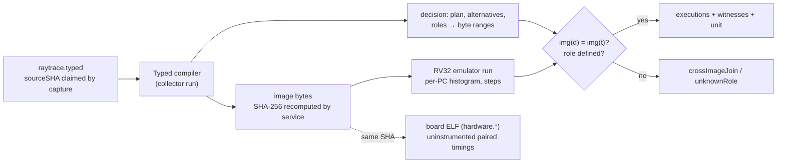

# Following one SIMD decision from source to executed instructions

This article explains how the `simd` workbench joins a compiler decision to the instructions that actually executed, and what such a join can and cannot establish. The worked subject is the eight-lane packet producer in the Typed ray row `typedRayComputeRow` on the ESP32-P4 instruction set, plus two new packet strategies and a small physics kernel. The instruction counts below came from public calls in my REPL room on port 3794. Section 9 also reports measurements from the independent physical board experiment. The final section gives the commands to repeat both workbooks.

## 1. What a total cannot tell you

The earlier PIE study counted guest instructions for 160 calls of the ray row, one per row of the opening scene. Matched scalar Typed retired 3,199,910 instructions and the PIE build retired 3,131,435. The difference is 68,475. That total does not say which instructions disappeared. They could have come from the vector subtraction itself, from the scratch stores that feed the scalar consumer, from the per-lane reads or from the loop control. Those are four different explanations, and each suggests a different next experiment.

Attributing the difference needs three facts that refer to the same bytes:

1. **Which instructions implement each part of the decision.** These are byte ranges in the emitted image, labelled with a *role* such as `full-packet-scratch-store`.
2. **How many times each instruction executed.** This is a per-PC histogram from an emulator run.
3. **That both facts describe one image.** The emulator must have executed exactly the bytes in which the ranges were recorded.

The `simd` provider holds these facts and joins them only when the third condition holds.

## 2. Evidence identity

An **image** is the raw RV32 code the compiler emitted for a program. The provider identifies an image by the SHA-256 of its bytes. When the service starts, it recomputes each digest from the base64 bytes in the study file and refuses the file if any digest differs. Image identity is therefore verified independently by the service. The current corpus has eight images:

| Image (SHA-256 prefix) | Bytes | Contents |
|---|---:|---|
| `813974db` | 9,564 | stock Typed ray program |
| `119637d1` | 10,384 | matched scalar packet producer |
| `8420b736` | 10,308 | PIE packet producer (the original opt-in compiler experiment) |
| `9a4a2356` | 10,332 | candidate: skip all-miss packets ("empty") |
| `55b350ea` | 12,684 | candidate: also extract all-hit packets ("full") |
| `48f9254b` | 1,652 | physics native kernels (`physics.S`) |
| `ced49a39` | 1,476 | physics Typed kernels (`physics.typed`) |
| `79809bfa` | 3,400 | guarded physics kernels (`board/physics_checked.S`) |

Two other identifiers look similar but carry weaker guarantees.

- **`source.sha256` and `packetSets[].sourceSHA` are claims made by the capture.** The collector `03-capture-ray.mjs` hashed `picocalc-os/worlds/raytrace/raytrace.typed` and asserted that the inspector reported the same hash. The service checks only that the value is 64 hexadecimal digits. It never opens the source file. Every ray decision and the packet set carry `b0a7c02bbb8646a2b17c669c7c42fcb5d76ae4d666fe90f988ea2bb97f143e0f`. That value is consistent within the corpus, and the provider cannot check it against the source.
- **Workload IDs are names.** `opening-160-rows`, `particle-n128` and `chain16:scheduled-pie` are strings written by the collectors. They are not digests of fixtures or results. Two traces with the same workload name share a label. That alone does not prove they ran identical inputs. For the ray arms, the stronger statement rests on the collectors themselves: they regenerated the 160 fixtures and compared all 4,100 observable output bytes of every call against the Wasm oracle, according to the collector source and the operator's results note.

A **trace** is one emulator run of one workload on one image: a sparse histogram of `{pc, executions}` and a total `steps`. The service requires the histogram to sum exactly to `steps`. It also requires every PC to be 4-byte aligned, inside the image and a 32-bit RV32 encoding if it executed. No PC may appear twice, and every count must be an integer JavaScript can represent exactly.

## 3. The join, stated precisely

Let a decision *d* name image img(*d*) and give, for role ρ, a set of half-open byte ranges R(*d*, ρ). Let a trace *t* name image img(*t*), with histogram *h*ₜ over the listed PCs Lₜ. Then

```text
executions(d, t, ρ) = Σ  hₜ(pc)   over aligned pc in R(d, ρ)
      defined only if img(d) = img(t) and R(d, ρ) is nonempty
      where hₜ(pc) = 0 for an aligned pc inside the image that is not in Lₜ
```

Three validation rules make this sum meaningful.

- Ranges of one role never overlap, so each PC is counted at most once. Ranges of *different* roles may overlap. The one-PC role `scalar-lane-load` lies inside the segment `halfword producer and sign guard`. For that reason the API reports one role at a time and offers no all-roles total.
- The histogram sums exactly to `steps`. Without that check, an unlisted PC could mean "never executed" or "not recorded". With it, the file asserts a complete histogram, and omission can mean zero. The check proves internal consistency of the file. The claim that the emulator counted every retired instruction comes from the collector, which asserted the same sum during capture.
- An image mismatch is refused rather than estimated. Byte offset 3056 in two different images names two unrelated instructions.



The dotted edge matters. A board image with the same SHA is the same code. That alone does not show that a physical measurement used the same input, and it does not rule out a duplicated or missing measurement.

A result carries its own identity. This is the PIE scratch store on the opening workload:

```js
simd.executions('pie-row', 'pie-opening', 'full-packet-scratch-store')
// executions 3135, staticInstructions 1, executedPCs 1,
// imageSHA 8420b736…, traceSteps 3131435, source lines 112–122 of raytrace.typed
```

## 4. The original decision: scalar producer versus PIE producer

The decision records for `scalar-row` and `pie-row` cite the same source interval, lines 112–122, and list three alternatives (`stock`, `scalar`, `pie`). Each alternative has the status `selected` or `unselected` and the reason "Experiment explicitly selected the build mode; no profitability estimate." The record therefore says that the plan was forced by the experiment, not chosen by a cost model. Both images also carry rejected-loop decisions (`*-rejected-6`, lines 100–104; `*-rejected-75`, lines 105–124) with the reason "no contiguous checked u16 subtraction producer".

Joining each role to its own image's trace gives:

| Role (executed guest instructions) | Scalar `119637d1` | PIE `8420b736` | Change |
|---|---:|---:|---:|
| halfword producer and sign guard | 175,065 | 106,095 | −68,970 |
| admission and packet control | 34,845 | 35,340 | +495 |
| scalar hit continuation | 399,200 | 399,200 | 0 |
| packet backedge | 156,420 | 156,420 | 0 |
| full-packet-scratch-store | 25,080 (8 PCs) | 3,135 (1 PC) | −21,945 |
| single-prefix-scratch-store | 990 | 990 | 0 |
| scalar-lane-load | 26,070 | 26,070 | 0 |
| whole trace (`steps`) | 3,199,910 | 3,131,435 | −68,475 |

The four segments do not overlap, and I checked this in each arm. Outside them, both arms execute exactly 2,434,380 instructions. The whole step difference therefore lies in two segments: −68,970 in the producer and +495 in packet control, which sum to −68,475. Inside the producer, eight halfword stores per group became one 16-byte vector store: 25,080 = 8 × 3,135 store executions became 3,135. The scalar consumer did not change. It still read 26,070 lanes and still ran 399,200 hit-continuation instructions.

## 5. Full groups and leading lanes

A **full group** is eight consecutive pixels whose input starts on a 16-byte boundary. Only full groups go through the vector path. A **leading lane** is a pixel before the first aligned group in a row-and-sphere pass. The capture's oracle (`expectedMasks` in `03-capture-ray.mjs`) advances `x` one pixel at a time until the address is 16-byte aligned, then forms groups while `x + 8 ≤ 160`. Leading lanes are handled one at a time by a single-prefix path.

The capture recorded each full group's 8-bit **hit mask**: bit *i* is set when lane *i*'s discriminant is nonnegative. The packet set for `opening-160-rows` holds 3,135 groups, all with 8 lanes, pose `default`, in 100 rows. They comprise 2,111 all-miss groups (mask 0), 282 mixed groups and 742 all-hit groups (mask 255), with 6,983 hit lanes in total. The masks were derived from the branch the emulator actually took after each sign guard. They were then checked against a recomputation from the input cells, and the scalar and PIE lists were required to be identical.

The lane-load PC separates the two paths exactly:

```text
scalar-lane-load = 8 × (full groups that reach the scalar consumer) + 990 leading-lane loads
pie:    8 × 3,135 + 990 = 26,070
```

The single-prefix store executed 990 times in both scalar and PIE. Leading lanes never form a group, so a packet strategy cannot skip or extract them. Section 6 shows that the candidates' lane-load counts still decompose with the same 990 term, although neither candidate defines a role that observes the prefix store directly.

## 6. Two new packet strategies

Two candidate images keep the PIE producer and change what happens to a group once its mask is known. The **empty** candidate loads the group, takes a minimum reduction, and skips all-miss groups before subtraction. The **full** candidate also takes a maximum reduction and, for all-hit groups, moves each lane to a register with an extract instruction instead of storing to scratch. The official disassembler names these instructions `esp.min.u16.a`, `esp.max.u16.a` and `esp.movi.16.a`. The collector `07-capture-packet-candidates.mjs` assigned roles from that disassembly and asserted the expected counts before writing the study.

| Role | PIE `8420b736` | Empty `9a4a2356` | Full `55b350ea` |
|---|---:|---:|---:|
| packet-input-load | — | 3,135 | 3,135 |
| min-reduction | — | 3,135 | 3,135 |
| packed-subtraction | — | 1,024 | 1,024 |
| max-reduction | — | — | 1,024 |
| full-packet-scratch-store | 3,135 | 1,024 | 282 |
| extract-full-hit-lane | — | — | 5,936 (8 PCs) |
| scalar-lane-load | 26,070 | 9,182 | 3,246 |
| halfword producer and sign guard | 106,095 | 53,257 | 35,271 |
| scalar hit continuation | 399,200 | 399,200 | 60,106 |
| packet backedge | 156,420 | 61,425 | 389,389 |
| outside the four segments | 2,434,380 | 2,434,380 | 2,434,380 |
| `steps` | 3,131,435 | 2,983,602 | 2,954,486 |
| change from PIE | — | −147,833 (−4.72%) | −176,949 (−5.65%) |

A dash means the decision defines no such role. It does not mean zero.

The mask census predicted two quantities before either candidate ran, and the joins match both exactly:

- **Skipping all-miss groups removes 8 × 2,111 = 16,888 lane loads.** Observed: 26,070 − 9,182 = 16,888. The 1,024 subtractions and stores are 3,135 − 2,111.
- **Extracting all-hit groups moves 8 × 742 = 5,936 lane reads to extracts.** Observed: 9,182 − 3,246 = 5,936, and the extract role executed 5,936 times. The remaining 282 stores are the mixed groups. The remaining lane loads decompose as 8 × 282 + 990 = 3,246, so the 990 leading lanes are untouched.

Single role labels are not stable categories across these images. In the full image, `scalar hit continuation` fell from 399,200 to 60,106, while `packet backedge` grew from 61,425 to 389,389 and from 10 to 595 static instructions. The emitter attached the duplicated hit handling for all-hit groups to a different segment label. A per-label comparison would claim that hit handling became 85% cheaper. The sums support a narrower statement: from empty to full, those two segments together went from 460,625 to 449,495 (−11,130), the producer went from 53,257 to 35,271 (−17,986), and packet control was unchanged at 35,340. The total is −29,116, which equals the step difference. The full image's code also grew. Its row function spans 4,064 bytes, compared with 1,688 for PIE, and 880 distinct PCs executed, compared with 318.

## 7. Missing is not zero, and zero is not missing

The provider distinguishes three outcomes, and the physics kernels show all three.

**An observed zero.** The guarded SoA PIE kernel on seven particles:

```js
simd.executions('physics-guarded_soa_pie', 'physics-guarded_soa_pie-particle-n7', 'packed-arithmetic')
// executions 0, executedPCs 0, staticInstructions 2, ranges [740,744) and [924,928), traceSteps 107
```

Neither PC appears in that trace's histogram. Because the histogram is complete (it sums to 107), omission here means the packed arithmetic executed zero times in this trace.

**An absent role.** The empty candidate still performs 990 leading-lane loads (9,182 = 8 × 1,024 + 990), but its collector defined no `single-prefix-scratch-store` role:

```js
simd.executions('empty-row', 'empty-opening', 'single-prefix-scratch-store')
// TypeError: unknownRole: decision "empty-row" has no role "single-prefix-scratch-store"; choose one of [...]
```

The work may well have happened. The study does not record where, so the provider refuses to answer rather than report 0.

**A refused join.** The physics decision belongs to image `79809bfa`, and the unguarded SoA trace ran image `48f9254b`:

```js
simd.executions('physics-guarded_soa_pie', 'physics-particle_soa_pie-particle-n128', 'packed-arithmetic')
// TypeError: crossImageJoin: decision "physics-guarded_soa_pie" describes image 79809bfa…
//   but trace "physics-particle_soa_pie-particle-n128" executed image 48f9254b…;
//   byte offsets are not comparable across images
```

`simd.executions('pie-row', 'full-opening', 'scalar-lane-load')` is refused in the same way. One join is legal but easy to misread. The guarded SoA decision joined to the guarded *AoS* trace on 128 particles returns 0 executions, with traceSteps 938. Both name image `79809bfa`, so the join is defined, and the answer is true: the SoA kernel's packed arithmetic did not run while the AoS kernel ran. Identity is checked per image. It does not check whether the trace exercised the decision's function.

## 8. The independent physics join

The required physics call returns:

```js
simd.executions('physics-guarded_soa_pie', 'physics-guarded_soa_pie-particle-n128', 'packed-arithmetic')
// executions 16, executedPCs 1 of staticInstructions 2,
// witnesses [{pc: 740, executions: 16}], traceSteps 126, image 79809bfa…,
// source scripts/physics/board/physics_checked.S line 35 (sha256 939ed007…, claimed by capture)
```

Sixteen packed arithmetic executions on 128 particles is one per group of eight. The second packed-arithmetic PC, at byte 924, did not execute in this trace. Across the five particle workloads in this corpus, joining each guarded kernel to its own trace gives:

| Workload | SoA PIE packed-arith / steps | AoS PIE packed-arith / steps | SoA scalar steps | AoS scalar steps |
|---|---:|---:|---:|---:|
| particle-n7 | 0 / 107 | 0 / 92 | 100 | 90 |
| particle-n8 | 1 / 36 | 1 / 83 | 110 | 99 |
| particle-n64 | 8 / 78 | 8 / 482 | 715 | 648 |
| particle-n127 | 15 / 988 | 15 / 957 | 1,393 | 1,263 |
| particle-n128 | 16 / 126 | 16 / 938 | 1,403 | 1,272 |

In this corpus the SoA PIE trace retires 126 instructions at n128 and 988 at n127. Its `native-helper` role accounts for 109 of the 126 and 888 of the 988. The join shows that a different set of helper PCs ran at n127: 76 of 82 static PCs, against 19 at n128. It does not say why. I make no claim about particle counts outside these five.

## 9. Emulator counts versus physical time

Everything above is **instrumented emulator evidence**. A host RV32 interpreter called a hook on every fetched PC. The unit is retired guest instructions, and the counts carry no time.

Physical time is a separate observation in `hardware.*`. Those are **uninstrumented paired timings** on the P4: no PC hook, whole-frame clocks, each pair measured within one of six counterbalanced load blocks. The board's image records for stock, scalar and PIE have SHAs equal to the emulator traces `stock-opening`, `scalar-opening` and `pie-opening` (ELF CRCs `0d2e18b8`, `bd9a8467`, `ab91b817`). For the default pose, scalar to PIE saved a median 242 µs per clean frame (6 pairs, range 217–307 µs, 0.43%), and 251 µs in the primary-intersection phase (6 pairs, range 202–271 µs, 1.53%).

The archived `hardware.*` study predates both candidate images. The independent board team subsequently measured the corresponding compiled row bodies on the P4. Over nine paired blocks on the opening workload of 160 rows, median cycle totals were 3,916,869 for the original PIE producer, 3,731,049 for the empty classifier and 3,725,090 for empty plus full. Median within-block savings against original PIE were **4.7443%** and **4.8951%**. Both candidates won all nine opening blocks. These cycles cover the checked row computation. Measuring an entire frame additionally includes shading, other stages and their memory traffic. See the physical evidence in this ticket at `various/ray/ceiling.csv`, `various/ray/ceiling-summary.json` and the row body hashes in `various/director/packet-images.json`.

## 10. Uncertainty and scope

- **Exact quantities.** Every count here is an integer from a histogram whose sum equals its trace's `steps`. There is no sampling error within a trace. The uncertainty lies in the labels.
- **Roles come from the collectors.** Ray roles came from compiler segment labels and from regular expressions over disassembly. A changed schedule must make those patterns fail, as the coordinator's diary notes. Labels can move between images, as section 6 showed, so compare sums that reconcile to `steps`.
- **One workload per ray arm.** Each ray trace is 160 calls on one opening scene. The 2,434,380 instructions outside the segments are constant across the four packet arms of this workload. Nothing here measures another scene.
- **Claimed sources.** The source SHAs and line intervals are the capture's assertions.
- **Tests.** The coordinator ran `go test -race -count=1 ./...` with local HTTP enabled. All six packages passed, including the service and both optional evidence channels. The package results are retained in `various/evidence/go-race-results.txt`.

## 11. Reproducing the results

From the repository root, the following commands start the combined workbench in tmux and run the candidate workbook in its own private session. If the service is already running, begin with the `python3` command after setting `ticket`. The command writes the full answer and SHA-256 of the cell to `/tmp/p4-simd-candidate-workbook.json`.

```sh
ticket=ttmp/2026/11/21/PICOCALC-SIMD-LAB--choosing-simd-packet-boundaries-in-the-typed-compiler-on-esp32-p4
tmux new-session -d -s p4simd-evidence-3794 "bash $ticket/scripts/evidence/06-start-workbench.sh candidates"
python3 "$ticket/scripts/evidence/05-run-workbook.py" --port 3794 \
  --cell "$ticket/scripts/evidence/09-candidate-workbook.js" \
  --out /tmp/p4-simd-candidate-workbook.json
```

Inside an interactive REPL session on that service, evaluate:

```js
simd.help().studySHA            // '4548c1192cfd1f660947fe1387ed1b9ea8f2ccd2a7094c2183d87cb3c5fbc203'
const role = (arm, r) => simd.executions(arm + '-row', arm + '-opening', r).executions
;['pie', 'empty', 'full'].map(a => role(a, 'scalar-lane-load'))   // [26070, 9182, 3246]
role('full', 'extract-full-hit-lane')                             // 5936
const masks = simd.packets('opening-160-rows').packets
;[masks.filter(p => p.hitMask === 0).length, masks.filter(p => p.hitMask === 255).length]  // [2111, 742]
simd.executions('physics-guarded_soa_pie', 'physics-guarded_soa_pie-particle-n128', 'packed-arithmetic').executions  // 16
```

The five independent candidate cells and their full replies are in `various/evidence/opus-public-repl.json`. The coordinator’s baseline and candidate workbooks are `scripts/evidence/04-simd-workbook.js` and `scripts/evidence/09-candidate-workbook.js`, with corresponding answers in `various/evidence/workbook.json` and `various/evidence/candidate-workbook.json`. See `scripts/evidence/03-capture-ray.mjs` and `07-capture-packet-candidates.mjs` for the collectors, `pkg/tracesimd/study.go` for the validation and join, and `pkg/traceapi/simd.go` for the JavaScript interface. The ticket guide at `design-doc/03-verifying-image-addresses-and-packet-evidence.md` explains how to reproduce the capture.

## Key points

- A join is defined only when the decision and trace name the same verified image SHA and the role exists. Otherwise the provider refuses.
- Omission means zero only inside a complete histogram. A missing role is a refusal, not a zero.
- The scalar-to-PIE gap of 68,475 instructions is −68,970 in the producer and +495 in packet control. The scalar consumer was unchanged.
- Lane loads equal eight per consumed full group plus 990 leading lanes. The mask census predicted the candidates' savings of 16,888 and 5,936 exactly.
- The physical opening-row test measured a 4.74% cycle saving for the empty classifier and 4.90% for empty plus full. The corresponding guest instruction reductions were 4.72% and 5.65%. Each quantity has its own unit and denominator.

## Run this article's JavaScript

From the compiler checkout, the following commands open a fresh stateful session on port 3794 and run the exact cell printed below. The shell variable `sid` retains the session ID for follow-up queries. If the service has stopped, its [launcher](../scripts/evidence/06-start-workbench.sh) accepts `candidates` to mount the combined study.

~~~sh
ticket=$(ls -d ttmp/2026/11/21/PICOCALC-SIMD-LAB--*)
sid=$(python3 "$ticket/scripts/director/09-open-lab-session.py" --keep | awk '{print $NF}')
go run ./cmd/trace-repl eval --addr 127.0.0.1:3794 --session "$sid" < "$ticket/scripts/reports/03-instruction-evidence.js"
~~~

~~~js
["pie", "empty", "full"].map(plan => {
    const row = simd.executions(plan+"-row", plan+"-opening", "scalar-lane-load");
    return {plan, imageSHA:row.imageSHA, executedLoads:row.executions};
})
~~~

[Standalone JavaScript file](../scripts/reports/03-instruction-evidence.js) · [Checked replies from all six articles](../various/director/report-cell-replies.json)
