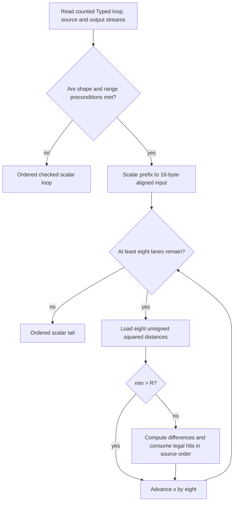

# Compiling a checked ray row for eight pixels at a time

## The work done by one row

The Typed source describes a small sphere renderer. A ray is the view direction at a screen pixel. Each sphere has a projected center, a radius, a depth and a material. For a screen row, the renderer walks the spheres in their original order. At a candidate pixel it compares squared distances, obtains an intersection depth from a lookup table and writes the identity of the closest surface. Later stages use depth, material and shadows to color the output. A fast primary intersection saves only the fraction of a frame spent doing that work.

The public dispatch measured here is `typedRayComputeRow(work, y)` in `picocalc-os/worlds/raytrace/raytrace.typed`. At the native ABI it takes a pointer and a signed 32-bit row number in RISC-V registers a0 and a1, and returns success in a0. There are no imports in this module. An aligned 4,100-byte work object begins with a four-byte capacity, followed by 2,048 unsigned halfwords. The first 17 data elements contain sphere metadata. Squared distances begin at element 40. The table starts at 520. The nearest-depth and material-ID planes start at elements 1545 and 1705. A row clears its two output arrays before walking the spheres. Clearing is observable if a later indexed access fails.

Consider a row at vertical offset `dy` from a sphere of radius `r`. The part of the squared radius left for the horizontal direction is `R = r*r - dy*dy`. When R is negative, the sphere contributes no pixels in the row. Otherwise pixel x hits exactly when its precomputed unsigned square `s[x]` is at most R. A hit computes `d = R - s[x]`, loads `sqrtTable[d]`, computes the candidate depth and conditionally updates the old depth and material ID. Equal depths preserve the source program's iteration order.

## Three places for the boundary between SIMD and scalar

PIE is the vendor extension on the ESP32-P4 that can operate on eight 16-bit values in a 128-bit register. A scalar instruction operates on one ordinary CPU register. Consider eight squares [25, 36, 49, 64, 81, 100, 121, 144]. At R=16, the unsigned minimum is 25. Every ray misses, and no lane may issue a table lookup or touch a destination. At R=60, three lanes hit and their differences are 35, 24 and 11. The compiler must evaluate the three consumers in source order even if it computes all eight differences together.

| Plan | Packed work | Scalar work |
|---|---|---|
| Previous PIE producer | Load eight squares, signed saturating subtract, spill eight halfwords | Read every lane back and test whether it hit |
| Empty-packet exit | First reduce eight unsigned squares to their minimum; branch if minimum > R | Original producer and consumption for possibly nonempty packets |
| Empty plus full | Additionally reduce to maximum; if maximum ≤ R the packet has eight hits | Full arm extracts each already-valid difference from the vector and enters its hit continuation; mixed packets use the prior path |

The actual compiler-emission study is in `scripts/director/packet-emitter.patch`. All three images compile the same Typed source. The independent hand ceiling in `scripts/ray/board/main/ceiling.c` uses an equally guarded scalar arm and separate unsigned minimum/maximum routines in `ceiling_reduce.S`. These controls avoid storing intermediate values to the Typed compiler's temporary stack. The hand controls consume input squares in scalar code for surviving lanes, whereas the compiler experiment can directly extract differences from its vector register. Keep those implementation families explicit when comparing results.



## Why the arithmetic guard ends at 32,766

Typed reads an unsigned 16-bit square and subtracts it in signed 32-bit arithmetic. The physical instruction instead reinterprets the input bits as a signed halfword and saturates the subtraction to [−32,768, 32,767]. The compiler reads the resulting bits as an unsigned halfword u and calls the hit continuation if `u <= R`. This particular continuation test permits useful narrowing, even though it only requires exact numeric results for lanes that hit.

| Unsigned input s, given 0 ≤ R ≤ 32,766 | 32-bit result | Packed result and unsigned test |
|---|---|---|
| 0 ≤ s ≤ R | Valid nonnegative R−s | Exact and at most R |
| R < s ≤ 32,767 | Negative | Negative difference reinterprets above R and is rejected |
| 32,768 ≤ s ≤ 65,535 | Negative | Signed input represents a negative number. R minus that number exceeds R, including when the subtraction saturates to 32,767 |

At R=32,767 and s=65,535, the signed input is −1. Saturating 32,767−(−1) yields 32,767, and the unsigned test would admit it. The reference computes −32,768 and rejects it. The ordinary loop handles this constant. A signed i32 threshold below zero also fails the fast-path unsigned comparison. There is no input XOR or rebias in the shipped producer. The split into the positive and negative halves above explains its behavior.

The opt-in research transformation in `scripts/ray/04-static-proof.mjs` examines the literal operand already captured by the loop analyzer. A known value outside the admissible set removes the packed candidate before emitting machine code. A known value in the admissible set removes its range branch. An unknown value retains the existing branch. The transform leaves length, wraparound, alignment and alias protection in force.

```text
plan = describe_counted_loop(function, source_order)
if plan has no independent input stream: emit original loop
else if term is known and unsigned(term) > 32766: emit original loop
else:
    if term is unknown and unsigned(term) > 32766: branch to original loop
    if stream arithmetic, capacity or disjointness proof fails: branch to original loop
    emit aligned prefix, packed full groups, and scalar tail
```

An output store can affect a later input when two handles share backing storage. A malformed receiver can make the first input or output address invalid. A first failing output access might occur after previous lanes wrote valid values. Prechecking the whole range and immediately throwing would lose those earlier writes. Falling back and replaying the original sequence preserves the first error and all prior writes. The three static simplifications above affect only the numeric predicate and retain this ordering requirement.

## Building, testing and reading evidence

1. Source the ESP-IDF 5.4.2 export script in the shell, change to the repository root and run `bash T/scripts/ray/06-stage-board.sh rows /tmp/simd-rows` where T is the ticket directory. Repeat with `frames` and a different empty destination. The first firmware runs the row ceiling, physics and held-out selector. The second runs the static predicate controls, complete frames and length sweep.
2. On the host, `node T/scripts/ray/04-static-proof.mjs OUT /path/to/riscv32-esp-elf` builds nine true executable guest modules. The prefix ends in `elf`. OUT must already exist. The independent JavaScript oracle checks each first trap receiver/index, every preceding halfword store, the result and the final byte image against the RV32 interpreter.
3. `scripts/ray/02-run-board.py` takes the port, trial app image, original build directory, original SHA and a fresh capture directory. It verifies the original bytes and runtime before replacing the app slot, then restores and rechecks them. The diagnostic runs at 360 MHz. Never infer board time from the interpreter's instruction totals.
4. `python3 T/scripts/ray/05-score.py rows CAPTURE/bench.log OUT` verifies the Cartesian product of arms, scene and blocks and each oracle status. Use `proof` for the follow-up's static predicate rows. Scores compute (control − candidate)/control within each block, then take the median. `scripts/director/08-score-frames.py` validates the separate frame and gate capture and scores the twelve fixtures.
5. `various/ray/ceiling.csv` contains the row cycles. `proof.csv` contains cycles over 64 calls in a valid-input timing batch. `static-proof.json` contains image hashes, the oracle evidence digest and counts of valid/trapping cases. `various/director/frame-result.json` uses microseconds to report six counterbalanced frame pairs per fixture. The root ticket's evidence report describes how to query the block and execution records in the REPL.

The valid physical controls can be faster for reasons other than the number of guest instructions. Register retention, sequence layout, flash placement, checking strategy, scratch traffic and scene density all matter. Use the Wasm oracle and architectural trace for correctness, the paired on-device harness for speed, and complete frame measurements to decide which design should advance.

## Measuring the cost of each packet class

The third image builds with mode `classes`. It times independent region calls with the same actual source squares and sphere metadata as the three complete row fixtures. The writable state is a controlled eight-pixel depth/ID vector. It gives one lane in three a depth of 1 and gives the remaining lanes an empty depth. Checking this state against an independent scalar reference outside every timed call makes both accepted updates and declined updates observable.

The operator gathered 3,135 opening, 3,705 dense and 893 sparse packets per block. Each of nine blocks evaluates all three hand schedules on the same packet, rotating their temporal order, and makes 208,791 reference comparisons in total. The scorer divides a block's cycle sum by the packet-class count before taking the median across blocks. The small table below gives the opening result.

| Eight-lane class | Packets per block | Scalar cycles/packet | Minimum only | Minimum and maximum |
|---|---:|---:|---:|---:|
| Empty | 2,111 | 55.208 | 40.242 | 41.230 |
| Mixed | 282 | 95.110 | 128.259 | 126.972 |
| Full | 742 | 132.745 | 164.982 | 151.001 |

Empty classification saves ordinary lane tests. A mixed packet still pays for classification, scalar lane tests and some hit consumers. A full packet can use the maximum to avoid the per-lane sign test, but the extra reduction and calls also cost cycles. This timing includes a function call per packet with separately initialized state; the complete row uses an inlined inner loop and real accumulated depth history. Use `scripts/ray/07-score-classes.py` to regenerate the evidence and the measured whole rows to select the actual compiler treatment.

For a live cross-check, run `python3 T/scripts/ray/08-repl-ray.py --addr http://127.0.0.1:3794`. The script loads the 81 opening records into its own JavaScript sandbox, joins all nine blocks against `simd.packets('opening-160-rows')`, verifies the three independently obtained denominators, and computes the same per-class medians from raw cycles. The captured response is in `various/ray/repl-classes.json`.
