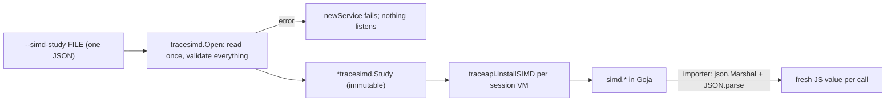

# Design: joining SIMD decisions to executed instructions (`simd` in trace-repl)

## The question this provider answers

The PIE-LOOPS compiler replaces the scalar producer of eight ray discriminants in `typedRayComputeRow` with one packed signed subtraction. The earlier work measured the whole 160-row workload: stock Typed retired 3,608,697 guest instructions, matched scalar 3,199,910 and PIE 3,131,435. A total cannot say where the 68,475 instructions between matched scalar and PIE went. Did the packet producer shrink? Did the scratch stores and per-lane reads that the scalar consumer still needs absorb part of the gain? To answer that, a researcher needs three facts that refer to the same bytes: which machine instructions implement each part of the decision, how many times each of those instructions ran, and that both facts describe one image.

`simd` provides exactly that join and refuses the joins that would be wrong. It is optional and read-only, and it does not estimate.

## Terms, in dependency order

- **Image.** The exact RV32 machine code bytes the emulator executed, identified by the SHA-256 of those bytes. Every byte offset in the study is an offset into one image. The same offset in two images names unrelated instructions.
- **Fixed-width RV32.** Every instruction is 4 bytes, starts at a multiple of 4, and has its low two bits set to `11`. A compressed (RVC) 2-byte instruction has different low bits. The validator uses this to check that ranges and executed PCs really point at instructions.
- **Decision.** One compiler choice for one function: the source interval it came from (path, source SHA, line range), the plan chosen, the alternatives considered with status and reason, and the image byte ranges that implement it.
- **Range and role.** A half-open interval `[start, end)` of image bytes with a label such as `packet-producer`, `scratch-store` or `lane-consumer`. A decision can give one role several ranges. Ranges of one role must not overlap, because otherwise one instruction would be counted twice. Ranges of different roles may overlap on purpose: a scratch store can be both part of the producer and of the store role.
- **Trace.** One emulator run of one workload on one image, recorded as a per-PC histogram: for each PC, how many times the instruction at that PC retired. `steps` is the total retired instructions and must equal the sum of the histogram.
- **Sparse histogram.** Only PCs with entries are listed. Because the trace is complete and the sum equals `steps`, an unlisted PC inside that image executed zero times *in that trace*. This is the only meaning of an omission. It says nothing about another trace, workload or image.
- **Packet set.** For a workload, the packets the PIE path formed: pose, row, group, lane count, and the hit mask of lanes whose discriminant was nonnegative.

## One example, end to end

A small study, the one used in `pkg/traceapi/simd_test.go`, has a 16-byte image A (four `addi x0,x0,0`) and one decision on it:

```json
{"id":"pie-row","imageSHA":"<sha of A>","ranges":[
  {"start":0,"end":8,"role":"packet-producer"},
  {"start":4,"end":12,"role":"scratch-store"}]}
```

Its trace on A lists `pc 0: 5`, `pc 4: 3`, `pc 8: 2`, with `steps: 10`. The query

```js
simd.executions("pie-row", "pie-opening", "packet-producer")
```

walks the producer range `[0,8)`, finds PCs 0 and 4, and returns

```json
{"decision":"pie-row","trace":"pie-opening","imageSHA":"<sha of A>","role":"packet-producer",
 "ranges":[{"start":0,"end":8,"role":"packet-producer"}],
 "staticInstructions":2,"executedPCs":2,"executions":8,"traceSteps":10,
 "unit":"guest instruction executions: ...","witnesses":[{"pc":0,"executions":5},{"pc":4,"executions":3}],
 "source":{...},"omittedPCsMean":"..."}
```

Notice three things. The answer carries its identity (decision, trace, image, role, source interval), so a citation does not depend on the session that produced it. It carries the per-PC witnesses, so a reader can check the sum. And the scratch-store role on the same trace returns 5 (`pc 4: 3`, `pc 8: 2`); PC 4 belongs to both roles, so adding the two role totals would count it twice. That is why the result is per role and the API offers no "sum all roles" call.

The same decision joined to a trace of image B fails with `crossImageJoin`. It does not try to translate offsets.

## Architecture



| Layer | File | Responsibility |
|---|---|---|
| Evidence | `pkg/tracesimd/study.go` | Decode one file, check every invariant, keep the result immutable, answer joins in Go with private copies |
| Session API | `pkg/traceapi/simd.go` | Bind `simd.*` in one VM, report absence, convert Go errors to `TypeError`, copy results into JS |
| Service | `cmd/trace-repl/main.go` | `--simd-study` flag; open and verify before `net.Listen`; install into each session's runtime initializer |

This mirrors `hardware.go`: the study pointer is nil when the flag is absent, `help()` always answers, and every data call throws a coded message that tells the researcher not to substitute other numbers.

## Validation, and why each rule exists

`Parse` runs in three passes over the bytes of the one file.

1. A generic decode (`UseNumber`) followed by a check for trailing data and a required-key walk. `encoding/json` cannot tell a missing `"start"` from `"start": 0`; for ranges, PCs and counts that ambiguity would silently mean "offset zero" or "never executed". Missing or `null` required keys are rejected.
2. A strict decode with `DisallowUnknownFields`. A misspelled field (`"exections"`) would otherwise be dropped. Fractional or out-of-int64 numbers fail here.
3. Semantic checks:

| Rule | Error code | What would go wrong without it |
|---|---|---|
| Image SHA-256 equals the bytes | `imageDigestMismatch`, `badDigest` | Joins would trust a label rather than code |
| Image length is a nonzero multiple of 4 | `notFixedWidth` | Offsets could fall between instructions |
| Every word in a range, and every executed PC, has low bits `11` | `notFixedWidth` | A range could cover data or an RVC halfword |
| Ranges and PCs are 4-aligned and inside the image | `misalignedRange`, `rangeOutsideImage`, `misalignedPC`, `pcOutsideImage` | Offsets from another image would pass |
| Same-role ranges do not overlap | `overlappingRanges` | Double counting |
| PCs are unique | `duplicatePC` | Two entries for one PC would make the sum ambiguous |
| Counts and steps are in `[0, 2^53-1]`, running sum checked before adding | `unsafeInteger`, `countOverflow` | JS `Number` would round silently |
| Sum of counts equals `steps` exactly | `stepsMismatch` | An incomplete histogram would make omission look like zero |
| Every `imageSHA` names a listed image | `unknownImage` | Dangling identity |
| Source path is a clean relative path | `pathOutsideDataset` | The study must not point outside the dataset; the path is metadata and is never opened |
| Unique ids, packet keys, `hitMask < 2^lanes` | `duplicate*`, `malformedPacket` | Ambiguous lookup, impossible masks |

Data words outside every range need not be instructions; images may contain constants or padding. That case is tested.

## Absence and emptiness

There are two unavailable states, both explicit:

- No `--simd-study`: `simd.help().available === false`, `absent` starts with `missingSIMDStudy`.
- A well-formed file with no images, decisions, traces or packets: `absent` starts with `emptySIMDStudy`. An empty study is not an answer of zero.

A malformed file is neither: the server refuses to start. The log line records the study SHA so an operator can tie a session to the file.

## Immutability and copies

The study's fields are unexported and never written after `Parse`. Go accessors return copies of every slice. The JS layer passes each result through `importer` (marshal, then `JSON.parse`), so each call returns a new object graph. `TestSIMDResultsAreIndependentCopies` edits every kind of result in one VM and then checks both that VM and a second VM that share the study. Session state (bindings a researcher makes) lives in the Goja runtime as before.

## API summary

| Call | Returns |
|---|---|
| `simd.help()` | availability, absence reason, methods, field lists, unit, omission rule, join rule, study SHA, image sizes |
| `simd.decisions()` | all decisions with source interval, plan, alternatives, image SHA, ranges |
| `simd.traces()` | trace metadata only: id, imageSHA, imageBytes, workload, steps, listedPCs, unit, `complete: true`, omission rule |
| `simd.counts(traceID)` | that metadata plus the sorted histogram |
| `simd.packets(workload)` | the packet set for that workload, with its source SHA |
| `simd.executions(decisionID, traceID, role)` | the identity-bearing join shown above |

## What this does not establish

Retired guest instructions are not P4 time; `hardware.*` holds an earlier physical timing capture. `hardware.metadata().images[arm].imageSHA` permits an explicit comparison with `simd.traces()` for archived images. Each observation retains its workload and units. A role total says which instructions ran, not why. Packets are reported per workload; joining a packet to specific PCs would require a per-packet trace, which the format does not carry.

## Lessons from the real corpus (interface unchanged)

The public interface described above is the one the `:3794` service exposes. `simd.help().executionFields` lists exactly the `Execution` fields in this document. Running it against the merged corpus (study SHA `4548c119…`, 8 images, 22 decisions, 75 traces) taught three things about using it:

- Identity is checked per image, not per function. `physics-guarded_soa_pie` joined to the guarded AoS trace of the same image is legal and returns a true 0. To ask whether a trace exercised a decision, also check the `function` role, or the trace's workload and id.
- Role labels are written by the collectors and can move between images. In the full ray candidate, hit handling moved from `scalar hit continuation` into `packet backedge`. Compare sums of non-overlapping segments that reconcile to `steps`.
- A collector that omits a role, such as the candidate images' missing `single-prefix-scratch-store`, produces `unknownRole` even when the work occurred. That refusal is intended.

The complete queries and replies are in `various/evidence/opus-public-repl.json`. See `analysis/03-joining-simd-decisions-to-executed-instructions.md` for their interpretation and physical follow-up.

## Review points

- Duplicate JSON keys are resolved last-wins by `encoding/json` in both passes; the validator does not detect them.
- The RV32 instruction check is the low-two-bit test only; it does not decode opcodes.
- `packetSets[].sourceSHA` is not cross-checked against `decisions[].source.sha256`, because a packet set can describe a workload without a decision.

## Rebuilding the published study

From the repository root, set `ticket` to this ticket directory. The host capture uses the Espressif 14.2 assembler/disassembler release dated 2024-11-19. The decoder compares the official spellings of machine instructions. An updated disassembler can change operand names while producing the same bytes. Point `prefix` at the documented version when reproducing this study.

```sh
ticket=ttmp/2026/11/21/PICOCALC-SIMD-LAB--choosing-simd-packet-boundaries-in-the-typed-compiler-on-esp32-p4
prefix="$HOME/.espressif/tools/riscv32-esp-elf/esp-14.2.0_20241119/riscv32-esp-elf/bin/riscv32-esp-elf"
trial=$(mktemp -d)
node "$ticket/scripts/evidence/03-capture-ray.mjs" "$prefix" "$trial/ray.json"
cmp "$trial/ray.json" "$ticket/various/evidence/ray.json"
node "$ticket/scripts/director/04-packet-images.mjs" "$trial/compiler"
node "$ticket/scripts/evidence/07-capture-packet-candidates.mjs" "$prefix" "$trial/compiler" "$trial/candidates.json"
cmp "$trial/candidates.json" "$ticket/various/evidence/candidates.json"
```

The baseline generator runs the separate inspector and normal compiler, checks image identity, regenerates 160 fixture buffers, and executes the scalar reference and the RV32 arms. The second generator uses compiler revision `9a1ff99d2e11c9f3618fc42e979b643c1023521d` and the director’s staged patched selector. It verifies both the complete candidate image and emitted row bytes against the compiler receipt, then checks each arm’s output against the same Wasm fixtures. This preserves both historical trial arms even if only one becomes a supported compiler mode. To replay the joins without rebuilding any binaries, start `scripts/evidence/06-start-workbench.sh candidates` in tmux. Use `scripts/evidence/05-run-workbook.py --port 3794 --cell <path to 09-candidate-workbook.js> --out <result.json>` in another shell. The physics capture comes from `scripts/physics/04-export-evidence.py` and its inputs under `various/physics/`.
