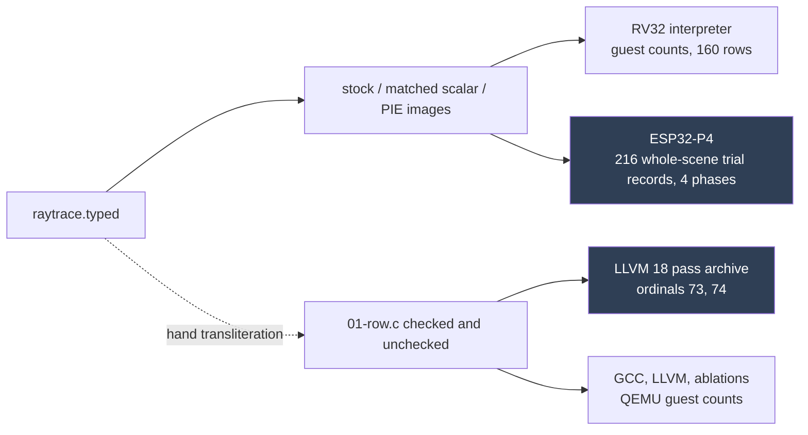

# Evidence for the Next Typed JS Optimization on the ESP32-P4

**Abstract.** This article asks which recorded evidence justifies a practical optimization to the Typed JS native compiler on the ESP32-P4. It combines three kinds of evidence: static LLVM IR states for a C model of the Typed ray row, dynamic guest instruction counts for C and Typed code on the same 160 row inputs, and paired physical timings of three Typed compiler treatments on the board. The validation scope of the inferred PIE producer is concrete. In the interpreter, all 480 Typed calls (160 recorded valid row inputs × 3 images) reproduced the 4,100 gold bytes. On the board, the runner checks each trial's output CRCs against the reference. No invalid-index input was exercised. Within that scope the producer accounts for a small part of the gain. Over the 160 row inputs, matched scalar accounts for 408,787 of the 477,262 interpreter steps PIE saves over stock Typed. On the default scene, PIE's paired clean-frame saving has a median of 242 µs over matched scalar and 1,616 µs over stock. Across all twelve recorded scenes, the per-scene median clean-frame saving over matched scalar ranges from 0.4095% to 0.4663%. Stock Typed executes 936,328 direct stack loads on the 160 row inputs. The GCC-compiled checked C row executes 1,120 direct stack loads on the same inputs. It is compiled from a source whose contract traps on every invalid index, but none of the 160 valid rows took a trap path. On this fixture, the evidence points to a checked scalar loop that keeps the hot values in registers. The article ends with a falsifiable version of that proposal and the exact collection it needs. I read every number here from frozen project artifacts and the two raw LLVM dumps, or derived it by arithmetic. The twelve-scene range comes from the supervisor's later validation, which section 5 describes. I ran no compiler, emulator, script or board.

## 1. The question, the layers, and the product status

Compiler evidence comes in layers, and a claim made at one layer does not transfer to another unchecked. This study uses four layers. The **static layer** is the text of LLVM IR after each optimization pass, archived for a C model of the Typed row function. The **guest-count layer** counts the instructions a program executes when run on an emulator: QEMU for the C objects and the project's RV32 interpreter for Typed images. The **physical layer** consists of microsecond timings on the ESP32-P4. The **product layer** is what ships. Each layer answers a different question, and the diagram shows which artifact feeds which.



The C model is the bridge. `01-row.c` keeps the Typed buffer layout, which is a 32-bit capacity followed by 16-bit elements. It also keeps the Typed table offsets (16 for the sphere count, 520 for the root table, 1545 for depths, 1705 for identities) and the fused traversal. Because the model is hand-written, LLVM evidence about it describes what a mature optimizer does with the same bounds contract. It is not a trace of the Typed compiler. [01-row.c](https://github.com/wesen/2026-10-20--ds-js-os/blob/bbb9d9eaf465ca35f8125d85ba06f7137012f648/ttmp/2026/11/21/PICOCALC-ROW-IR--trace-the-ray-row-through-gcc-and-llvm-optimization-passes/scripts/01-row.c)

The product status is separate from these archive findings. According to the physical report, the inferred PIE loop pass is an opt-in compiler setting, and other applications keep the stock cold-compile cost. The physical report also cites a separate experiment whose complete Typed frame of 29.975 ms is the fastest recorded in these studies. That experiment rewrote the Typed source, changing the traversal and adding a divisor proof. It is not one of the three compiler treatments compared here, which all compile the unchanged source. Its frame time therefore cannot be compared with the clean-phase times in section 5 as a treatment effect. Nothing in my packet records a decision to make PIE loops the default. [physical report](https://github.com/wesen/2026-10-20--ds-js-os/blob/bbb9d9eaf465ca35f8125d85ba06f7137012f648/ttmp/2026/11/21/PICOCALC-PIE-LOOPS--infer-and-lower-packed-loop-regions-in-unchanged-typed-programs/analysis/01-what-an-inferred-packed-subtraction-buys-on-the-esp32-p4.md) · [C and Typed report](https://github.com/wesen/2026-10-20--ds-js-os/blob/bbb9d9eaf465ca35f8125d85ba06f7137012f648/ttmp/2026/11/21/PICOCALC-ROW-IR--trace-the-ray-row-through-gcc-and-llvm-optimization-passes/analysis/01-from-checked-halfwords-to-a-native-row-loop-in-gcc-and-llvm.md)

## 2. A static witness: capacity loads at ordinals 73 and 74

Every checked element access in the C model calls a helper that reads `work->capacity`, compares it with the index, and traps on failure. Since `capacity` is the first field of the struct, the load reads `i32` directly from the pointer in argument zero, with no offset. I call such a load a **direct i32 header load site**. A site is one instruction in the program text. It is not an execution count.

The source has eleven helper calls. The clearing loop has two, the sphere count read has one, and the three sphere fields `obj+1`, `obj+2` and `obj+3` add three more. The inner pixel loop has five: the horizontal sample, the root lookup at `520+d`, the old depth read, and the two conditional stores. That makes 2 + 1 + 3 + 5 = 11. The pass metrics for the checked variant record the helper calls first as 11 `elementCalls` with zero header loads. After inlining they record 0 calls, 11 trap call sites and 11 header loads. One EarlyCSE snapshot shows 11 traps and 6 header loads. Later SROA and LoopVectorize snapshots show 10 traps and 6 loads. The unchecked variant never has a header load. [pass-metrics.json](https://github.com/wesen/2026-10-20--ds-js-os/blob/bbb9d9eaf465ca35f8125d85ba06f7137012f648/ttmp/2026/11/21/PICOCALC-ROW-IR--trace-the-ray-row-through-gcc-and-llvm-optimization-passes/various/passes/pass-metrics.json)

The witness for the 11 → 6 change is a pair of byte ranges in one archived stream, which is the stderr of `opt-18 -passes=default<O2> -debug-pass-manager -print-after-all` on the checked module. Each address has the form `{variant, phase, streamSHA, ordinal, start, end}`, and the range is half-open over the uncompressed stream.

| Ordinal | Header | Start | End | Range bytes | Definition bytes | Direct i32 header load sites | `llvm.trap` calls |
|---:|---|---:|---:|---:|---:|---:|---:|
| 73 | `IR Dump After SROAPass on row` | 231,496 | 240,363 | 8,867 | 8,635 | 11 | 11 |
| 74 | `IR Dump After EarlyCSEPass on row` | 240,363 | 248,127 | 7,764 | 7,627 | 6 | 11 |

Both rows share the stream digest `bbd3b983cff150aeb56d99e517331a1ea0b4af5afc86869c730b9dca2ac795b4`, which is the digest of the uncompressed `checked-middle` stream. The arithmetic checks: 240,363 − 231,496 = 8,867 and 248,127 − 240,363 = 7,764. Ordinal 73 ends where ordinal 74 begins, so the two dumps are adjacent. The range lengths differ by 1,103 bytes, but that difference measures whole dump ranges. Each range includes the `; *** IR Dump After …` header, the `; Function Attrs` comment and the pass-manager lines printed after the function. The function definition itself runs from `define` through its closing brace, excluding the trailing newline. It is 8,635 bytes at ordinal 73 and 7,627 bytes at ordinal 74, a difference of 1,008 bytes. My packet contains the complete raw text of both ranges, and the load and trap counts in the table come from reading those bodies directly. [w-full-fixture witness, original stream](https://github.com/wesen/2026-10-20--ds-js-os/blob/bbb9d9eaf465ca35f8125d85ba06f7137012f648/ttmp/2026/11/21/PICOCALC-ROW-IR--trace-the-ray-row-through-gcc-and-llvm-optimization-passes/various/llvm-pipeline/checked-middle.log.gz)

Ordinals are necessary because pass names repeat. The checked metrics hold four SROA snapshots and two EarlyCSE snapshots for `row`. The coordinator also found two backend dumps both named `virtregrewriter`, at ordinals 74 and 78. A lookup by name returns several states, and only the ordinal within a variant and phase identifies one. Repeated reads of the same address also matter for tools. In direct library use, the Go reader verifies the stream digest and indexed headers on first body access. The REPL service release candidate calls `Archive.Verify()` during startup to validate and retain every stream before it accepts a session. Later body reads in either path reuse the validated bytes. The direct-reader benchmark in the investigation diary measures the library call. [coordinator diary](https://github.com/wesen/2026-10-20--ds-js-os/blob/bbb9d9eaf465ca35f8125d85ba06f7137012f648/ttmp/2026/11/21/PICOCALC-TRACE-REPL--a-persistent-compiler-evidence-repl-in-go-and-javascript/reference/03-archive-diary.md)

The bodies show which sites survive. A direct site is a line of the form `load i32, ptr %work`. SSA value names are numbered separately in each state, so the same name can denote different instructions in the two dumps. Ordinal 73's `%8` is a sphere-field capacity load in `element.exit52`, while ordinal 74's `%8` is the inner-loop load in `for.body29`. The block labels are the same in both dumps, so the comparison below goes by block. At ordinal 73 the eleven direct loads are `%0` in `for.cond.cleanup` (count read), `%2` in `for.body` and `%3` in `element.exit37` (clearing loop), `%4` in `for.body8`, `%6` in `element.exit47` and `%8` in `element.exit52` (sphere fields), and `%10` in `for.body29`, `%12` in `if.then`, `%14` in `element.exit67`, `%16` in `if.then45` and `%18` in `element.exit77` (inner pixel loop). At ordinal 74 the six direct loads are `%0` in `for.cond.cleanup`, `%2` in `for.body`, `%3` in `element.exit37`, `%4` in `for.body8`, `%8` in `for.body29` and `%13` in `element.exit77`. The inner loop shows the change concretely. At ordinal 74 the checks in `if.then` and `element.exit67` compare `%8` with `%add36` and `%add40` instead of loading the capacity again. The capacity loads that survive in `element.exit37` and `element.exit77` each follow an `i16` store through a pointer derived from `%work`. EarlyCSE does not prove that such a store leaves the header unchanged. The sphere loop goes from three loads to one, and the inner loop goes from five to two. The tail of ordinal 74 schedules `SpeculativeExecutionPass on row (126 instructions)`, and the tail of ordinal 73 announces EarlyCSE on 142 instructions. The 16-instruction difference consists of 5 capacity loads, 1 comparison, 9 repeated `%data.i*` field GEPs and the duplicate address `%add.ptr.i76`. [w-full-fixture witness, original stream](https://github.com/wesen/2026-10-20--ds-js-os/blob/bbb9d9eaf465ca35f8125d85ba06f7137012f648/ttmp/2026/11/21/PICOCALC-ROW-IR--trace-the-ray-row-through-gcc-and-llvm-optimization-passes/various/llvm-pipeline/checked-middle.log.gz)

The witness also has limits. First, a byte range is not a clean function body. With `-debug-pass-manager` writing to the same stderr, each range also holds the lines that the pass manager prints before the next header. The coordinator reports that the first dump in the stream begins at byte 50, after a preamble. A counter must therefore parse the `define ... @row` body and ignore those lines. Second, the count is static. Of the five removed sites, two lie in the per-sphere loop and three lie on conditional paths of the inner pixel loop, in `if.then`, `element.exit67` and `if.then45`. Those three run only for candidate hits, so 11 → 6 has no fixed dynamic weight. Third, attribution to EarlyCSE needs the pass-manager lines between the two dumps. The tail of ordinal 73 reads `Running pass: EarlyCSEPass on row (142 instructions)`, followed by three analysis announcements: `MemorySSAAnalysis`, `AAManager` and `BasicAA`. No other transformation pass is announced before the ordinal-74 header, so the change is attributable to EarlyCSE in this pipeline. Fourth, both dumps contain 11 `call void @llvm.trap()` instructions, which agrees with the metrics. The trap count is not the number of live checks. At ordinal 74, the store check in `if.then45` repeats the comparison already made in `element.exit67` (same capacity `%8`, same index `%add40`). EarlyCSE folded that check to `br i1 true`, which leaves its trap block in the text but unreachable. Ten live comparisons therefore remain. The later snapshots with 10 traps fit a subsequent pass deleting that block, but I have not checked the dumps that would show it. Finally, no ablation in the packet disables EarlyCSE, so whether later passes such as GVN would have removed the same loads stays unknown.

The pseudocode below is the counting predicate. The coordinator's exact regular expression is not in my packet, so this is a specification, not a copy. Applied by reading to the two raw dumps, it gives the counts in the table.

```python
data = gzip.decompress(read("checked-middle.log.gz"))
assert sha256(data) == "bbd3b983...95b4"
dump = data[231496:240363]                     # ordinal 73, half-open, 8,867 bytes
body = span(dump, b"define", b"\n}")           # through "}", 8,635 bytes; 7,627 at 74
sites = [l for l in body if l.strip().endswith(b"= load i32, ptr %work, align 4")]
traps = [l for l in body if b"call void @llvm.trap()" in l]
assert len(sites) == 11 and len(traps) == 11   # 6 and 11 for data[240363:248127]
```

## 3. Checked C as a dynamic reference

Static sites become meaningful when they are joined to execution. The C execution script links each object with a tiny start file, runs it under `qemu-riscv32-static -one-insn-per-tb -d exec,nochain` once for each of the 160 row inputs, and counts only the guest PCs inside the linked `row` symbol. Each run's output buffer must equal the gold bytes produced by the real Wasm build of `raytrace.typed`. The totals cover all 160 calls. [05-execute.py](https://github.com/wesen/2026-10-20--ds-js-os/blob/bbb9d9eaf465ca35f8125d85ba06f7137012f648/ttmp/2026/11/21/PICOCALC-ROW-IR--trace-the-ray-row-through-gcc-and-llvm-optimization-passes/scripts/05-execute.py) · [03-fixtures.mjs](https://github.com/wesen/2026-10-20--ds-js-os/blob/bbb9d9eaf465ca35f8125d85ba06f7137012f648/ttmp/2026/11/21/PICOCALC-ROW-IR--trace-the-ray-row-through-gcc-and-llvm-optimization-passes/scripts/03-fixtures.mjs)

| C row, 160 calls | Guest instructions | Direct sp loads | Direct sp stores | Row bytes |
|---|---:|---:|---:|---:|
| Checked, GCC 14.2 `-O2` | 1,136,142 | 1,120 | 1,120 | 318 |
| Checked, GCC `-fno-ivopts` | 1,308,071 | 0 | 0 | 278 |
| Checked, LLVM 18 `llc -O2` (LSR on) | 1,233,611 | 320 | 320 | 296 |
| Checked, `llc -O2 -disable-lsr` | 1,275,560 | 0 | 0 | 268 |
| Unchecked, GCC | 768,238 | 160 | 160 | 174 |
| Unchecked, GCC `-fno-ivopts` | 1,407,598 | 0 | 0 | 176 |
| Unchecked, LLVM `llc` (LSR on) | 632,124 | 640 | 640 | 210 |
| Unchecked, `llc -disable-lsr` | 798,350 | 960 | 960 | 236 |

[execution.json](https://github.com/wesen/2026-10-20--ds-js-os/blob/bbb9d9eaf465ca35f8125d85ba06f7137012f648/ttmp/2026/11/21/PICOCALC-ROW-IR--trace-the-ray-row-through-gcc-and-llvm-optimization-passes/various/passes/execution.json)

Four comparisons follow from the table. With checks, GCC executes 97,469 fewer instructions than LLVM (1,233,611 − 1,136,142). Without checks, the order reverses, and LLVM executes 136,114 fewer. The bounds contract costs GCC 367,904 instructions, 47.9% above its unchecked row, and costs LLVM 601,487, 95.2% above its unchecked row. The LSR pairs come from the same optimized module, run through `llc` with and without `-disable-lsr`. With checks, LSR saves 41,949 instructions (3.29% of the disabled arm) and grows the row from 268 to 296 bytes. Without checks, it saves 166,226 (20.82%) and shrinks the row from 236 to 210 bytes. The clang-built unchecked object is 208 bytes and the `llc`-built one is 210, with identical counts. Code size and executed work are therefore separate measures. A larger checked row can execute fewer instructions.

Stack accesses are counted by two different predicates, and the difference matters. The C counter disassembles the linked binary and counts an executed PC when its mnemonic is `lw`, `lh`, `lhu`, `sw` or `sh` and its operand text contains `(sp)`. Byte loads, byte stores and floating-point accesses are not counted, and neither are accesses through any other base register, including a pointer copied from `sp`. The Typed counter in section 4 instead reads the 32-bit word at the PC and tests the encoding fields: `rs1 == 2` with major opcode 3 (LOAD) or 35 (STORE). It counts all integer widths, but it does not decode compressed or vendor encodings. [07-typed-counts.mjs](https://github.com/wesen/2026-10-20--ds-js-os/blob/bbb9d9eaf465ca35f8125d85ba06f7137012f648/ttmp/2026/11/21/PICOCALC-ROW-IR--trace-the-ray-row-through-gcc-and-llvm-optimization-passes/scripts/07-typed-counts.mjs)

Neither counter can identify a register spill. An sp-relative store may be a callee-saved register save in the prologue, a spilled temporary, a local with a permanent stack home, or scratch storage. The per-call constancy in the C samples is suggestive. Checked GCC executes 7 loads and 7 stores in each of rows 0, 61 and 109, and 1,120 = 7 × 160. LLVM executes 2 and 2. Counts that stay fixed while the loop work varies fit prologue and epilogue saves, but a spill outside any loop would produce the same pattern. Confirming the attribution needs per-PC counts matched against the disassembly, and the packet has only totals and three sample rows. The LSR pair shows why a stack count is not a score: checked LLVM with LSR adds 640 sp accesses and still executes 41,949 fewer instructions.

## 4. Three Typed outputs on the same 160 rows

The Typed compiler builds three images of the unchanged source. **Stock** is the ordinary backend. **Matched scalar** applies the PIE-loops region inference but fills the scratch lanes with eight scalar subtracts and halfword stores. **PIE** fills them with one 16-byte load, one eight-lane signed saturating subtraction and one 16-byte scratch store. The scalar and PIE arms share admission, memory intervals, iteration domain, lane consumer and fallback. Every one of the 480 Typed calls (160 valid row inputs × 3 images) reproduced the 4,100 gold bytes. No input in this set reaches a bounds trap, so these calls do not test trap order. The `Packed stores` column is the interpreter's `r.packed.stores`. It counts executed 16-byte packed scratch stores, not packets or groups. Under the lowering described above, each eight-lane group issues exactly one such store, so the count also bounds the number of packed groups. That correspondence comes from the emitter's design and is not counted separately. [typed-counts.json](https://github.com/wesen/2026-10-20--ds-js-os/blob/bbb9d9eaf465ca35f8125d85ba06f7137012f648/ttmp/2026/11/21/PICOCALC-ROW-IR--trace-the-ray-row-through-gcc-and-llvm-optimization-passes/various/passes/typed-counts.json)

| Typed, 160 row inputs | Interpreter steps | Direct sp loads | Direct sp stores | Packed stores | Image bytes |
|---|---:|---:|---:|---:|---:|
| Stock (program 0) | 3,608,697 | 936,328 | 353,778 | 0 | 9,564 |
| Matched scalar (program 8) | 3,199,910 | 729,553 | 309,611 | 0 | 10,384 |
| PIE (program 5) | 3,131,435 | 729,553 | 309,776 | 3,135 | 10,308 |

Image sizes come from the device identity file, and all three images compile the same source digest `b0a7c02b…`. On these 160 row inputs, matched scalar saves 408,787 steps (11.33% of stock) and 206,775 stack loads compared with stock. PIE then saves another 68,475 steps (2.14% of matched scalar), with exactly the same stack loads and 165 more stack stores. Of the 477,262 steps PIE saves over stock on this fixture, 85.65% of the difference is already present in matched scalar, and 14.35% separates PIE from matched scalar. These are interpreter steps. One step is one decoded instruction, a packed instruction counts as one step, and a step is not a P4 clock cycle. [images.json](https://github.com/wesen/2026-10-20--ds-js-os/blob/bbb9d9eaf465ca35f8125d85ba06f7137012f648/ttmp/2026/11/21/PICOCALC-PIE-LOOPS--infer-and-lower-packed-loop-regions-in-unchanged-typed-programs/various/device/images.json)

The sample rows separate rows that execute no packed stores from active ones. Row 0 executes 0 packed stores, and its matched-scalar and PIE counts are identical: 20,130 steps, 5,192 loads, 1,960 stores. Row 61 executes 38 packed stores and saves 830 steps with 2 extra stack stores. Row 109 executes 19 packed stores and saves 415 steps with 1 extra stack store. The totals follow the same unit exactly: 3,135 = 165 × 19, 68,475 = 165 × 415, and the stack-store difference is 165. The data are therefore consistent with 165 region executions of 19 packed stores (one per group) each, every one saving 415 steps (21.84 per group) and adding one stack store. With eight lanes, 19 groups cover 152 of 160 pixels, which fits one group being lost to alignment. Per-PC counts would confirm or refute this. The three samples alone cannot. A row with no packets also shows that the scalar arm costs something before it pays: row 0 executes 27 more instructions and 6 more stack loads under matched scalar than under stock.

The fast path has semantic limits that do not depend on vector width. Typed reads an unsigned halfword and computes an exact 32-bit difference, while the PIE subtract works on signed saturating lanes. The compiler admits a row term only between 0 and 32,766. It reads each lane back as unsigned and accepts it only when the value is at most the row term, so every true hit gives its exact nonnegative discriminant, and both negative results and saturated lanes are rejected. At a row term of 32,767 the argument fails, and the scalar path runs instead. Checked memory adds a second limit. The emitter proves, or tests at entry, that the output writes cannot alias unread input, and a shifted alias or a short output takes the scalar route so that writes before a trap happen in the original order. The hit continuation, with the variable root lookup, the nearest-depth comparison and the conditional stores, always stays in ordinary scalar code. The report's post-freeze probe shows the cost of the guard. On a misaligned eight-element transfer with no full group, stock took 282 instructions, matched scalar 305 and PIE 308. [physical report](https://github.com/wesen/2026-10-20--ds-js-os/blob/bbb9d9eaf465ca35f8125d85ba06f7137012f648/ttmp/2026/11/21/PICOCALC-PIE-LOOPS--infer-and-lower-packed-loop-regions-in-unchanged-typed-programs/analysis/01-what-an-inferred-packed-subtraction-buys-on-the-esp32-p4.md)

The same table shows the gap to C on this fixture. Checked GCC executes 1,136,142 QEMU guest instructions on the same 160 valid inputs, which is 36.3% of PIE Typed's 3,131,435 interpreter steps. The two counters come from different tools, and both count one executed RV32 instruction as one unit. The GCC row is compiled from the checked source, but these inputs do not exercise its trap paths. PIE Typed executes 729,553 direct stack loads where checked GCC executes 1,120, a ratio near 651. The two stack predicates differ as described in section 3.

## 5. Physical timing and how to pair it

The board runner loads the three Typed treatments in each of the six permutations of `(0, 8, 5)`, one permutation per acquisition block. After each load it times twelve recorded scenes at 160 × 160 with their recorded strides. Each benchmark trial record covers one whole scene for one treatment in one block, not one row of the picture. It reports four phase entry points, `clean`, `audit`, `primary` and `shade`, and each phase is a separately invoked benchmark with its own setup. That gives 6 × 3 × 12 = 216 trial records and 18 loads. Every load checks the linked ELF CRC against the host identity, and the runner checks each trial's three output CRCs against the reference. On the default scene, the recorded trials of all three treatments carry the same output triplet `ab0a7c80`, `cd0ef60c`, `bf111cbb`. [06-board.py](https://github.com/wesen/2026-10-20--ds-js-os/blob/bbb9d9eaf465ca35f8125d85ba06f7137012f648/ttmp/2026/11/21/PICOCALC-PIE-LOOPS--infer-and-lower-packed-loop-regions-in-unchanged-typed-programs/scripts/06-board.py) · [loads.json](https://github.com/wesen/2026-10-20--ds-js-os/blob/bbb9d9eaf465ca35f8125d85ba06f7137012f648/ttmp/2026/11/21/PICOCALC-PIE-LOOPS--infer-and-lower-packed-loop-regions-in-unchanged-typed-programs/various/device/loads.json)

Two orders operate in this design. The outer order is the treatment's load position in the block. Within one block the three treatments occupy three different load positions by construction. The six blocks cycle through all six permutations so that, across blocks, each treatment occupies each position equally often. The inner order is the rotation of the three timing arms (two C references and the installed Typed program), `rot = (block + pos + i) mod 3`, where `i` is the scene's position in the block's rotated scene list. Since 12 is a multiple of 3, `rot ≡ pos + k (mod 3)` for scene `k`, so within one scene the rotation is fully determined by load position. For the default scene `k = 0`, and rotation equals load position in every block. The raw record index is `36·block + 12·pos + i`, and this formula reproduces all eighteen opening trial records in the fixture. Within each scene, every treatment appears twice at each position, so position effects are counterbalanced across the six blocks. Rotation, however, cannot be tested there as a separate factor. The board rotates the inner timer arms but stores times by arm identity, not by collection order, so the installed Typed timing is always `timesUs[2]` whatever its rotation. [rows.json](https://github.com/wesen/2026-10-20--ds-js-os/blob/bbb9d9eaf465ca35f8125d85ba06f7137012f648/ttmp/2026/11/21/PICOCALC-PIE-LOOPS--infer-and-lower-packed-loop-regions-in-unchanged-typed-programs/various/device/rows.json)

The default scene's clean phase, block by block (S stock, M matched scalar, P PIE, all in µs):

| Block | Load order | S | M | P | S − P | (S − P)/S | M − P | (M − P)/M |
|---:|---|---:|---:|---:|---:|---:|---:|---:|
| 0 | S M P | 57,673 | 56,311 | 56,094 | 1,579 | 2.738% | 217 | 0.385% |
| 1 | S P M | 57,692 | 56,260 | 56,039 | 1,653 | 2.865% | 221 | 0.393% |
| 2 | M S P | 57,692 | 56,346 | 56,039 | 1,653 | 2.865% | 307 | 0.545% |
| 3 | M P S | 57,700 | 56,349 | 56,089 | 1,611 | 2.792% | 260 | 0.461% |
| 4 | P S M | 57,670 | 56,348 | 56,049 | 1,621 | 2.811% | 299 | 0.531% |
| 5 | P M S | 57,697 | 56,333 | 56,109 | 1,588 | 2.752% | 224 | 0.398% |
| Median | | 57,692 | 56,339.5 | 56,069 | 1,616 | 2.801% | 242 | 0.430% |

The two ways of summarizing differ. The **marginal median difference** subtracts medians computed separately for each arm. The **median of paired differences** first subtracts within each block and then takes the median. For stock to PIE the marginal value is 57,692 − 56,069 = 1,623 µs and the paired value is 1,616 µs. For matched scalar to PIE the marginal value is 56,339.5 − 56,069 = 270.5 µs and the paired value is 242 µs. The paired form is the right one here, because both members of each difference come from the same scene fixture and the same acquisition block. Pairing controls those two factors. It cannot guarantee identical physical machine state, and the two members always come from different load positions within the block. Order effects are handled by counterbalancing across the six permutations, not by the pairing. Paired medians are not additive. The stock-to-scalar paired median is 1,356.5 µs, and 1,356.5 + 242 = 1,598.5 does not equal 1,616. Percentages use each pair's own baseline, so the 2.801% is the median of six ratios, not 1,616 / 57,692. All six PIE-over-scalar differences in this scene are positive, ranging from 217 to 307 µs. [09-paired-results.py](https://github.com/wesen/2026-10-20--ds-js-os/blob/bbb9d9eaf465ca35f8125d85ba06f7137012f648/ttmp/2026/11/21/PICOCALC-PIE-LOOPS--infer-and-lower-packed-loop-regions-in-unchanged-typed-programs/scripts/09-paired-results.py)

The phase entry points show where the time goes. In the default scene's opening trial records, the paired stock-to-PIE primary saving has a median of 1,609.5 µs, close to the clean-frame 1,616 µs, while the shade phase moves between −47 and +58 µs. The report's medians across the opening scene are 17.791, 16.429 and 16.185 ms for primary and 48.575, 48.562 and 48.564 ms for shade. Because primary and shade run with their own setup, these numbers show where the saving is concentrated, not an additive decomposition of the clean frame. Across all twelve scenes, the report gives median clean-frame savings of 2.66% to 2.89% over stock and 0.41% to 0.47% over matched scalar. My own frozen-packet analysis held raw trial records only for the default scene's opening blocks, and I verified only that scene by hand. The twelve-scene figures were validated after that analysis by the supervisor, using the standalone script described in section 7. Relative to matched scalar, PIE's per-scene median clean-phase saving ranges from 0.4095% to 0.4663% across the 12 scenes. This range was reproduced independently by the supervisor and agrees with the report's rounded 0.41% to 0.47%. This sets the physical conclusion for this fixture. On the P4 clean phase, the packed producer adds less than half a percent over the matched scalar code it replaces. The concrete falsifier "PIE alone saves at least 1% clean-frame time in every pose" therefore fails, and it fails on all 12 scenes, since no per-scene median reaches 1%. [physical report](https://github.com/wesen/2026-10-20--ds-js-os/blob/bbb9d9eaf465ca35f8125d85ba06f7137012f648/ttmp/2026/11/21/PICOCALC-PIE-LOOPS--infer-and-lower-packed-loop-regions-in-unchanged-typed-programs/analysis/01-what-an-inferred-packed-subtraction-buys-on-the-esp32-p4.md)

The guest-count and physical layers agree on one proportion on the default scene. This is consistent with the cheaper scalar work also mattering on hardware, but it does not show that the scalar work causes the physical saving. Per block, `(S − M)/(S − P)` for the clean phase is 86.3%, 86.6%, 81.4%, 83.9%, 81.6% and 85.9%, close to the 85.65% share of instructions. The rows also hold a `cycles` field. For block 0 stock clean, 20,760,393 / 57,673 ≈ 360 counts per µs. The timer code in `typed_ray_p4.c` is not in my packet, so I treat this as a recorded ratio and not as a verified clock rate. None of this converts interpreter steps into cycles.

Compilation is part of the cost. The board's median cold compile is 454,132.5 µs for stock, 658,508.5 µs for matched scalar and 658,027 µs for PIE, with peak JavaScript heaps near 680 kB and 774 kB. The report's later prefilter brings the PIE compile down to 523.692 ms and puts break-even at about 44 frames.

## 6. A falsifiable next optimization

Within the scope of this fixture, the evidence supports one specific next step. The proposal is a **checked scalar loop for the ordinary Typed backend**: in the innermost pixel loop of `typedRayComputeRow`, keep the index, the invariant row term, the buffer base and a validated capacity value in registers. The capacity is reloaded only after an operation that may write the header, and every bounds check stays in source order. This is the Typed analogue of what EarlyCSE did at ordinal 74. There, one capacity value in `for.body29` serves the inner-loop checks until the store in `if.then45`, and the value is reloaded in `element.exit77`. The proposal adds what the register allocator did for checked GCC. The supporting evidence is 729,553 stack loads that remain unchanged between matched scalar and PIE on the 160 row inputs, the checked-C stack counts near zero on the same inputs, and the earlier factor experiment cited in the C report, where moving selected loop locals to registers saved a paired 3.121 ms of primary time with checks retained. I did not verify that last figure from raw data.

The hypothesis is falsifiable at two layers, and every clause must hold for it to survive. Let R be the register-loop treatment and M matched scalar.

- **Guest-count clause.** R executes fewer direct sp loads than M on the same 160 row fixtures. Its output bytes must be identical on every fixture. A new set of invalid-index fixtures must also show the same trap behavior, because the current set contains none. The clause fails if the loads do not fall, if any output differs, or if any trap prefix differs.
- **Physical clause.** For each scene k of the twelve, let d_k be the median over the six blocks of the paired primary-phase difference M − R in µs. The clause holds if and only if d_k > 0 for every k. If any single scene has d_k ≤ 0, the clause is falsified, whatever the other eleven scenes show. A median pooled across scenes plays no part in this test.

The hypothesis is rejected if either clause fails. I set no magnitude threshold, because none of the recorded data justifies a specific predicted speedup.

```text
for each treatment in {matched-scalar, register-loop, register-loop+PIE}:
    image   = compile(raytrace.typed, mode)            # record image bytes, source SHA
    for y in 0..159:
        run interpreter with per-PC hooks              # counts[pc], not only totals
        assert bytes == gold[y] and trap prefix equal
    classify sp accesses by PC: prologue/epilogue, loop body, scratch
board: 6 permutations x 12 scenes x 4 phases, timesUs[2], ELF CRC per load
report: paired per-block us and % per (scene, phase), cold compile us, peak JS bytes
```

Several measurements are missing, and each limits a claim made above. The packet has no per-PC Typed counts, so the 19-group unit and the stack-access classification remain inferences. The IR bodies for ordinals 73 and 74 are available and name the six surviving sites (section 2). The packet has no IR for the later snapshots, so the removal of the folded trap block is inferred from the metrics. No EarlyCSE-disabled ablation exists, so the dynamic value of the 11 → 6 change is unknown. No fixture exercises an invalid index, so trap behavior is covered only by the source contract and the static IR. No LLVM-compiled code has run on the board. My frozen packet held raw device records only for the default scene's opening blocks. The other eleven scenes rest on the report's summary and on the supervisor's later validation of all 144 groups. The timer and renderer sources are named but not supplied.

## 7. Reproduction guide

The shared source checkout is `/home/manuel/code/wesen/2026-10-20--ds-js-os`. The portion of each source URL after the commit hash is also its path in that checkout. Use a separate checkout or worktree for the pinned revisions below.

Provenance has two stages, and the commands follow it. The original studies and my analysis use the frozen revision `bbb9d9eaf465ca35f8125d85ba06f7137012f648`. The supervisor's later validation uses a standalone script committed afterwards. At the frozen revision, run these from the repository root. The Python reader lists matching dumps and writes one by index. The writer ends at the next index entry, so `--entry 73` returns the whole range `[231496, 240363)`, header and pass-manager lines included, and not only the definition.

```bash
git checkout bbb9d9eaf465ca35f8125d85ba06f7137012f648
r=ttmp/2026/11/21/PICOCALC-ROW-IR--trace-the-ray-row-through-gcc-and-llvm-optimization-passes
p=ttmp/2026/11/21/PICOCALC-PIE-LOOPS--infer-and-lower-packed-loop-regions-in-unchanged-typed-programs
python3 "$r/scripts/10-read-pass.py" checked middle SROAPass
python3 "$r/scripts/10-read-pass.py" checked middle SROAPass --entry 73 > /tmp/o73.ll
python3 "$r/scripts/10-read-pass.py" checked middle EarlyCSEPass --entry 74 > /tmp/o74.ll
python3 "$p/scripts/09-paired-results.py" "$p/various/device"
go test -race ./pkg/tracearchive
```

`go test -race ./pkg/tracearchive` is the coordinator's first archive test. It checks the header-load change at 73 to 74 against the real archive. `pkg/tracehardware` was not committed at the frozen revision, so it cannot be run there.

The after-the-fact validation of the physical groups is a standalone Python script at commit `313021c59bb98fc42c0cecd9f2fc1f3781f1d35a`. It lives at `ttmp/2026/11/21/PICOCALC-TRACE-REPL--a-persistent-compiler-evidence-repl-in-go-and-javascript/scripts/13-verify-evidence-article.py` and runs from the repository root. It reads the raw device records directly and verifies all 144 comparison groups across all twelve scenes. Its output is the source of the 0.4095% to 0.4663% range in section 5. The new Go test suite in `pkg/tracehardware` is separate from this script, and this article does not rely on it.

```bash
git checkout 313021c59bb98fc42c0cecd9f2fc1f3781f1d35a
python3 ttmp/2026/11/21/PICOCALC-TRACE-REPL--a-persistent-compiler-evidence-repl-in-go-and-javascript/scripts/13-verify-evidence-article.py
```

Two kinds of qualification need to stay apart. The independent oracle consists of the standalone script and the archive test. These read the frozen artifacts directly, and the supervisor's figures come from that oracle. The trace REPL's JavaScript public API needs its own qualification against that oracle. This article does not report it. No JavaScript API call was executed for this article, and no public persona result is claimed here. The paired arithmetic for the default clean phase can be checked without any tools.

```python
from statistics import median
S=[57673,57692,57692,57700,57670,57697]; M=[56311,56260,56346,56349,56348,56333]
P=[56094,56039,56039,56089,56049,56109]
assert median(S)-median(P)==1623 and median([s-p for s,p in zip(S,P)])==1616
assert median([m-p for m,p in zip(M,P)])==242 and median(M)-median(P)==270.5
```

[10-read-pass.py](https://github.com/wesen/2026-10-20--ds-js-os/blob/bbb9d9eaf465ca35f8125d85ba06f7137012f648/ttmp/2026/11/21/PICOCALC-ROW-IR--trace-the-ray-row-through-gcc-and-llvm-optimization-passes/scripts/10-read-pass.py) · [09-archive-llvm.py](https://github.com/wesen/2026-10-20--ds-js-os/blob/bbb9d9eaf465ca35f8125d85ba06f7137012f648/ttmp/2026/11/21/PICOCALC-ROW-IR--trace-the-ray-row-through-gcc-and-llvm-optimization-passes/scripts/09-archive-llvm.py) · [coordinator diary](https://github.com/wesen/2026-10-20--ds-js-os/blob/bbb9d9eaf465ca35f8125d85ba06f7137012f648/ttmp/2026/11/21/PICOCALC-TRACE-REPL--a-persistent-compiler-evidence-repl-in-go-and-javascript/reference/03-archive-diary.md) · [13-verify-evidence-article.py](https://github.com/wesen/2026-10-20--ds-js-os/blob/313021c59bb98fc42c0cecd9f2fc1f3781f1d35a/ttmp/2026/11/21/PICOCALC-TRACE-REPL--a-persistent-compiler-evidence-repl-in-go-and-javascript/scripts/13-verify-evidence-article.py)

The main conclusion is scoped to this ray row, its 160 valid row fixtures and the twelve recorded scenes. On that scope, packed arithmetic is a measured but secondary gain: 0.4095% to 0.4663% of the clean phase over matched scalar on the P4. The larger and better-supported target is the scalar code around it. In the checked C model compiled by GCC, the bounds checks from the source contract coexist with near-zero stack traffic. The trap paths of that model were not exercised on these inputs. [physical report](https://github.com/wesen/2026-10-20--ds-js-os/blob/bbb9d9eaf465ca35f8125d85ba06f7137012f648/ttmp/2026/11/21/PICOCALC-PIE-LOOPS--infer-and-lower-packed-loop-regions-in-unchanged-typed-programs/analysis/01-what-an-inferred-packed-subtraction-buys-on-the-esp32-p4.md) · [execution.json](https://github.com/wesen/2026-10-20--ds-js-os/blob/bbb9d9eaf465ca35f8125d85ba06f7137012f648/ttmp/2026/11/21/PICOCALC-ROW-IR--trace-the-ray-row-through-gcc-and-llvm-optimization-passes/various/passes/execution.json)
