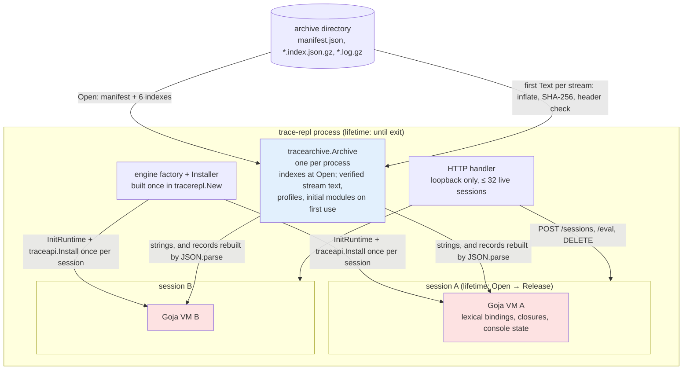
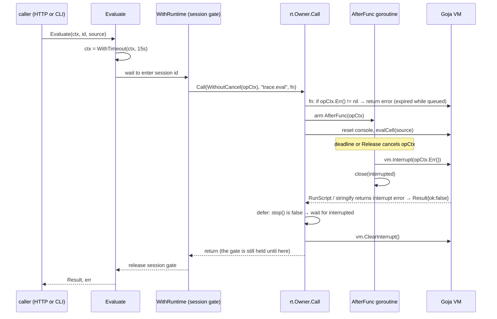

# Persistent Trace Sessions and Evidence Lifetimes: Designing and Falsifying a Compiler Change over the PicoCalc Ray-Row Archive

> **Revision under study.** The component assays use the reader and VM revisions recorded in `various/session-lifetime/input-revisions.json`. The integrated service now calls `Archive.Verify()` before it listens, so its six streams are already resident when the first session opens. References below to a first read inflating a stream describe the direct archive API. A live-service qualification follows separately.

The PicoCalc trace workbench (`trace-repl`) is a local Go server. It opens one archive of LLVM pass dumps for a ray-tracing row function and lets an engineer query that archive from JavaScript sessions that persist between requests. This note is for a compiler student meeting the workbench for the first time. It explains what persists, where it persists, for how long, and what ends it. It then uses that model to build one compiler hypothesis from archive facts, and states in advance which results would support the hypothesis and which would count against it.

> [!summary]
> - The workbench has two caches with different owners. JavaScript **bindings** live in one session's Goja VM and end when that session is released. **Verified archive data** (LLVM dump text, parsed profiles, initial modules) lives in one `Archive` per process. Every session shares it, and it ends only when the process exits. "Warm" or "cached" means nothing until you say which of the two you mean.
> - A session's cells run one at a time. A deadline, or a release of the session, interrupts a running cell. That includes JavaScript that runs while the result is being serialized. The interrupt is cleared before the next cell starts. Passing tests observed each of these behaviours.
> - The native bridge (`pkg/traceapi/install.go`) passes dump text to JavaScript as a string. It passes every structured record (events, profiles, statistics) as a new JavaScript value, built by the VM's own `JSON.parse`. A cell may mutate what it receives, and no other session sees the change.
> - In the checked C control, `%work` points to a buffer whose header holds its capacity. Each bounds check loads that capacity. The archive tests assert that `load i32, ptr %work,` appears 11 times in checked/middle ordinal 73 and 6 times in ordinal 74 (`EarlyCSEPass`). That is a static count. A candidate that removes more of these loads still has to show a net drop in executed guest instructions. An unchanged total would count against that drop, but it would not show that the removed loads were cold.
> - The resident-read benchmark (172.4 and 186.8 ns/op in this run) measures one Go substring read from an already verified stream. It is not query latency, not compiler speed and not PicoCalc speed.

## Methods and limits

Every claim in this note rests on one of four kinds of evidence:

- **Observed.** A passing test in the single assay run recorded in the study diary (Step 3). The run executed the five session tests of `pkg/tracerepl`, two real-corpus tests of `pkg/tracearchive` and `BenchmarkCheckedMiddleDump`. All 9 test executions passed.
- **Source.** Code that was read but not executed: `pkg/tracerepl/service.go`, `pkg/tracerepl/http.go`, `pkg/tracearchive/archive.go`, `pkg/traceapi/install.go`, and the archive tests outside the assay's `-run` filter (`TestProfileOwnershipAndModuleIdentity`, `TestIndexIntegrityAndInflatedByteAddressing`). Line numbers for `install.go` refer to the copy supplied as study evidence.
- **Reported.** Results stated by earlier work. The main sources are the PICOCALC-ROW-IR analysis *From checked halfwords to a native row loop in GCC and LLVM* (called "the ROW-IR study" below) and the archive-reader and supervisor diaries of ticket `PICOCALC-TRACE-REPL`.
- **Not executed.** Everything else, including every operator command and every candidate build described below.

The assays are component tests. The session tests use small test installers and never load the archive. The archive tests call Go directly and never run JavaScript. No test runs the real installer, no workbench server was started, and no JavaScript query reached the real archive. No operator trace of a deployed workbench was available for this study. Two parts of the system were not in the evidence. One is `trace/query.js`, the JavaScript library that defines the public query names (the operator guide documents only `q.help()`). The other is the `replsession` package.

| Area | Established here | Not established |
|---|---|---|
| Session semantics | bindings, isolation, serial cells, interrupts from deadline and release, interrupt cleanup (observed, test installers) | the same behaviour with the real installer over the real archive |
| Native bridge | how each archive method is converted into JavaScript (source) | public JS names and any caching in `query.js`; whether Goja copies a dump string's bytes per session |
| Archive | lazy verified inflation, once per stream per process; 12 concurrent Go readers inflate once (observed) | two JavaScript sessions reading concurrently |
| Profiles | a fresh copy on every read, and the 1,233,611 total (source; also reported by the ROW-IR study) | an observation in this assay |
| Cancellation | interruption of JavaScript, including inside `toJSON` (observed) | interruption of a running Go call (expected not to happen; untested) |
| HTTP status | 201, 200, 400, 413, 204, 404, 403 (tested) | 408 and 410 (code only) |
| Static IR | 11 → 6 literal `%work` capacity loads at ordinals 73 → 74 (observed) | function-aware counts, counts at later ordinals, other variants |
| Run-time effect | none | how often any of the six loads executes; no per-PC samples exist |
| Performance | component ns/op of the Go reader: one 10-iteration run, two counts | query latency, compiler speed, PicoCalc speed |
| Memory | stream residency lasts for the process lifetime; caps on source, result and console | any bound on JavaScript heap or process memory |
| Security | loopback and `Origin` checks | authentication between local processes |

Later sections do not repeat these boundaries. Each trace heading carries its evidence label.

## Why this note exists

The user's original direction asked for a Go service "so that you don't need to recompute everything all the time but can keep things in the sandbox emmory." A later message fixed the purpose: "allow researchers/users to design and validate optimizations for compiler building. that is the entire goal here, and eveyrthing we are building should support that endeavour." Both quotations are verbatim from the supervisor's investigation diary for ticket `PICOCALC-TRACE-REPL`.

"Keep things in memory" covers several mechanisms, and they fail in different ways. A fast second answer does not say whether a JavaScript variable survived, whether the archive bytes stayed resident, or whether nothing was reused and the work was simply cheap. For compiler research the difference matters. A count that silently came from a stale binding, or from a copy that an earlier cell edited, is a wrong scientific input. The supervisor diary states the risk directly: "Confusing those two kinds of reuse makes memory and performance claims difficult to test."

## What the archive describes

### The computation

The PicoCalc ray tracer draws a 160 × 160 image. A **ray-row step** computes the nearest sphere hits for one scanline. For each of the row's 160 pixels and each sphere, it computes the discriminant `d = r² − (y − cy)² − (x − cx)²`. When `d ≥ 0`, the pixel hits that sphere at depth `cz − floor(sqrt(d))`. The step keeps the nearest hit for each pixel by writing its depth and object ID. On a tie, the earlier sphere wins. The ROW-IR study calls this visibility work the **primary pass**.

### Whose compiler does what

Two compiler toolchains appear in this evidence, and the archive holds dumps from only one of them.

- **Typed JS** is the project's own restricted JavaScript-like language. Its compiler is also the project's own, and it runs on the PicoCalc's ESP32-P4 processor. The frontend checks declarations and emits a sequence of numeric operations for each function. One backend target encodes those operations as WebAssembly, which gives an independent host execution used as a result oracle. The native target translates the same operations into 32-bit RISC-V instructions. In Typed, a `buffer` carries its capacity followed by 16-bit elements. Every element access checks the index against that capacity, and an invalid access traps after earlier writes have already happened.
- **GCC and LLVM** compile C. The archive contains only LLVM 18.1.3 pass dumps of C code compiled for RV32IMAFC. LLVM never sees Typed source.

The archive's three builds, `checked`, `unchecked` and `firmware`, are therefore three C programs compiled by LLVM (ROW-IR study, "Two kinds of evidence"):

| Build | Source | What it answers |
|---|---|---|
| `checked` | a C control written to mirror the Typed row. It uses the same buffer header, element width, table offsets, traversal order, signed subtraction and conditional writes. Every access goes through an inline helper that loads the capacity, compares it with the unsigned index and traps on failure | what a production scalar compiler can do while it keeps Typed's bounds contract |
| `unchecked` | the same control, assuming every access is valid | the cost of a different contract. It cannot be substituted into checked code without proving its preconditions |
| `firmware` | the production C renderer's `trace_row` (`picocalc-os/nucleus/raytrace_demo.c`), the same preprocessed unit that Espressif GCC 14.2.0 builds for the shipped firmware | LLVM's scalar lowering of the shipped C. The firmware itself is built by GCC, so this build says nothing about device performance |

Both controls were compiled with signed wraparound and with strict-aliasing optimizations disabled. The execution profile names the checked LLVM build `checked-llvm`.

The ROW-IR study established the contrasts this note builds on. Expected rows came from the real WebAssembly program. All 2,080 row calls in that study (ten C configurations and three Typed configurations, each on the same 160 opening-scene inputs) matched the expected return value and every byte of the 4,100-byte test buffer. The C objects then ran under QEMU, counting only guest instructions inside the linked row function:

| Same 160 row inputs (ROW-IR study) | Guest instructions | Direct stack loads / stores |
|---|---:|---:|
| checked C, LLVM | 1,233,611 | 320 / 320 |
| checked C, LLVM, loop strength reduction disabled | 1,275,560 | not reported |
| unchecked C, LLVM | 632,124 | 640 / 640 |
| checked C, GCC | 1,136,142 | 1,120 / 1,120 |
| ordinary Typed (project compiler) | 3,608,697 | 936,328 / 353,778 |

In the checked LLVM build, the same study reports that LLVM's inliner replaced 11 static calls to the check helper with 11 inlined checks, each with its own trap call site. It also reports that the early CSE pass then reduced the direct header-load sites from 11 to 6, and that "the optimized checked hot loop still contains a header load and unsigned branches."

### `%work` and its capacity header

In the checked control's IR, `%work` is the pointer to the row's shared buffer. That buffer holds both the input tables and the output rows, at element offsets that include 520 for square roots, 1545 for depths and 1705 for object IDs. Its header, the `i32` at offset 0, stores the buffer's capacity. Bounds checks compare indexes against that value, which keeps every memory access inside the buffer. An instruction `load i32, ptr %work` is therefore the capacity load of a bounds check.

### Dumps, streams and ordinals

LLVM can print a function's intermediate representation (IR) after each optimization pass. Each printout is a **pass dump**, and it begins with a header line such as `IR Dump After EarlyCSEPass on row`. Each build has two phases. **middle** covers the target-independent LLVM IR pipeline. **backend** covers the machine-code passes, whose dumps print machine IR. One build's dumps for one phase form a **stream**: one gzipped log, one index of header byte offsets, and one SHA-256 in the manifest. A dump's **ordinal** is its zero-based position within its stream, so the same ordinal means different dumps in different streams.

Two passes appear below. `EarlyCSEPass` is LLVM's early common-subexpression elimination. It walks a function's dominator tree and replaces a computation or load with an earlier, dominating one when it can prove that the value has not changed. `virtregrewriter` replaces virtual registers with physical ones. The RISC-V pipeline runs it twice, and only the second run leaves the function with the property `NoVRegs`.

The archive also holds three JSON **profiles** (`execution`, `typed`, `metrics`; `archive.go:136–138`) and each variant's initial pre-optimization module. The execution profile carries run-time totals such as guest instructions per build. It has no per-instruction execution counts.

## Three terms to learn first

**Goja VM.** Goja is a JavaScript interpreter written in Go. It parses JavaScript source, compiles it to its own bytecode and executes that bytecode inside the Go process. One `*goja.Runtime`, called "the VM" in this note, holds one global environment and every JavaScript value created in it. A value belongs to the runtime that created it, and a runtime must not be used by two goroutines at once. Every isolation and serialization rule below follows from these two constraints. In this workbench, one session means one VM.

**Runtime owner.** Because a VM cannot be touched concurrently, the session library (go-go-goja's `engine` and `replsession` packages) gives each runtime an owner, `rt.Owner`. Service code never calls the VM directly. It calls `rt.Owner.Call(ctx, name, fn)`, and the owner runs `fn(ctx, vm)` while no other callback is using that VM. `Evaluate` reaches the VM only this way, under the label `"trace.eval"` (`pkg/tracerepl/service.go:148`). A layer above the owner also holds the session for the whole operation: `s.sessions.WithRuntime(ctx, id, …)` (`service.go:145`). The code comment at `service.go:146–147` calls this per-session exclusion the "session gate."

**Context.** A Go `context.Context` is a value passed down a call chain. It carries a deadline and a cancellation signal. When a context is cancelled, every context derived from it is cancelled too. The service uses three context operations:

| Operation | Effect | Where |
|---|---|---|
| `context.WithTimeout(ctx, 15s)` | derives a context that is cancelled after 15 s | `service.go:142` |
| `context.AfterFunc(opCtx, f)` | runs `f` on its own goroutine once `opCtx` is done. The returned `stop()` reports `true` if it prevented `f` from starting | `service.go:153` |
| `context.WithoutCancel(opCtx)` | keeps `opCtx`'s values but is never cancelled | `service.go:148` |

`opCtx` is the operation context that `WithRuntime` passes to the callback. Two events cancel it in the tests: the deadline (`TestTimeoutDuringComputationAndResultSerialization`) and a release of the session (`TestClosingSessionInterruptsActiveCell`). The interrupt path in `Evaluate` is `AfterFunc(opCtx, …)`, so the release test implies that release cancels `opCtx`. The `replsession` code that does this was not in the evidence.

## Two caches, two owners

The architecture has one shared Go archive and many private VMs. The diagram labels every box with the lifetime of what it holds.



The archive is the blue box. `tracearchive.Open` (`pkg/tracearchive/archive.go:95`) reads the manifest and validates all six gzipped indexes, one for each of three variants times two phases. It reads no log bytes. The first `Text` call for a stream inflates the whole stream, checks its length and SHA-256 against the manifest, and checks every indexed header line. Only then does it store the text in `stream.text` (`archive.go:247–255`). From then on the text is immutable and is never re-read from disk. If verification fails, nothing is stored, and a later call retries. Two other objects are also kept for the process lifetime. A profile is parsed and hashed once (`archive.go:300–322`). An initial module is inflated and hashed on its first `InitialModule` call. Its digest is computed then, but it is not compared with a manifest entry (`archive.go:366–394`).

Each red box is a VM. `tracerepl.New` (`service.go:108`) builds one runtime factory. Every `Open` asks `replsession` for a new session, which creates a new VM and runs `Installer.InitRuntime` on it (`service.go:46–96`). A top-level `const` or `let` in a cell creates a binding in that VM's **global lexical environment**, the declarative part of the global scope that later scripts in the same VM share. Such a binding is not a property of `globalThis`. In standard JavaScript, only top-level `var` and function declarations create global-object properties. No other VM can see either kind.

## The native bridge: how a cell reaches the archive

An **installer** is Go code that puts host objects into a new VM. It runs once per session, at VM creation, inside `InitRuntime`. The doc comment on `Installer` states the rule: "All JS objects it creates belong to that VM. Immutable Go evidence can be shared." (`service.go:38–40`). The workbench's installer for archive queries is `traceapi.Install(vm, archive)` (`pkg/traceapi/install.go:18`). Its own comment requires it to run on the VM's owner goroutine before any user input is evaluated. It works in four steps:

1. It builds an importer from the VM's own `JSON.parse` (`install.go:67–88`).
2. It creates a bridge object with six Go-backed methods (`install.go:26–51`).
3. It sets that object as the global `__trace`, then runs the embedded library `trace/query.js` (`install.go:57–60`).
4. It deletes `__trace` from the global object (`install.go:64`).

User cells therefore never see `__trace`. They see only what `query.js` defined while the bridge was visible. That library was not in the evidence, so this note does not name its functions.

| Bridge method | Go call | Arrives in JavaScript as |
|---|---|---|
| `text(variant, phase, ordinal)` | `Archive.Text` | a JavaScript string, via `vm.ToValue` |
| `profileSHA(name)` | `Archive.ProfileSHA` | a JavaScript string |
| `events(variant, phase)` | `Archive.Events` | new arrays and objects: `json.Marshal` in Go, then the VM's `JSON.parse` |
| `profile(name)` | `Archive.Profile`, already a private deep copy (`cloneJSON`) | the same JSON round trip |
| `initialModule(variant)` | `Archive.InitialModule` | `{text, digest}`, through the same JSON round trip |
| `stats()` | `Archive.Stats` | the same JSON round trip |

A Go error becomes a JavaScript `TypeError`, raised with `panic(vm.NewTypeError(…))`.

The supervisor diary describes this design: "Go copies archive records into the requesting JavaScript VM as plain data. The host's mutable Go state stays behind read-only methods." The code agrees with that description for structured records. Dump text is the exception: it is passed as a string, not as JSON. Five consequences follow.

- **A cell can hold a derived result.** A bridge call returns an ordinary JavaScript value. A cell that counts loads in a returned dump and binds the count with `const` keeps a JavaScript number in its session until release. That binding is the user's own cache. The workbench neither creates it nor invalidates it.
- **Immutable source and per-session mutable values differ, and the difference has to be checked.** Verified stream text is immutable. Profile trees are "never lent to a caller" (`archive.go:68`). Every value that arrives through the JSON round trip is new and belongs to one VM, so a cell can edit an event list or a profile copy without affecting any other session. `TestProfileOwnershipAndModuleIdentity` asserts the Go half of this (source). The other side of the same rule is that a value held in a session binding may have been changed by an earlier cell, while the archive's copy cannot have been. Before you report a number, recompute it from a fresh bridge call. Cite it by its `Ref` (variant, phase, stream SHA, ordinal, start, end; `archive.go:25–32`) or, for a profile, by its `profileSHA`. That digest identifies the file on disk, not the session's possibly edited copy.
- **Byte offsets stay byte offsets.** `Ref.start` and `Ref.end` arrive as JavaScript numbers, but they index the inflated stream's bytes. Slicing a JavaScript string with them would count UTF-16 code units. The supervisor diary records the same point: "A JS string offset would use UTF-16 code units." Use `text(…)` to get a dump instead of slicing.
- **Each call allocates new JavaScript data.** Every JSON-imported result is new in the receiving VM on every call. An `initialModule` call carries the whole module text through `json.Marshal` and `JSON.parse` each time. For `text`, whether Goja's string conversion shares the Go string's bytes or builds a separate representation depends on Goja internals outside the evidence. Either way, the string is immutable.
- **Go calls cannot be interrupted.** A bridge method that is running Go code (for example, a first `Text` inflation) finishes before a JavaScript interrupt can take effect (Trace 4).

| Object | Created | Owned by | Ends |
|---|---|---|---|
| `*tracearchive.Archive`, its indexes, verified text, profiles, initial modules | server start (`Open`), then first use | the process | process exit |
| runtime factory with the installer | `tracerepl.New` | the `Service` | `Service.Close` |
| the bridge closures and the functions `query.js` defines | each session's `InitRuntime` | that session's VM | `Release` |
| JavaScript values returned by one bridge call | that call | that session's VM | when no binding refers to them, or at `Release` |

A Go closure in the bridge can safely refer to the shared `*Archive`, because the archive's mutable state is protected by per-stream mutexes and atomic counters. A JavaScript object created for session A is never handed to session B, because the installer creates objects in exactly one VM.

## Four kinds of "reuse," and what ends each one

Each row names what is reused, the observation that shows the reuse happened, and the event that ends it.

| Kind | What is reused | Observation that shows it | Ended by |
|---|---|---|---|
| In-process binding reuse | a JavaScript value already in the session's VM (`x`, a closure, a derived count) | the next cell reads the value without a bridge call. `TestPersistentSessionBoundary` reads `x.value` after incrementing it and gets `43` | `Release` of the session, or process exit |
| Re-running a query on resident bytes | the archive's verified stream text. The JavaScript and the bridge call run again in full | `Archive.Stats()` (reachable from a cell through the `stats` bridge method): `textReads` rises and `streamInflations` does not | process exit only. Releasing a session does not clear it |
| Recalculating a metric | nothing beyond the archive data. The count, diff or table is computed again | the result is a new value. A profile is a new deep copy on every call (`archive.go:332`) and is rebuilt again by `JSON.parse` | nothing to end; see below |
| Process restart | nothing. All VMs and the whole archive cache are gone | `Open` runs again. `streamInflations` starts from 0, and the first `Text` for each stream inflates again | — |

Rows one and two are easy to confuse. Suppose a cell binds the text of checked/middle ordinal 73 to `t73`, and a later cell counts loads in `t73`. That is binding reuse, and no bridge call happens. If the later cell instead asks the bridge for ordinal 73 again, the JavaScript runs again and the archive returns a substring of text it has already verified. That is row two. Both return the same count. Only the counters show the difference: in the second case `textReads` rises.

Row three depends on where caching could happen. There are four places:

- **The archive package** (`tracearchive`, source read in full) keeps verified stream text, parsed profile trees and initial modules. It stores no computed result.
- **The bridge** (`install.go`, source read in full) keeps no state beyond its reference to the archive.
- **The query library** (`query.js`) was not read. A memoization layer inside it is not ruled out.
- **User bindings** are an explicit cache that the user controls (row one).

This note therefore does not claim that the whole product never caches a metric. It claims only that the two Go layers it read do not.

**Releasing a session** ends its VM and bindings, but the process and its archive continue. A new session starts with no bindings, and its first read of an already resident stream inflates nothing.

## Lifetime traces

Each trace follows one scenario from the source to an observable result.

### Trace 1: a closure keeps its values (mechanism observed; operator commands not executed)

The operator guide's example defines a function in one cell and calls it in the next:

```sh
go run ./cmd/trace-repl eval --session "$sid" --code 'const doubled = n => n * 2'
go run ./cmd/trace-repl eval --session "$sid" --code 'doubled(21)'
```

The first cell runs through `evalCell` (`service.go:177`), which calls `vm.RunScript("<trace-cell>", program)` with the source unchanged. Script semantics apply. The `const` creates a binding in the VM's global lexical environment, and the cell's completion value is `undefined`. The service reports that as `"value":null,"kind":"undefined"` (`service.go:200–201`). The function object, and anything it closes over, stays reachable through that binding. The second cell runs in the same VM, resolves `doubled` and returns `42`.

The same mechanism, a binding that keeps state across cells, was observed in `TestPersistentSessionBoundary` (`pkg/tracerepl/service_test.go:49`):

```text
session first:  const x = { value: answer }; x.value   → 42
session first:  x.value += 1                           → 43
session first:  await Promise.resolve(x.value);        → 43
session first:  console.log('hello', x.value); x.value → 43, console ["hello 43"]
```

`answer` comes from the test installer `vm.Set("answer", 42)` (`service_test.go:19`), not from the archive. A closure keeps whatever it closed over. If it closed over a dump string it already fetched, calling it again does not touch the archive. If it closed over a function that calls the bridge, calling it again re-runs that call against resident bytes. Decide which of the two you want when you write the closure.

Two rules from the same files apply. Redeclaring a top-level `const` is a JavaScript error, so use `let` for names you reassign (operator guide). A cell that begins with `await ` is wrapped as one expression inside an async arrow function (`service.go:182–183`). Such a cell must be a single expression, so it cannot declare a binding. Its promise must already be settled when the script returns, because the session has no event source that could settle it later (`service.go:192–193`).

### Trace 2: two sessions do not share bindings (observed)

In the same test, the second session evaluates `typeof x` and gets `"undefined"` (`service_test.go:56`). Each `Open` produces a separate VM with its own global lexical environment, and `x` exists only in the first one. The test also checks `[typeof require, typeof process, typeof fetch]` → `["undefined","undefined","undefined"]`. `InitRuntime` deletes `require` (`service.go:49`), and the factory is built without default registry modules (`service.go:109–112`).

What two sessions do share is the `Archive`. Text is shared as immutable Go strings. Profiles are shared only as the parsed original, and every read receives a private copy.

### Trace 3: two concurrent callers (observed at the session level and the Go archive level)

**Same session.** `TestSameSessionSerializesEvaluations` (`service_test.go:92`) declares `let n=0` and then starts 16 goroutines that each evaluate `n += 1` in the same session. The final `n` is `16`. If two cells could run on the VM at once, increments could be lost and the VM's state could be corrupted. One passing run cannot prove that never happens, but `16` is the result the gate and the owner together are designed to produce. The operator guide states the cost of this rule: "The execution deadline is 15 seconds including the wait to enter that session." A cell queued behind a slow cell uses up its own deadline while it waits.

**Different sessions, same stream.** VMs in different sessions can run concurrently, and they meet in the archive. `Archive.Text` takes the stream's own mutex (`archive.go:245`). The first caller inflates and verifies while later callers wait, and then every caller slices the same string. `TestConcurrentReadsShareSuccessfulInflation` (`archive_test.go:97`) starts 12 goroutines that read checked/middle ordinal 74 from one fresh archive. It asserts `textReads == 12`, `streamInflations == 1` and `inflatedBytes == 1027953`. That test calls the archive directly, not through JavaScript.

The mutex is per stream, so a first read of checked/backend does not wait for checked/middle. The mutex is also held while a resident read slices the string. That hold is short, but it means reads of one stream are serialized rather than parallel.

### Trace 4: a timeout during result serialization (observed)

A cell can finish its script and still run JavaScript afterwards. `evalCell` turns the cell's last value into JSON by calling the VM's own `JSON.stringify` from Go (`service.go:206`). `JSON.stringify` calls any `toJSON` method the value defines, and that method is user JavaScript. The test uses exactly this case (`service_test.go:81`):

```js
({toJSON() { while (true) {} }})
```

`RunScript` returns the object immediately. The infinite loop starts inside serialization, which is still inside the owner callback with the `AfterFunc` armed. With the test's 100 ms deadline (`service_test.go:79`), the timeout fires, `vm.Interrupt(opCtx.Err())` stops the loop, and `stringify` returns an error. The result is `ok:false`, with an error that contains `deadline`. The test then evaluates `3 + 4` in the same session and gets `7`, which shows that the interrupt was cleared. The same check follows a plain `while(true) {}`. The whole test took 0.20 s: two cells at 100 ms each.

Any JavaScript that runs during the owner callback can be interrupted. A Go function that the cell calls cannot be interrupted while it runs. The bridge's `text` method calls `Archive.Text`, which takes no context. A cell that is blocked in a first-read inflation therefore finishes that inflation before the interrupt takes effect. In this corpus that cost is bounded: open plus one verified stream measured about 7 ms in the assay. This conclusion follows from the code and from Goja's interrupt API. No test exercises it.

### Trace 5: deleting a session while a cell is running (observed)

`TestClosingSessionInterruptsActiveCell` (`service_test.go:158`) installs a native `markStarted` function and runs `markStarted(); while (true) {}`. Once `markStarted` has signalled, the test calls `Release` from another goroutine with a 3-second limit. It asserts three results: `Release` returns without error, `Evaluate` returns with no Go error and with `result.OK == false`, and the test finishes. The default deadline is 15 s, and the test passed in 0.00 s, so the interrupt came from the release and not from the deadline.

After a release the session is unusable. `TestPersistentSessionBoundary` shows that `Evaluate` on a released ID returns an error. Over HTTP, `TestHTTPProtocol` shows `DELETE /sessions/{id}` → 204, and then `POST /sessions/{id}/eval` → 404 (`service_test.go:114`). `failure` in `pkg/tracerepl/http.go:115–127` also maps `ErrSessionClosing` and `ErrSessionClosed` to 410 Gone, but no test exercises that mapping.

### Trace 6: queueing and interrupt cleanup (source; probed by Traces 4 and 5)

The most delicate code in the service is the order of operations in `Evaluate` (`service.go:138–173`). The sequence diagram shows the timeout case.



Each step prevents a specific failure.

- **The pre-check `opCtx.Err()` (l.149–151).** The deadline also covers time spent waiting in the queue. A cell that expired before it reached the VM does not run at all. It returns an error, which HTTP maps to 408 (`http.go:117–118`). A cell that times out while running returns HTTP 200 with `ok:false`, as in Trace 4. The status code therefore tells you whether the cell ran.
- **`WithoutCancel` on the owner call (l.148).** If the owner call returned as soon as `opCtx` was cancelled, `WithRuntime` could let the next cell in while this callback was still running on the VM. Waiting for the callback keeps the gate held until the VM is idle.
- **Waiting for `interrupted` before `ClearInterrupt` (l.157–162).** When `stop()` returns `false`, the interrupt function has already started. Without the wait, `ClearInterrupt` could run first and the interrupt could land afterwards. The next, unrelated cell would then fail with a stale deadline error. The `3 + 4 → 7` check in Trace 4 probes this ordering.
- **Resetting console state before and after the cell (l.163–167).** Console lines are kept per VM in `cellIO`. They are cleared at both ends of a cell, so lines from one cell never appear in the next cell's result. The cap is 64 lines plus one omission warning, at most 2048 bytes each (`service.go:59–78`).

## Walkthrough: source → operation → result for ordinals 73 and 74 (observed)

This walkthrough follows the observation behind the hypothesis below, from the files on disk to two integers. It uses the Go API that the archive test calls, `TestArchivedPassesAndEvidenceRanges` (`archive_test.go:29`), because that is the path the assay executed.

**Source.** The archive is the ticket directory `ttmp/2026/11/21/PICOCALC-ROW-IR--trace-the-ray-row-through-gcc-and-llvm-optimization-passes`. Below `various/llvm-pipeline/` it contains `manifest.json`, and for each stream a `<variant>-<phase>.index.json.gz` and a `<variant>-<phase>.log.gz`. The manifest gives each stream's SHA-256, raw byte count and dump count.

**Operation 1: open.** `Open` decodes the manifest. For checked/middle, `openStream` (`archive.go:148`) decodes 195 index entries. It turns each entry's offset into the half-open byte range `[offset, nextOffset)`, and the last range ends at the manifest's raw byte count. It parses the pass name from each header (`parsePass`, `archive.go:195`). The test asserts that ordinal 74's pass is `EarlyCSEPass`. No log bytes have been read yet: the test asserts `streamInflations == 0` after listing all 4,133 events.

**Operation 2: first text read.** The first `Text("checked", "middle", n)` locks the stream and inflates `checked-middle.log.gz`, reading at most `RawBytes + 1` bytes. It requires exactly 1,027,953 bytes and the SHA-256 `bbd3b983cff150aeb56d99e517331a1ea0b4af5afc86869c730b9dca2ac795b4`. It requires every indexed range to start on a line boundary with the recorded header. It then stores the text and increments `streamInflations` and `inflatedBytes`. In this test, the first read of checked/middle is the terminal event (ordinal 194), read in the loop at `archive_test.go:38–53`. That loop leaves `streamInflations == 6`.

**Operation 3: resident reads of 73 and 74.** `Text("checked", "middle", 73)` finds the text already present. It increments `textReads` and returns `s.text[start:end]`, a byte range.

**Operation 4: metric.** The test computes `strings.Count(body, "load i32, ptr %work,")` and requires 11 for ordinal 73 and 6 for ordinal 74 (`archive_test.go:64–71`). This is row three of the reuse table: the count is computed again every time.

**Result.** Two counts, each with a citable address: `{variant: checked, phase: middle, streamSHA: bbd3b983…795b4, ordinal: 73 | 74, start, end}`. Anyone can locate the same bytes from that address without the workbench: inflate the log, check the SHA-256 and slice the byte range.

Two limits of this metric matter for the hypothesis. First, the pattern is literal. It matches only `i32` loads whose pointer operand is exactly `%work`, which are the capacity-header loads. It misses a capacity load through a copied or recomputed pointer. Second, the archive diary warns that "an individual event's range can also contain printer diagnostics for the next pass, so consumers need function-aware parsing when measuring instructions." The test does not parse functions.

## One compiler hypothesis, with a falsifier

The aim of the workbench is to choose a compiler change and to know in advance what would count against it. The hypothesis below starts from archive facts. Each further step is a separate check with its own possible outcomes.

**Facts already established.**

1. checked/middle has 195 dumps, and ordinal 74 is an `EarlyCSEPass` dump in stream `bbd3b983…795b4` (observed).
2. The literal `load i32, ptr %work,` occurs 11 times in dump 73 and 6 times in dump 74 (observed). The ROW-IR study reports the same EarlyCSE reduction in direct header-load sites, from 11 to 6. The 11 are the capacity loads of the 11 inlined check helpers (reported).
3. The optimized checked hot loop still contains a header load (reported, ROW-IR study).
4. A pass name alone is not an address. checked/backend ordinals 74 and 78 are both `virtregrewriter`, and only ordinal 78 has `NoVRegs` on its second line (observed). Every citation needs variant, phase and ordinal. This is the chromobench playbook's Case 2 rule: "a function that resolves a name must receive the context that makes the name unique."

**Hypothesis.** In the checked control's LLVM build, at least one capacity load that survives EarlyCSE executes on each candidate pixel. It does so even though nothing the row does between two such loads can change the capacity. If the compiler could reuse one loaded capacity at those points, the row function would execute fewer guest instructions over the 160 fixture calls, with identical results.

**Why the reuse would be legal.** This is an argument that must be checked. Fixtures can test it but cannot prove it. Elements follow the header, so an in-bounds element store writes bytes after the capacity field. A failing check traps before its access. If the row makes no call that can write the buffer (S2 confirms this), no operation in the row can change the capacity. Reusing one loaded capacity then keeps every check and every trap at its original program point. That matters because the checked contract requires earlier writes to remain visible when a later access traps. The ROW-IR study notes that, for this reason, the checks themselves cannot simply be moved to function entry.

**Why LLVM might keep the loads.** Two explanations are possible, and static check S2 decides between them.

- **Memory.** A store into the same buffer, such as a depth or ID write, separates two capacity loads, and LLVM cannot prove that the store misses the header. Strict aliasing is disabled for these controls, so LLVM has no type-based way to separate the `i32` header from 16-bit elements. It must prove disjointness from address arithmetic.
- **Control flow.** EarlyCSE reuses a value only from an instruction that dominates the later one. A load on one branch cannot be replaced by a load on a sibling branch, whatever the memory state. Later passes may remove some of these loads, which S1 measures.

An earlier draft of this note proposed `noalias` on `%work`. That does not fit. The stores in question go through pointers derived from `%work` itself. A `noalias` attribute constrains accesses made through other pointers and says nothing about those.

**Candidate changes, in order.**

- **C1: supply the fact by hand (C control).** Load the capacity once at function entry and pass that value to every check helper. Rebuild with the same LLVM 18.1.3 flags and capture a new archive. Every check remains. This is a source change, not a compiler change. It measures how much a compiler that proved the fact could gain on this function.
- **C2: the compiler change.** If S2 finds that stores separate the loads, the change is an alias fact: an in-bounds element access never overlaps the header. If S2 finds control flow instead, the change belongs in a later redundancy-elimination or hoisting step, not in alias analysis.
- **For the Typed compiler**, the corresponding change is to keep the capacity in a register throughout the checked scalar loop. Typed's compiler is the one that produces code for the device. This change is part of the "checked scalar loop" milestone that the ROW-IR study recommends. LLVM results on the C control are a reference point, not a measurement of the Typed compiler.

**Static checks to run in a session (not run for this note).** Each can end the hypothesis before a build is spent on it.

- **S0. Is 73 → 74 one pass on one function?** Read the header of checked/middle ordinal 73. It should name `row`, so that the 11 → 6 difference is EarlyCSE's work on that function. The ROW-IR study's report supports this, but the archive test does not assert ordinal 73's header.
- **S1. What do later passes leave?** Count capacity loads in the last checked/middle dump (ordinal 194), using function-aware parsing, and mark which of them sit inside the pixel loop. The ROW-IR study expects at least one in the hot loop. If none remain in the loop, the change has nothing left to remove from executed work.
- **S2. What separates each surviving load from the previous capacity load?** In dump 74, list the instructions between consecutive capacity loads in `row`, and record whether the earlier load dominates the later one. Also confirm that the only calls in the row are trap calls. A store into the buffer supports the memory explanation. A non-dominating earlier load supports the control-flow explanation.
- **S3. How large is the ceiling?** The unchecked build has no capacity checks, so it is not a control for the load count. It bounds the total cost of the checked contract instead. 1,233,611 − 632,124 = 601,487 guest instructions separate checked and unchecked LLVM. That gap covers every check, every trap branch and everything they change downstream. A capacity-reuse change can recover only part of it.

A live session suits this work. Bind the dump texts once, define one function-aware counting closure, and apply it to all 195 checked/middle ordinals. The closure and the bound texts persist between cells (Trace 1). Only the first read of each stream inflates anything, which `stats()` confirms through `streamInflations`. Keep the cells in a file. The CLI reads stdin when `--code` is absent, so the same analysis can run again after a restart, or against a candidate archive in a new server process where no binding survives.

**Dynamic test.** A static count says how many load instructions the IR contains, not how often they execute. The supervisor diary records: "The original study never recorded per-PC samples." The archive cannot answer the dynamic question. To answer it, build the candidate, capture a new archive, start a new server with `--archive` pointing at it, and run the same fixtures as the ROW-IR study.

State the primary outcome before building: *the total guest instructions executed by the checked LLVM row function over the 160 fixture calls falls below 1,233,611.* Three questions follow, and each has its own evidence:

- **Legality.** Is the transformation semantically equivalent?
- **Generated work.** Did the optimization reduce executed instructions?
- **Device benefit.** Is a program on the PicoCalc faster?

A yes to one question does not answer the others.

| Question | Measure | Baseline | Supports | Counts against |
|---|---|---|---|---|
| Did the change act on the IR? | capacity loads at the final checked/middle dump, function-aware | S1 | fewer | unchanged: the change did not act |
| Equivalent on the fixtures? | return value and all 4,100 buffer bytes for each of the 160 rows, compared with the WebAssembly-computed expected rows (the ROW-IR study's comparison); plus an out-of-bounds case that must trap after the same earlier writes | unchanged build | identical | any difference: not semantically equivalent on that fixture |
| Did generated work fall? (primary, stated beforehand) | total guest instructions of the row function, 160 calls, under QEMU; repeat the capture to confirm it is deterministic | 1,233,611 | lower | unchanged or higher: evidence against the net reduction |
| Where did instructions move? | diff of the final assembly; direct stack loads and stores; per-PC counts if the capture records them | 320 / 320 stack operations | saving located at the removed loads; no new stack traffic | new spills, a changed schedule or a different branch layout |
| Does the device benefit? | paired P4 timing of a program the Typed compiler produced with the corresponding change, using the archive diary's Step 3 design (median of six within-block savings) | the unchanged compiler | above a threshold stated before measuring, for example the supervisor's one-percent example rule | at or below zero |

Read the outcomes this way.

**Fewer static capacity loads with an unchanged total.** This is evidence against the preregistered net reduction. It does not show that the removed loads were cold, or that they cost nothing. The change may have added or moved instructions, changed spills or list scheduling, or produced a different branch mix, and any of those could offset a real saving. The assembly diff, and per-PC counts if they are captured, are what attribute the difference.

**A mismatching return value or buffer byte.** This disqualifies semantic equivalence on that fixture. It does not identify the cause, such as a particular aliasing error. Find the first differing byte and the instruction that wrote it before naming a cause.

**Identical outputs.** These are necessary but not sufficient for legality. The 160 opening-scene rows are valid inputs. They do not exercise every trap path, which is why the out-of-bounds case is part of the test. The ROW-IR study's acceptance test makes the same demand: "the same rows, memory, exceptions and writes before a trap."

**Output CRCs.** On the device, the harness's oracle-checked output CRCs (archive diary Step 3) are a compact smoke test. When exact equality of the output matters, the full byte comparison above is stronger.

**A lower total.** This supports the generated-work claim for this function and these inputs. It says nothing about device time. The C control does not run on the PicoCalc, so device benefit needs the separate Typed-compiler measurement.

## Reading the measurements in this note

The assay ran the archive benchmark `BenchmarkCheckedMiddleDump` (`archive_test.go:270`) with 10 iterations per line and two counts. The host was linux/amd64, an Intel i7-1165G7 at 2.80 GHz, with GOMAXPROCS 8.

| Sub-benchmark | Run 1 | Run 2 | What one operation contains |
|---|---|---|---|
| `open-and-first-read` | 6,918,053 ns/op, 5,948,150 B/op, 4,799 allocs/op | 7,413,779 ns/op, 5,948,123 B/op, 4,799 allocs/op | locate the ticket directory, `Open` (manifest and six gzipped indexes), then one `Text` that inflates, hashes and header-checks 1,027,953 bytes |
| `resident-read` | 186.8 ns/op, 0 B/op, 0 allocs/op | 172.4 ns/op, 0 B/op, 0 allocs/op | lock the stream mutex, increment a counter, return a substring of the retained text |

Neither row includes HTTP, JSON request decoding, waiting for the session gate, Goja execution, the bridge's conversion into the VM, `JSON.stringify` of the result, process start-up, LLVM itself, or anything that runs on a PicoCalc. With 10 iterations, the resident line covers about 2 µs of timed work, so timer resolution and noise dominate it. The archive diary's earlier 300 ms runs on the same CPU model reported 103.2–132.2 ns/op. Treat both figures as orders of magnitude. The two rows differ by more than four orders of magnitude.

The resident read reported 0 B/op and 0 allocs/op. That means this Go call made no heap allocation in this benchmark invocation, on this Go build. It does not mean that no data moves. The mutex and the counter are written, a string header is returned, and the bridge's conversion into the VM, which lies outside the benchmark, can allocate.

No measurement of the running product (a live server answering a JavaScript query) exists for this note. If one is made, report it separately, with its own boundary stated.

## The trust boundary

The HTTP service is for trusted researchers on one machine. `Handler` (`http.go:21`) rejects any request that has an `Origin` header or a non-loopback `Host` (`http.go:91`). Browser pages send an `Origin` header on these requests, so they are refused. The service does no authentication: any local process that can reach the loopback port can open sessions and run JavaScript. Inside a session, `require` is removed and no host module loader is installed. The standard JavaScript objects and the functions defined by `query.js` remain.

The budgets limit what crosses the boundary, not what the process uses:

- Source is capped at 64 KiB (`service.go:20`). The HTTP body is capped at `6*MaxSourceBytes+1024`, because JSON escaping can expand one source byte to six wire bytes (`http.go:46–47`).
- Results are capped at 512 KiB of serialized JSON (`service.go:21, 214`). The operator guide advises returning `undefined` explicitly to keep a large binding without transporting it.
- Console output is capped at 64 lines of 2048 bytes.
- The HTTP handler admits at most 32 live sessions (`http.go:17, 28`).

None of these limits memory. A cell can allocate as much JavaScript heap as the Go process allows. The archive keeps every verified stream for the life of the process; the archive diary gives 30,912,391 bytes as the readable stream total for this study. Each bridge call that returns a JSON-imported record adds new data to the receiving VM. The operator guide's advice applies: "For jobs that require a hard process-memory limit, choose an operating-system resource boundary for the server."

## Two criteria from the lab's playbooks, applied here

**From [[ARTICLE - Playbook - Improving an Agent-Facing JavaScript API with Persona Runs - Lessons from homolog-bench]] (§9, §10.1): every status word names its scope, and every fact that must be reported has an observation that shows it.** homolog-bench lost 143 steps because one word, "cached," referred to two caches. This workbench has the same structure: bindings in a VM, and data in the archive. That is why this note never calls a result "warm" without naming the cache. It is also why the evidence for reuse is the counter assertion `streamInflations == 1` after 12 reads, not the short resident time. A short time alone could mean either a cheap inflation or no inflation. The counter tells them apart.

**From [[ARTICLE - Playbook - Persona Sessions with Agents - Improving Software and APIs from Usability Reports]] ("Verifying findings," "Recording what is left"): a finding is a symptom until a probe with exact inputs reproduces it, and a round ends with lists of what was fixed, what was left and what was not reproduced.** The evidence labels in "Methods and limits" apply this criterion. The 11 → 6 load count is observed, because a test with exact inputs (variant, phase, ordinals, literal pattern) reproduces it on the real corpus. The JavaScript form of the same query, the operator's `doubled` example and every candidate build stay on the not-reproduced list until someone runs them. The same criterion keeps a failed output comparison from being written up as a diagnosis.

## Reproduction

From the repository root:

```sh
go test -v ./pkg/tracerepl
go test -v ./pkg/tracearchive \
  -run 'TestArchivedPassesAndEvidenceRanges|TestConcurrentReadsShareSuccessfulInflation' \
  -bench BenchmarkCheckedMiddleDump -benchtime 10x -count 2
```

The first command runs the five session tests, all with explicit test installers. The second runs the two real-corpus archive tests and the benchmark. To exercise the workbench itself, follow the operator guide: start `go run ./cmd/trace-repl serve --archive ttmp/2026/11/21/PICOCALC-ROW-IR--trace-the-ray-row-through-gcc-and-llvm-optimization-passes`, then use `open`, `eval` and `close`. The ROW-IR study's "Laboratory commands" section gives the commands that rebuild the C controls, run the fixtures under QEMU and regenerate the execution counts, which a candidate build would reuse.

## Related notes

- [[ARTICLE - Playbook - Improving an Agent-Facing JavaScript API with Persona Runs - Lessons from homolog-bench]]
- [[ARTICLE - Playbook - Persona Sessions with Agents - Improving Software and APIs from Usability Reports]]
- PICOCALC-ROW-IR analysis: *From checked halfwords to a native row loop in GCC and LLVM*

Source files in the trace workbench repository: `pkg/tracerepl/service.go`, `pkg/tracerepl/service_test.go`, `pkg/tracerepl/http.go`, `pkg/tracearchive/archive.go`, `pkg/tracearchive/archive_test.go`, `pkg/traceapi/install.go` (read; its embedded `query.js` was not), the `cmd/trace-repl` operator guide, and the `PICOCALC-TRACE-REPL` supervisor and archive-reader investigation diaries.
