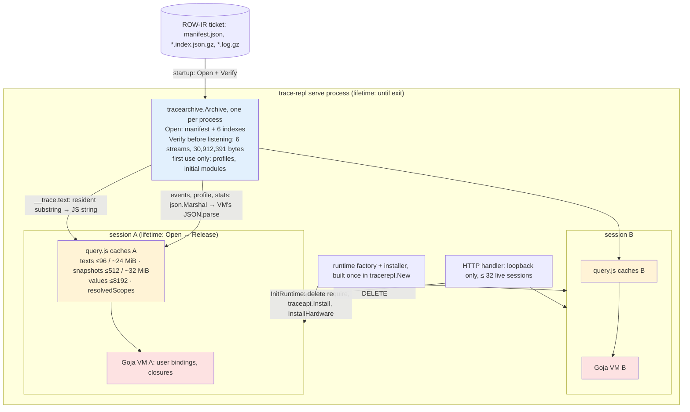
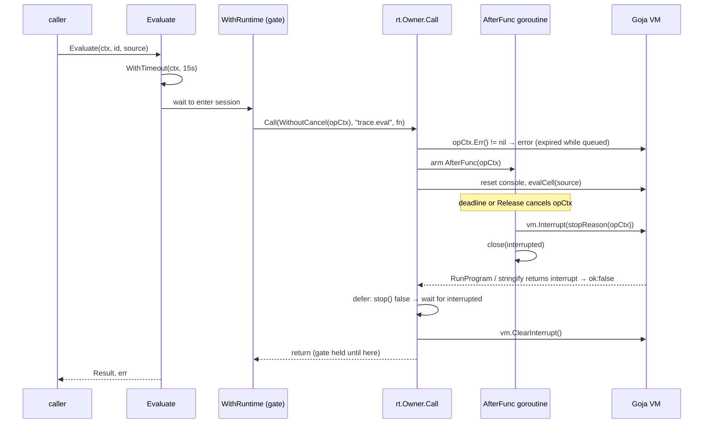

# Persistent investigations in a Goja runtime

*Frozen baseline study of the PicoCalc compiler workbench, revision `df7a7b6`.*

The PicoCalc trace workbench (`trace-repl`) is a local Go server. It loads one archive of LLVM pass dumps for a ray-tracing row function, and engineers query it from JavaScript sessions that persist between requests. This note is written for a compiler student who is new to the workbench. It covers four things:

- which objects persist, who owns each one, and what ends it;
- one real query, followed through the shipped server from source to result;
- what changes when that query is repeated;
- one compiler experiment designed from the result, with the outcomes that would count against it stated in advance.

> [!summary]
> - **Three layers of state, three owners.** (1) One `tracearchive.Archive` per server process. `serve` verifies all six LLVM streams (30,912,391 bytes) before listening and keeps them until exit. (2) The user's bindings and closures, in each session's Goja VM. (3) The bounded caches that `query.js` keeps in the same VM: `texts`, `snapshots` and `values`, plus `resolvedScopes`. Sessions share only layer 1. "Cached" means nothing until you name the layer.
> - **Production query.** On the frozen baseline service, `measure(73)` and `measure(74)` returned **11** and **6** `i32` loads through `row`'s argument 0 (`%work`). These are the bounds-check capacity loads at checked/middle ordinals 73 (`SROAPass`) and 74 (`EarlyCSEPass`). Each count came with its byte range and line witnesses. I ran the query through a read-only witness harness, and an operator ran it independently. The two receipts agree on every value and every cache counter. A direct-library test written before the product shipped found the same 11 and 6 by a literal count.
> - **Cache transitions.** The first measurement missed twice in each of `texts`, `snapshots` and `values`. Reading the saved results changed no counter. Running `measure()` again on the same declarative facts added 2 hits each to `snapshots` and `values` and left `texts` alone. A fresh session started with every cache empty, and `saved` was undefined there.
> - **Static, not dynamic.** A candidate compiler change must also cut executed guest instructions below 1,233,611, with every output byte unchanged. An unchanged total counts against that net reduction. It does not show that the removed loads were cold.
> - **Timing.** The 172.4 and 186.8 ns/op figures are one Go substring read. The HTTP elapsed times are single uncontrolled observations. Neither supports any claim about query latency, speedup, compiler speed or PicoCalc speed.

## Evidence and method

The claims in this note rest on different kinds of evidence, so each claim is labelled with how it was obtained.

The user asked for a Go service "so that you don't need to recompute everything all the time but can keep things in the sandbox emmory", and fixed its purpose: "allow researchers/users to design and validate optimizations for compiler building" (verbatim, `PICOCALC-TRACE-REPL` supervisor diary). Reuse has several mechanisms. A count taken from a stale binding or a cache entry is a wrong input if the reader believes it was recomputed. The labels:

| Label | What ran | Who | Against |
|---|---|---|---|
| **Component assay** | 5 session tests with test installers; 2 real-corpus archive tests and `BenchmarkCheckedMiddleDump`, calling Go directly; 9/9 test executions passed | me, at the start of the study | the pre-shipping build; no JavaScript reached the archive |
| **Author live run** | the five researcher cells below, plus cache observations, over loopback HTTP in fresh sessions that were then closed | me, once, through a read-only harness running `scripts/23-session-query-witness.py` | the frozen baseline service; `various/session-lifetime/author-live-query.json` |
| **Operator live run** | the same cells | an operator, independently | the same baseline; `various/session-lifetime/live-query.json` |
| **Source** | read, not executed: shipped `service.go`, `http.go`, `archive.go`, `install.go`, `cmd/trace-repl/main.go`, and excerpts of `pkg/traceapi/query.js` | | |
| **Reported** | the PICOCALC-ROW-IR analysis *From checked halfwords to a native row loop in GCC and LLVM* ("the ROW-IR study") and the `PICOCALC-TRACE-REPL` diaries | | |

`various/session-lifetime/baseline-service.json` records the following about the baseline:

- **Source head:** `df7a7b64c0b6d6930a803f8022b9c312bedf7e03`.
- **Binary SHA-256:** `d8a8b5ae1c6ff2c76f2e94e4f7a8c8c0dacb1c417d92c73a13b3adfcaa3f2dd4`.
- **Query-source SHA-256:** `5434331b4e1f4008dc131e276e8011d454163db4eeccf8282e12c0ed0fa7b411`.
- **Launch:** `serve` on `127.0.0.1:3791`, with `--archive` (the ROW-IR ticket) and `--device-study` (the PIE-LOOPS ticket).
- **Readiness:** 6 verified streams and 30,912,391 bytes. The device study reported 864 paired trials and 18 load records.
- **Smoke test:** `q.help()` returned a string.

I read the shipped source copies that came with these receipts, but I did not check them against the commit.

Since the component assay, the shipped code has changed in these places, and the assay covers none of them:

- `Archive.Verify` is new, and `main.go` calls it.
- Cells are now parsed by `parseCell`, and failures are explained by `explainFailure`.
- Interrupts now carry `stopReason` text.
- A 429 message names the client's options.
- `DELETE` frees the slot of a session that has already gone.
- Shutdown maps to 503.

The `Evaluate` ordering that the assay did exercise is unchanged.

## What the archive describes

This section explains which program the dumps come from and whose compiler produced them.

The PicoCalc ray tracer draws a 160 × 160 image. A **ray-row step** finds the nearest sphere hit for each pixel of one scanline. For each pixel and sphere it computes `d = r² − (y − cy)² − (x − cx)²`. When `d ≥ 0`, it hits that sphere at depth `cz − floor(sqrt(d))`. The step writes the nearest hit's depth and object ID, and the earlier sphere wins a tie.

**Typed JS** is the project's own restricted JavaScript-like language. Its compiler runs on the PicoCalc's ESP32-P4. It has a WebAssembly target, used as a host result oracle, and a native RV32 target. A Typed `buffer` stores its capacity followed by 16-bit elements. Every access checks the index against the capacity, and an invalid access traps after earlier writes have already happened. **LLVM and GCC** compile only C. The archive holds LLVM 18.1.3 dumps of C for RV32IMAFC. LLVM never sees Typed source.

| Build | Source (ROW-IR study) | Answers |
|---|---|---|
| `checked` | a C control mirroring the Typed row: same header, element width, offsets, traversal order and conditional writes. Each access calls an inline helper that loads the capacity, compares it with the unsigned index, and traps on failure | what a production scalar compiler can do under Typed's bounds contract |
| `unchecked` | the same control, assuming every access is valid | the cost of a different contract; not substitutable without proof |
| `firmware` | the production C `trace_row`, from the same unit that GCC 14.2.0 builds for the firmware | LLVM's lowering of the shipped C; nothing about the device |

Both controls used signed wraparound and had strict aliasing disabled. `%work` is `row`'s first parameter. It points to one shared buffer holding the input tables and the output rows: square roots at element offset 520, depths at 1545, IDs at 1705. The buffer's `i32` header at offset 0 is its capacity, so `load i32, ptr %work` is the capacity load of a bounds check.

The ROW-IR study counted guest instructions under QEMU inside the row function, over the same 160 opening-scene inputs. All 2,080 row calls matched the WebAssembly expected rows, comparing the return value and all 4,100 buffer bytes:

| Build (ROW-IR study) | Guest instructions | Stack loads / stores |
|---|---:|---:|
| checked C, LLVM | 1,233,611 | 320 / 320 |
| unchecked C, LLVM | 632,124 | 640 / 640 |
| checked C, GCC | 1,136,142 | 1,120 / 1,120 |
| ordinary Typed | 3,608,697 | 936,328 / 353,778 |

For checked LLVM, the study reports three things:

- 11 inlined checks.
- EarlyCSE reducing the direct header-load sites from 11 to 6.
- "the optimized checked hot loop still contains a header load and unsigned branches."

**Dumps, streams, ordinals.** LLVM prints a function's IR after each pass. Each printout is a **pass dump**, headed by a line such as `IR Dump After EarlyCSEPass on row`. Each build has a **middle** phase (target-independent IR) and a **backend** phase (machine IR). One build's dumps for one phase form a **stream**: one gzipped log, one index of header offsets, and one manifest SHA-256. An **ordinal** is a dump's zero-based position within its stream.

A pass name alone does not identify a dump. checked/backend 74 and 78 are both `virtregrewriter`, and only 78 shows `NoVRegs` (component assay). A middle-phase byte range also includes the `-debug-pass-manager` lines for the following pass ("Running pass: <next> on row"). `Archive.Text`'s doc comment warns about this. **EarlyCSEPass** walks the dominator tree. It replaces a load or computation with an earlier, dominating one when it can prove the value is unchanged.

## Runtime terms

These three terms come from Go and Goja, not from the workbench. The rest of the note depends on them.

**Goja VM.** Goja is a JavaScript interpreter written in Go. One `*goja.Runtime` (the VM) holds a global environment and every value created in it. A value belongs to its VM, and two goroutines must never use one VM at once. One session is one VM.

**Owner and session gate.** Service code reaches a VM only through `rt.Owner.Call(ctx, "trace.eval", fn)`, which runs `fn` while no other callback uses the VM. That call runs inside `s.sessions.WithRuntime(ctx, id, …)`, which holds the session for the whole operation. The comment in `Service.Evaluate` calls this per-session exclusion the "session gate."

**Context.** A Go `context.Context` carries a deadline and a cancellation signal. `Evaluate` uses three context functions:

- `WithTimeout(ctx, 15s)` (`service.go:145`).
- `AfterFunc(opCtx, f)` (`:156`), which runs `f` once `opCtx` is done. Its `stop()` returns `true` if it prevented `f` from running.
- `WithoutCancel(opCtx)` (`:151`), whose result is never cancelled.

## Where state lives, and which object an engineer reuses

This section names every object that survives between requests, its owner, and what ends it.



**Layer 1: the archive (one per process).** `newService` (`cmd/trace-repl/main.go`) calls `tracearchive.Open` and then `Archive.Verify`. `Open` reads the manifest and validates the six gzipped indexes. It reads no log bytes. `Verify` then processes each stream. It inflates the log, checks the length and SHA-256 against the manifest, checks every indexed header against the log, and stores the text in `stream.text` (`verified` and `inflate`, `archive.go:261–326`). The purpose is stated in `main.go`: "a damaged capture fails here rather than after a researcher has cited one of its references, and no first query pays for decompression."

From then on, every `Ref` a session receives points into checked bytes, and no cell ever triggers an inflation. Two parts of the archive stay lazy in the served product:

- profiles, loaded on the first `Profile` or `ProfileSHA` call;
- initial modules, loaded on the first `InitialModule` call. Their digest is computed but not compared with a manifest.

Tests and the benchmark call `Open` without `Verify`, so they use the per-stream lazy path.

**Layer 2: user bindings (one per session).** Each `Service.Open` creates a VM, and `Installer.InitRuntime` runs on it (`service.go:49–99`). A top-level `const`, `let` or `class` creates a binding in that VM's global lexical environment. Such a binding is not a property of `globalThis`, and it persists until `Release`. No other VM can see it.

**Layer 3: query caches (one set per session).** `query.js` runs once per VM, so every session gets its own `cache` object (`query.js:88–92`):

| Cache | Holds | Bound | Key |
|---|---|---|---|
| `texts` | raw prints from `__trace.text` | 96 entries; ~24 MiB, estimated at 2 bytes per UTF-16 unit | stream + ordinal (`eventKey`) |
| `snapshots` | parsed function snapshots | 512 entries; ~32 MiB, by each snapshot's own estimate | event + level + function (`irSnapshot`, `:823–825`) |
| `values` | metric values per (snapshot, metric) | 8192 entries; no byte bound | code not in the excerpts |
| `resolvedScopes` | resolved event scopes | no bound visible in the excerpts | |

The three LRU caches (`class LRU`, `:61–87`) evict their oldest entry while they exceed the entry bound, or exceed the byte bound while holding more than one entry. A single oversized entry therefore stays. `cacheStats` (`:1947–1950`) reports all four caches in the shape the receipts record, and given `{clear: true}` it empties them.

The comment at `:59–60` gives the correctness rule: "Keys are derived from declarative plan parts only (stream, ordinal, function, metric definition). Lambdas never enter a cache key, so mutating a closure cannot poison a cache." A closure such as `measure` lives only in layer 2. Each `q.run` also builds a per-run `memo`, keyed by plan object identity, which is discarded when the run ends (`newContext`, `:110–113`).

**The bridge.** `traceapi.Install` (`install.go:20–67`) sets a global `__trace` object with six Go-backed methods, runs `query.js` (which captures the object), and then deletes `__trace`. The methods return values in two ways:

- `text` and `profileSHA` return JavaScript strings, through `vm.ToValue`.
- `events`, `profile`, `initialModule` and `stats` go through `json.Marshal` and the VM's own `JSON.parse` (`importer`, `:69–90`), so each call yields new plain data that belongs to that VM.

Go errors become `TypeError`s. Profiles are also deep-copied in Go (`cloneJSON`), so a cell can edit what it receives without affecting any other session. It follows that a bound value may have been edited by an earlier cell, while the archive's copy has not. Cite reported numbers by `Ref` (variant, phase, stream SHA, ordinal, start, end) or by `profileSHA`, not by binding name.

**What an engineer reuses.** In the experiment below, the reused objects are these:

- **Shared by every session:** the single `*tracearchive.Archive` with its six verified `stream.text` strings, which are read-only.
- **This session only:**
  - the bindings `fn`, `middle`, `header` and `measure`;
  - the array `saved`, the engineer's own copy of two records;
  - the `snapshots` and `values` entries for checked/middle 73 and 74, `row` and the capacity-load metric.

A second session reuses only the archive. Sharing the archive read-only does not share any VM's bindings or semantic caches.

## Five kinds of reuse, each with an observation

This section answers two questions an engineer will ask: "was this recomputed?" and "what would make it recompute?"

| Kind | What is reused | Observation | Ended by |
|---|---|---|---|
| Binding read | a bound value (`saved`) | live runs: `saved.map(x => x.value)` → `[11, 6]`, every counter unchanged | `Release`, exit |
| Query-cache hit | snapshot and value for the same declarative facts | live runs: repeating `measure(73)` and `measure(74)` added +2 hits to `snapshots` and `values`; `texts` stayed at 0 hits / 2 misses | eviction, `{clear: true}`, `Release` (source) |
| Resident archive read | verified bytes; the JavaScript runs in full | a `texts` miss calls `Archive.Text`, which slices `stream.text` (source). Library: 12 readers of a cold stream, 1 inflation (component assay) | exit only |
| Recalculation | archive bytes only | another session or another metric definition; the live runs' second session reported all caches at 0 | — |
| Restart | nothing | `Open` and `Verify` run again | — |

The first two rows are the easiest to confuse.

- **Reading `saved`** returns records that already exist, and no query runs.
- **Calling `measure(73)` again** builds new plan objects, so the per-run `memo` (keyed by object identity, empty at each run) cannot be what answered. The per-VM caches answered, because they are keyed by declarative facts. `texts` was never consulted, because `irSnapshot` calls `printOf` only on a snapshot miss.

In neither case was the count recomputed from IR. For an independent re-check, open a fresh session or clear the caches.

The receipts do not include `Archive.Stats()`. Reading the source, the first measurement made two bridge `text` calls, so `textReads` should have risen by 2 and `streamInflations` should have stayed at 6. This is not observed.

## Session lifecycle

This section covers what happens to a session's state when a cell fails, when cells collide, when the deadline passes, and when the session closes. The observations come from the component assay with test installers unless marked otherwise.

**Bindings persist, and so do some failures.** `TestPersistentSessionBoundary` binds `const x = { value: answer }`, where `answer = 42` comes from a test installer, increments it, and reads `43` in later cells. The shipped `evalCell` (`service.go:295–337`) runs cells with script semantics. A completion value of `undefined` or a function is reported as `"value":null` with kind `"undefined"` or `"function"`. Two rules follow from the shipped source:

- If a cell fails after declaring a top-level `let`, `const` or `class` but before the initializer finishes, that name stays uninitialized for the rest of the session. `explainFailure` says so and suggests a new name.
- A cell that begins with `await ` or `await(` is wrapped as one expression (`parseCell`), so it cannot declare anything. Its promise must already be settled when the cell returns.

**Sessions are isolated.** A second session gets `typeof x` → `"undefined"`, and `require`, `process` and `fetch` are all undefined. On the real installer, the live runs' fresh session got `typeof saved` → `"undefined"`, with every cache at 0.

**Cells in one session run serially.** `TestSameSessionSerializesEvaluations` runs 16 concurrent `n += 1` cells in one session and ends with `16`. One passing run does not prove that updates can never be lost, but `16` is the result the gate is designed to produce. The 15 s deadline includes the time spent waiting for the gate.

**Two callers on one cold stream (library only).** `Archive.verified` holds the stream mutex while it inflates. `TestConcurrentReadsShareSuccessfulInflation` ran 12 goroutines against a fresh `Open` and got `textReads == 12`, `streamInflations == 1` and `inflatedBytes == 1027953`. The served product never reaches this case, because Verify already made every stream resident. Concurrent sessions contend only for the short resident slice. No test runs concurrent JavaScript sessions.

**A timeout can interrupt result serialization.** `evalCell` serializes the result with the VM's own `JSON.stringify` (`service.go:325`), which runs any user-defined `toJSON`. The test cell `({toJSON() { while (true) {} }})`, with a 100 ms deadline, returned `ok:false` with a deadline error. A following `3 + 4` returned `7`. The run took 0.20 s: two cells at 100 ms each. The shipped `stopReason` text for a deadline adds that "bindings from earlier cells remain."

**Release interrupts a running cell.** `TestClosingSessionInterruptsActiveCell` runs `markStarted(); while (true) {}` and releases the session from another goroutine. `Evaluate` returns `ok:false` with no Go error. The test took 0.00 s, well inside the 15 s deadline, so the interrupt came from the release. Over HTTP, `DELETE` returns 204 and a later `eval` returns 404.

**Go calls cannot be interrupted.** `vm.Interrupt` acts only while JavaScript runs, so a Go bridge call finishes first. In the served product, no bridge call inflates a stream. The only lazy Go work left is the first profile or initial-module load and JSON marshalling. This is inferred from the code and Goja's interrupt API, and no test covers it.

The order of operations inside `Evaluate` (`service.go:141–176`) keeps one cell's interrupt from reaching the next cell:



Each step has a purpose:

- **The queue check (`:152–154`)** returns an error for a cell that expired before it reached the VM, and HTTP reports it as 408. A cell that times out while running returns 200 with `ok:false`. The status code therefore tells you whether the cell ran.
- **`WithoutCancel` (`:151`)** keeps the gate held until the VM is idle.
- **Waiting for `interrupted` before `ClearInterrupt` (`:160–165`)** stops a late interrupt from failing the next cell. The `3 + 4 → 7` check probes this.
- **Clearing console state at both ends (`:166–170`)** keeps one cell's console lines out of the next cell's result.

## Walkthrough: source → operation → result for ordinals 73 and 74

This walkthrough follows the production query from the files on disk to the two counts, along the path that both live runs took.

**Source.** The PICOCALC-ROW-IR ticket's `various/llvm-pipeline/` directory holds `manifest.json` and, for each stream, an `.index.json.gz` and a `.log.gz`. checked/middle has 195 dumps and 1,027,953 bytes, with SHA-256 `bbd3b983cff150aeb56d99e517331a1ea0b4af5afc86869c730b9dca2ac795b4`.

**1. Startup.** `openStream` turns each index offset into a half-open byte range `[offset, nextOffset)`, and `parsePass` names each dump's pass. `Verify` then makes all six streams resident.

**2. Session.** `POST /sessions` returns 201 with a session ID. `InitRuntime` deletes `require`, installs the bridge and runs `query.js`.

**3. Cell 1 defines plans and evaluates nothing:**

```js
const fn = a.variant("checked").function("row");
const middle = fn.timeline("middle");
const header = q.ir.instructions().opcode("load").resultType("i32").pointer(fn.argument(0)).count();
const measure = n => q.run(header.at(middle.at(n).after));
"ready"
```

It returned `"ready"`, and every cache still read 0.

**4. Cell 2 measures:** `const saved = [measure(73), measure(74)]; saved`.

For ordinal 73, the evaluation proceeds in five steps:

1. `q.run` creates a fresh context.
2. `StatePlan._target` (`:902–910`) selects the event itself for the `after` side, with function `row`.
3. `irSnapshot` misses, so `printOf` misses in `texts` and calls `__trace.text("checked", "middle", 73)`. That call reaches `Archive.Text`, which returns `stream.text[231496:240363]`.
4. `buildIrSnapshot` finds `define … @row(` and its closing `}`.
5. The metric resolves `row.argument(0)` to `%work` and counts the `i32` loads through it.

`evalCell` serializes the record, well under the 512 KiB cap. Ordinal 74 follows the same path.

**Result.** Both live receipts record the same result:

| | Ordinal 73 | Ordinal 74 |
|---|---|---|
| header | `IR Dump After SROAPass on row` | `IR Dump After EarlyCSEPass on row` |
| `Ref` range | [231496, 240363) | [240363, 248127) |
| function lines | 3–215 | 3–199 |
| `load i32, ptr %work` | **11** | **6** |
| witness blocks | `for.cond.cleanup`, `for.body`, `element.exit37`, `for.body8`, `element.exit47`, `element.exit52`, `for.body29`, `if.then`, `element.exit67`, `if.then45`, `element.exit77` | `for.cond.cleanup`, `for.body`, `element.exit37`, `for.body8`, `for.body29`, `element.exit77` |

`texts.approxBytes` was 33,386, which equals 2 × (8,867 + 7,764 + 29 + 33): the two range lengths plus the two header lengths, at 2 bytes per unit. The prints are ASCII, so their string length equals their byte length.

The component test `TestArchivedPassesAndEvidenceRanges` used a different method. It counted the literal `load i32, ptr %work,` over each raw byte range through the Go reader alone, with no JavaScript, and got the same 11 and 6. The two methods share only the archive bytes and the Go reader. A check that needs no workbench at all is to inflate `checked-middle.log.gz`, confirm the SHA-256, slice the two ranges and count inside `define … @row`. I have not run it. Any other result falsifies both methods.

The metric has two limits:

- It counts loads whose pointer operand is `%work` itself, so it misses capacity loads through a copied or recomputed pointer.
- Its unit is "static instruction sites", as its own record says. It counts places in the IR, not executions.

## A one-pass experiment: what EarlyCSE did, and what a change must show

This section takes the practical view. It shows how an engineer benefits in one concrete experiment, what that experiment can and cannot conclude, and what would falsify it.

### The experiment and its benefit

The question is what one pass, EarlyCSE on `row` in checked/middle, did to the capacity loads, and whether that motivates a compiler change. Cells 1 and 2 are the experiment. The workbench helps in four concrete ways, and each is tied to an object named above:

1. **Checked citations.** Verify ran before the first request, so both `Ref`s point into bytes hashed against the manifest. The engineer can cite `{checked, middle, bbd3b983…795b4, 73 | 74, start, end}` without running any check.
2. **One metric definition everywhere.** `header` is bound once, and every record carries the same `definition`, `ir.instructions(opcode=load,resultType=i32,pointer=arg(row,0)).count`, so counts at different ordinals measure the same thing.
3. **Witnesses for the next check.** The records name the five removed sites by block (`element.exit47`, `element.exit52`, `if.then`, `element.exit67`, `if.then45`) and the six survivors by block. Check S2 starts from these lines.
4. **Known repeat semantics.** A repeated `measure(73)` in the same session is a cache hit, while a fresh session starts empty. The engineer therefore knows which repetition is an independent re-check.

**Causal bound.** The experiment establishes one static fact. Between two consecutive dumps of `row` in one stream (SROAPass at 73, EarlyCSEPass at 74), the number of direct capacity-load sites fell from 11 to 6, at the listed lines. Ordinal 73's live header names `row`, and the archive holds no dump between 73 and 74. That closes the earlier open check S0, which asked whether 73 → 74 is one pass on one function.

The experiment does not show how often any load executes, why six survived, or anything about guest instructions or device time.

**Independent falsifiers.** Three checks could falsify the observation:

- a recount of the cited ranges with no workbench, as described above;
- the same cells run by a different person in a different session, which is what the operator's run was, and it agreed;
- the Go literal-count test.

### The compiler hypothesis

**Hypothesis.** In checked LLVM, at least one capacity load that survives the middle pipeline executes on each candidate pixel, although nothing between two such loads can change the capacity. If the compiler reused one loaded capacity there, the row function would execute fewer guest instructions over the 160 fixture calls, with identical results.

**Why reuse would be legal.** This is an argument to check, not a result. Elements follow the header, so an in-bounds element store writes after the capacity field, and a failing check traps before its access. If the row makes no call that can write the buffer, nothing changes the capacity, and reusing one loaded value keeps every check and trap at its original program point. That matters because Typed requires earlier writes to stay visible when a later access traps. The same requirement is why the checks themselves cannot simply be moved to function entry.

**Why LLVM might keep the loads.** Each block whose clang-assigned name marks a loop body (`for.body`, `for.body8`, `for.body29`) kept its own load. That pattern fits EarlyCSE's dominance rule. A load at the top of an iteration has no dominating earlier load within that iteration, and EarlyCSE does not reason across the back-edge. Block names are a convention, not a CFG fact, so S2 must confirm this reading.

Removing a per-iteration load needs a later pass, such as LICM or GVN, to prove that no store in the loop writes the header. Strict aliasing is disabled, so that proof must come from address arithmetic: the type system cannot separate the `i32` header from the 16-bit element stores. The ROW-IR study's surviving hot-loop header load suggests that no later pass made the proof.

`noalias` on `%work` would not help. The depth and ID stores go through pointers derived from `%work`, and `noalias` says nothing about those.

**Candidates.**

- **C1 (C control, a source change).** Load the capacity once at entry and pass it to every check. Every check stays. C1 measures what a compiler that proved the fact could gain.
- **C2 (the compiler change).** If S2 finds element stores between the loads, C2 is an alias fact: an in-bounds element access never overlaps the header. If S2 finds only control flow, C2 belongs in hoisting or redundancy elimination.
- **Typed.** The corresponding change for the Typed compiler keeps the capacity in a register through the checked scalar loop. It is part of the ROW-IR study's "checked scalar loop" milestone. LLVM results are a reference, not a Typed measurement.

**Static checks (not yet run).**

- **S1:** the same metric at the last checked/middle dump of `row`, marking the loads inside the pixel loop. If no load remains in the loop, nothing executed is left to remove.
- **S2:** at ordinal 74, the instructions between consecutive capacity loads, whether each earlier load dominates the later one, and confirmation that the only calls are trap calls.
- **S3:** the checked − unchecked gap of 1,233,611 − 632,124 = 601,487 instructions bounds the cost of the whole checked contract. Capacity reuse can recover only part of it.

### The dynamic test, preregistered

The archive cannot answer the dynamic question. As the supervisor diary puts it, "The original study never recorded per-PC samples." State the primary outcome before building: *the checked LLVM row function's total guest instructions over the 160 fixture calls fall below 1,233,611.* Legality, generated work and device benefit are separate questions.

| Question | Measure | Supports | Counts against |
|---|---|---|---|
| Did the change act? | S1's metric on the candidate archive (new process, new `--archive`, fresh session) | fewer | unchanged |
| Equivalent on fixtures? | return value and all 4,100 bytes for every row vs the WebAssembly expected rows, plus an out-of-bounds case that must trap after the same earlier writes | identical | any difference |
| Did generated work fall? (primary) | row-function guest instructions, 160 calls, QEMU, captured twice | below 1,233,611 | unchanged or higher |
| Where did work move? | assembly diff; stack traffic (baseline 320 / 320); per-PC counts if captured | saving at the removed loads | new spills, a changed schedule or branch layout |
| Device benefit? | paired P4 timing of a Typed program with the corresponding change (archive diary Step 3 design) | above a threshold stated in advance | at or below zero |

How to read the outcomes:

- **Fewer static loads with an unchanged total** count against the net reduction. They do not show that the removed loads were cold or free: moved instructions, spills, list scheduling or a different branch mix can offset a real saving. Only the assembly diff, and per-PC counts if captured, can attribute the difference.
- **A mismatching byte** disqualifies equivalence on that fixture without naming a cause. Find the first differing byte and the instruction that wrote it before naming one.
- **Identical outputs** are necessary but not sufficient. The 160 rows exercise no trap path, which is why the out-of-bounds case is included ("the same rows, memory, exceptions and writes before a trap", ROW-IR study).
- **On-device output CRCs** are a smoke test. The full byte comparison is stronger.
- **A lower total** supports the generated-work claim for this function and these inputs. It says nothing about device time.

## Reading the measurements

This section says what each number contains, so that none is read as more than it is.

`BenchmarkCheckedMiddleDump` (component assay; 10 iterations, two counts, linux/amd64, i7-1165G7 at 2.80 GHz, GOMAXPROCS 8):

| Sub-benchmark | Run 1 | Run 2 | One operation |
|---|---|---|---|
| `open-and-first-read` | 6,918,053 ns, 5,948,150 B, 4,799 allocs | 7,413,779 ns, 5,948,123 B, 4,799 allocs | `Open`, then one `Text` that inflates, hashes and header-checks 1,027,953 bytes |
| `resident-read` | 186.8 ns, 0 B, 0 allocs | 172.4 ns, 0 B, 0 allocs | lock, counter, slice of resident text |

The benchmark's helper calls `tracearchive.Open` directly and never calls `Verify`, so the first row still measures inflating text that has not been inflated before. In the served product that cost moves to startup. The baseline's readiness record reports 127 ms for `Verify` over all six streams, in one observation.

The resident line covers about 2 µs of timed work across ten lookups, which makes it sensitive to timing overhead and short-run variability. Treat both rows as orders of magnitude. "0 allocs" means that this Go call made no heap allocation in this run. The bridge's conversion into the VM lies outside the benchmark.

Each live receipt records the client-side elapsed time of every HTTP call, including serialization. Each time is one uncontrolled observation. This note draws no latency or speedup conclusion from them, and that includes any comparison of a cache-hit cell with a cache-miss cell.

## Trust boundary and budgets

The service is for trusted researchers on one machine. Its limits cap what crosses the HTTP boundary, not what the process uses.

`Handler` refuses requests that carry an `Origin` header or a non-loopback `Host` (`http.go:97`). It does no authentication.

| Status codes | Evidence |
|---|---|
| 201, 200, 400, 413, 204, 404, 403 | tested |
| 415 (media type), 408 (expired in queue), 410 (closing or closed), 429 (32 live sessions), 503 (shutting down) | code only |

The caps are 64 KiB of source (HTTP body `6*MaxSourceBytes+1024`, because JSON escaping can turn one byte into six), 512 KiB of result, and 64 console lines of 2048 bytes.

None of these limits memory:

- The archive retains 30,912,391 stream bytes for the life of the process.
- By their own estimates, the `texts` and `snapshots` caches can reach about 56 MiB per session. `values` has no byte bound.
- The JavaScript heap is unlimited.

For a hard memory limit, use an operating-system resource boundary, as the operator guide advises.

## Two playbook criteria, applied

**Homolog-bench persona-run playbook (§9, §10.1).** Every status word names its scope, and every fact the reader must report has an observation behind it. Here, every claim of reuse rests on a counter, not a time: `streamInflations == 1` after 12 reads, unchanged counters after reading a binding, and `snapshots` and `values` hits after repeating a measurement.

**Chromobench usability-report playbook ("Verifying findings", "Recording what is left").** A finding is confirmed only by a probe with exact inputs, and every round ends with three lists:

- **Reproduced:** 11 → 6, twice live and once by a component probe.
- **Left:** the shipped deltas, which no test covers; concurrent JavaScript sessions; the 408, 410, 429 and 503 paths; the `values` key code; and why `resolvedScopes` stayed at 0, which the excerpts do not explain.
- **Not executed:** S1–S3, every candidate build, and every device measurement.

## Reproduction and references

To reproduce the component assay, run from the repository root:

```sh
go test -v ./pkg/tracerepl
go test -v ./pkg/tracearchive \
  -run 'TestArchivedPassesAndEvidenceRanges|TestConcurrentReadsShareSuccessfulInflation' \
  -bench BenchmarkCheckedMiddleDump -benchtime 10x -count 2
```

To reproduce the live run, start `go run ./cmd/trace-repl serve --archive <PICOCALC-ROW-IR ticket directory>` and run `scripts/23-session-query-witness.py`. Compare the new receipt against the recorded ones:

- the values and cache transitions should match `various/session-lifetime/author-live-query.json` and `various/session-lifetime/live-query.json`;
- the service details should match `various/session-lifetime/baseline-service.json`.

Elapsed times will differ, and they carry no conclusion.

The ROW-IR study's "Laboratory commands" rebuild the C controls and run the QEMU fixtures.

- [[ARTICLE - Playbook - Improving an Agent-Facing JavaScript API with Persona Runs - Lessons from homolog-bench]]
- [[ARTICLE - Playbook - Persona Sessions with Agents - Improving Software and APIs from Usability Reports]]
- PICOCALC-ROW-IR analysis: *From checked halfwords to a native row loop in GCC and LLVM*
- Source: `cmd/trace-repl/main.go` (`newService`); `pkg/tracerepl/service.go` (`InitRuntime`, `Evaluate`, `stopReason`, `parseCell`, `explainFailure`, `evalCell`); `pkg/tracerepl/http.go` (`Handler`, `failure`); `pkg/tracearchive/archive.go` (`Open`, `Text`, `verified`, `Verify`, `Profile`, `InitialModule`, `Stats`); `pkg/traceapi/install.go` (`Install`, `importer`); `pkg/traceapi/query.js` (excerpts: `LRU`, `cache`, `printOf`, `irSnapshot`, `StatePlan`, `cacheStats`). Tests are cited by function name, from `pkg/tracerepl/service_test.go` and `pkg/tracearchive/archive_test.go`.
- Receipts and witness script: `scripts/23-session-query-witness.py`; `various/session-lifetime/{author-live-query,live-query,baseline-service}.json`. Diaries: `PICOCALC-TRACE-REPL` supervisor and archive-reader.
