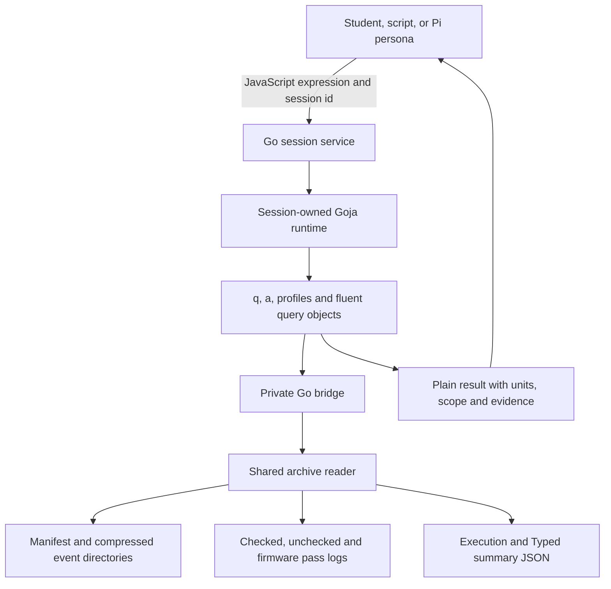

# Implementing the compiler evidence workbench

## Begin with one research question

In the checked C version of the PicoCalc ray tracer, a row function receives a pointer to a buffer. The first field of that buffer stores its capacity. Before reading or writing an element, the program may need the capacity to check whether the index is valid. Does the optimizing compiler load that field again at each site? At what point in compilation do some of those reads disappear?

There are three distinct observations an engineer might make. A printed LLVM function contains a number of load *sites*. A particular frame executes some of those sites many times and others zero times. The physical ESP32-P4 spends a number of cycles executing the entire frame, including work outside the row. The units are static instructions, executed instructions and time. This service lets a researcher select the first two from the archived study and inspect their provenance. Physical trial pairing has its own requirements, described in the research workbook.

Suppose a student already found a metric that counts directly addressed capacity loads. They want to compare a second pass, or use a slightly different predicate. Restarting a tool to answer each question discards both the intermediate selection and the decompressed evidence. A REPL, or read–evaluate–print loop, holds a live JavaScript runtime for that investigation. Successive HTTP requests can refer to the same variable. A second session has a fresh runtime and shares the underlying immutable evidence with the first.

## Following a query through the system



The Go process handles file I/O, gzip, integrity checks and session lifetime. The query language uses JavaScript expressions evaluated by Goja inside that process. A reusable predicate can therefore be an ordinary lambda, and an investigator can assign a metric to a variable and pass it to several operators. The host supplies the archive at startup. A query addresses a registered variant, phase or measurement. It never needs to construct a host filesystem path.

The eight operations below cover most questions in the workbook.

| Operation | Scientific meaning | Example |
|---|---|---|
| Select a population | Establish which printed observations or executed calls belong to the question | `a.variant("checked").events("middle")` |
| Identify a subject | Constrain an operation to a named function or its argument | `run.function("row").argument(0)` |
| Select an event | Address an absolute position in a particular stream | `middle.at(74).after` |
| Define a metric | Specify an opcode, result type, operand and reduction | `q.ir.instructions().opcode("load").resultType("i32").pointer(row.argument(0)).count()` |
| Measure | Apply a metric to one state or an ordered timeline | `header.at(state)`, `middle.measure(header)` |
| Compare | Preserve the direction, denominator and input witnesses | `q.compare(before, after)` |
| Filter or project | Keep records meeting a predicate or choose the fields to return | `.where(e => e.pass === "EarlyCSEPass")` |
| Evaluate | Obtain data suitable for inspection, transport or a further calculation | `q.run(plan)` |

### What an LLVM observation contains

LLVM's middle end transforms a program expressed in its intermediate representation, or IR. In that language `%v = load i32, ptr %work` names a 32-bit memory read. A direct load from a buffer pointer can read the initial capacity field under this program's layout contract. A load through a pointer computed by a `getelementptr` instruction answers a different structural question. The predicate used here tests direct operand identity under the adapter's supported printed syntax. Inferring equivalence through arbitrary pointer arithmetic would require further analysis.

The backend eventually selects machine instructions, assigns registers and prints machine state. A pass named Virtual Register Rewriter occurs twice in the checked backend trace. A query that identifies a pass only by its name cannot identify which run established the final machine property. Read the property together with the ordinal in its backend stream. Middle-end ordinal 74 and backend ordinal 74 are independent addresses.

A compiler may print a loop region, a whole function or a module. A module print containing the entire function can answer a function-level question. A partial loop dump cannot establish the total number of loads across every path in that function. Check coverage before interpreting a zero.

### Why byte ranges and predecessor identity matter

The archive stores one gzip file and one compressed offset directory per variant and phase. The directory indexes the *uncompressed* log by byte. Go selects the interval from its original byte buffer before handing text to JavaScript. Text positions inside a JavaScript string count UTF-16 code units, so they would give different ranges in logs with non-ASCII characters. Each event reference includes the digest of the corresponding inflated stream and a half-open range. A student with only this reference and the archive can retrieve the same bytes later.

```text
for a pair of observations from one function and stream:
    require evidence of the entire function on both sides
    require compatible measurement units
    if the ordinals are consecutive:
        report after minus before with both witnesses
    otherwise:
        retain the gap
```

The order of operators changes the scientific meaning. Measure the complete timeline before asking for the first decrease. Filtering to several occurrences of one pass first removes intervening transformations. An analyst may deliberately compare those endpoints, but the endpoint difference cannot establish which intervening invocation caused it.

### What the profile summaries contain

The checked C runner linked a symbol named `row`, ran 160 inputs under RV32 emulation, checked each output against a golden row and counted guest PCs within the symbol. Its published JSON contains totals and selected single-row samples. The Typed runner separately counted instructions in its native row implementation using the same fixture population. The scope of these totals is one opening-scene set. A repeat across compiler arms gives another treatment of that set. It does not create another independent scene.

The statically printed number of `load` instructions in LLVM and the dynamically executed number of stack loads in the Typed image are different observables. A smaller binary may execute more instructions. More executed instructions may still cost fewer physical cycles if their latencies differ. Loop strength reduction, for example, changes addressing and induction calculations. The clean comparison toggles that pass within one LLVM configuration. Comparing GCC with LLVM measures all compiler differences together.

### Lifetime, ownership and trust

| Object | Owner | Lifetime | Reason |
|---|---|---|---|
| Gzip directory, verified bytes, summary inputs | Go archive | Service process | Reuse immutable inputs across investigators |
| JS bindings, closures and computed results | One Goja runtime | Named session | A second eval can use the exact value created by the first |
| Pending evaluation | One requesting client and session | One eval | Session operations must obey runtime ownership and finish or be interrupted |
| HTTP response | Caller | Client-controlled | Can be stored alongside a paper or compared in another process |
| Cryptographic evidence reference | Study artifact | As long as the referenced content exists | Independent of address-space and session lifetime |

A live session is volatile. Save important queries as source and retain citations returned with their results. Restarting the process recreates the state from those inputs. The REPL is a local research service for trusted operators. Isolating JavaScript bindings between sessions is one guarantee. Enforcing a hard operating-system memory quota for adversarial JavaScript is a different requirement.

### Public entry points and code navigation

| File or interface | What a new contributor should inspect |
|---|---|
| `cmd/trace-repl/` | Command parsing, archive selection, opening a session, sending expressions and closing it |
| `pkg/tracerepl/` | Session ownership, evaluation, interruption, HTTP transport and result encoding |
| `pkg/tracearchive/` | Manifest interpretation, byte offsets, digest checks, summary import and cache counters |
| `pkg/traceapi/install.go` | Per-runtime installation, JSON copying and the private native bridge |
| `pkg/traceapi/query.js` | Public query objects, evaluation rules, metrics, evidence records and help |
| Previous `PICOCALC-ROW-IR/scripts/09-archive-llvm.py` | Producer of the six indexed pass streams |
| Previous `PICOCALC-ROW-IR/scripts/05-execute.py` and `07-typed-counts.mjs` | Producers and definitions of the dynamic counts |
| Previous `PICOCALC-TRACE-QUERY/scripts/01-check-evidence.mjs` | Independent witness using Node, gzip and direct artifact reads |
| This ticket's `scripts/10-replay-workbook.py` | Replays the earlier example modules through real session requests |

The normal request sequence is `POST /sessions`, one or more `POST /sessions/{id}/eval` calls with a JSON object containing `source`, then `DELETE /sessions/{id}`. The evaluator returns ordinary JSON. Session identifiers are opaque. A REPL client that opens a new session for every query discards its own bindings even when every request goes to the same service.

## Qualifying the design with agent users

The first supplied playbook treats an agent's mistaken calls and silent wrong results as usability evidence. The second requires reproducing each symptom and assigning it to the layer that caused it. Together they produce a practical experiment. Give compiler-engineer personas a goal, a single evaluation tool and a fresh session. Record the calls they attempted and the results they cited. Grade the scientific claim independently against the bytes. Then reproduce the suspected interface issue outside the persona session, change the responsible layer, and rerun the task in a fresh room.

A correct final number can conceal a poor API. An agent might have guessed the number, read the answer in an example, or succeeded after many wrong calls. Conversely, a persona that reports insufficient evidence for a per-PC attribution has answered a difficult question correctly. The tester must score evidence and recovery as well as numerical agreement.

The [original specification and 26 worked examples](../reference/05-original-language-specification-and-workbook-concordance.md) remain available alongside the [ray-tracing research questions](02-research-questions-and-executable-queries-for-the-ray-row.md). The latter relates each query to the compiler change it could justify.

## Designing the next compiler experiment

The workbench reads captured evidence. To validate a new compiler change, a researcher still needs an experimental treatment, a compiler build, correctness checks and measurements. Each part has its own identity. Record them before interpreting the outcome.

1. **Name the proposed mechanism.** For a two-register operand cache, nominate the functions and value-lifetime patterns for which it should eliminate frame traffic. Give an explicit counterexample, such as two live values crossing a clobbering call.
2. **Define the treatments.** Compile the same Typed source twice, once with the current compiler and once with only the candidate enabled. Preserve flags, source digests, compiler revision, code image and target. If the change needs signed arithmetic or a no-alias precondition, specify it.
3. **Test semantics.** Run both images on the identical opening rows and held-out scenes. Compare every output element. Include a bounds failure or trapping case when the optimization can change the order of access. Record mismatches before claiming a speed result.
4. **Match observation to mechanism.** For a register-cache hypothesis capture PCs with decoded base registers and offsets, or a compiler-produced location map identifying frame slots. For a claim about cold compile latency capture wall time and peak compiler memory. For a user-visible frame claim capture device time from a fixed start and stop event.
5. **Freeze the artifact set.** Preserve each raw artifact, its producer, hash, unit and coverage. The Go service holds verified content in memory. Use a fresh service against a new archive for a new experiment. Mutating a directory behind an existing session would mix revisions.
6. **Make the decision explicit.** Report whether the observations support the hypothesized mechanism, whether the matched outcome improved, and whether that improvement matters for the stated use case. A result can justify collecting a better profile, dropping a candidate, or qualifying it on broader programs.

In particular, the 1,290,106 direct stack accesses in stock Typed justify investigating register pressure. They do not identify two particular values that merit registers. The paired hardware rows, by contrast, can directly test an existing candidate's complete-frame effect. The [executable decision cell](../scripts/11-test-optimization-claim.js) shows how to reject a specified performance claim and cite the input used to reject it.
