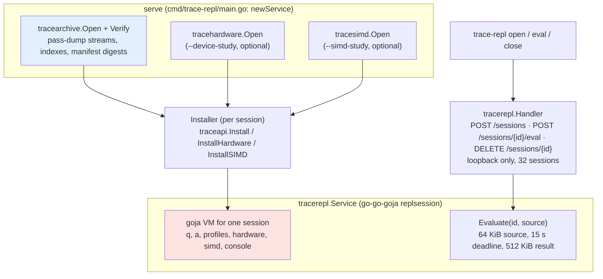

# Turning the trace REPL into a compiler workbench

The trace REPL is a local Go service that keeps JavaScript sessions alive between requests, so a researcher can ask a sequence of questions about compiler evidence without reloading anything. It was built to query LLVM pass dumps of one ray-tracer loop. PICOCALC-RAY-PARITY then used it as the main workbench for a real change to the Typed compiler. There it turned out to be most useful for something it was not designed for: holding the Typed compiler itself in a persistent VM. This guide explains how the service works, what that use showed, and how to change it so that it becomes the normal place to compile, run, compare and measure Typed compiler candidates. It assumes you can read Go and JavaScript. Everything specific to this repository is explained where it first matters.

## 1. What the service does today

A researcher starts one service process, then opens sessions and sends JavaScript **cells** to them. A cell is one piece of source evaluated in the session's VM. Top-level `const`, `let`, `function` and `class` declarations persist for later cells, the way they do in a notebook.

```sh
go run ./cmd/trace-repl serve --addr 127.0.0.1:3791 \
    --archive ttmp/2026/11/21/PICOCALC-ROW-IR--trace-the-ray-row-through-gcc-and-llvm-optimization-passes
sid=$(go run ./cmd/trace-repl open --addr 127.0.0.1:3791)
go run ./cmd/trace-repl eval --addr 127.0.0.1:3791 --session "$sid" --code 'q.help()'
go run ./cmd/trace-repl close --addr 127.0.0.1:3791 --session "$sid"
```

Each session starts with five globals:

- `q`, the **query language**: lazy *plans* over LLVM pass prints. `q.run(plan)` evaluates one.
- `a`, the **archive**: variants such as `checked`, their phases (`middle`, `backend`), functions and timelines.
- `profiles`: guest instruction counts recorded for named compiler arms.
- `hardware`: P4 timing rows from an optional device study.
- `simd`: SIMD decision ranges and per-address execution counts from an optional SIMD study.

A typical question is "which pass first reduced the number of buffer-capacity loads in the checked row?"

```js
const row = a.variant("checked").function("row")
const capacity = q.ir.instructions().opcode("load").resultType("i32").pointer(row.argument(0)).count()
q.run(row.timeline("middle").measure(capacity).changes().where(c => c.status === "known" && c.delta < 0).first())
// → ordinal 74, EarlyCSEPass, 11 → 6 sites, with a reference {variant, phase, streamSHA, ordinal, start, end}
```

Every value that comes from the archive carries such a **reference**. It names a verified stream by SHA-256 and a byte interval within it, so a claim in a report can be traced to the exact compiler output it came from.

## 2. Architecture



The parts, from the bottom up:

- **`pkg/tracearchive`** reads a ticket's `various/llvm-pipeline/manifest.json`. That file lists, for each variant and phase, a gzip stream of pass prints, its index and its SHA-256. `Open` validates the indexes. `Verify` inflates every stream once and checks the digest, so a damaged capture stops the service at startup rather than after a researcher has cited it. `Events`, `Text` and `Profile` serve read-only views. The archive is immutable and shared by all sessions.
- **`pkg/tracehardware`** and **`pkg/tracesimd`** load the two optional study formats, with the same verify-at-startup rule.
- **`pkg/traceapi`** installs the JavaScript API into a VM. `Install` binds a temporary `__trace` bridge object whose methods copy archive data into fresh JS values. Copying goes through `JSON.parse`, so a session can mutate its results without touching shared Go data. It then runs the embedded `query.js`, which defines `q` and `a`, and deletes the bridge.
- **`pkg/tracerepl`** owns sessions through go-go-goja's `replsession` service. Each session has its own goja runtime with an **owner** goroutine; every VM access goes through `rt.Owner.Call`, so cells in one session run one at a time. `Installer.InitRuntime` deletes `require`, so there is no host module loader. It also installs a capturing `console` (at most 64 lines of 2,048 characters) and keeps `JSON.stringify` for result serialization. `Evaluate` rejects source over `MaxSourceBytes` (64 KiB). It runs the cell under a `context.WithTimeout` of `defaultEvalTimeout` (15 s), which interrupts the VM on expiry, and serializes the result up to `MaxResultBytes` (512 KiB).
- **`Handler`** (`http.go`) serves three routes, rejects any request with an `Origin` header or a non-loopback `Host`, caps open sessions at `MaxSessions` (32) and bounds request bodies at six wire bytes per source byte.
- **`cmd/trace-repl`** is a Glazed/Cobra CLI. `serve` builds the service from `--archive` (required), `--device-study` and `--simd-study`. The HTTP server has a 25 s write timeout.

### 2.1 What happens to one cell

1. `POST /sessions/{id}/eval` with `{"source": "..."}` reaches `Handler`. It checks the content type, the size and that the body has exactly one field.
2. `Service.Evaluate` takes the session's gate through `WithRuntime` and schedules a callback on the VM's owner.
3. `parseCell` parses the source as a script. A cell consisting of exactly `await <expr>` is wrapped in an async arrow, and other uses of `await` get a hint. `lexicalNames` records the cell's top-level `let`/`const`/`class` names, so that a cell which fails after declaring a name can explain why the name is unusable afterwards.
4. The cell runs. When the deadline fires, `vm.Interrupt` stops it with a message naming the 15 s limit. The interrupt is cleared before the gate is released.
5. The result value is serialized with the VM's own `JSON.stringify`, and console lines are attached.

## 3. What a real compiler change needed

PICOCALC-RAY-PARITY changed `picocalc-os/compiler/typed-rv32.js`, the RV32 backend of the Typed compiler. Its analysis document `analysis/01-using-the-trace-repl-for-compiler-work-field-notes-and-verdict.md` records every observation with the exact error. The essential findings are these:

| # | Observation | Consequence |
|---|---|---|
| N1 | Five services were running on ports 3791–3795, each started by a different lab. `GET /` returns 404 and nothing reports what a service mounts. The help text names the "row archive" on a service that mounts another capture. | Finding the right service took `ps` and tmux session names. |
| N2 | The query language answered LLVM questions precisely. `q.run(run.functions())` still produces the `[notAPlan]` error the persona studies recorded. | The query layer is sound. Its eager/lazy split still trips users. |
| N3 | SROA promoted the shadow kernel's locals while the function was called `checked_shadow`. GlobalOpt then renamed it `kernel`, whose timeline shows no promotion. | Function history is split at renames. |
| N4 | The session VM runs the Typed compiler unmodified. goja is a bytecode interpreter like QuickJS on the P4, so compile-cost problems invisible under V8 show up. `operandLocations: {}` cost +24% of a ray compile; this located a real defect in minutes. | The most valuable use was not an evidence query at all. |
| N5 | `typed-wasm.js` (70,183 B) exceeded the 64 KiB cell limit, and the assembled Editor source returned HTTP 413. A Python client had to append 30,000-character chunks to a global string and `eval` it. | Every user rebuilds a loader. Earlier labs pushed data rows 64 at a time. |
| N6 | Comparing 38 inputs × 7 option sets × 2 compilers stopped at the 15 s deadline. A Python driver now sends one input per cell. | Batch work is driven from outside and loses the "persistent notebook" property. |
| N7 | Every study re-implements `median` and paired comparisons. | Small inconsistencies between reports, such as a median of paired percentages against a ratio of medians. |
| N8 | Sessions never expire. A day of work leaves dozens open, and `MaxSessions` is 32. | Long-lived services eventually refuse new sessions. |

The pattern is consistent. The REPL's guarantees, verified inputs, persistent bindings and serialized access, are what compiler work needs. Its interface, though, assumes the only inputs are the archives given at startup and that every question is a short query.

## 4. The design

The changes below keep the existing guarantees. All new inputs are read-only and digest-identified, every value that matters can be traced to bytes, and the service stays loopback-only for trusted local users. Each change is independent and can be reviewed and merged on its own.

### W1. A compiler workbench provider

**Purpose.** Let a session load the Typed compiler at a named git revision, or from the working tree, and keep several revisions side by side.

**Interface.** Everything that depends on a revision hangs off the object `compiler.at` returns, so a base and a candidate can never be mixed up by accident.

```js
const base = compiler.at("eaf0872")        // git revision, resolved once to a full commit
const work = compiler.at("worktree")       // the files on disk now; a later call re-reads them
work.revision                               // full commit SHA, or "worktree"
work.files                                  // [{path, sha256, bytes, line}] for provenance
work.typedRv32.compile(source, imports, max, options)
work.typedWasm.compileFunctions(...)
work.typedWorld.imports
work.globals.compileTypedWorldRv32(...)     // every name the files published, not only the modules
work.interp.run(program, entry, args, memory)   // picocalc-os/tools/rv32-interp.js
work.rayBench.frameProfile(program)             // picocalc-os/tools/typed-ray-bench.js
work.ray                                    // text of picocalc-os/worlds/raytrace/raytrace.typed at the same revision
work.world("editor")                        // {name, text, files}, assembled from worlds/editor/source.list
work.read("picocalc-os/worlds/files/files.typed")  // any file at the same revision, as repo.read returns it
work.typedSources()                         // paths of every picocalc-os/worlds/**/*.typed at the revision
```

**How the files refer to each other.** The seven files are classic scripts. Each wraps its body in an arrow IIFE with `"use strict"` and publishes its module with `globalThis.<name> = …`. They then find each other in two different ways, which the wrapper below has to support both of:

| File | Publishes on `globalThis` | Reads |
|---|---|---|
| `typed-wasm.js` | `typedWasm`, `compileTyped` | `globalThis.typedAsync?.rewrite` at compile time (typed-async is optional); `globalThis.__typedLexIndex`, a native lexer hook that only the P4 firmware provides |
| `typed-async.js` | `typedAsync` | bare `typedWasm` |
| `typed-world.js` | `typedWorld`, `compileTypedWorld`, `compileTypedWorldRv32` | bare `typedWasm` and `typedRv32`, both only inside function bodies |
| `typed-rv32.js` | `typedRv32` | bare `typedWasm`; `globalThis.typedPieLoops` as a presence check, then bare `typedPieLoops.lower` |
| `typed-pie-loops.js` | `typedPieLoops` | bare `typedWasm` |
| `tools/rv32-interp.js` | `typedRv32Interp` | nothing |
| `tools/typed-ray-bench.js` | `typedRayBench` | bare `typedRv32Interp` |

`typed-world.js` loads before `typed-rv32.js` but names `typedRv32` only when one of its functions is called, so the bindings must be live rather than copied at load time. The two tools exist only from `eaf0872` on, so at an older revision they are absent, not an error.

**Mechanism.** Two revisions coexist in one VM if each is evaluated inside a function scope that shadows `globalThis` and declares the bare names as `let` bindings:

```js
// generated by the service for one revision; not user code
(function () {
const globalThis = Object.create(null);
let typedWasm, typedAsync, typedWorld, typedRv32, typedPieLoops, typedRv32Interp, typedRayBench;
/* contents of picocalc-os/compiler/typed-wasm.js */
;typedWasm = globalThis.typedWasm;
/* contents of picocalc-os/compiler/typed-async.js */
;typedAsync = globalThis.typedAsync;
/* … the same for typed-world, typed-rv32, typed-pie-loops, rv32-interp, typed-ray-bench … */
return globalThis;
})()
```

Writes such as `globalThis.typedRv32 = …` inside each file land on the shadowing object. Bare names resolve to the wrapper's `let` bindings, which are assigned before any later file's functions run and are visible to earlier files' functions when they are called. Three details matter:

- Each file is followed by a newline and a leading `;`. A file can end in a `//` comment, and every file begins with `(`, so without the separator the next file's IIFE would be parsed as a call of the previous one's result.
- The wrapper returns the whole shadow object, because `typed-world.js` and `typed-wasm.js` publish functions (`compileTypedWorldRv32`, `compileTyped`) that are not module objects.
- The shadow object has no prototype. A read of `globalThis.typedAsync` or `globalThis.__typedLexIndex` then finds nothing rather than a value a user cell happened to define on the real global, so a revision without typed-async cannot pick up another revision's.

This was checked in Node before implementation: loading `eaf0872` and `3213028` into one realm leaks no global, gives distinct module objects, compiles the ray tracer to byte-identical images under `{policy: "stock"}` (9,564 B) and the default (8,632 B), and to different images under `operandLocations.saved` and `direct` (8,632 B against 8,048 B). The candidate's interpreter runs the default image's opening frame in 12,717,463 instructions, the figure PICOCALC-RAY-PARITY recorded. The wrapper is assembled in Go and compiled once per set of file digests with `goja.Compile`. A `*goja.Program` is not tied to a runtime, so every session runs the same compiled program, and the 64 KiB cell limit does not apply. Each entry of `files` records the wrapper line at which that file starts, so a stack trace position can be mapped back to a file.

**Go side.** A new package `pkg/tracecompiler`:

```go
type Bundle struct {
    Revision string            // resolved commit, or "worktree"
    Files    []File            // path, sha256, text
}
func Resolve(repo, rev string) (*Bundle, error) // git show rev:path for each file; cached by commit
func Worktree(repo string) (*Bundle, error)    // read now; no cache
func Install(vm *goja.Runtime, repo string, cache *Cache) error // defines compiler.at, compiler.sources
```

`serve` gains `--repo` (default: the repository containing the binary's working directory). The resolved bundle text for a commit is immutable and can be shared by all sessions. The JS objects are created per session, as `traceapi.Install` does.

**Validation.** A Go test loads two revisions in one VM, compiles the ray tracer with both and checks that the images differ exactly when `typed-rv32.js` differs. It also checks that the worktree bundle reports the digests of the files on disk.

### W2. Read-only repository and mounted inputs

**Purpose.** Remove eval-shipped data (N5).

**Interface.**

```js
repo.read("picocalc-os/worlds/raytrace/raytrace.typed")   // {path, sha256, bytes, text}
repo.show("eaf0872", "picocalc-os/compiler/typed-rv32.js") // same, at a revision
repo.list("ttmp/2026/11/21/PICOCALC-RAY-PARITY--…/various") // names and sizes
mounts.board                                                // --mount board=/tmp/…/bench.log
mounts.board.json()                                         // parsed when the file is JSON
```

**Rules.** Paths are cleaned and must stay inside `--repo` after symlink resolution. `--mount name=path` admits one explicit outside file per flag and is read and digested at startup. Files are capped (for example 32 MiB). Nothing writes. A `.gz` file is inflated transparently, and the reported digest names the file as stored. Every returned object carries its SHA-256, matching the archive's reference discipline.

### W3. Background jobs

**Purpose.** Run batch cells, such as equivalence sweeps and profiles, inside the session without the 15 s limit (N6), while keeping the interactive limit for ordinary cells.

**Protocol.**

```text
POST /sessions/{id}/jobs      {"source": "...", "timeoutSeconds": 600}   → 202 {"job": "job-…"}
GET  /sessions/{id}/jobs/{job}                                            → 200 {"state": "running"|"done"|"failed"|"stopped", "result": Result?}
DELETE /sessions/{id}/jobs/{job}                                          → interrupt
```

**Semantics.** A job takes the session's gate exactly as a cell does, so cells and jobs in one session stay serialized. A cell or a second job sent while a job is queued or running does not wait behind it: it gets `409 Conflict` at once, with the job's ID. Waiting would only spend the cell's own 15 s budget behind a job that may run for minutes. The job's deadline is its own, capped by a service flag `--max-job` (default 10 min). Its result obeys `MaxResultBytes`. The HTTP write timeout does not apply, because the response returns at once. `trace-repl eval --job` submits and polls.

**Implementation sketch.**

```go
func (s *Service) Submit(id, source string, timeout time.Duration) (jobID string, err error) {
    job := &Job{ID: newID(), State: Running}
    s.jobs.put(id, job)
    go func() {
        ctx, cancel := context.WithTimeout(s.lifetime, timeout)
        defer cancel()
        result, err := s.evaluate(ctx, id, source, timeout)   // today's Evaluate body, timeout as a parameter
        job.finish(result, err)
    }()
    return job.ID, nil
}
```

### W4. An inventory endpoint and correct help

**Purpose.** Make a running service describe itself (N1).

```text
GET /info → {
  "version": "...", "revision": "<git commit of the binary's source>",
  "archive": {"path": "...", "streams": [{"variant": "checked", "phase": "middle", "sha256": "..."}]},
  "deviceStudy": {"path": "...", "sha256": "..."} | null,
  "simdStudy":   {"path": "...", "sha256": "..."} | null,
  "mounts": [...], "repo": "...",
  "sessions": {"open": 7, "max": 32},
  "limits": {"sourceBytes": 65536, "resultBytes": 524288, "cellSeconds": 15, "jobSeconds": 600}
}
```

`trace-repl info --addr …` prints it. `q.help()` should name the archive the service actually mounted instead of the fixed string "PicoCalc LLVM row archive". The manifest has no title field: it maps variant to phase to stream. The name therefore comes from the archive directory, which is a docmgr ticket (`PICOCALC-SHADOW-LLVM--following-a-checked-floor-shadow-…`), and from the `Title:` line of that ticket's `index.md` when one exists.

The binary's own revision is only known when the Go toolchain stamped it. `go build` in a git checkout records `vcs.revision` and `vcs.modified` in the build info, and `go run` does not. `/info` reports the build info when it is present and otherwise says so, and it always reports the `HEAD` of `--repo` at startup, which is what a researcher usually wants to know.

### W5. A shared statistics global

**Purpose.** One tested implementation of the comparisons every study reports (N7).

```js
stats.median([3, 1, 2])                                    // 2
stats.paired(rows, {key: r => r.block, control: r => r.arm === 0, candidate: r => r.arm === 4, value: r => r.value})
// → {pairs: 6, controlMedian, candidateMedian, medianPercentSaved, wins, losses,
//    method: "median of per-pair percentage change"}
stats.summary(xs)                                          // {n, min, q1, median, q3, max}
```

`stats.paired` refuses unmatched keys and duplicate pairs with an error naming them. Earlier studies checked this by hand in each script. Implement it in an embedded `stats.js` installed like `query.js`, with Go tests that evaluate fixed fixtures.

### W6. Rename-aware function identity

**Purpose.** Follow one function's history across renames (N3).

**Mechanism.** During indexing, `tracearchive` computes a digest of each function body in each print. When a name first appears in a module print with the same body digest as a name that disappears in that print, the archive records an alias edge `checked_shadow → kernel` at that ordinal. `run.function("kernel").aliases()` returns the earlier names. `timeline("middle", {follow: true})` concatenates the histories and marks the rename event. A rename that also changes the body cannot be detected this way and is reported as two functions.

### W7. Session lifetime

**Purpose.** Stop long-lived services from filling up (N8).

`GET /sessions` lists `{id, created, lastUsed, cells, jobs}`. A `--idle` flag (default 2 h) unloads sessions unused for that long. A request to an unloaded session returns 404 with the reason "session expired after 2h idle". `trace-repl sessions` prints the list.

## 5. Implementation order

The order follows value and dependency. Each step is one reviewed change with tests.

1. **W4 inventory.** Small, and needed to debug everything after it. Files: `pkg/tracerepl/http.go`, `cmd/trace-repl/main.go`. Test: `GET /info` on a service built from the test fixtures in `pkg/tracearchive`.
2. **W5 stats.** Pure JS plus Go tests. Files: new `pkg/traceapi/stats.js` and `stats.go`, installed from `newService`.
3. **W2 repo and mounts.** Files: new `pkg/tracerepo`. Flags `--repo` and `--mount`. Tests: path escape attempts (`../`, symlinks out of the tree), size cap, digest.
4. **W1 compiler provider.** Depends on W2's file access. Files: new `pkg/tracecompiler`. Test: two revisions in one session, as above.
5. **W3 jobs.** Files: `pkg/tracerepl/service.go` (factor `evaluate(ctx, id, source, timeout)` out of `Evaluate`), `http.go`, a CLI flag. Tests: a job that runs past 15 s completes; a cell sent during a job gets 409; deleting a job interrupts it; closing the session stops its job.
6. **W7 session lifetime.** Files: `http.go` (the `live` map gains timestamps), `service.go`.
7. **W6 rename identity.** The most delicate, because it touches indexing. Files: `pkg/tracearchive/archive.go`, `query.js`. Test on the SHADOW-LLVM capture: `kernel` aliases `checked_shadow`, and SROA's alloca removal appears in the followed timeline.

After W1–W3, port PICOCALC-RAY-PARITY's Python drivers (`scripts/01-open-compiler-session.py`, `02-planner-equivalence.py`, `03-compile-cost.py`, `08-score-board.py`) to single cells or jobs. That they become unnecessary is the acceptance test for the ticket.

**Building from a git worktree.** `go.mod` replaces `github.com/go-go-golems/go-go-goja` with the relative path `../go-go-golems/go-go-goja`. That resolves from the main checkout, but not from a worktree under `.claude/worktrees/`, where `go build` fails with `replacement directory ../go-go-golems/go-go-goja does not exist`. Do not edit `go.mod`. Point `GOWORK` at a `go.work` file outside the tree that `use`s the worktree and replaces the same module with the absolute path of the checkout. A `go.work` replace overrides the module's own.

## 6. Decision records

**D1. Keep one VM per session, and isolate revisions by scope, not by VM.** Alternative: one VM per compiler revision. That loses the ability to compare two compilers' outputs inside one cell, which is the most common operation. The wrapper scope from W1 isolates the modules, and a test proves it.

**D2. Jobs reuse the session gate.** Alternative: run jobs in a cloned VM. goja runtimes cannot be cloned, and rebuilding a session's bindings defeats the purpose. Serializing cells behind jobs is simple and correct.

**D3. Read-only file access is scoped to the repository, with explicit mounts for anything else.** The REPL is for trusted local users, but a confined, read-only interface keeps references meaningful: every input has a path and a digest.

**D4. Do not grow the query language for compiler execution.** Compilation and interpretation are plain JavaScript functions from the compiler's own files. The query layer stays a language over archived evidence.

## 7. Reference

| Item | Location |
|---|---|
| CLI and service construction | `cmd/trace-repl/main.go`: `serve`, `newService`, `serveListener` |
| Session VMs, limits, cell parsing | `pkg/tracerepl/service.go`: `Installer.InitRuntime`, `Evaluate`, `parseCell`, `MaxSourceBytes`, `MaxResultBytes`, `defaultEvalTimeout` |
| HTTP routes | `pkg/tracerepl/http.go`: `Handler`, `MaxSessions`, `localAddress` |
| Query language | `pkg/traceapi/query.js`, installed by `pkg/traceapi/install.go: Install` |
| Device and SIMD providers | `pkg/traceapi/hardware.go: InstallHardware`, `pkg/traceapi/simd.go: InstallSIMD` |
| Archive format | `pkg/tracearchive/archive.go`: `Open` (expects `various/llvm-pipeline/manifest.json`), `Verify`, `Events`, `Text` |
| Session runtime library | `github.com/go-go-golems/go-go-goja/pkg/replsession`, `pkg/engine` |
| Field evidence | `ttmp/2026/11/21/PICOCALC-RAY-PARITY--…/analysis/01-using-the-trace-repl-for-compiler-work-field-notes-and-verdict.md` |
| Workarounds to replace | `ttmp/2026/11/21/PICOCALC-RAY-PARITY--…/scripts/repl_client.py`, `01-open-compiler-session.py`, `02-planner-equivalence.{js,py}`, `03-compile-cost.py`, `08-score-board.{js,py}` |
| Files W1 must load | `picocalc-os/compiler/{typed-wasm,typed-async,typed-world,typed-rv32,typed-pie-loops}.js`, `picocalc-os/tools/{rv32-interp,typed-ray-bench}.js` |
