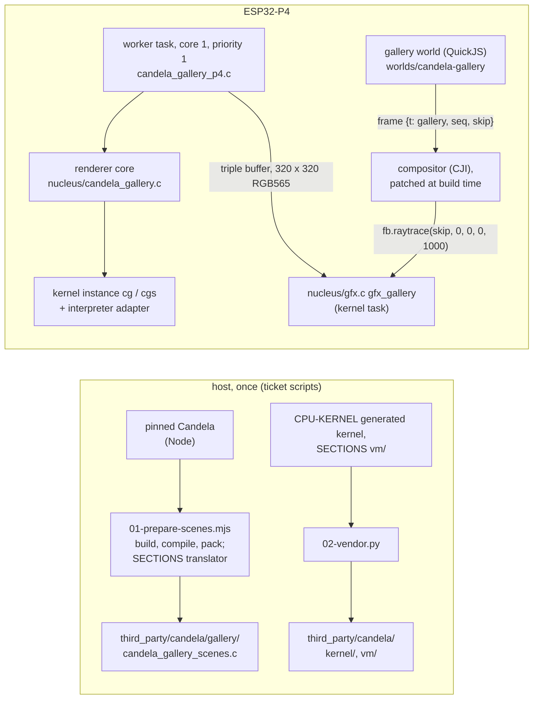

# Render Candela's presets progressively on the PicoCalc's screen

## 1. Goal

The PicoCalc renders Candela's own scenes with Candela's own path tracer and shows them on its screen. The scenes are presets of the pinned Candela (`candela-workspace(1).zip`, SHA-256 `873b2dd4...df5d`). The renderer is the kernel of PICOCALC-CANDELA-CPU-KERNEL, generated from Candela's `src/kernel.js`, with every CPU substitution (its `cpu` arm). Each scene's generated material and field code runs in PICOCALC-CANDELA-SECTIONS' bytecode interpreter. Nothing on the screen is precomputed: every pixel is path-traced on the ESP32-P4.

The user has switched the keyboard and the display off on purpose. The gallery therefore comes to the front by itself after boot and changes scenes by itself; a key also changes scene when a keyboard is present.

This is the integration that PICOCALC-CANDELA-FIRST-LIGHT planned, with prepared presets instead of the on-device front end. Connecting PICOCALC-CANDELA-WORLD's front end to the same renderer is Milestone B (Section 10).

## 2. The pieces and where they live



| Part | File | Role |
|---|---|---|
| Scene preparation | ticket `scripts/01-prepare-scenes.mjs` | runs Candela in Node; writes the scene table |
| Vendoring | ticket `scripts/02-vendor.py` | copies the kernel and interpreter byte for byte, records SHA-256 (`third_party/candela/VENDOR.json`), writes the kernel's fixed-text digest |
| Scene table | `picocalc-os/third_party/candela/gallery/candela_gallery_scenes.c` | 18 scenes: packed buffers and bytecode |
| Kernel | `picocalc-os/third_party/candela/kernel/` | CPU-KERNEL's `cdl_kernel.{h,cpp}`, `cdl_post.cpp`, `cpu/` headers |
| Interpreter | `picocalc-os/third_party/candela/vm/` | SECTIONS' `cdl_vm.{h,c}`, `cdl_vm_isa.h`, `cdl_vm_ck_math.h` |
| Instance adapter | `picocalc-os/nucleus/candela_gallery_instance.cpp` | one per kernel instance: the `Sections` table bound to the interpreter, as `cg_instance` |
| Renderer core | `picocalc-os/nucleus/candela_gallery.{h,c}` | passes, accumulation, metering, display, upscale, digests; plain C, also built on the host |
| Device side | `picocalc-os/port/esp32p4/main/candela_gallery_p4.c` | worker task, scene policy, triple buffer, console, UART records |
| Screen hook | `picocalc-os/nucleus/gfx.c` (`gfx_gallery`, under the option) | draws the newest frame and a caption |
| Compositor patch | `picocalc-os/tools/candela-gallery-compositor.py` | applied to a copy of `js/system/compositor.js` at build time |
| Gallery world | `picocalc-os/worlds/candela-gallery/` | comes to the front, forwards keys, asks for repaints |

## 3. Scenes

`01-prepare-scenes.mjs` runs Candela's front end in Node through CPU-KERNEL's loader (`scripts/lib/candela.mjs`, `exportScene`): `build`, `compile`, `pack({time: 0})`, and the frame uniforms as `Viewport.frame()` writes them for pass 0 at the scene's resolution. It translates the generated sections with SECTIONS' translator (`translateProgram`), and reads the display settings as Candela's viewport does (`src/viewport.js`: tone map, bloom, vignette, grain, false colour; the camera's exposure mode and EV; the tangent of half the field of view). It checks that every program was compiled against the fixed kernel whose `fixedText()` has SHA-256 `8925739795c7...942d` (WORLD design, Section 8).

The gallery holds CPU-KERNEL's six measured scenes and 12 more of SECTIONS' 20 verified presets, 18 in all:

| Scenes | Resolution | Why |
|---|---|---|
| B-01, R-01, L-03, G-01, E-02, W-02, F-01, V-02, G-02 | 160 x 160 | a pass takes about 1.6 s or less on one core |
| X-04, S-02, R-05, V-03, V-04, R-08, X-03, R-04, G-03 | 80 x 80 | heavier per sample (SDFs, volumes, heightfields, spectral) |
| K-04, K-08 | not included | their meshes pack into 1,135,111 and 1,065,550 static SD rows (18.2 and 17.1 MB), more than the 8 MB app partition |

S-02 and R-05 are spectral, so the firmware carries a second kernel instance compiled with `CDL_SPECTRAL=1`. The 18 scenes' packed data and bytecode take 39,644 bytes.

## 4. The renderer

### 4.1 Passes

One pass is one sample per pixel. Pass `p` uses Candela's frame index, the value `Viewport.frame()` writes to `U(0).z`: 0 for the first pass, then `p + 1`. The accumulation keeps Candela's layout, per pixel the sum of colour and the sample count (vec4), so every pixel is always displayed as its own mean, whatever the progress of the current pass.

Pass 0 is rendered in 16 sub-passes over 4 x 4 cells, in the order (0,0); (2,2), (2,0), (0,2); then the twelve odd offsets. After the first sub-pass one pixel per cell is sampled, after the fourth one pixel per 2 x 2 cell, after the sixteenth every pixel. The display fills an unsampled pixel from the first pixel of its cell. The first image therefore costs 1/16 of a pass, and the image sharpens as pass 0 continues. Later passes go row by row. One call of `cg_step` renders one row of the current sub-pass or pass, so the worker sees a scene change within one row's time.

### 4.2 Exposure

Candela meters an auto-exposed image at 2, 8 and 32 samples per pixel, with a centre-weighted log average over 48 x 32 blocks and a highlight limit (`src/viewport.js` `meter()`); until then its EV is 12. `cg_meter` is that function in C, in double precision. The gallery also meters the first coarse image, so it is not shown at EV 12, and counts only sampled pixels (during pass 0). Fixed, parameter and physical exposures use the camera's EV (X-03: 14.5). The display multiplier is Candela's `1 / (1.2 * 2^ev)`.

### 4.3 Display

Every scene uses AgX with no bloom, vignette, grain or false colour. The gallery's display pass is CPU-KERNEL's generated `tmAgx`, operation for operation, up to its final `pow(o, 2.2)`; that power and the sRGB encoding are one 4,096-entry table from `o` to an 8-bit value. On the host, over all 18 scenes at 4 and 64 passes, the result differs from the generated `displayPx` in at most 1.1% of pixels, each by one RGB565 step. The generated `displayPx` costs 4,315 cycles per pixel (CPU-KERNEL, Section 4), 0.31 s for a 160 x 160 frame, because of six `powf` calls; the table removes them. A scene with another tone map would fall back to the generated pass.

The image is upscaled to 320 x 320 bilinearly (2x or 4x) in RGB565 and published through a triple buffer: the worker writes one frame, the kernel task reads another, the third is exchanged atomically, so neither waits.

### 4.4 Cadence

The worker publishes a frame after the first and fourth sub-passes, after each of the first four passes, after later passes when 0.4 s have passed since the last frame, and inside a long pass every 1.5 s.

### 4.5 Scene policy

The worker renders only while the gallery is on screen (a paint in the last 2 s): when the user leaves it, core 1 is free again. A scene ends when it reaches 64 passes and has been held for 6 s more, or when it has been on screen for 60 s with at least one complete pass. Then the next scene starts, in table order, cycling. A key moves at once: the gallery world counts Right/Down/N/Space/Enter up and Left/Up/B down, and the counter travels to the renderer in the compositor's draw call.

## 5. Firmware integration

### 5.1 Task

The worker runs on core 1 at priority 1, below the kernel task (priority 5) and the painter's build worker (priority 2), with a 24 KB stack in PSRAM, as the painter's worker has. It therefore runs in the kernel's idle time. The task watchdog does not check core 1's idle task (`CONFIG_ESP_TASK_WDT_CHECK_IDLE_TASK_CPU1=n`).

### 5.2 Memory

PSRAM: the accumulation (160 x 160 x 16 = 409,600 bytes), three 320 x 320 frames (614,400), the w x h display image (51,200), the scene's buffers (at most 3,664 bytes), one 49 KB sky table per kernel instance (rebuilt when the sun differs, 21 ms), the stack (24 KB). Internal RAM: the interpreter's register file, sized from the program header (at most a few hundred bytes), and the renderer's small state. SECTIONS' adapter kept a static 16 KB register file, which in the firmware would be internal `.bss`; the gallery's adapter takes the caller's buffer instead (`candela_gallery_instance.cpp`), otherwise unchanged.

### 5.3 The screen

The compositor owns the framebuffer; apps publish trees. The one way a compositor can put a native image on screen is `fb.raytrace(sx, sy, lx, ly, selection)` (`gfx_raytrace`), which the Ray Tracer app already uses. With the option, `gfx_raytrace` treats selection 1000 as the gallery (`gfx_gallery`): it copies the newest frame, darkens the bottom 16 rows to a quarter and writes the caption (scene, samples per pixel, seconds per pass).

The compositor is compiled by CJI from `js/system/compositor.js` in the playable firmware. With the option, CMake runs `tools/candela-gallery-compositor.py` on a copy and CJI compiles the copy. The tool makes four anchored edits (each anchor must occur exactly once or the build stops): `validGallery`/`drawGallery`; a full-screen path while the gallery is in front and no banner is up; the gallery in the normal path (with chrome) when a banner is up; and validation of the gallery world's frames.

### 5.4 The gallery world

`worlds/candela-gallery/gallery.js` is a QuickJS app named `gallery` (launcher key `p`). It sends `open` to the compositor at start and every second until it has been in front once (at most 30 tries), because with the keyboard off nobody can open it. It republishes its frame four times a second (`seq`), so the compositor repaints and new passes appear, and counts keys into `skip`.

### 5.5 The build option

`PICOCALC_CANDELA_GALLERY` (default OFF) in `port/esp32p4/CMakeLists.txt`. With it, `port/esp32p4/main/CMakeLists.txt` compiles the kernel twice (instances `cg` and `cgs`) through one-line wrapper sources, the interpreter, the core, the scene table and the device side; bundles the world and appends its manifest entry to the typed manifests; and swaps the compositor's CJI input for the patched copy. Without it, nothing is added and the two C files it touches (`gfx.c`, `main_p4.c`) preprocess to the same text as before (Section 8).

```bash
source ~/esp/esp-idf-5.4.2/export.sh
picocalc-os/port/esp32p4/build-smooth-chess.sh BUILD -D PICOCALC_CANDELA_GALLERY=ON
```

## 6. Floating-point contraction

The kernel, the interpreter and the renderer core are compiled with `-ffp-contract=off` (and `-fno-math-errno -fwrapv`).

GCC contracts `a * b + c` into `fmadd.s` in GNU C and C++ modes on RV32, and does not on x86-64 without FMA. With contraction, the device's frames are not the host's: CPU-KERNEL found per-pixel agreement of 99.1-100% at 64 spp, and SECTIONS found that 8 of 13 presets give different RV32 frame digests for compiled and interpreted sections. Without contraction, SECTIONS' RV32 digests equal the x86-64 digests for every scene without a Preetham sky, and the interpreted and compiled sections agree on all 13. Contraction-off costs the kernel 5-8% more instructions (SECTIONS, Section 13.6).

The gallery chooses bit-reproducibility: a device frame can then be checked exactly against a host build, which is the only way to tell a renderer error from rounding at a glance, and the cost is a few percent of throughput. The remaining difference between x86-64 and the device in sky scenes is libm (`acosf` in the sky table's construction: glibc and newlib round differently); for those, the bit-exact reference is the same code compiled for RV32 and run in the counting interpreter (Section 7).

## 7. Measurement

- **Per scene, on the device** (`CGAL` records): time to first image (from the start of the scene to the first published frame), time to the coarse and half images, seconds per pass, camera samples per second and cycles per sample over the render (wall time of the worker's render calls, which includes any preemption by the kernel task), display time, and peak heap (the local minimum of free internal and PSRAM heap during the scene, through `heap_caps_monitor_local_minimum_free_size_start`).
- **Agreement:** `gallery digest ID N` renders a plain row-major pass at frame index 0 and prints its digest (CPU-KERNEL's frame digest: FNV-1a over every pixel's 48-byte `cdl_pixout`), then renders N passes exactly as the gallery does and prints the accumulation's digest and the display's digest. The host builds the same sources twice (`scripts/04-build-ref.py`): for x86-64 and, with ESP-IDF's toolchain, for RV32 in SECTIONS' counting interpreter. The device must equal the RV32 reference bit for bit; the x86-64 reference must equal it in scenes without a sky.

## 8. Proof that the playable firmware is unchanged without the option

`scripts/05-same-without-option.py` preprocesses `gfx.c` and `main_p4.c` with the exact compile commands of a build without the option (from its `compile_commands.json`), once from `main` at `627d608` and once from the worktree, and requires equal output; it lists every other changed file, all of which are new and compiled only with the option. (Results: Section 9.)

## 9. Results

To be filled in from the device runs.

## 10. Milestone B

To be filled in.
