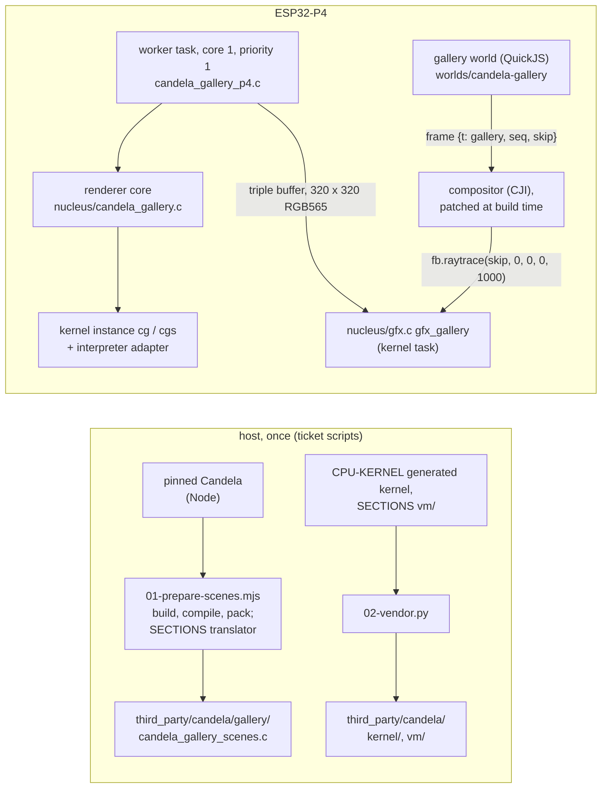
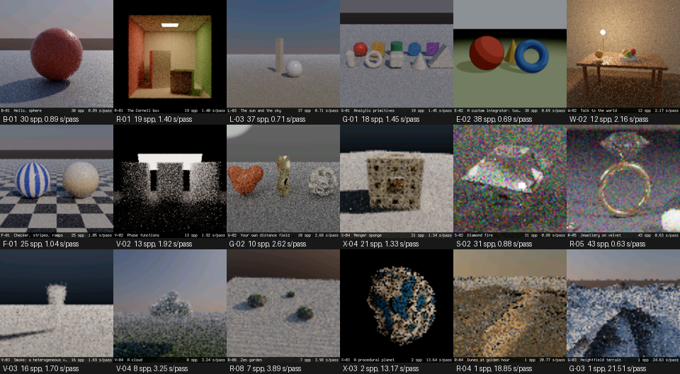

# Render Candela's presets progressively on the PicoCalc's screen

## 1. Goal

The PicoCalc renders Candela's own scenes with Candela's own path tracer and shows them on its screen. The scenes are presets of the pinned Candela (`candela-workspace(1).zip`, SHA-256 `873b2dd4...df5d`). The renderer is the kernel of PICOCALC-CANDELA-CPU-KERNEL, generated from Candela's `src/kernel.js`, with every CPU substitution (its `cpu` arm). Each scene's generated material and field code runs in PICOCALC-CANDELA-SECTIONS' bytecode interpreter. Nothing on the screen is precomputed: every pixel is path-traced on the ESP32-P4.

The user has switched the keyboard and the display off on purpose. The gallery therefore comes to the front by itself after boot and changes scenes by itself; a key also changes scene when a keyboard is present.

This is the integration that PICOCALC-CANDELA-FIRST-LIGHT planned, with prepared presets instead of the on-device front end. Connecting PICOCALC-CANDELA-WORLD's front end to the same renderer is Milestone B (Section 10).

## 2. The pieces and where they live



| Part | File | Role |
|---|---|---|
| Scene preparation | ticket `scripts/01-prepare-scenes.mjs` | runs Candela in Node; writes the scene table |
| Vendoring | ticket `scripts/02-vendor.py` | copies the kernel and interpreter byte for byte, records SHA-256 (`third_party/candela/VENDOR.json`), writes the kernel's fixed-text digest |
| Scene table | `picocalc-os/third_party/candela/gallery/candela_gallery_scenes.c` | 18 scenes: packed buffers and bytecode |
| Kernel | `picocalc-os/third_party/candela/kernel/` | CPU-KERNEL's `cdl_kernel.{h,cpp}`, `cdl_post.cpp`, `cpu/` headers |
| Interpreter | `picocalc-os/third_party/candela/vm/` | SECTIONS' `cdl_vm.{h,c}`, `cdl_vm_isa.h`, `cdl_vm_ck_math.h` |
| Instance adapter | `picocalc-os/nucleus/candela_gallery_instance.cpp` | one per kernel instance: the `Sections` table bound to the interpreter, as `cg_instance` |
| Renderer core | `picocalc-os/nucleus/candela_gallery.{h,c}` | passes, accumulation, metering, display, upscale, digests; plain C, also built on the host |
| Device side | `picocalc-os/port/esp32p4/main/candela_gallery_p4.c` | worker task, scene policy, triple buffer, console, UART records |
| Screen hook | `picocalc-os/nucleus/gfx.c` (`gfx_gallery`, under the option) | draws the newest frame and a caption |
| Compositor patch | `picocalc-os/tools/candela-gallery-compositor.py` | applied to a copy of `js/system/compositor.js` at build time |
| Gallery world | `picocalc-os/worlds/candela-gallery/` | comes to the front, forwards keys, asks for repaints |

## 3. Scenes

`01-prepare-scenes.mjs` runs Candela's front end in Node through CPU-KERNEL's loader (`scripts/lib/candela.mjs`, `exportScene`): `build`, `compile`, `pack({time: 0})`, and the frame uniforms as `Viewport.frame()` writes them for pass 0 at the scene's resolution. It translates the generated sections with SECTIONS' translator (`translateProgram`), and reads the display settings as Candela's viewport does (`src/viewport.js`: tone map, bloom, vignette, grain, false colour; the camera's exposure mode and EV; the tangent of half the field of view). It checks that every program was compiled against the fixed kernel whose `fixedText()` has SHA-256 `8925739795c7...942d` (WORLD design, Section 8).

The gallery holds CPU-KERNEL's six measured scenes and 12 more of SECTIONS' 20 verified presets, 18 in all:

| Scenes | Resolution | Why |
|---|---|---|
| B-01, R-01, L-03, G-01, E-02, W-02, F-01, V-02, G-02 | 160 x 160 | a pass takes about 1.6 s or less on one core |
| X-04, S-02, R-05, V-03, V-04, R-08, X-03, R-04, G-03 | 80 x 80 | heavier per sample (SDFs, volumes, heightfields, spectral) |
| K-04, K-08 | not included | their meshes pack into 1,135,111 and 1,065,550 static SD rows (18.2 and 17.1 MB), more than the 8 MB app partition |

S-02 and R-05 are spectral, so the firmware carries a second kernel instance compiled with `CDL_SPECTRAL=1`. The 18 scenes' packed data and bytecode take 39,644 bytes.

## 4. The renderer

### 4.1 Passes

One pass is one sample per pixel. Pass `p` uses Candela's frame index, the value `Viewport.frame()` writes to `U(0).z`: 0 for the first pass, then `p + 1`. The accumulation keeps Candela's layout, per pixel the sum of colour and the sample count (vec4), so every pixel is always displayed as its own mean, whatever the progress of the current pass.

Pass 0 is rendered in 16 sub-passes over 4 x 4 cells, in the order (0,0); (2,2), (2,0), (0,2); then the twelve odd offsets. After the first sub-pass one pixel per cell is sampled, after the fourth one pixel per 2 x 2 cell, after the sixteenth every pixel. The display fills an unsampled pixel from the first pixel of its cell. The first image therefore costs 1/16 of a pass, and the image sharpens as pass 0 continues. Later passes go row by row. One call of `cg_step` renders one row of the current sub-pass or pass, so the worker sees a scene change within one row's time.

### 4.2 Exposure

Candela meters an auto-exposed image at 2, 8 and 32 samples per pixel, with a centre-weighted log average over 48 x 32 blocks and a highlight limit (`src/viewport.js` `meter()`); until then its EV is 12. `cg_meter` is that function in C, in double precision. The gallery also meters the first coarse image, so it is not shown at EV 12, and counts only sampled pixels (during pass 0). Fixed, parameter and physical exposures use the camera's EV (X-03: 14.5). The display multiplier is Candela's `1 / (1.2 * 2^ev)`.

### 4.3 Display

Every scene uses AgX with no bloom, vignette, grain or false colour. The gallery's display pass is CPU-KERNEL's generated `tmAgx`, operation for operation, up to its final `pow(o, 2.2)`; that power and the sRGB encoding are one 4,096-entry table from `o` to an 8-bit value. On the host, over all 18 scenes at 4 and 64 passes, the result differs from the generated `displayPx` in at most 1.1% of pixels, each by one RGB565 step. The generated `displayPx` costs 4,315 cycles per pixel (CPU-KERNEL, Section 4), 0.31 s for a 160 x 160 frame, because of six `powf` calls; the table removes them. A scene with another tone map would fall back to the generated pass.

The image is upscaled to 320 x 320 bilinearly (2x or 4x) in RGB565 and published through a triple buffer: the worker writes one frame, the kernel task reads another, the third is exchanged atomically, so neither waits.

### 4.4 Cadence

The worker publishes a frame after the first and fourth sub-passes, after each of the first four passes, and inside a long pass every 1.5 s. After that, a finished pass is shown when 0.4 s and ten display durations have passed since the last frame. A display (tone map of 160 x 160 pixels, upscale, publish) measured 131-145 ms on the worker, so without the bound it took 14% of B-01's minute.

### 4.5 Scene policy

The worker renders only while the gallery is on screen (a paint in the last 2 s): when the user leaves it, core 1 is free again. A scene ends when it reaches 64 passes and has been held for 6 s more, or when it has been on screen for 60 s with at least one complete pass. Then the next scene starts, in table order, cycling. A key moves at once: the gallery world counts Right/Down/N/Space/Enter up and Left/Up/B down, and the counter travels to the renderer in the compositor's draw call.

## 5. Firmware integration

### 5.1 Task

The worker runs on core 1 at priority 1, below the kernel task (priority 5) and the painter's build worker (priority 2), with a 24 KB stack in PSRAM, as the painter's worker has. It therefore runs in the kernel's idle time. The task watchdog does not check core 1's idle task (`CONFIG_ESP_TASK_WDT_CHECK_IDLE_TASK_CPU1=n`).

The stack stays in PSRAM. Measured with `gallery digest ID 4 internal` on the same boot, an internal-RAM stack saves 1.0-2.7% of the cycles per sample (B-01 13,545 against 13,219; Section 9), and the playable firmware has about 70 KB of internal heap free while the gallery runs. Running above the kernel task (`quiet`) saves 28-36%: that is what sharing core 1 with the rest of the firmware costs, and the gallery pays it rather than delay the kernel.

### 5.2 Memory

PSRAM: the accumulation (160 x 160 x 16 = 409,600 bytes), three 320 x 320 frames (614,400), the w x h display image (51,200), the scene's buffers (at most 3,664 bytes), one 49 KB sky table per kernel instance (rebuilt when the sun differs, 21 ms), the stack (24 KB). Internal RAM: the interpreter's register file, sized from the program header (at most a few hundred bytes), and the renderer's small state. SECTIONS' adapter kept a static 16 KB register file, which in the firmware would be internal `.bss`; the gallery's adapter takes the caller's buffer instead (`candela_gallery_instance.cpp`), otherwise unchanged.

### 5.3 The screen

The compositor owns the framebuffer; apps publish trees. The one way a compositor can put a native image on screen is `fb.raytrace(sx, sy, lx, ly, selection)` (`gfx_raytrace`), which the Ray Tracer app already uses. With the option, `gfx_raytrace` treats selection 1000 as the gallery (`gfx_gallery`): it copies the newest frame, darkens the bottom 16 rows to a quarter and writes the caption (scene, samples per pixel, seconds per pass).

The compositor is compiled by CJI from `js/system/compositor.js` in the playable firmware. With the option, CMake runs `tools/candela-gallery-compositor.py` on a copy and CJI compiles the copy. The tool makes four anchored edits (each anchor must occur exactly once or the build stops): `validGallery`/`drawGallery`; a full-screen path while the gallery is in front and no banner is up; the gallery in the normal path (with chrome) when a banner is up; and validation of the gallery world's frames.

### 5.4 The gallery world

`worlds/candela-gallery/gallery.js` is a QuickJS app named `gallery` (launcher key `p`). It sends `open` to the compositor at start and every second until it has been in front once (at most 30 tries), because with the keyboard off nobody can open it. It republishes its frame (`seq`), so the compositor repaints and new passes appear: four times a second for two seconds after it opens or a key changes the scene, then twice a second, since each repaint copies the whole 320 x 320 frame on the kernel task. It counts keys into `skip`.

### 5.5 The build option

`PICOCALC_CANDELA_GALLERY` (default OFF) in `port/esp32p4/CMakeLists.txt`. With it, `port/esp32p4/main/CMakeLists.txt` compiles the kernel twice (instances `cg` and `cgs`) through one-line wrapper sources, the interpreter, the core, the scene table and the device side; bundles the world and appends its manifest entry to the typed manifests; and swaps the compositor's CJI input for the patched copy. Without it, nothing is added, and the three files it touches that the playable build compiles (`gfx.c`, `main_p4.c`, `p4.h`) preprocess to the same text as before (Section 8).

`main_p4.c` gains no line: `ESP_ERROR_CHECK` writes `__LINE__` into the binary, so an added line above it changes the playable firmware. The console case is a macro, `P4_GALLERY_CONSOLE(cmd, rest)`, appended to the `raybench` line and defined in `p4.h` (empty without the option), and the worker starts on the compositor's first draw of the gallery (or the first `gallery` command), so `main()` calls nothing.

```bash
source ~/esp/esp-idf-5.4.2/export.sh
picocalc-os/port/esp32p4/build-smooth-chess.sh BUILD -D PICOCALC_CANDELA_GALLERY=ON
```

## 6. Floating-point contraction

The kernel, the interpreter and the renderer core are compiled with `-ffp-contract=off` (and `-fno-math-errno -fwrapv`).

GCC contracts `a * b + c` into `fmadd.s` in GNU C and C++ modes on RV32, and does not on x86-64 without FMA. With contraction, the device's frames are not the host's: CPU-KERNEL found per-pixel agreement of 99.1-100% at 64 spp, and SECTIONS found that 8 of 13 presets give different RV32 frame digests for compiled and interpreted sections. Without contraction, SECTIONS' RV32 digests equal the x86-64 digests for every scene without a Preetham sky, and the interpreted and compiled sections agree on all 13. Contraction-off costs the kernel 5-8% more instructions (SECTIONS, Section 13.6).

The gallery chooses bit-reproducibility: a device frame can then be checked exactly against a host build, which is the only way to tell a renderer error from rounding at a glance, and the cost is a few percent of throughput. The remaining difference between x86-64 and the device in sky scenes is libm (`acosf` in the sky table's construction: glibc and newlib round differently); for those, the bit-exact reference is the same code compiled for RV32 and run in the counting interpreter (Section 7).

## 7. Measurement

- **Per scene, on the device** (`CGAL` records): time to first image (from the start of the scene to the first published frame), time to the coarse and half images, seconds per pass, camera samples per second and cycles per sample over the render (wall time of the worker's render calls, which includes any preemption by the kernel task), display time, and peak heap (the local minimum of free internal and PSRAM heap during the scene, through `heap_caps_monitor_local_minimum_free_size_start`).
- **Agreement:** `gallery digest ID N` renders a plain row-major pass at frame index 0 and prints its digest (CPU-KERNEL's frame digest: FNV-1a over every pixel's 48-byte `cdl_pixout`), then renders N passes exactly as the gallery does and prints the accumulation's digest and the display's digest. The host builds the same sources twice (`scripts/04-build-ref.py`): for x86-64 and, with ESP-IDF's toolchain, for RV32 in SECTIONS' counting interpreter. The device must equal the RV32 reference bit for bit; the x86-64 reference must equal it in scenes without a sky.

## 8. Proof that the playable firmware is unchanged without the option

Two scripts, after PICOCALC-CANDELA-WORLD's 13 and 14:

- `scripts/05-same-without-option.py` preprocesses every playable source the change reaches (`gfx.c`, and the 18 sources of the build that include `p4.h`, `main_p4.c` among them) with the exact compile commands of a build without the option (its `compile_commands.json`), once from `main`'s text and once from the worktree, and requires byte-equal output, line markers off but `__LINE__` and `__FILE__` expansions included. The base source and base `p4.h` are written side by side; `-fmacro-prefix-map` maps the temporary directory back to the real one. It lists every other changed file; all are new and compiled only with the option.
- `scripts/08-same-build-files.py` compares a fresh configure of `main` with a fresh configure of the worktree without the option: every compile command, `build.ninja`, and the five world manifests CMake writes, after replacing each tree's paths, the app version string (`git describe`), the ESP-IDF Python environment and the git HEAD files ESP-IDF watches. (Two configures of the same directory differ from one in `TARGET_PDB` lines, so both sides must be first configures.)

Against `main` at 5c01d81: 19 of 19 sources equal (`various/identity/05-same-without-option-5c01d81.txt`); compile commands, `build.ninja` and manifests equal (`various/identity/08-same-build-files-5c01d81.txt`). With the option, `gfx.c` differs in 19 preprocessed lines and `main_p4.c` in 3.

## 9. Results

Device run `various/device-04-a396d3b/` (image `28d9a812...`, commit a396d3b on main 5c01d81): health before and after, a screen capture, `gallery digest ID 4` for every scene, a 5 s probe of core 1, each scene shown for 30 s from its start and captured, injected Left and Right keys, health again. The board lock was held throughout. The image stayed installed (Section 9.6).

### 9.1 What is on the screen



Every capture is the compositor's framebuffer (`shot`), so it is what the panel would show; the panel itself is off. After 30 s the 160 x 160 scenes have 10-38 samples per pixel and the 80 x 80 scenes 1-43. B-01, L-03, E-02 and F-01 are clean at that point, the Cornell box and the volumes still noisy, and the heightfields R-04 and G-03 have finished their first pass only.

### 9.2 Timings per scene

From each scene's record in the scene phase (`scripts/07-summarize.py`; `various/device-04-a396d3b/summary-tables.txt`). First image: from the start of the scene to the first published frame (the coarse 1/16 sub-pass, metered, displayed). Later pass: median time of passes after the first. Samples per second and cycles per sample over the worker's render calls, wall time, so they include everything else that ran on core 1 meanwhile. Display: one tone map, upscale and publish. Peak heap: the drop of the free heap from the scene's start to its minimum (all tasks; `heap_caps_monitor_local_minimum_free_size_start`). The three 320 x 320 frames and the display image (665,600 bytes of PSRAM) are allocated once, when the gallery is first shown, and are not in these numbers.

| Scene | Size | First image (ms) | Coarse / half (ms) | First full pass (s) | Later pass (s) | Samples/s | Cycles/sample | Display (ms) | Peak heap PSRAM / internal (bytes) |
|---|---|---:|---:|---:|---:|---:|---:|---:|---:|
| B-01 | 160 | 312 | 163 / 493 | 1.36 | 0.88 | 28,806 | 12,469 | 125.8 | 541,720 / 4,044 |
| R-01 | 160 | 359 | 239 / 676 | 1.91 | 1.381 | 18,293 | 19,650 | 127.7 | 542,528 / 4,044 |
| L-03 | 160 | 317 | 198 / 471 | 1.23 | 0.692 | 36,135 | 9,938 | 126.6 | 558,460 / 5,120 |
| G-01 | 160 | 362 | 246 / 684 | 1.94 | 1.419 | 17,687 | 20,325 | 124.5 | 545,172 / 4,168 |
| E-02 | 160 | 314 | 185 / 443 | 1.19 | 0.672 | 37,089 | 9,692 | 126.8 | 542,016 / 4,268 |
| W-02 | 160 | 386 | 227 / 842 | 2.74 | 2.135 | 11,865 | 30,304 | 127.3 | 545,748 / 4,204 |
| F-01 | 160 | 295 | 167 / 556 | 1.53 | 1.022 | 24,522 | 14,642 | 131.1 | 542,096 / 4,144 |
| V-02 | 160 | 378 | 220 / 700 | 2.50 | 1.899 | 13,303 | 27,027 | 127.6 | 542,200 / 4,044 |
| G-02 | 160 | 400 | 280 / 909 | 3.24 | 2.628 | 9,755 | 36,868 | 126.3 | 541,976 / 5,080 |
| X-04 | 80 | 241 | 141 / 503 | 1.56 | 1.329 | 4,818 | 74,660 | 61.2 | 236,920 / 4,188 |
| S-02 | 80 | 155 | 103 / 307 | 1.07 | 0.871 | 7,264 | 49,497 | 59.7 | 271,856 / 4,120 |
| R-05 | 80 | 110 | 58 / 222 | 0.79 | 0.624 | 10,132 | 35,479 | 60.2 | 239,592 / 4,316 |
| V-03 | 80 | 253 | 204 / 552 | 1.91 | 1.687 | 3,774 | 95,294 | 56.9 | 234,832 / 5,276 |
| V-04 | 80 | 258 | 203 / 923 | 3.44 | 3.232 | 1,967 | 182,939 | 54.4 | 236,952 / 5,196 |
| R-08 | 80 | 392 | 342 / 1169 | 4.24 | 3.975 | 1,645 | 218,704 | 58.9 | 237,176 / 4,264 |
| X-03 | 80 | 941 | 860 / 3608 | 14.31 | 13.537 | 486 | 740,457 | 58.3 | 269,816 / 6,880 |
| R-04 | 80 | 1358 | 1309 / 5449 | 21.72 | - | 340 | 1,060,159 | 62.4 | 236,920 / 9,564 |
| G-03 | 80 | 1677 | 1628 / 6368 | 25.59 | - | 298 | 1,209,502 | 54.3 | 236,836 / 9,584 |

### 9.3 Agreement with the host

`gallery digest ID 4` renders frame 0 row by row, then 4 passes as the gallery does (with its sub-passes and meter), and prints the frame-0 digest, the accumulation's digest and the fast display's digest. The references are the same sources built for x86-64 and for RV32 (`scripts/04-build-ref.py`, `various/references/`).

| Scene | Passes | Device frame 0 | acc | display | = RV32 | = x86-64 (frame 0, acc, display) | Mean luminance ratio | Cycles/sample | RV32 instr/sample | CPI |
|---|---:|---|---|---|---|---|---:|---:|---:|---:|
| B-01 | 4 | e2ba6956 | 3b52c63c | 23d7885f | yes | no/no/yes | 1.0 | 13,071 | 5743.6 | 2.276 |
| R-01 | 4 | e8421c97 | 2ac5b8e1 | 1d7de02e | yes | yes/yes/yes | 1.0 | 19,938 | 11061.5 | 1.802 |
| L-03 | 4 | 16cb13f0 | bfc2a34a | e95af902 | yes | no/no/yes | 0.999999999 | 10,251 | 4567.3 | 2.244 |
| G-01 | 4 | 4af50eb8 | 68d5a13d | 7e548c18 | yes | no/no/yes | 1.0 | 20,550 | 9785.6 | 2.1 |
| E-02 | 4 | de9e22b5 | 6edba2ef | 74c3f85c | yes | yes/yes/yes | 1.0 | 10,244 | 5517.2 | 1.857 |
| W-02 | 4 | 34a669ff | 865eba2b | dd654b4c | yes | yes/yes/yes | 1.0 | 30,296 | 16004.6 | 1.893 |
| F-01 | 4 | 4dd2f3eb | 1982b77b | 00d099a0 | yes | no/no/no | 1.0 | 15,110 | 6795.6 | 2.223 |
| V-02 | 4 | 9482ee60 | 76ffc818 | 1b6b5329 | yes | no/no/yes | 1.0 | 26,984 | 14333.6 | 1.883 |
| G-02 | 4 | 7834364c | 81a65012 | ada1739a | yes | yes/yes/no | 1.0 | 37,166 | 18686.9 | 1.989 |
| X-04 | 4 | 2b9af109 | a0aafa50 | 450d2ead | yes | yes/yes/yes | 1.0 | 74,340 | 40442.0 | 1.838 |
| S-02 | 4 | e32b0f6b | a4d9bc0b | 4785e5ad | yes | yes/yes/yes | 1.0 | 48,596 | 25566.9 | 1.901 |
| R-05 | 4 | 74d02e3d | 261b0649 | 658822ca | yes | no/no/yes | 1.0 | 35,214 | 17583.4 | 2.003 |
| V-03 | 4 | 5b10021a | a9569209 | b995fd34 | yes | no/no/no | 1.00003291 | 92,436 | 53164.7 | 1.739 |
| V-04 | 4 | f700ca37 | c4ca0369 | 38566376 | yes | no/no/yes | 1.0 | 177,060 | 100950.1 | 1.754 |
| R-08 | 4 | 426121c5 | 67be6e6b | 280382f5 | yes | no/no/yes | 1.0 | 220,067 | 122808.0 | 1.792 |
| X-03 | 4 | 390c87ec | 4f975e1b | 74f26c85 | yes | yes/yes/yes | 1.0 | 753,131 | 396477.5 | 1.9 |
| R-04 | 4 | a53bf8ab | 76562f1c | cab1ca27 | yes | no/no/no | 0.999929676 | 1,130,492 | 650101.2 | 1.739 |
| G-03 | 4 | 23c854f6 | b87782c2 | 1ead113e | yes | no/no/no | 1.000018635 | 1,338,734 | 791855.0 | 1.691 |

All 18 scenes equal the RV32 references in all three digests: the device runs the code that was counted, bit for bit. Against x86-64, R-01, E-02, W-02, X-04, S-02 and X-03 are equal in all three; G-02 has the same frame and accumulation but a different display; the other eleven differ from frame 0 on. The x86-64 and RV32 builds differ only in their libm (glibc against newlib): SECTIONS traced the frame differences to `acosf` in the sky table, and G-02 shows that `log2f` in the display differs too. Mean luminance after 4 passes agrees within 7e-5 in every scene.

CPI here is the worker's wall-clock cycles over the counted instructions, 1.69-2.28; it includes the rest of the firmware's use of core 1 (Section 9.4). Above the kernel task, B-01 runs at 8,647 cycles per sample, CPI 1.51, inside CPU-KERNEL's standalone 1.28-1.72.

### 9.4 What sharing core 1 costs

Digests of the same scene on the same boot, PSRAM stack below the kernel task (the worker's conditions), internal-RAM stack below it, and above it (`various/device-03-placement/` for five scenes; B-01 again in device-04):

| Scene | PSRAM stack | Internal stack | Above the kernel task | Same digests |
|---|---:|---:|---:|---|
| B-01 | 13,545 | 13,219 | 8,622 | yes |
| R-01 | 20,687 | 20,429 | 14,662 | yes |
| W-02 | 31,592 | 31,016 | 21,861 | yes |
| X-04 | 77,983 | 77,204 | 55,934 | yes |
| S-02 | 51,775 | 50,360 | 35,769 | yes |
| B-01 (device-04) | 13,071 | 12,782 | 8,647 | yes |

The stack's placement is worth 1.0-2.7%. Sharing the core is worth 28-36%. Of that:

- **Direct preemption, 17%.** `gallery probe 5000` (a priority-1 loop on core 1 that counts every step longer than 1 us), with the gallery on screen and paused: 16.94% of the time went to other tasks and interrupts, in 917 gaps per second (3,912 under 10 us, 80 under 100 us, 431 under 1 ms, 143 under 10 ms, 17 longer; the longest 35.5 ms).
- **The kernel task, 19.6%.** Over the 988 s scene phase (`stats` before and after), the dispatch lane was busy 19.6% of the time. The largest users: the keyboard driver, 8.40%, polling the keyboard the user has switched off (I2C0 busy 29.4% of the time); the compositor, 4.13%, which copies the 320 x 320 frame at each repaint; Snake 1.53%; sysmon 1.12%; the gallery world 0.87%; logs 0.83%; the launcher 0.61%; the display driver 0.42%.
- **The rest, about 11-19%,** is what the kernel task's work leaves in the caches: the worker's code and scene data are evicted and fetched again after each preemption.

The worker therefore stays where it is: below the kernel task, so no world waits for the renderer, with its stack in PSRAM, because the internal heap has about 70 KB free while the gallery runs (`internalFree0` 70,479-71,283).

### 9.5 Keys

`key right 60` on the console injects a key where the keyboard driver reads it. It ended B-01 with reason `next` and started R-01; `key left 60` ended R-01 with reason `previous`. The path is the one a physical key takes: driver, compositor, gallery world, `skip`, `gfx_gallery`, worker.

### 9.6 Health and installation

Health with `board_health(..., "off-by-user")`: keyboard and display recorded as off by user; Snake, Files, Editor, Agenda and Chess judged. Before (main's 8acb94cc), after the gallery image booted (6 s wait for the boot compiles), and after the whole run: all five idle with no restarts and no error. Of the 30 worlds at the end, only `nat-import` is stopped ("it links to path_open, which picocalc-os does not give a module", 5 crashes); main's playable image showed the same 5 crashes in its `stats` before the flash (uptime 338 s), so this is not the gallery's. The run script then left the image installed and wrote `/tmp/picocalc-current-playable.txt`:

```text
/tmp/picocalc-candela-gallery-a396d3b/build 28d9a81241870a45f75c19f0406c4c0fc8c182e2a855cbab3dae6c99caf203a6
```

It replaces main's 3353264 build (`8acb94cc...`), from which it differs only by the option. After a boot the gallery comes to the front by itself and cycles through the 18 scenes; F1 returns to the launcher, and `p` opens the gallery again.


## 10. Milestone B

Not done in this ticket. PICOCALC-CANDELA-WORLD's front end runs Candela's unchanged JavaScript in a QuickJS world and hands a packed scene (`cr_scene_t`) and a compiled program (`cr_program_t`, with SECTIONS' bytecode in `sections`) to `port_candela_start/update/stop/status_json` (`nucleus/candela_render.h`). Today `nucleus/candela_render_stub.c` checks them and reports passes on the kernel's clock without drawing. The gallery's renderer core is what that stub stands in for, so the connection is an adapter and a frame path, not a new renderer:

1. **A renderer behind `candela_render.h`**, replacing the stub when both options are on. `port_candela_start` checks the program's `fixed_kernel_sha256` against `cg_kernel_fixed_sha256`, picks the instance by `spectral`, builds a `cg_scene_desc` from the `cr_scene_t` and hands it to the gallery's worker (`cg_begin`). `update` with `CR_RESET` restarts accumulation (`cg_end`, `cg_begin`; the sky table is rebuilt only when the sun changed). `stop` ends the scene; `status_json` reports pass, samples and seconds per pass; each finished pass calls `candela_world_frame` (which delivers a `candela.frame` message to the world) as the stub does.
2. **The scene-data buffer.** `cr_scene_t` carries six arrays (U, O, LI, BV, SDs, SDd); the kernel binds one SD buffer in which SDd starts at row `dyn_base`. The adapter concatenates them into one allocation; the gallery's prepared scenes already have that layout.
3. **Frame size.** `CG_MAX_SIDE` is 160 and the core's line buffer and display image are sized for it; the world accepts up to 640. Refuse larger frames (the gallery's choice), or size those buffers from the scene.
4. **Pixels on screen.** The world draws its own screen, and `candela.frame` carries counters, not pixels. The renderer's frames need the same path the gallery uses: `fb.raytrace(..., 1000)` from the compositor while the Candela world is in front, or a region of the world's layout handed to `gfx_gallery`.
5. **Qualification.** The world's B-01 must give the gallery's frame-0 digest (`e2ba6956` on RV32 and on the device), and the option-off proofs (scripts 05 and 08) must still hold for the playable build.
